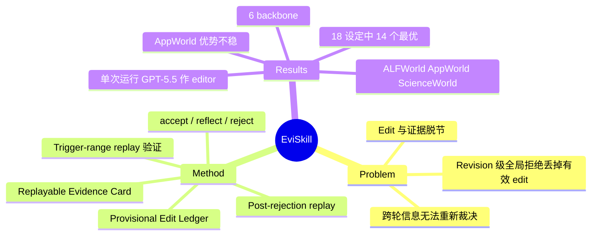

## Summary
EviSkill 把 skill 演化中的每条 edit 绑定到可重放的执行证据（Replayable Evidence Card，记录 trajectory 区间），先在原始上下文里 replay 验证 edit 是否真改变了行为，再用 post-rejection replay 把"整体被 validation 拒绝但局部有效"的 edit 暂存到下一轮继续修订。在 ALFWorld / AppWorld / ScienceWorld 上、6 个 backbone 下，18 个 model-dataset 设定中 14 个最优；但所有结果为单次运行、无方差，且 extractor/editor/evaluator 一律用 GPT-5.5。

## Problem & Motivation
现有 skill 演化方法（Trace2Skill、EvoSkill、SkillGrad、SkillOpt 等）把执行反馈直接转成 skill 编辑，边界是 revision 级的全局 validation：通过则整包接受，失败则整包丢弃。作者用两个 preliminary study 论证两个缺陷：(1) 对 Trace2Skill 产生的 edit 逐条重放其来源任务，结果有的提升、有的无变化、有的变差（Fig. 2，只有柱状图，数字文本里取不到）；(2) 在被全局拒绝的 revision 中，由 GPT-5.5 挑出的子集 edit 在 training 任务上优于上一版 Validated Skill（Fig. 3）。据此主张 edit 需要与证据绑定、被行为验证、并跨 epoch 重新裁决。

## Method
- **状态定义**：Validated Skill S^V 只在 candidate 在 D_val 上严格更高时才更新；Working Skill S^W = S^V ⊕ P（Provisional Edit Ledger，保存已 replay 支持但未入 S^V 的 edit，最多 16 条）。最终推理只用冻结的 S^V，未晋升的 provisional edit 丢弃。
- **Evidence-Grounded Edit Synthesis**：GPT-5.5 extractor 从训练轨迹抽 Trajectory Evidence Card；对 Tracked Edits 还从相邻 epoch 的同一任务轨迹对中抽 Contrastive Evidence Card。Card = ⟨id, trigger ranges G, 提议修正 d⟩，trigger range 是 (task, epoch, 步骤区间 [s,t])。兼容的 Card 聚成 Evidence Window，由 editor 合成 edit，edit 保留其 supporting cards。
- **Replay-Guided Edit Verification**：复现 trajectory 在 step s 之前的前缀以重建状态，在 S^W ⊕ u 下重新执行该区间；evaluator 比较 source/replay 片段给出 accept / reflect / reject，reflect 时 editor 依据反馈修订并再 replay 一次。每个 edit 至多 replay 3 个 trigger range。
- **Cross-Epoch Evidence Propagation**：candidate 全局被拒时，对每个 consolidated edit 在 S^V ⊕ v 下做 post-rejection replay（每 epoch 至多 15 个），accept 的进入 Ledger；Card 连续两次被 replay 拒绝则 stale，至多推迟两个 epoch。
- **设置**：action agent 6 个（GPT-5.5/5.4/5.4-mini，Qwen3.6-35B-A3B/3.5-9B/3.5-4B），温度 0.7；extractor/editor/evaluator 固定 GPT-5.5（medium reasoning）。训练/验证任务仅 90-96 / 48-57 个，演化 4 个 epoch。

## Key Results
- **Table 1 主结果**（GPT-5.5 / GPT-5.4 / Qwen3.5-9B / Qwen3.5-4B，另 2 个 backbone 在附录 Table 4）：ScienceWorld 上 GPT-5.4 为 76.78（LLM Skill 66.35，SkillOpt 63.03）；Qwen3.5-9B 为 37.91（SkillOpt 22.27）；ALFWorld Qwen3.5-9B 91.04（SkillGrad 87.31）。
- 作者报告 EviSkill 在 18 个设定中 14 个最优、16 个前二，相对 NoSkill 平均 +17.93 个点，在 17 个设定中超过 LLM Skill、1 个持平。
- **AppWorld 优势不稳**：Qwen3.5-9B 上 EviSkill 43.45，低于 SkillOpt 47.62 和 SkillGrad 46.43，且与 LLM Skill 完全相同；GPT-5.5 上 94.64 vs LLM Skill 94.05，差 1 题量级（168 题中约 1 题）。作者自己也承认 AppWorld 上优势不一致。
- **基线退化**：GPT-5.5 ScienceWorld 上 LLM Skill 76.78，Trace2Skill 65.40、EvoSkill 54.50、SkillGrad 67.30，即演化反而劣于初始 skill（-10 到 -22 个点）。
- **消融**（三个 GPT backbone 平均）：去掉 replay 分别降 2.49 / 4.56 / 2.85（ALFWorld / AppWorld / ScienceWorld）；去掉 cross-epoch 后 AppWorld 从 89.68 降到 85.52。
- **机制统计**（18 runs、72 epochs）：初次 replay 未通过的 edit 占比 20.7% / 41.8% / 42.5%；reflect 修订恢复 AppWorld 13/16、ScienceWorld 49/54；96 条 provisional edit 中 72.9% 之后晋升（46.9% 一个 epoch 后）、27.1% 到预算结束仍未定论；23.0% 的 Card 在 ≥2 个 epoch 被使用。

## Evidence Ledger
| Claim ID | Claim | Type | Source locator | Evidence excerpt | Status |
|:--|:--|:--|:--|:--|:--|
| C1 | EviSkill 在 18 个 model-dataset 设定中 14 个取得最高准确率，16 个进入前二 | SOTA/数字 | §4.2 Obs.1 | "EviSkill achieves the best accuracy in 14 of the 18 model–dataset settings and ranks among the top two methods in 16." | source-verified |
| C2 | EviSkill 相对 NoSkill 平均提升 17.93 个百分点，且在所有设定中均提升 | 数字 | §4.2 Obs.1 | "It improves over NoSkill in all settings, with an average gain of 17.93 percentage points." | source-verified |
| C3 | 在 ScienceWorld 上，Qwen3.5-9B 下超过最强基线 15.64 点，GPT-5.4 下超过 10.43 点 | 数字 | §4.2 Obs.1; Table 1 | "exceeds the strongest baseline by 15.64 points with Qwen3.5-9B and 10.43 points with GPT-5.4" | source-verified |
| C4 | GPT-5.5 ScienceWorld 上 EviSkill 83.41%，LLM Skill 76.78%，Trace2Skill/EvoSkill/SkillGrad 分别为 65.40/54.50/67.30 | 数字/baseline 可比性 | §4.2 Obs.2; Table 1 | "the initial skill achieves 76.78%, whereas Trace2Skill, EvoSkill, and SkillGrad obtain 65.40%, 54.50%, and 67.30%, respectively." | source-verified |
| C5 | EviSkill 在 17 个设定中优于 LLM Skill，其余 1 个持平 | 数字 | §4.2 Obs.2 | "improves over LLM Skill in 17 settings while matching it in the remaining one" | source-verified |
| C6 | AppWorld 上 EviSkill 相对竞争方法的优势不稳定（作者自述） | 局限 | §4.2 Obs.1 | "the advantage over competing methods is less consistent on AppWorld." | source-verified |
| C7 | Qwen3.5-9B AppWorld 上 EviSkill 43.45，低于 SkillOpt 47.62 与 SkillGrad 46.43 | 数字/SOTA | Table 1 | "EviSkill 43.45 +17.86"（表格已拍平；SkillOpt 行 47.62、SkillGrad 行 46.43） | source-verified |
| C8 | 去掉 replay 使平均准确率在 ALFWorld/AppWorld/ScienceWorld 分别下降 2.49/4.56/2.85 点 | 因果/消融 | §4.3 Obs.3; Fig. 5 | "Removing replay reduces average accuracy by 2.49, 4.56, and 2.85 percentage points on ALFWorld, AppWorld, and ScienceWorld" | source-verified |
| C9 | 去掉 cross-epoch propagation 使 AppWorld 从 89.68% 降至 85.52% | 因果/消融 | §4.3 Obs.4 | "with the largest decrease on AppWorld, from 89.68% to 85.52%." | source-verified |
| C10 | 初次 replay 未通过（reflect 或 reject）的 edit 占比为 ALFWorld 20.7%、AppWorld 41.8%、ScienceWorld 42.5% | 数字 | §4.4.1 Obs.5; Fig. 6a | "20.7% on ALFWorld, 41.8% on AppWorld, and 42.5% on ScienceWorld are assigned to reflection or rejection." | source-verified |
| C11 | reflect 修订恢复 AppWorld 13/16、ScienceWorld 49/54 个 edit；该比例仅针对被选入 reflect 的子集 | 数字/口径 | §4.4.1 Obs.5; Fig. 6b | "recovers 13 of 16 reflected edits on AppWorld and 49 of 54 on ScienceWorld" | source-verified |
| C12 | 96 条 provisionally retained edit 中 72.9% 之后被纳入 globally accepted skill，27.1% 到 4 epoch 预算结束仍未定论 | 数字/机制 | §4.4.2 Obs.6; Fig. 7 | "72.9% of these locally supported edits are subsequently incorporated into globally accepted skills." | source-verified |
| C13 | 23.0% 的 Evidence Card 在至少两个不同 epoch 被选入 Evidence Window，54.3% 恰好一个 epoch | 数字 | §4.4.2 Obs.7; Fig. 8 | "23.0% of unique Evidence Cards are selected for Evidence Windows in at least two distinct epochs, while 54.3% are selected in exactly one" | source-verified |
| C14 | extractor、editor、evaluator 均使用 GPT-5.5（medium reasoning），与 action agent backbone 无关 | 可比性 | Appendix C | "The evidence extractor f^{ext}, editor f^{edit}, and evaluator f^{eval} use GPT-5.5 with medium reasoning." | source-verified |
| C15 | Preliminary study 2 中子集 edit 由 GPT-5.5 按内容挑选，并以 GPT-5.4-mini 在训练集上评估，而非用 validation 集 | 机制/证据强度 | Appendix D.2 | "ask it to return the indices of the \min(3,N-2) edits judged most promising based on their content." | source-verified |
| C16 | Preliminary study 1：Trace2Skill 的 edit 重放后有的提升、有的无变化、有的变差 | 因果/动机 | §2.1; Fig. 2 | "some improve task performance, others produce no improvement or even degrade the original behaviors." | source-verified |
| C17 | 数据划分：AppWorld 90/57/168，ScienceWorld 96/48/211，ALFWorld 96/48/134（train/val/test） | 数字/可比性 | Appendix B.1, Table 2 | "yielding 96 training and 48 validation tasks across all 24 families. We use the complete official test split of 211 tasks." | source-verified |
| C18 | 所有方法在每个 benchmark/backbone 下使用相同 action agent、任务划分、环境配置与评测协议 | 可比性 | §4.1 | "task splits, environment configuration, and evaluation protocol held fixed across methods within each benchmark and backbone setting." | source-verified |
| C19 | 代码开源于 GitHub | code | Abstract | "Our code and implementation details are available at https://github.com/Zhouyaner/eviskill ." | source-verified |
| C20 | 最终推理使用冻结的 S^V，未晋升的 provisional edit 被排除 | 机制 | §3.3, Eq. 11 | "Unpromoted provisional edits are excluded from S^{\star} , and do not trigger further skill evolution." | source-verified |

## Strengths & Weaknesses
**Strengths**
- 问题切分有价值：把 skill 编辑的单位从 revision 降到 edit，并指出"整体被拒不等于每条 edit 无效"。Obs.6 的 72.9% 晋升率给出了直接证据，且作者诚实标出 27.1% 未定论。
- Replay 用 trajectory 前缀重建状态，是比 LLM-as-judge 打分更接近因果的局部检验；Obs.5 里 20-42% 的 edit 初次 replay 不通过，说明"trajectory 看起来合理 ≠ 行为改善"确实存在。
- 报告了对自己不利的结果（AppWorld 优势不稳、Qwen3.5-9B AppWorld 落后）。

**Weaknesses**
- **Teacher 强度混淆**：所有 edit 生成与 replay 判定都由 GPT-5.5 完成，baseline 的优化器 LLM 是否同为 GPT-5.5 在正文/附录 B 的描述中未见说明，不能排除 gain 部分来自更强的 extractor 或更多 LLM 调用。EviSkill 每个 epoch 额外做 replay 和 post-rejection replay，但文中没有 token/环境步数成本对比，也没有等算力基线。
- **统计力不足**：测试集 134/168/211 题，1 题约 0.6-0.75 个点；未见多 seed 或置信区间，temperature 0.7。GPT-5.5 AppWorld 94.64 vs 94.05 实际是 1 题之差；14/18 最优的计数对这类小差距敏感。Table 1 的 2 个 backbone 之外的结果在附录，没有在正文验证。
- **Replay 的适用边界**：需要环境可重置并能复现 trajectory 前缀（ALFWorld/AppWorld/ScienceWorld 都是可重置模拟器）。真实 web/GUI、含外部状态或不可逆副作用的环境无法直接 replay，这是对 GUI/web agent 迁移的主要限制；论文未讨论。Replay 也只检验"在原失败区间上是否改善"，不检验对其他任务的回归，回归仍靠全局 validation 兜底。
- **Preliminary study 的证据较弱**：study 2 用 GPT-5.5 内容判断挑子集、训练集上评估，既有选择偏差又不是 held-out；study 1 用 strict increase/decrease/unchanged 三分，样本小、只对 Trace2Skill 做。
- 与自己的消融相比，没有"仅 provisional ledger 而无 contrastive card"等更细的拆分，无法区分 Ledger 与 Card 重用各自贡献。
- 全部 3 个 benchmark 是 text/API 环境，没有 GUI 或视觉输入；ScienceWorld 的大幅提升（Qwen3.5-9B 8.53 → 37.91）基数很低，对高基数设定的外推不明。

## Mind Map

## Notes
- [[2607-RethinkSkillEvolve]]：同一问题的审计视角，认为 persistent skill 自演化是"稀疏的、被 validation 过滤的搜索"；EviSkill 的 72.9% 晋升率与 provisional ledger 可视为对"被过滤掉的候选里还有价值"的一种工程回应，但两者的 validation 噪声问题（小 val 集）同样存在。
- [[2605-SkillOpt]]：EviSkill 的直接基线与 revision-gate 的来源；EviSkill 在其基础上把 gate 下沉到 edit 级并加 replay。Table 1 中 SkillOpt 在 AppWorld 仍有多处领先或接近。
- [[2608-ContinualSkillBench]]：该工作发现 in-context learning 与显式 skill 维护几乎持平；若 EviSkill 的 gain 主要来自 GPT-5.5 作为 teacher 的信息注入，则两者结论可对照，值得在等信息量设定下检验。
- 待验证疑问：把 replay 换成同数量的"随机 range 重新演化"或"同 token 预算的多候选 validation"，gain 还剩多少？
