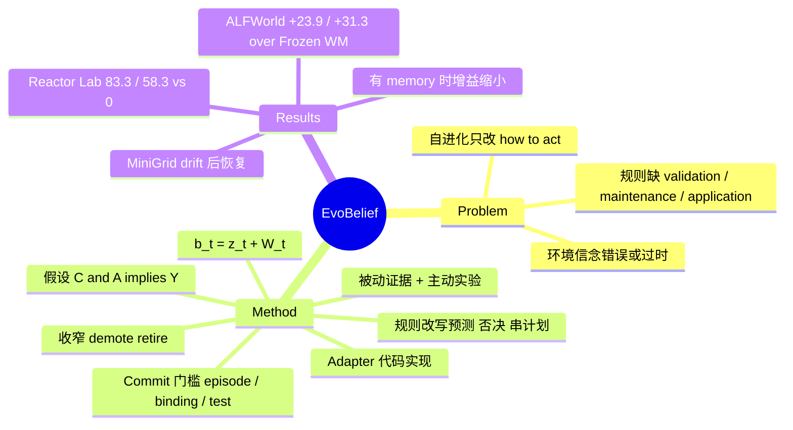

## Summary
EvoBelief 把 self-evolution 的对象从"agent 怎么做"换成"agent 相信环境怎么运作"：在冻结 LLM 外挂一个 world model W，其中每条知识是可证伪假设 (C ∧ A ⇒ Y)，只有经过跨 episode / 跨 binding / 独立测试的证据才获得"权限"指导预测与规划，反例会收窄或撤销规则。在 ALFWorld、ScienceWorld、MiniGrid（隐藏 drift）、DiscoveryWorld（科学发现）上均优于 ReAct / WorldEvolver / Frozen WM。但假设提取、验证、规划均由各 benchmark 的 code adapter 完成，LLM 主要只做 actor 与 anchor predictor，通用性证据有限。

## Problem & Motivation
现有 self-evolving agent（Reflexion、ExpeL、Voyager、skill 库等）主要改进 *how to act*，但 agent 的失败也可能源于对环境动力学的先验信念错误或过时（例：先验认为化合物 X 在 120 °C 内稳定，实际 100 °C 分解）。任务级纠正（"用更低温度"）不能沉淀成跨任务可复用的环境属性。已有 world-model agent（WALL-E、ITP-I、WorldEvolver）尚未系统解决三件事：规则在被信任前的 validation、环境变化后的 maintenance（修订/收窄/退役）、以及对不同任务的 application。

## Method
- **两时间尺度状态** b_t = (z_t, W_t)：z_t 是 episode-local 情境估计（每个 episode 重置），W_t 是跨 episode 持久的环境动力学信念，从空集开始。
- **假设形式** H := (C ∧ A ⇒ Y)，附带 scope、测试配方、证据记录；用抽象 role 做 binding，更广的 scope 只能靠多种 binding 的证据获得。
- **触发**：grounded prediction mismatch（预测与真实观测不符）或 decision-critical unknown（其答案会改变下一步决策）。允许保留 rival hypotheses。
- **证据**：被动证据（普通任务转移恰好测试已有假设）与主动证据（专为区分 rival 而跑的 live experiment，占用任务交互预算）。实验仅在"结果能改变决策、无已验证规则可回答、可执行、至少两种结果导致不同后续动作"时被准入；支持/证伪判据在执行前固定；结果判为 supported / counterexampled / inconclusive。
- **Authority / commit**：N_ep ≥ τ_ep ∧ N_bind ≥ τ_bind ∧ N_test ≥ τ_test 才 commit（Eq. 3）；阈值在评测前预设、不在 benchmark 上调。附录：至少 2 个 binding、2 个 episode，且其中一次独立于该假设影响过的决策；同一实验设计的多个读数只算 1 次独立测试；DiscoveryWorld 单长 episode 用一次事先冻结预测的 held-out test。
- **维护**：反例先收窄 scope 并重算 commit 条件，不满足则 demote（保留证据，可恢复），无支持证据时才 retire；evidence ledger append-only，所有状态转换可追溯。
- **使用**：actor 先在不看 W 的情况下生成候选动作，frozen predictor 给 anchor 预测；仅"条件成立且 binding 在 scope 内"的已验证规则可改写预测/否决动作/串成短计划，否则回退到 W-blind 选择。靠规则取得的成功不计为该规则的新独立支持。
- **实现事实（读时关键）**：ALFWorld / MiniGrid / ScienceWorld 上规则由 typed transitions 经 code induction 得到，规则后果由结构化表示直接计算，无 rule-conditioned 模型调用；DiscoveryWorld 上定量/类别规律由代码拟合；actor 从不看到规则文本（App. C）。即生命周期与 authority 检查由 benchmark adapter 在 actor 外实现，而非 prompt。

## Key Results
- **ALFWorld（134 个 unseen 任务，无 transition memory）**：Haiku 4.5 上 EvoBelief 66.42 vs Frozen WM 42.54（+23.9）、ReAct 33.58、WorldEvolver 35.07、ITP-I 29.85；GPT-5.4 上 76.12 vs Frozen WM 44.78（+31.3）、WorldEvolver 61.94。有 memory 时差距缩小：Haiku 68.66 vs WorldEvolver 58.96 / Frozen WM 57.46；GPT-5.4 76.87 vs 72.39 / 55.22。
- **ScienceWorld（90 任务）**：无 memory 时 Haiku 64.44（ReAct 55.56，Frozen WM 46.67）、GPT-5.4 71.11（WorldEvolver 65.56）。注意 Haiku 下 ReAct (55.56) 高于 WorldEvolver (52.22) 与 Frozen WM；ITP-I 在全部设置低于 ReAct。ScienceWorld 上多数直接行为干预来自 live experiment，已验证规则指导的决策较少。
- **跨任务复用**：ALFWorld 上 >80% 在已验证规则下做的决策落在规则被验证时所在任务家族之外（Table 8）。
- **MiniGrid 隐藏 drift**（door 对应的 key 在 episode 20 后静默切换，Haiku 无 memory）：MG-C pre/post-drift 61.67/95.00，Frozen WM 0/0，WorldEvolver 0/0；MG-M 78.33/81.67 vs Frozen WM 1.67/0、WorldEvolver 6.67/16.67；对照 MG-R 83.33/78.33 vs Frozen WM 48.33/50.00。三个 held-out seed 上 69.6% vs Frozen WM 1.3%；颜色/房间名置换后 80.8% vs 7.1%。消融：无主动实验或无学习规则都退回先验水平；规则放 shadow（跑实验但不执行计划）也降低成功率，MG-C 最甚。
- **DiscoveryWorld（GPT-5.4，每 task family×tier 12 个新实例）**：Reactor Lab Completion Normal 83.33 / Challenge 58.33，ReAct、WorldEvolver、Hypothesizer 均 0；Plant Nutrients Normal 75.00 vs Hypothesizer 50.00，Challenge 83.33 vs 75.00（WorldEvolver / Hypothesizer）。Plant Nutrients 的完成率差对最强 baseline 的 CI 含 0，仅 knowledge 差 CI 排除 0。
- **Held-out 转移预测**（每 benchmark 1,500 条，Haiku）：EvoBelief 在 State-ΔF1 / EM / token F1 领先，ScienceWorld 上 WorldEvolver 的 feasibility 准确率更高。

## Evidence Ledger
| Claim ID | Claim | Type | Source locator | Evidence excerpt | Status |
|:--|:--|:--|:--|:--|:--|
| C1 | ALFWorld 无 actor-side memory 时 EvoBelief 相对 Frozen WM 在 Haiku 4.5 和 GPT-5.4 上分别提升 23.9% 和 31.3%（成功率绝对百分点） | number | Abstract; Table 1 | "improves success over the matched Frozen World Model by 23.9% and 31.3% with Claude Haiku 4.5 and GPT-5.4, respectively" | source-verified |
| C2 | ALFWorld 无 memory 下 Haiku 4.5 成功率：EvoBelief 66.42，ReAct 33.58，WorldEvolver 35.07，ITP-I 29.85，Frozen WM 42.54 | number | Table 1 | "No memory ReAct 33.58 ... Frozen WM 42.54 EvoBelief 66.42" (flattened table; locate by row order) | source-verified |
| C3 | ALFWorld 无 memory 下 GPT-5.4：EvoBelief 76.12，WorldEvolver 61.94，Frozen WM 44.78，ReAct 46.27 | number | Table 1 | "ReAct 33.58 46.27 ... WorldEvolver 35.07 61.94 ... Frozen WM 42.54 44.78 EvoBelief 66.42 76.12" (flattened) | source-verified |
| C4 | 有 transition memory 时 ALFWorld 上 EvoBelief 对 WorldEvolver 的优势缩小（Haiku 68.66 vs 58.96；GPT-5.4 76.87 vs 72.39） | comparison | Table 1; §4.2 | "margin over Frozen WM is largest without transition memory for both backbones and remains positive with it" | source-verified |
| C5 | ScienceWorld 无 memory：Haiku 4.5 EvoBelief 64.44、ReAct 55.56；GPT-5.4 EvoBelief 71.11、WorldEvolver 65.56 | number | Table 1 | "EvoBelief has the highest task success rate in every setting shown" | source-verified |
| C6 | ITP-I 在 Table 1 全部八个设置下均低于同设置的 ReAct | comparison | Table 1 | "ITP-I ( Liu et al., 2026 ) 29.85 39.55 42.22 36.67" (flattened) | source-verified |
| C7 | ALFWorld 上超过 80% 的已验证规则下的决策发生在规则被验证时所在家族之外 | number | §4.2; Table 8 | "over 80% of the decisions under a validated rule fall in a family other than the one where the rule was validated" | source-verified |
| C8 | ScienceWorld 上多数直接行为干预来自 live experiment 而非已验证规则 | causal-mechanism | §4.2; §4.5; Table 6 | "Live experiments account for most direct behavioral intervention, while validated rules guide a smaller number of later decisions." | source-verified |
| C9 | MiniGrid MG-C Haiku：EvoBelief pre/post-drift 61.67/95.00，Frozen WM 与 WorldEvolver 均 0.00/0.00 | number | Table 2 | "Frozen WM 0.00 0.00 ... EvoBelief 61.67 95.00" (flattened) | source-verified |
| C10 | MiniGrid MG-R（先验可解约一半）：EvoBelief 83.33/78.33，Frozen WM 48.33/50.00 | number | Table 2 | "On MG-R, a less adversarial control where the prior solves about half of the episodes, EvoBelief still improves substantially" | source-verified |
| C11 | 三个 held-out seed 上 EvoBelief 69.6% vs Frozen WM 1.3%；颜色与房间名置换后 80.8% vs 7.1% | number | §4.3; Table 10 | "On three held-out seeds EvoBelief solves 69.6% of episodes against 1.3% for Frozen WM, and 80.8% against 7.1%" | source-verified |
| C12 | 去除主动实验或去除学习规则均使 MiniGrid 成功率停在先验水平；shadow 规则也降低成功率，MG-C 最明显 | causal-mechanism | §4.3; Table 11 | "Without active experiments the critical rules never gain independent support, and without learned rules the planner falls back to the prior" | source-verified |
| C13 | MiniGrid 静默 key 切换后反例使规则退役并重新开放实验，随后验证出 successor 规则，成功率回到切换前水平 | causal-mechanism | §4.3; Figure 6 | "the counterevidence retires the rule and reopens experimentation. EvoBelief then validates a successor rule, and success returns to its pre-switch level." | source-verified |
| C14 | DiscoveryWorld Reactor Lab：EvoBelief Normal 完成率 83.33%、Challenge 58.33%，ReAct / WorldEvolver / Hypothesizer 均为 0% | number | Abstract; Table 3 | "completing 83.3% of Normal-tier and 58.3% of Challenge-tier instances, versus 0% for each evaluated baseline" | source-verified |
| C15 | Plant Nutrients 上 EvoBelief 对最强 baseline 的 completion 差的 CI 含 0，仅 knowledge 差 CI 排除 0 | benchmark-setting | §4.4; Table 7 | "the interval for its completion difference from the strongest baseline of each tier includes zero" | source-verified |
| C16 | WorldEvolver 与 ITP-I 使用官方发布实现，经同一 harness、接口、预算重跑，每任务只尝试一次 | benchmark-setting | App. E (Baselines, Protocol) | "WorldEvolver and ITP-I are the official released implementations, run through the same harness, interface, and budgets" | source-verified |
| C17 | WorldEvolver 原论文报告 best-of-5，本文改为单次尝试；WALL-E 2.0 的 ALFWorld 结果因协议与 backbone 不同而不可直接比较 | benchmark-setting | App. E | "a task counts as solved when any one of the five trials succeeds ... each task is attempted once." | source-verified |
| C18 | ALFWorld/MiniGrid/ScienceWorld 的规则由 typed transitions 经 code induction 得到，规则后果直接计算，无 rule-conditioned 模型调用；actor 从不接收规则文本 | causal-mechanism | §4.1; App. C; Table 4 | "The actor itself never receives the validated rule text." | source-verified |
| C19 | 规则生命周期与 authority 检查由 benchmark adapter 在 actor 之外实现，而非 prompt | causal-mechanism | App. C (Division of labor) | "the rule lifecycle and its authority checks are implemented outside the actor rather than delegated to a prompt" | source-verified |
| C20 | commit 阈值事先固定、不在 benchmark 结果上调；ALFWorld 等多 episode 设置要求 ≥2 个 binding 且 ≥2 个 episode | benchmark-setting | §3.4; App. B | "The thresholds are set before any benchmark run, are never tuned on benchmark results" | source-verified |
| C21 | Plant Nutrients 的首个版本在 6 个新实例上未过预设性能门槛、完成 0 个实例，后修订实现并报告新版本 | benchmark-setting | App. F.5 | "A first version of the Plant Nutrients instantiation ... failed it: it completed no task instance" | source-verified |
| C22 | 所有实验仅在文本环境上进行；多模态、具身、真实软件 agent 是未来工作 | benchmark-setting | App. A | "Our experiments use text-based environments" | source-verified |
| C23 | 论文未提供代码链接 | license-code | 全文（未检索到 GitHub/code 声明） | unknown | source-verified |

## Strengths & Weaknesses
**Strengths**
- 问题 formulation 清楚：把"信念存在"与"行为权限"分离（authority），用 N_ep/N_bind/N_test 的独立证据门槛控制规则传播，直接针对错误规则跨任务传染的风险。
- 实验设计比同类更克制：MiniGrid 用预先固定的 held-out seed 与实体名置换检验规则是否 grounded 于效果而非名字；MG-R 对照排除"先验太弱"的解释；配对 McNemar + bootstrap CI；公开了 Plant Nutrients 首版失败。
- 基线可信度较高：WorldEvolver / ITP-I 用官方实现同 harness 重跑，并说明 best-of-5 与单次尝试的差异。
- 可追溯：append-only ledger，能说明某个动作为何被规则改写。

**Weaknesses / 隐含假设**
- **LLM 在核心环节缺位**：假设诱导、验证计数、适用性检查、规划均由 benchmark-specific adapter 的代码完成（typed transitions、law fitting、编译实验），actor 看不到规则。因此"自进化的 LLM agent"更像"符号化环境学习器 + 冻结 LLM 提议动作"；每个新环境需要写 adapter，跨环境通用性未检验。比较对象（WorldEvolver 等）是否同样享有结构化观测接口，从正文看不清。
- 隐含假设：transition 可被类型化并可检验、实验可逆且代价可控、环境近似确定性；commit 用计数阈值，在随机环境下会出问题（作者在 App. A 承认需要统计检验）。
- 阈值（τ）虽称预设不调，但 MiniGrid MG-C/MG-M 本身被"设计"为需要一个先验不会预料的步骤、24 步预算不留碰运气空间——这是对该方法有利的 benchmark 构造；near-zero 基线反映的是隐藏规则而非弱基线（作者自己也这么说）。
- 样本小：DiscoveryWorld 每 cell 12 个实例，ScienceWorld 90 任务，ALFWorld 134 任务单次尝试；MiniGrid 同 stream 的 episode 共享 belief state，作者承认 episode 级检验未考虑这种依赖。
- 增益随 memory 减弱：有 transition memory 时 ALFWorld 增益显著缩小；ScienceWorld 主要靠 live experiment 而非规则复用，说明规则机制的作用部分与 episodic memory 可替代。
- 只测两个 backbone（Haiku 4.5、GPT-5.4），无 ablation 说明在 ScienceWorld 中 experiment 与 rule 谁贡献更多（App. F 有机制统计，但未做彻底隔离）。
- 无代码链接，复现依赖作者提供的 adapter。

**影响**：为"world model 即可证伪假设库"提供了一个清晰模板；对 GUI/web agent 的启发是 UI 动力学（如某控件的实际行为）也可作为带 scope 的规则被反例修正，但本文并未验证。

## Mind Map

## Notes
- 与 [[2606-WALLWM]] 无直接关系（该文是 WALL-WM 世界动作建模，非 WALL-E 规则学习）；WALL-E / WorldEvolver 是本文的直接对手，vault 暂无二者的独立笔记。
- [[2507-SelfEvolvingAgentsSurvey]]：本文属于该 survey 框架中"what to evolve"里被忽略的一类——环境 world model，而非 prompt/memory/tool/policy。
- [[2607-RethinkSkillEvolve]]：同样关注 self-evolving 反馈动态；EvoBelief 的反例驱动 retire 可视为对"技能越攒越多反而有害"问题的另一种回答（对环境知识而非 skill）。
- [[2603-HybridSelfEvolvingStructured]]：GUI agent 的结构化记忆，与 EvoBelief 的 evidence-linked rule store 可组合——把 GUI 动力学写成带 scope 的可证伪规则。
- [[2511-DreamGym]]：同样用 LLM/合成环境替代真实交互，但 DreamGym 训练参数，EvoBelief 冻结参数、更新外部信念。
- 同周论文 Memento 3（rulebook 式 model-based recursive self-improvement）是紧邻工作，另行消化，对比点：规则的获取者（LLM vs adapter 代码）和 authority 机制。
- 疑问：若把 adapter 换成 LLM 自己提取 typed transition，门槛机制是否仍成立？GUI 场景下 "binding" 如何定义？
