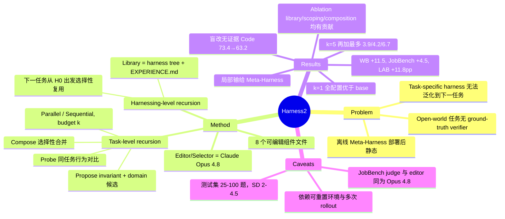

## Summary
Harness2 在不改模型权重、也没有 ground-truth verifier 的条件下，对每个测试任务现场改写 agent 的 execution harness：先跑一次 reference，再提出 invariant / domain-specific 两个候选 harness 在同一任务上 probe，最后依据行为对比 compose 出 successor（Propose–Probe–Compose）；每个任务结束后，把被采用的 harness 和经验写进 improvement library，指导后续任务的改写。在 WorkBuddy-Bench、JobBench、LAB 三个 benchmark 和 2 executor × 2 初始 harness 共四种配置下，k=1 单步相对 base harness 全部为正，最大增益为 +11.5（WorkBuddy-Bench）、+4.5（JobBench）、+11.8pp（LAB Partial）；k=5 并行递归还能继续加分。这些增益的前提是任务可以在可重置的沙箱里重复执行，且 editor 用的是 Claude Opus 4.8，比两个 executor 都强；论文所说的 "open world" 实际只是指没有标签，并不涵盖有不可逆副作用的部署环境。

## Problem & Motivation
Agent 的表现很大程度取决于 harness（system prompt、guardrails、memory、skills、tool guidance、scripts、subagents、plugin）。现有 harness RSI 分两类：Meta-Harness、AHE 等在固定训练集或验证反馈上离线搜索，部署后 harness 固定不变，遇到分布外任务就泛化不了；Recursive Harness Self-Improvement、Harness Scaling、TTHE 等在测试时针对当前任务改 harness，但依赖 proxy signal 或 pairwise judgment，而且为某个任务高度定制的 harness 直接沿用到下一个任务时会带来噪声。作者的核心问题是："Can recursive self-improvement improve both the current harness and how future harnesses are improved?"，也就是要把"如何改进 harness"这个过程本身也变成可积累的对象。

## Method
**问题设定**：模型 M 冻结。harness H=(c¹…c^K) 沿用 AHE 的文件级分解并多加一个组件，共 K=8 个文件：system prompt、guardrails、memory、skills、tool guidance、scripts、subagents、middleware plugin。任务以流的形式到达，没有标签；每个任务都从同一个 H₀ 出发，在有限预算内允许对当前任务重复执行，然后才提交 deliverable。

**Task-level recursion（单任务内）**
- **Propose**：先采样一次 reference execution e⁰，它只用来展示 harness 的行为，不说明答案对错。然后同时提出两个候选：invariant candidate 针对跨领域反复出现的 agentic 缺陷（planning、tool use、context management、delegation）；domain-specific candidate 针对当前领域的知识、流程和约束。提出候选时可以从 library 复用组件，但涉及任务的具体事实必须拿当前任务的证据核对。
- **Probe**：两个候选在同一任务、同一 model/environment 配置下执行，和 reference 对比得到 behavioral contrast。作者明确说这一步不用来判断任务是否做对。
- **Compose**：读取 reference、候选、diff 和全部执行证据后做选择性组合，可以合并、修订、只采纳一个候选或保留原 harness。每个决定都要对应一条具体观察，组合好的 harness 再执行一次得到 e′。
- **Parallel recursion**（借鉴 RSA）：k 次 reference，k 个 invariant 加 k 个 domain 候选，再起 k 个独立的 Compose session，每个 session 都看到完整候选池。这里只做一次 population update，k 控制的是宽度。**Sequential recursion**（Self-Refine 式）：串接 k 个 contrastive step。k>1 时由一个 agentic selector 在匿名 deliverable 中挑一个提交，selector 看不到对应的 harness，也不允许生成新内容。

**Harnessing-level recursion（跨任务）**：每个任务结束后回顾完整的改进记录 D_t，只保留有 execution contrast 支撑的 lesson，执行 R_{t+1}=Update(R_t, H*_t, D_t)。library 的每个 entry 由完整的被采用 harness tree 加一份 EXPERIENCE.md（适用情形、lesson、证据）组成，另有 index 按需检索。下一个任务仍从 H₀ 开始，之前的组件不会自动继承，只能在 Propose 阶段被选择性复用。每个 benchmark domain 有独立的 library，各自从空库开始。

**实现**：executor 是 Gemini 3.5 Flash / GLM-5，运行在 OpenCode / Codex 中；editor 和 selector 都是 Claude Opus 4.8（OpenCode，high reasoning effort）；有一个 guard 拒绝向任何 session 交付包含 grader verdict、rubric 或 score 的目录。每次 rollout 上限 200 turns / 3600s。

## Key Results
**主表**（Table 1/2，均为 3 次 shuffled stream 的均值，k=1）
- WorkBuddy-Bench Avg：GLM-5+OpenCode 从 64.2 升到 75.7（+11.5），Gemini 3.5 Flash+OpenCode 从 72.4 升到 77.5（+5.1）。
- JobBench：Gemini+OpenCode 从 31.5 升到 36.0（+4.5），GLM-5+OpenCode 从 20.6 升到 24.2。
- LAB Partial：GLM-5+OpenCode 从 59.6 升到 71.4（+11.8pp），但同一配置下 ReasoningBank 是 71.3，两者基本持平。
- **Harness2 并非处处最好**：GLM-5+Codex 的 WB-Code 为 74.9，低于 Meta-Harness† 的 76.8；Gemini+Codex 的 LAB 为 75.6，低于 Meta-Harness† 的 76.5。
- **+Recursion（k=5 并行）**：在 k=1 基础上 WorkBuddy-Bench Avg 最多再加 +3.9，JobBench 最多 +4.2，LAB 最多 +6.7pp。

**Budget 与 compute**
- 在 WB-Code 上，并行递归从 k=1 到 k=5 由 76.5 升到 80.8；WB-Office 由 79.5 升到 83.4。Harness Scaling 从 k=2 到 k=3 时在两个 domain 上都出现退化。
- Figure 6 统计了提交前的全部 token。Gemini+OpenCode 下 k 从 1 增加到 5，相对 base 的增益在 JobBench 上由 4.5 升到 7.5，在 WorkBuddy-Bench 上由 5.1 升到 8.4。作者称 Meta-Harness 的算力比 Harness2 k=5 更多，分数却更低。具体 token 数只在图中给出，文本没有列出。

**Ablation**（Table 3，Gemini+OpenCode，k=1，指标为 WorkBuddy/JobBench）
- 完整方法 77.5/36.0。
- w/o library 为 74.4/34.2（−3.1/−1.8）。
- w/o scoping 为 74.6/32.3（−2.9/−3.7）。
- w/o composition 为 75.9/34.1（−1.6/−1.9）。

**最有信息量的一条**（Figure 7 左）：如果不给 reference、probe 和 library，让 editor 直接改 base harness，Code 从 73.4 跌到 63.2，Web 从 69.9 跌到 65.0。换句话说，没有执行证据的盲改会伤害性能。

**Library 与迁移**
- 用 k=5 积累的 library 做一步改写、不做 probe，Code/Web/Office 分别 +0.9/+4.4/+5.1。
- 从 JobBench 积累的 library 迁移到 WorkBuddy-Bench，三个 domain 分别 +0.6/+0.5/+2.9。
- Leave-one-out（Figure 11）：WorkBuddy-Bench 从 77.5 升到 79.4，JobBench 从 36.0 升到 37.7。这个实验能看到之后任务的 entry，作者自己也承认它不是 online 估计。

**其他**
- Same-model（Figure 8，k=2）：Claude Opus 5 同时做 executor 和 editor，在 WB/JobBench/LAB 上分别 +3.3/+5.5/+3.0；GLM-5 自改在 LAB 上 +13.7。
- 跨 executor 迁移：把为 Gemini 3.5 Flash 改好的 harness 直接交给 GLM-5，WB-Code 从 58.5 升到 75.8。
- Tool error rate 在 JobBench 上从 14.4% 降到 9.1%。
- 从 OpenCode 出发的 k=5 结果，在 Code/Web/Office 上比最强的固定生产 harness（Claude Code / Codex 等）分别高 +4.6/+5.8/+4.9。
- Failure analysis：WB-Code 上 selector 选了一个得 55 分的输出，放弃了得 95 分的那个；错误前提也会在多个候选之间传播，造成 2–11 分的损失。

## Evidence Ledger
| Claim ID | Claim | Type | Source locator | Evidence excerpt | Status |
|:--|:--|:--|:--|:--|:--|
| C1 | k=1 单步在全部四种配置、三个 benchmark 上均优于 base harness | comparison | §1; Table 1/2 | "One contrastive step improves performance on all three benchmarks in every configuration" | source-verified |
| C2 | GLM-5+OpenCode 的 WorkBuddy-Bench Avg 从 64.2 升到 75.7（+11.5） | number | Table 1 | "OpenCode ... 64.2 (1.4)" / "Harness2 ... 75.7 (2.2)" | source-verified |
| C3 | Gemini 3.5 Flash+OpenCode 的 JobBench 从 31.5 升到 36.0（+4.5） | number | Table 2 | "Base harness \| 31.5 (1.1)" / "Harness2 \| 36.0 (2.3)" | source-verified |
| C4 | GLM-5+OpenCode 的 LAB Partial 从 59.6 升到 71.4（+11.8pp），同配置 ReasoningBank 为 71.3 | number | Table 2 | "Base harness \| 20.6 (2.0) \| 20.0 (0.8) \| 59.6 (2.7)"; "ReasoningBank ... 71.3 (1.3)" | source-verified |
| C5 | GLM-5+Codex 的 WB-Code 上 Harness2（74.9）低于 Meta-Harness†（76.8） | comparison | Table 1 (GLM-5/Codex) | "Meta-Harness† \| 76.8 (1.9)" / "Harness2 \| 74.9 (1.5)" | source-verified |
| C6 | Gemini+Codex 的 LAB 上 Harness2（75.6）低于 Meta-Harness†（76.5） | comparison | Table 2 (Gemini/Codex) | "Meta-Harness† ... 76.5 (2.1)" / "Harness2 ... 75.6 (4.5)" | source-verified |
| C7 | k=5 并行递归在 k=1 基础上最多再加 3.9（WB）、4.2（JobBench）、6.7pp（LAB） | number | §1; Table 1/2 +Recursion | "Parallel recursion adds up to 3.9 points on WorkBuddy-Bench, 4.2 on JobBench, and 6.7 percentage points on LAB Partial" | source-verified |
| C8 | WB-Code 上并行递归从 76.5 升到 80.8，WB-Office 从 79.5 升到 83.4（k=1→5） | number | §4, Figure 5 | "Parallel recursion rises from 76.5 to 80.8 on Code and from 79.5 to 83.4 on Office" | source-verified |
| C9 | Harness Scaling 从 k=2 到 k=3 时在两个 domain 上都退化 | comparison | §4, Figure 5 | "Harness Scaling regresses from k=2 to 3 on both domains" | source-verified |
| C10 | Gemini+OpenCode 下 k 从 1 到 5，相对 base 的增益在 JobBench 上由 4.5 升到 7.5，在 WB 上由 5.1 升到 8.4 | number | §4, Figure 6 | "raises gains over the base from 4.5 to 7.5 points on JobBench and from 5.1 to 8.4 on WorkBuddy-Bench" | source-verified |
| C11 | Meta-Harness 的算力比 Harness2 k=5 更多，表现却更低（计入执行与改进的全部 token） | comparison | §4, Figure 6 | "Meta-Harness uses more compute than Harness2 at k=5 for lower performance" | source-verified |
| C12 | 去掉 library 后 WB/JobBench 下降 3.1/1.8，去掉 scoping 下降 2.9/3.7，去掉 composition 下降 1.6/1.9 | number | Table 3 | "removing the library lowers ... by 3.1 and 1.8 points ... scoping costs 2.9 and 3.7 ... composition costs 1.6 and 1.9" | source-verified |
| C13 | 不给 reference、probe、library 而直接改写 base harness，Code 从 73.4 跌到 63.2，Web 从 69.9 跌到 65.0 | causal-mechanism | §4, Figure 7 left | "Code scores drop from 73.4 to 63.2 and Web scores fall from 69.9 to 65.0" | source-verified |
| C14 | k=5 积累的 library 在不做 probe 时，Code/Web/Office 分别 +0.9/+4.4/+5.1 | number | §4, Figure 7 left | "the library instead supports gains of 0.9, 4.4, and 5.1 points on Code, Web, and Office" | source-verified |
| C15 | JobBench 积累的 library 让 WorkBuddy-Bench 一步改写分别 +0.6/+0.5/+2.9 | number | §4, Figure 7 right | "A JobBench-derived library also improves one-step refinement on WorkBuddy-Bench by 0.6, 0.5, and 2.9 points" | source-verified |
| C16 | Leave-one-out 重跑：WB 从 77.5 升到 79.4，JobBench 从 36.0 升到 37.7；该实验可访问之后任务的 entry | benchmark-setting | App. E.2, Figure 11 | "The re-run can access entries from both earlier and later tasks, so this is an offline reuse analysis" | source-verified |
| C17 | 同一模型兼任 executor 和 editor（k=2）时，Opus 5 在 WB/JobBench/LAB 上 +3.3/+5.5/+3.0，GLM-5 在 LAB 上 +13.7 | number | §4, Figure 8 | "Opus 5 gains 3.3, 5.5, and 3.0 points ... GLM-5 gains 13.7 points on LAB" | source-verified |
| C18 | 默认 editor 和 selector 都是 Claude Opus 4.8，所有 baseline 的 revision/reflection 也用 Opus 4.8 | benchmark-setting | §3.1; App. C, D.2 | "Revision and reflection use Claude Opus 4.8, matching our editor." | source-verified |
| C19 | JobBench 的评分 judge 为 Claude Opus 4.8（与 editor 同模型），WorkBuddy 的 judge 为 Gemini 3.5 Flash | benchmark-setting | App. B | "Deliverables are judged against a weighted rubric by Claude Opus 4.8" | source-verified |
| C20 | 测试集规模：WB 测试半集 40/35/25，JobBench 34 题，LAB 100 题 | benchmark-setting | App. B | "we report on the test halves (40/35/25 tasks)" / "report on the 34 test tasks" | source-verified |
| C21 | 为 Gemini 3.5 Flash 改好的 harness 直接迁移给 GLM-5，WB-Code 从 58.5 升到 75.8 | number | App. E.3, Figure 12 | "GLM-5 gains 17.3 points on Code (58.5→75.8)" | source-verified |
| C22 | 一步改进后 JobBench 的 tool error rate 从 14.4% 降到 9.1% | number | App. E.4, Table 7 | "Error rates fall on all three benchmarks, most on JobBench (14.4%→9.1%)" | source-verified |
| C23 | k=5 从 OpenCode 出发，在 Code/Web/Office 上比最强固定生产 harness 高 4.6/5.8/4.9 | comparison | App. E.5, Figure 13 | "Harness2 exceeds the strongest fixed alternative by 4.6, 5.8, and 4.9 points" | source-verified |
| C24 | Failure case：WB-Code 上 selector 选了 55 分的输出，舍弃了 95 分的输出 | number | App. E.6, Figure 14 | "on WB-code, an output scoring 55 is chosen over one scoring 95" | source-verified |
| C25 | 代码开源于 github.com/google-research/harness2；论文没有说明代码 license（论文本身为 CC BY 4.0） | license-code | Abstract 下方链接; arXiv 页 | "github.com/google-research/harness2" | source-verified |

## Strengths & Weaknesses
**Strengths**
- **把"改进过程"本身当作学习对象**。library 存的是可执行的 harness tree 加 EXPERIENCE.md，而不是只把轨迹蒸馏成文字（ReasoningBank 的做法）。下一个任务不自动继承上一个 harness，避免高度定制的 harness 在任务间传递噪声。这种区分 execution harness 和 improvement harness 的设计概念清晰。
- **Figure 7 左给出了一个有价值的负结果**：没有执行证据时盲改 harness，Code 会掉 10.2 分。这说明增益来自"在同一任务上 probe 对比"这一证据来源，而不只是"让强模型改 prompt"。它也提醒所有 test-time harness evolution 工作，必须报告"不 probe 直接改"这个对照。
- 实验设计相对认真：四种 executor×harness 配置；所有 baseline 的 revision 都用 Opus 4.8，和本方法的 editor 一致；Harness Scaling 移植到同一组可编辑组件上；有一个 guard 屏蔽 rubric 和 score；作者主动报告了 9 个 regression 和 leave-one-out 的局限。
- Table 6 的组件 ablation 显示 skills 和 scripts 贡献最大（Avg −5.3/−3.7），prompt 类只有 −1.5，说明增益主要来自可执行组件而不是提示词。这和 Strong-to-Weak 一文"deterministic offloading"的归因一致。

**Weaknesses / 隐含假设**
- **"Open world" 的定义过窄**。方法要求同一任务在 fresh container 里重复执行多次（k=1 时至少有 reference、两个候选 probe、composed 再执行一次，共 4 次 rollout），这等于假设环境可以重置、动作没有副作用。真实部署（发邮件、改线上数据、GUI 上的不可逆操作）恰好是 "open world" 最难的部分，而这一点被这个设定绕开了。所以它本质上是一种 test-time compute 方法，不是 online deployment 方法。
- **Compute 可比性存疑**。base 只跑 1 次 rollout，Harness2 k=1 已有 4 次以上执行，外加 Opus 4.8 editor session。Appendix C 定义了 Best-of-k baseline（用同一个 selector），但正文的主表和 Figure 5 里，就文本可读的部分而言，没有看到它的数值（具体是否出现在 Figure 6 待核）。而"多采样加选择"正是最该排除的解释。Meta-Harness 用更多算力却更低的说法把离线搜索成本也算了进去，这个口径对离线方法是否公平，值得商榷。
- **Judge 与 editor 同源**。JobBench 的 judge 是 Claude Opus 4.8，editor 和 selector 也是 Opus 4.8，存在 editor 把输出改成 judge 偏好风格的风险。WorkBuddy 的 LLM/VLM judge 是 Gemini 3.5 Flash，同时也是 executor 之一。same-model 实验（Figure 8）缓解了"必须靠更强 editor"的质疑，但没有解决 judge 偏好的问题。
- **样本小，方差大**。WB 每个 domain 只有 25–40 题，JobBench 34 题，SD 常在 2–4.5。不少胜负落在 1 SD 以内，例如 LAB GLM-5 的 71.4 vs ReasoningBank 的 71.3、Gemini JobBench 的 36.0 vs Meta-Harness 的 35.8。"consistent gains" 对 base 成立，对强 baseline 不完全成立（C5、C6）。
- **Harnessing-level recursion 的证据最薄弱**。w/o library 在 k=1 下只差 −3.1/−1.8。跨 benchmark 迁移在 WB-Code/Web 上只有 +0.6/+0.5，接近噪声。leave-one-out 能看到之后任务的 entry，不是 online 证据。library 按 domain 隔离、每条 stream 只有几十个任务，"可积累的复利" 在更长的 stream 上会不会被 library 膨胀和过时经验抵消，论文没有测（Appendix G 也承认 library management 是 open problem）。
- **Selector 是明确的瓶颈**：出现过 55 被选、95 被弃的案例，错误前提也会在候选之间传播。没有 verifier 时，contrastive evidence 抵不住 shared model bias，作者在 Limitations 里也承认了这一点。

**潜在影响**：这是 test-time harness evolution 方向上结构较完整的一个系统，可以作为 self-improving agent 的对照基线。它最值得带走的设计原则是"probe 对比优先于盲改"。在 GUI/computer-use 场景，可重置沙箱（OSWorld 类）与真实部署之间的差距会直接决定这套方法能否落地。

## Mind Map

## Notes
- [[2606-RHO]]：同样做无标签 harness 优化（self-preference over rollouts），并且同样依赖同任务的多次 rollout 加模型自判。RHO 用 pairwise self-preference 选 harness，Harness2 用 behavioral contrast 组合 harness，两者都面对 shared model bias 这个共同弱点，适合放在一起比较哪种无标签信号更可靠。
- [[2608-StrongToWeakHarness]]：Harness2 引用了它（Qian et al., 2026）。该文用强 builder 给弱 target 建 harness，依赖 5% validation；Harness2 默认也是强 editor（Opus 4.8）改弱 executor，但完全不用标签。两者共同的发现是增益主要来自可执行组件（scripts/skills，即 deterministic offloading）。
- [[2607-MetaSkillEvolve]]：都是"两层递归"（task artifact 加改进机制本身）。MetaSkill-Evolve 让 meta-skill 在慢环里被自应用改写，Harness2 的 improvement harness 只更新 library、stage instructions 固定不变，所以 Harness2 的"harnessing-level recursion" 比名字暗示的弱。
- [[2606-RecursiveAgentHarness]]：名字相近，但讨论的是另一件事。RAH 把 harness 作为递归调用的单元（parent spawn subagent harness），Harness2 的递归针对的是 harness 的改进过程，注意不要混淆。
- 待核：Appendix C 定义的 Best-of-k baseline 是否在 Figure 6 中出现。如果没有出现，"多次 rollout 加 selector" 这个最简单的解释就没有被排除。
