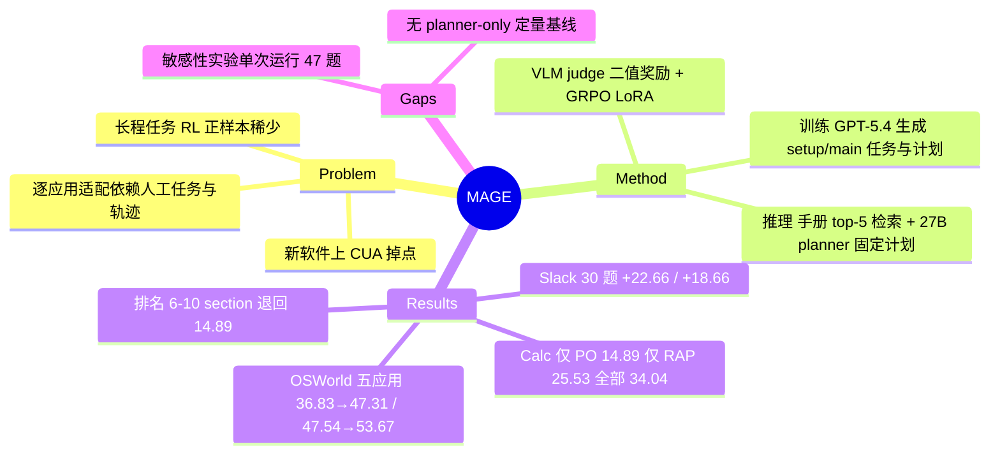

## Summary

MAGE 把软件用户手册用在两个地方：推理时按任务检索 top-5 手册 section，由 Qwen3.6-27B planner 结合首帧截图生成一份固定计划给 CUA；训练时让 GPT-5.4 从手册 section 生成"setup + main"任务与计划，CUA 带着计划 rollout，VLM 判成败后用 GRPO + LoRA 做逐应用适配。OSWorld 五个应用（50 步、5 次运行）上 UI-TARS-1.5-7B 从 36.83 提到 47.31、EvoCUA-8B 从 47.54 提到 53.67，自建 30 题 Slack 上分别 +22.66 / +18.66。Calc 消融中只做训练几乎无效（14.47→14.89），检索计划贡献主要增益（→25.53），但缺一个"planner 不给手册"的定量对照，无法把增益拆成"手册内容"和"外加一个 27B planner"两部分。

## Problem & Motivation

CUA 换到新软件时性能下降，因为任务依赖藏在菜单、对话框、快捷键后面的应用特定操作；而逐应用适配通常要人工定义任务、采集轨迹。RL 能减少人工示范，但 GUI 任务长，初始策略很少成功，GRPO 拿不到足够正样本。作者的判断是：用户手册本身就写明了功能入口和操作步骤，是现成、可扩展的程序性监督，既能在执行时指路，也能在训练时生成任务并把 rollout 引向成功状态。与 RAG-GUI、Agent S 只在推理时用外部知识不同，MAGE 同时把手册用于策略更新。

## Method

**推理（Retrieval-Augmented Planning, RAP）**：手册按目录（PDF）或 HTML 标题切成 section，用 Qwen3-Embedding-0.6B 编码入库；任务开始时以指令为 query 取 cosine top-K（默认 K=5），planner（Qwen3.6-27B）读指令、首帧截图与检索到的 section，输出编号步骤计划。计划在整个 episode 中固定不变，CUA 每步以指令、计划、当前截图和最近 5 张截图为条件出动作。

**训练**：
1. 任务生成：GPT-5.4 读每个 section 的文本与配图，最多生成两组（setup 任务 + 计划、main 任务 + 计划）；setup 负责在空白初始界面上造出 main 任务需要的数据或对象，因此不需要人工准备初始环境。过滤掉概述、版本说明、需外部资源的 section 后采样一部分任务。
2. Episode 生成：当前策略带计划执行，setup 成功才执行 main；VLM judge 只看指令和最后 5 张截图给二值成功奖励。
3. 策略优化：GRPO，奖励 = 成功 + λ·步数效率（λ=0.1，仅成功时生效）；每组随机采一条 episode 训练、用全组算 advantage，零方差组丢弃；按"轮"把新 rollout 并入已有数据集离线训练。UI-TARS-1.5 用 LoRA r=16 跑两轮（每任务 3 / 2 条 rollout），EvoCUA 因更快过拟合只跑一轮（5 条 rollout）。

## Key Results

- **设置**：OSWorld 中 Calc / Impress / Writer / GIMP / VSCode 五个应用，50 步上限，每个主模型 5 次独立运行，总体 SR 按任务数 micro-average；backbone 的 5 次运行中有部分直接取自 OSWorld 官方 dashboard（UI-TARS-1.5 两次、EvoCUA 一次）。另建 Slack 测试集：15 个主题 30 题（18 题无 setup、12 组 setup–main），与训练用手册独立构建，由 Gemini 3.1 Pro Preview 看最后 5 张截图判成败。
- **OSWorld（Table 1）**：UI-TARS-1.5 36.83±3.09 → 47.31±2.02，EvoCUA-8B 47.54±0.96 → 53.67±1.73，Welch t 检验 p 分别为 4.13e-4 与 3.63e-4；单应用最大增益为 UI-TARS-1.5 的 Calc（14.47→34.04）与 EvoCUA 的 VSCode（66.09→76.52）。
- **Slack（Table 2）**：UI-TARS-1.5 26.67±5.27 → 49.33±11.88，EvoCUA 32.67±4.94 → 51.33±8.03。
- **消融（Table 3，Calc，UI-TARS-1.5）**：基线 14.47；仅 PO 14.89；仅 RAP 25.53；RAP+PO 34.04。基线与完整 MAGE 为 5 次均值，其余变体单次运行。
- **手册与检索敏感性（Table 7–9，Calc，均在 PO 训练后的模型上）**：2021 版完整手册 34.04；2010 旧版 25.53；保留 75% / 50% / 25% section 为 25.53 / 21.28 / 17.02；随机 5 个 section 27.66；排名 6–10 的 section 14.89，与不给计划（14.89）相同；Top-1 / 3 / 5 / 10 为 25.53 / 27.66 / 34.04 / 25.53。
- **成本（Table 4，UI-TARS-1.5）**：每个应用平均 API 费用 \$37.83、三张 H100 上 46.62 小时（rollout 36.73 h + 训练 9.89 h）；VSCode 在六张 RTX 4090 上单独计 \$91.25、108.08 h。
- **监督质量（App. D）**：Calc / Impress / Writer 各抽 50 个生成任务，93.3% 有用、84.0% 可执行；OSWorld Calc 上 47 份检索计划中 70.21% 判为有帮助；GPT-5.4 judge 与 OSWorld 规则评测器一致率 79.82%（91/114）。训练 rollout 成功率六应用未加权平均 39.15%，VSCode 仅 21.88%。

## Evidence Ledger

| Claim ID | Claim | Type | Source locator | Evidence excerpt | Status |
|:--|:--|:--|:--|:--|:--|
| C1 | 作者单位 Korea University 与 Hanyang University；代码 github.com/ku-autoai/MAGE | license-code | 首页；Abstract | "Affiliation: Korea University … Affiliation: Hanyang University … https://github.com/ku-autoai/MAGE.git" | source-verified |
| C2 | Backbone UI-TARS-1.5-7B、EvoCUA-8B；检索 Qwen3-Embedding-0.6B；planner Qwen3.6-27B；GPT-5.4 用于任务生成与训练期评测 | benchmark-setting | §4.1 Models | "Qwen3-Embedding-0.6B … Qwen3.6 (27B) for plan generation … GPT-5.4 for manual-based task generation and trajectory evaluation" | source-verified |
| C3 | 计划在任务开始时由指令、首帧截图与 top-K section 生成并全程固定；默认 K=5 | causal-mechanism | §3.2；§4.1；App. A.2 | "the planner generates a task-specific plan conditioned on the task instruction, initial screenshot … The generated plan remains fixed" | source-verified |
| C4 | OSWorld 五应用、50 步、5 次运行、micro-average；backbone 的 5 次含官方 dashboard 结果（UI-TARS 两次、EvoCUA 一次） | benchmark-setting | §4.1 Evaluation setup | "five runs include results from the official OSWorld dashboard (two for UI-TARS-1.5 and one for EvoCUA)" | source-verified |
| C5 | Table 1：UI-TARS-1.5 36.83→47.31；EvoCUA 47.54→53.67；Calc 14.47→34.04；VSCode（EvoCUA）66.09→76.52 | number | Table 1 | "UI-TARS-1.5 … 14.47 … 36.83 ± 3.09 … MAGE (UI-TARS-1.5) … 34.04 … 47.31 ± 2.02" | source-verified |
| C6 | Welch t 检验 p=4.13e-4 与 3.63e-4 | number | §4.2 | "two-sided Welch’s t-test … UI-TARS-1.5 (p=4.13×10^-4) and EvoCUA (p=3.63×10^-4)" | source-verified |
| C7 | Slack 30 题（18 无 setup + 12 组）15 主题，Gemini 3.1 Pro Preview 判定；26.67→49.33，32.67→51.33 | number | §4.1；Table 2；App. B | "18 main-only tasks and 12 setup–main task pairs"; "30 evaluation tasks across 15 functional themes" | source-verified |
| C8 | Table 3（Calc）：基线 14.47、仅 PO 14.89、仅 RAP 25.53、RAP+PO 34.04；中间变体单次运行 | number | Table 3；§4.3.1 | "The baseline and MAGE results are averaged over five independent runs, while the other variants are evaluated using a single run." | source-verified |
| C9 | Table 7：完整 34.04、旧版 25.53、75%/50%/25% 为 25.53/21.28/17.02、无 RAP 14.89 | number | Table 7 | "Full (2021) 34.04 / Old (2010) 25.53 / Partial (2021, 75%) 25.53 / … 17.02 / Without RAP 14.89" | source-verified |
| C10 | Table 8–9：随机 27.66、排名 6–10 14.89（= 无 RAP）；Top-1/3/5/10 为 25.53/27.66/34.04/25.53 | number | Table 8；Table 9 | "Random 5 sections 27.66 / Low-ranked sections (Ranks 6–10) 14.89 / Without RAP 14.89" | source-verified |
| C11 | Table 7–9 变体均在 PO 训练后的模型上，"Without RAP" 即仅 PO 设置 | benchmark-setting | App. C 开头 | "The “Without RAP” setting uses the adapted CUA without a plan … corresponds to the PO-only setting" | source-verified |
| C12 | 论文没有"planner 不给手册"的定量消融，只有 Figure 3 单个定性例子（无手册计划 7 步完成） | benchmark-setting | §4.3.2 | "when the planner generates a plan without access to the retrieved manual sections, the agent still completes the task in seven steps"（缺失性断言，全文检索） | source-verified |
| C13 | GRPO；VLM judge 二值成功（最后 5 张截图）+ λ=0.1 步数奖励；LoRA；UI-TARS 两轮（3/2 rollout），EvoCUA 一轮（5 rollout）；零方差组排除 | causal-mechanism | §3.3；App. A.2 | "conduct only a single training round for EvoCUA"; "exclude episode groups with zero reward variance" | source-verified |
| C14 | 成本：平均 \$37.83、三张 H100 上 46.62 h；VSCode \$91.25、108.08 h（六张 RTX 4090） | number | Table 4；§4.3.3；App. A.3 | "46.62 hours on three NVIDIA H100 GPUs and approximately \$37.83 in API costs" | source-verified |
| C15 | GPT-5.4 judge 与 OSWorld 规则评测器一致率 79.82%（91/114） | number | Table 12；App. D.3 | "overall agreement of 79.82% (91/114) across Calc, Impress, and Writer" | source-verified |
| C16 | 生成任务 93.3% 有用、84.0% 可执行（150 题）；检索计划 70.21%（33/47）有帮助 | number | Table 10–11 | "93.3% of the generated tasks are judged useful … feasibility rate is lower at 84.0%"；计划评估仅 OSWorld Calc | source-verified |
| C17 | 训练 rollout 平均成功率 39.15%，VSCode 21.88%、Calc 52.13% | number | Table 5 | "VSCode … 21.88 … Calc … 52.13 … Average … 39.15"（六应用未加权均值） | source-verified |
| C18 | 作者承认 OSWorld 任务可能已在 CUA 训练数据中，故另建 Slack；Slack 测试集独立于训练手册构建 | benchmark-setting | §4.1；App. B | "tasks on these applications may already be in CUA training data"; "independently of the user manuals used for training" | source-verified |
| C19 | 论文未报告手册生成训练任务与同应用 OSWorld 测试任务的重叠检查 | benchmark-setting | 全文 | v1 未报告（overlap/contamination/dedup 检索无结果） | source-verified |
| C20 | 实现中只用最近 5 张截图作为历史上下文 | benchmark-setting | App. A.1 | "our implementation uses only the five most recent screenshots as trajectory context" | source-verified |

## Strengths & Weaknesses

**Strengths**

- 统计口径在同类 GUI 适配论文里偏好：主表 5 次运行、报标准差和 Welch t 检验，还单列了 API 费用与 GPU 时长。
- 手册质量曲线（旧版 25.53、保留 75%→25% 从 25.53 降到 17.02）和检索排名对照（排名 6–10 的 section 退回 14.89）给出了"内容相关性起作用"的剂量证据，比只报主结果更有说服力。
- setup / main 拆分让任务生成不依赖人工准备初始文件，是逐应用自动造 RL 任务的一个简单可复用做法。

**Weaknesses**

- **planner 混杂未拆开**：RAP 同时引入了"外加一个 27B planner"和"手册内容"两个变量。唯一的无手册计划对照是 Figure 3 一个定性例子，而且那个例子里无手册计划同样成功。随机 section（27.66）高于 Top-1（25.53）与 Top-10（25.53），也说明一部分增益可能来自"有计划"本身而非相关内容。需要"planner 只看指令和截图"的定量基线才能判断手册贡献多少。
- **消融与敏感性实验分辨率低**：Calc 按 34.04 = 16/47 推算共 47 题，一题约 2.13 个百分点；Table 3 中间变体和 Table 7–9 全部为单次运行，而基线在 5 次运行间的标准差就有 6.45。25.53、27.66 之间只差一题，Top-K 曲线的非单调形状和"Top-5 最优"都在单次噪声之内。
- **PO 单独几乎无效**：仅 PO 14.89 对 14.47，增益只在带计划推理时显现。训练全程以计划为条件，推理去掉计划即分布偏移，"策略适配"能否脱离 planner 独立成立，论文没有给出证据。
- **OSWorld 侧的污染与评测混杂**：作者承认 OSWorld 任务可能已在 backbone 训练数据里，但没有检查手册生成任务与同应用 OSWorld 测试任务的重叠；backbone 的 5 次运行部分取自官方 dashboard，与自跑结果混合。
- **Slack 结果的评测依赖 VLM judge**：只看最后 5 张截图，而同一类 judge 与 OSWorld 规则评测器一致率只有 79.82%；Slack 上 MAGE 的标准差（11.88）也明显大于基线。
- 训练奖励本身也来自 VLM judge，约两成判定与规则评测器不一致，噪声奖励对 GRPO 的影响未分析。

**定位**：属于"外部程序性知识 + 逐应用 RL 适配"的组合。推理时一侧与 RAG-GUI、Agent S、[[Papers/2603-GUIDEWebVideo]] 同属任务级一次性注入；训练时一侧与 ZeroGUI、DART 同属自动造任务的在线 RL，区别是任务和计划都从手册生成。

## Mind Map

## Notes

- 相关：[[Papers/2500-RetrievalAugmentedGuiAgents]]（推理时文本教程 guideline）、[[Papers/2410-AgentS]]（外部知识做层级规划）、[[Papers/2603-GUIDEWebVideo]] 与 [[Papers/2511-OnlineVideoLearning]]（教程视频作为外部知识源）、[[Papers/2601-EvoCUA]] 与 [[Papers/2501-UITARS]]（backbone）、[[Papers/2412-AgentTrek]]（成本对照）、[[Topics/NonInvasive-GUI-Scheduling]]。
- 注意 vault 中另有 [[Papers/2607-MageVL]]（Microsoft 的流式多模态模型），与本文无关。
