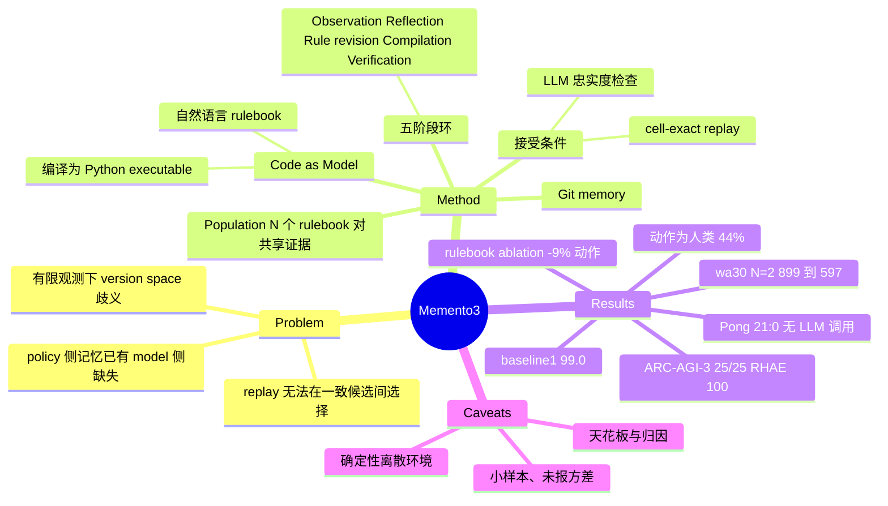

## Summary
Memento 3 让冻结的 LLM agent 把对环境规则的假设写成可修订的自然语言 rulebook（Markdown），再编译为可执行的 Python world model 用于预测与规划（"Code as Model"），并用 LLM 忠实度检查加 cell-exact replay 验证后才接受更新。在 ARC-AGI-3 的 25 个公开游戏上单模型 agent 全部通关、mean RHAE 100.0、总动作数为人类的 44%；但同一 harness 来源的 baseline1 已是 99.0，增益主要是最后 1 分与动作效率，rulebook 的净贡献只有 3 个游戏上的小幅 ablation 支撑。

## Problem & Motivation
有限观测下，多个 world model 可以复现全部已观测 transition 却在未见状态上给出不同预测（version space 问题）。仅靠 replay 能排除不一致的程序，但无法在一致的候选之间选出正确规则（论文例子：“box 撞墙停下” vs “box 停在第 7 列”）。已有 code world model 工作（WorldCoder、GIF-MCTS、baseline1 等）多把程序本身当作学习状态，缺少一个显式记录“相信什么、哪些未定”的语义层。作者认为 Memento 系列（episodic memory → 反思式学习 → executable skills）主要改进 policy 侧，Memento 3 补上 model 侧。

## Method
- **学习状态** Z_t = (H_t, ψ_t, θ_t)：交互记录 H_t 是证据，rulebook ψ_t 是可泛化假设（实体、动作语义、动力学、目标、未决备选），可执行体 θ_t 含初始化器 ι、转移预测器 f、观测渲染 ρ、目标集。LLM 参数全程冻结（Eq. 5）。
- **五阶段更新环**：Observation → Reflection（选 retain / revise rulebook / 仅修代码）→ Rule revision → Compilation → Verification。规则级变更先写入 rulebook 再改代码；纯实现错误只改代码、保留 rulebook。
- **接受条件**：LLM 判定代码忠实于 rulebook，且 cell-exact replay 复现所有已记录轨迹（ARC-AGI-3 上要求 64×64 每个 cell 都匹配）。
- **规划**：在已验证的 θ 上搜索到推断目标的动作序列，逐步执行，首次预测失配即停并把反例纳入下一轮修订。模型构造、replay、本地执行不计入动作数。
- **Git memory**：rulebook 与编译产物放在单一 Git 工作区，每轮 commit 并打 tag，agent 可自行 diff/回滚历史版本。
- **Population 扩展**（N 个 rulebook–executable 对共享同一交互记录 H_t）：按计划动作序列做行为等价类，每个 planning episode 均匀采样一类；所有成员都用新观测检验，被证伪者各自走反思更新。动机是单个模型可能“自我确认”（其计划从不暴露其错误，Eq. 28-29）。作者明确说明这不是校准的 Bayesian posterior。
- 形式化：Bayes-adaptive POMDP 加 belief 更新（Eq. 3, 13-14），Code as Model 作为其近似；MDL 偏好简洁的 rulebook/实现。这部分是动机性形式化，没有对近似误差的理论保证。
- 实现：harness 以 baseline1 代码库为起点，在 Claude Code 中以 Claude Opus 5、extra-high reasoning effort 运行。

## Key Results
- **ARC-AGI-3（Table 1/2）**：25 个公开游戏全部通关，每个游戏 RHAE 100，mean 100.0；总动作 7,518 vs 人类 17,135（0.44；逐游戏比值 0.20 到 0.67，中位 0.42）。对比：baseline1 99.0（同样全通关，8,347 动作，0.49）；NOOA 85.1（通关 19/25）；OPINE-World 78.4（20/25）；DreamTeam 38.1（6/25）；Continual Harness 20.5（3/25）。baseline1 逐游戏仅在 sc25（84.2）与 tn36（90.1）未到 100。论文称相对 Claude Opus 5 + ARC Prize Standard harness 高 59.3 分。
- **Rulebook ablation（Table 3，各难度带取 1 个游戏）**：ft09/ka59/cn04 三个游戏总动作 617 vs 677（-9%），agent turns 678 vs 830（-18%）。两个变体都在三个游戏上通关到 RHAE 100。
- **Population（Table 4，wa30，N=2 vs N=1）**：总动作 N=1 为 899、N=2 为 597（0.66×）；9 个层级中 8 个持平或更优，L8 为 1.06× 更差。
- **Atari Pong**：学到的控制器在三种开局下均 21:0（分别用 3,358 / 4,014 / 5,039 个动作），评估时不调用 LLM；学习成本 9.5×10^3 emulator frames，对比 EfficientZero 20.1 分/4.0×10^5 frames，Rainbow/IMPALA/GDI/LASER 约 20.9-21 分/2.0×10^8 frames；同 LLM 无 world model 得 -19，随机 -20.7。

## Evidence Ledger
| Claim ID | Claim | Type | Source locator | Evidence excerpt | Status |
|:--|:--|:--|:--|:--|:--|
| C1 | 单模型 agent 在 ARC-AGI-3 全部 25 个公开游戏的所有关卡通关 | number | Abstract; §4 Main result | the single-model agent clears every level of all 25 public games | source-verified |
| C2 | mean RHAE 为 100.0 | number | Table 1; §4 Main result | Code-as-Model reaches the 100 ceiling on all 25 games, yielding a mean RHAE of 100.0 | source-verified |
| C3 | 总动作 7,518，为人类 17,135 的 0.44 | number | Table 2; §4 Main result | clears all 25 games in 7,518 actions, 0.44 of the human baseline (17,135) | source-verified |
| C4 | 逐游戏动作比值范围 0.20（m0r0）到 0.67（lf52），中位 0.42 | number | §4 Main result; Table 2 | Per-game ratios range from 0.20 on m0r0 to 0.67 on lf52 (median 0.42) | source-verified |
| C5 | baseline1 mean RHAE 为 99.0 且同样通关全部游戏 | comparison | §4 Main result; Table 1 | the closest is baseline1 at 99.0, which also clears every game | source-verified |
| C6 | baseline1 总动作 8,347（人类预算的 0.49），是唯一另一个完成全部游戏的系统 | comparison | §4 Main result; Table 2 | baseline1 is the only other system to finish every game, using 8,347 actions (0.49 of the human budget) | source-verified |
| C7 | NOOA 85.1（19/25）、OPINE-World 78.4（20/25）、DreamTeam 38.1（6）、Continual Harness 20.5（3） | comparison | §4 Main result | NOOA reaches 85.1 having cleared 19 of the 25 games, OPINE-World 78.4 with 20, DreamTeam 38.1 with 6 | source-verified |
| C8 | 相对 Claude Opus 5 + ARC Prize Standard harness 高 59.3 分 mean RHAE | comparison | §1 Introduction | our agent achieves a 59.3-point higher mean RHAE | source-verified |
| C9 | 所有 baseline 数字均取自官方 ARC Prize scorecard，harness 以 baseline1 代码库为起点、Claude Opus 5 extra-high 推理 | benchmark-setting | §4 Benchmark and setup | build our experimental harness using the baseline1 codebase as a starting point and run it in Claude Code with Claude Opus 5 | source-verified |
| C10 | 去掉 rulebook 后，三个游戏合计动作 617→677（-9%），agent turns 678→830（-18%） | number | Table 3; §4 Ablations | it uses 617 rather than 677 actions, a reduction of 9%, and 678 rather than 830 agent turns, a reduction of 18% | source-verified |
| C11 | rulebook ablation 仅覆盖 ft09/ka59/cn04 三个游戏；Table 3 每格单一数值、未报方差或重复次数（原文未声明运行次数） | benchmark-setting | §4 Ablations; Table 3 | We therefore select one game from each of three difficulty bands ... each experimental run ... incurs substantial ... cost | source-verified |
| C12 | ablation 中 rulebook 变体与无 rulebook 变体都在三个游戏上通关到 RHAE 100 | comparison | §4 Ablations | Every run clears every level and reaches RHAE 100, so Table 3 compares the cost of convergence. | source-verified |
| C13 | wa30 上 N=2 population 将总动作从 899 降到 597 | number | Table 4; §4 Population | the population reduces the total from 899 to 597 scored actions | source-verified |
| C14 | N=2 在 9 个层级中 8 个持平或更优（L8 为 1.06×，劣于 N=1） | number | Table 4; §4 Population | matches or improves per-level action efficiency on eight of the nine levels | source-verified |
| C15 | population 实验仅在 wa30 一个游戏、N=2 上进行，主实验均用 N=1 | benchmark-setting | §4 Population | The main experiments use the single-pair setting (N=1). | source-verified |
| C16 | Pong 控制器在三种不同开局下均 21:0，评估时无 LLM 调用 | number | Abstract; §5 Result | wins 21:0 in all three, achieving the maximum episode score of 21 | source-verified |
| C17 | Pong 学习成本 9.5×10^3 emulator frames，约为 model-free baseline 的 1/(2.1×10^4)、model-based 的 1/42 | comparison | Table 5; §5 Result | approximately 2.1×10^4 and 42 times this cost, respectively | source-verified |
| C18 | 同一 LLM 无 world model 在 Pong 得 -19，随机策略 -20.7 | number | Table 5; Figure 8 | The same LLM without a world model finishes with a score of -19 | source-verified |
| C19 | Pong 的 baseline 分数采用各自原论文的评估协议，与本文三个 episode 的均值不严格同口径 | benchmark-setting | Table 5 caption | while the published baselines follow their respective evaluation protocols | source-verified |
| C20 | 接受更新需 LLM 判定代码忠实于 rulebook 且 cell-exact replay 复现已观测 transition | causal-mechanism | Abstract; §3.2 | Updated code is accepted only when the LLM judges it faithful to the rulebook | source-verified |
| C21 | 论文自陈 ARC-AGI-3 公开集完成度本身无法隔离 world-model 架构的贡献，需考虑模型/推理预算、重复运行稳定性与 held-out 评估 | sota-novelty | §6 Continual agent adaptation | Public-set completion alone therefore cannot isolate the contribution of a world-model architecture. | source-verified |
| C22 | 论文称 language rules、executable artefacts、reflection、replay 均为已有组件，新意在围绕持久环境规格的组织 | sota-novelty | §6 Language rules and reflective memory | Language rules, executable artefacts, reflection, and replay are established components | source-verified |
| C23 | 代码/发布：正文未给出代码仓库链接 | license-code | 全文（unknown，未找到 code 链接） | （正文中无仓库 URL；仅有 GitHub issue 报告控件） | source-verified |

## Strengths & Weaknesses
**亮点**
- Reflection 显式区分“规则错”与“实现错”（revise rulebook vs 只修代码），这个分流让语义假设与代码实现分开维护，比单纯 code world model 多了一层可审计的假设状态；Fig. 5 的 tr87 案例（11 个 rulebook 版本，早期规则后来被推翻）是机制确实在工作的具体证据。
- 对 self-confirming 的形式化观察（Eq. 28-29：模型在自己选的动作上预测正确就永远不被证伪）是 population 的合理动机，且 wa30 上 L5、L9 动作减半有信号。
- 评估口径较透明：动作计数含 reset 与失败尝试，baseline 取官方 scorecard，未完成游戏的动作数用 † 标注不可比。
- Pong 案例说明学到的可执行模型可转为不调 LLM 的反馈控制器，学习成本远低于 model-free RL。

**缺陷与适用边界**
- **天花板效应，难以归因**：baseline1 已 99.0 且全通关，Memento 3 的 harness 又以 baseline1 代码库为起点，因此与它的差距仅 1.0 分与 8,347→7,518 动作（-10%）；作者在 §6 自己承认公开集通关无法隔离 world-model 架构的贡献。Continual Harness/DreamTeam 等低分 baseline 很可能是弱 backbone 所致，不是方法差异。
- **rulebook 的因果证据薄**：ablation 仅 3 个游戏，Table 3 每格只有一个数、未报方差或重复次数（原文没有声明跑了几次），节省 9% 动作；在 LLM 运行高方差的设定下，这个差距落在噪声范围内的可能性无法排除。“rulebook 改善收敛”只是文中的 suggest。
- **population 证据更弱**：单游戏 wa30、N=2、仅一组对比，N=2 在 L8 反而更差；动作减少也可能来自更多算力（两倍的模型构造、LLM 调用不计入动作）。未报告 token/调用成本。
- **成本不透明**：模型构造、replay、本地执行不计入 RHAE 动作数；Opus 5 extra-high 加 Claude Code 的 LLM 调用量与 wall-clock 未报告，“效率”只指环境动作。
- **适用假设强**：环境须是确定性、离散、可 cell-exact replay 的 POMDP；在随机/连续/部分可观测物理场景，cell-exact 验证条件不成立。Pong 中也承认 full-frame replay 仍有残余渲染与挡板运动误差，改用 replay 诊断 + 控制器评估，验证标准因此被放松。
- **泛化未检验**：只用公开集，未做 held-out 游戏；Bayesian/RSI 的框架叙述较重，而实际 RSI 含义只是“LLM 冻结、外部工件被修订”，与更强意义的 RSI 差距大；形式化未对 LLM 近似 belief 给出保证。
- Pong 对比并非同协议（见 C19），且 RL baseline 的学习成本为已发表数字。

**对领域的意义（推测）**：把 world model 放进可 diff/可回滚的外部记忆，并区分“规则更新”与“实现更新”，对 self-evolving agent 与 agent memory 方向是一个可迁移的设计原则；但本文不足以证明 rulebook 比纯 code world model 有稳定增益。

## Mind Map

## Notes
- **Memento 系列关系**：本文是 Memento 系列（Memento [48] → Memento 2 [42] → Memento-Skills [49]）的 model-based 续作，作者为 UCL/Huawei Noah's Ark（Jun Wang、Haitham Bou-Ammar 等）。vault 中的 [[2605-MementoGUI]]（Zeng, Hua, Luo 等，GUI 长时多模态记忆控制）名字相近但是不同团队、不同工作，并非该系列；不要混淆。[[2601-MemRL]] 引用的是系列第一篇 Memento 的 M-MDP 框架（arXiv 2508.16153），属于同一线索的 policy 侧记忆。
- [[2606-WALLWM]]：同样关注规则/世界模型如何与 agent 对齐；本文 related work 中 WALL-E 通过比较预测与观测轨迹来更新符号规则，与 rulebook 的“预测误差驱动规则修订”思路相近，可对照。
- [[2604-AgenticWorldModel]]：世界模型综述，可用来定位 Code as Model（程序化 world model + 语言规则层）在分类中的位置。
- [[2608-SkillZip]]：同属“冻结 LLM、外部工件演化”的 self-evolving 路线，其 Fig. 4 覆盖了 Memento-Skills；关心外部记忆/技能膨胀时可组合阅读。
- 本周另有 EvoBelief（2610.12789，另行消化）同样讲可证伪 world model，二者对照时关键问题是：谁的验证标准更强（cell-exact replay vs 其他），以及自我确认问题如何处理。
- 值得追问：去掉 rulebook 的 gain 在多次重复运行下是否稳定？换更弱 backbone 时 rulebook 是否更重要（rulebook 可能是对弱模型更有价值的 scaffold）？GUI/Web 环境是非确定且部分可观测的，cell-exact replay 的验证思想如何降级迁移？本文未评估 GUI/Web，故未加 gui-agent tag。
