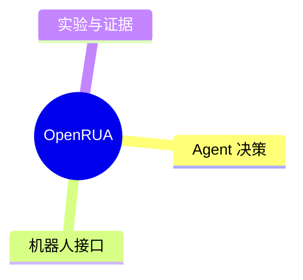

## Summary

OpenRUA 将真实机器人开发常见的 ROS 2 接口模式用于仿真，让通用 coding agent 在任务中自行构造观测和动作程序。 [原文](https://arxiv.org/html/2610.02459v1)

## Problem & Motivation

如果机器人已具备成熟的软件接口，通用 Agent 是否仍需要为任务手工设计完整运行工作流？

## Method

Agent 通过终端、文件工作区、ROS 2 文档与 starter tools 接触机器人。每次从全新工作区开始，在任务期间写代码读观测、做量测并发出控制。仿真真值和任务验收谓词不提供给 Agent。

## Key Results

Claude Code + Opus 5 在 CaP-Bench 仿真为 693/700，LIBERO-PRO 八条件为 696/800。RoboCasa365 的难复合任务分数低于较窄的 CaP-Bench，协议各自独立。

## Evidence Ledger

| Claim ID | Claim | Type | Source locator | Evidence excerpt | Status |
|:--|:--|:--|:--|:--|:--|
| C1 | Agent 使用文档、原生 ROS 2、starter tools 和空白工作区实时构造控制程序 | causal-mechanism | §3, Figure 2, Appendix B | Workspace as Harness | source-verified |
| C2 | CaP-Bench 693/700、LIBERO-PRO 八条件 696/800 | number | §4.2 Table 1, Appendix C.1 | Table 1 | source-verified |
| C3 | 所有定量结果来自仿真，推理可暂停物理时间 | benchmark-setting | §§4.1, 5 | Limitations | source-verified |

## Strengths & Weaknesses

真机实时性尚需额外测试。其他工作的引用对照存在模型、预算及先前经验差异，终端接口的净效应需要在相同模型和任务上评估。

## Mind Map

## Notes

- [[Topics/RobotUseAgents-Survey]]
