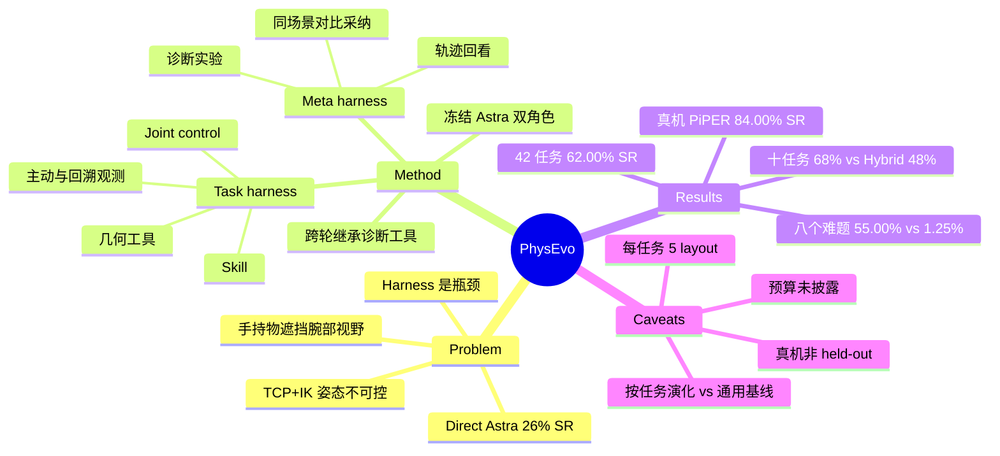

## Summary

PhysEvo 把「harness 自演化」搬到真机操作：冻结同一个 Astra 模型分饰 task agent（执行）与 meta-agent（读轨迹、诊断、改 tool/skill/诊断工具、测试后保留），不更新权重、不训练 action policy。在 42 个 RoboDojo 仿真任务上，按任务保留的 deployment version 在 held-out layout 上五维加权平均 68.14 分 / 62.00% SR（RoboDawn one-shot Astra 为 47.17% SR），在 8 个 direct Astra 难题上 55.00% vs 1.25%；真机 AgileX PiPER 上继续改 skill 后 5 任务 25 次试验 90.60 分 / 84.00% SR。关键保留的是证据而非结论：增益来自"按任务演化 + 允许改控制接口"，与 baseline 的计算量/任务专属程度并不对齐。

## Problem & Motivation

直接让 Astra 控制机器人并不可靠：作者引用 GPT-as-Policy 的十任务评测，direct Astra 在 object classification 上 100% 成功但整体仅 26% SR，搭配 π0.5 的 hybrid 为 48%。作者的诊断是瓶颈在 harness（模型与机器人之间的 tool、skill、执行逻辑），而不在模型能力本身：倒水时手持瓶子遮挡腕部相机；TCP + 局部 IK 接口会把机械臂折成妨碍操作的姿态，而 Astra 没有显式选择关节构型的权限。动机论证是"事后诊断能看到行动时看不到的证据"——轨迹把命令与后果对齐，同一模型可以据此提出具体干预并通过再执行来检验。这一论证是推测性的（见下文 weaknesses），文中只用少数个案支撑。

## Method

**两套可编辑 harness，一个冻结模型**。H_r = (H_task, H_meta)。task harness 提供观测、动作 tool、执行反馈与 skill（task-agnostic skill 如 grasp verification / recovery，跨任务共享；task-specific skill 如 pouring / packing，仅任务内部）；meta harness 提供代码查看与编辑、轨迹回看、诊断实验、修订测试。两个角色模型相同、上下文与 tool 权限分离。模型权重、机器人动力学、任务 evaluator 不可编辑。

**初始状态**：TCP 目标 + 局部 IK 的观测-动作循环，加通用代码编辑工作区。其余（joint control、观测工具、skill、诊断工具）都由演化产生。

**修订循环**（Appendix A）：执行 → meta-agent 拿到任务结果、图像、机器人状态、动作反馈和当前代码 → 形成失败假设并做诊断实验 → 提出对 tool / skill / 执行逻辑 / meta 资源的候选修订 → 先检查代码可运行，再对行为类修改在同一任务、同一初始场景上与当前 harness 对比 → 分数上升，或越过失败点且分数不降则采纳，分数下降则拒绝；诊断工具按其要修的误差/测量来检验 → 采纳的 tool 与对应 skill 一起在下一 episode 加载。修订只在 episode 之间生效。每个任务在交互预算内演化后固定一个 deployment version，在 5 个 held-out layout 上评分（每 layout 1 次尝试）。

**演化出的框架**：
- Joint-level control：`control_arms` 接收 12 个绝对关节目标 + 2 个连续夹爪指令，姿态成为策略决策的一部分。
- Active / retrospective observation：用空闲臂把腕部相机移到侧面取景；`review_frames` 回取本 episode 早先的图像与对齐的机器人状态而不推进物理；像素投影、多视角三角化、temporal triangulation 由确定性工具计算几何（模型选特征，工具算几何，不使用隐藏物体坐标）。
- Skill + 诊断工具：skill 把 tool 与适用物理条件绑定；meta harness 保留把图像、机器人状态、策略决策对齐的轨迹回看工具，供后续轮次复用，这是"recursive"的唯一落点。

## Key Results

- **42 任务 RoboDojo（Table 1）**：五维等权平均 68.14 分 / 62.00% SR；RoboDawn (1-shot, GPT-6 Astra) 54.63 / 47.17%，高 14.83 个点；42 任务等权则为 65.00 分 / 58.57% SR。分维度 SR：Generalization 45.00（RoboDawn 50.00，更低）、Precision 40.00（25.00）、Long-horizon 45.00（45.00，持平）、Memory 100.00（53.33）、Open 80.00（62.50）。即收益集中在 Memory（+46.67）、Open（+17.50）、Precision（+15.00）；Generalization 反而落后。
- **十任务 GPT-as-Policy 集（Table 2）**：PhysEvo 79.80 分 / 68.00% SR，Direct 38.50 / 26.00%，Hybrid 62.60 / 48.00%；8 个任务 SR 高于 Direct，2 个打平。逐任务看：Build tower 20%（Hybrid 60%，G0.5 78.67%）、Fold clothes 60%（Hybrid 100%）、Organize table 0%。
- **八个 direct Astra 难题（Table 3）**：PhysEvo 55.00% SR / 62.88 分，official Astra 1.25% / 5.96（+53.75 点）；Simate-beta 50.83%，Liber-0 Preview 46.44%，RoboDawn 45.00%。倒小球入花瓶 0%→80%（相对 RoboDawn），倒液体 80%→100%。Laptop/headphones 与 Fill pen holder 仍为 0% SR。
- **控制接口对比（C.1）**：语言分类任务，2 个 layout、6 个 episode，TCP 40 / Joint 100 / Both 55 分。
- **真机 AgileX PiPER（Table 4）**：每任务 5 次，Stack blocks / Stack bowls / Place pens 均 100% SR，Pour water 60% SR，Write PhysEvo 93.00 分 / 60% SR；总体 90.60 分 / 84.00% SR。真机在部署后继续做 skill 修订。
- **几何工具组件测试（C.2）**：synthetic marker 重建接受 12 点中的 8 点，中位误差 0.615 mm，P95 1.437 mm，4 点被有效性检查拒绝。

## Evidence Ledger

| Claim ID | Claim | Type | Source locator | Evidence excerpt | Status |
|:--|:--|:--|:--|:--|:--|
| C1 | 按任务保留的 PhysEvo 版本在 42 个 RoboDojo 任务上，五维等权平均为 68.14 分、62.00% SR | number | Abstract; Sec 5.2; Table 1 | PhysEvo achieves 68.14/100 score and 62.00% SR, exceeding RoboDawn one-shot's 47.17% SR by 14.83 points | source-verified |
| C2 | RoboDawn one-shot Astra 的五维平均为 54.63 分 / 47.17% SR，是对比中最强的已发表参照 | comparison | Sec 5.2; Table 1; App B.2 | RoboDawn's five-dimension Score and SR are computed from its public evaluation records: GPT-6 Astra, 1-shot, with five runs per task | source-verified |
| C3 | 42 任务等权平均为 65.00 分 / 58.57% SR | number | Sec 5.2 | Equal weighting of all 42 tasks instead gives 65.00 score and 58.57% SR. | source-verified |
| C4 | 相对 RoboDawn，PhysEvo 的 SR 在 memory +46.67、open-ended +17.50、precision +15.00 个百分点 | comparison | Sec 5.2; Table 1 | PhysEvo improves SR by 46.67 percentage points in memory, 17.50 in open-ended tasks, and 15.00 in precision. | source-verified |
| C5 | PhysEvo 在 Generalization 维度 SR 为 45.00%，低于 RoboDawn 的 50.00% | comparison | Table 1 | PhysEvo (ours) 51.08 45.00 ... RoboDawn (1-shot) 55.08 50.00 | source-verified |
| C6 | PhysEvo 在 Memory 维度达到 100.00 分 / 100.00% SR | number | Table 1 | PhysEvo (ours) ... 100.00 100.00 | source-verified |
| C7 | 十任务 GPT-as-Policy 集上 PhysEvo 68.00% SR，Direct Astra 26.00%，Hybrid（Astra+π0.5）48.00% | comparison | Sec 5.3; Table 2 | PhysEvo reaches 68.00% SR, versus 26.00% for direct Astra and 48.00% for the hybrid | source-verified |
| C8 | 十任务集上 PhysEvo 相对 Direct 在 8 个任务 SR 提升、2 个打平 | comparison | Sec 5.3 | PhysEvo improves SR over Direct on eight tasks and ties on two. | source-verified |
| C9 | Build tower 上 PhysEvo 20% SR，低于 Hybrid 的 60% 与 G0.5 的 78.67% | comparison | Table 2 | Build tower ... 78.67 ... 60.00 ... 0.00 ... 20.00 | source-verified |
| C10 | 八个 direct Astra 难题上 PhysEvo 55.00% SR 对 official Astra 1.25%，差 53.75 点 | number | Sec 5.4; Table 3 | PhysEvo achieves 55.00% SR and 62.88 score, compared with official Astra's 1.25% and 5.96: a 53.75-point SR gain | source-verified |
| C11 | 八任务子集由 RoboDojo 报告外部定义，标准为 VLA SR ≥20% 且 Astra SR 低 | benchmark-setting | Sec 5.4; App B.2 | This externally defined subset tests whether improvement reaches manipulation tasks that direct Astra rarely completes. | source-verified |
| C12 | 八任务子集上 Simate-beta 为 50.83%，Liber-0 Preview 46.44%，RoboDawn 45.00%，PhysEvo 高于它们 | comparison | Sec 5.4; Table 3 | Its mean SR also exceeds Simate-beta's 50.83%, Liber-0 Preview's 46.44%, and RoboDawn's 45.00%. | source-verified |
| C13 | 倒小球入花瓶 SR 相对 RoboDawn 从 0% 升到 80%，倒液体从 80% 升到 100% | number | Sec 5.4; Table 3 | PhysEvo improves SR over RoboDawn from 0% to 80% for pouring balls and from 80% to 100% for pouring liquid. | source-verified |
| C14 | 每个任务保留一个 deployment version，在 5 个 held-out layout（各 1 次尝试）上评分，这些 layout 不用于修订或版本选择 | benchmark-setting | Sec 5.1; App B.1 | Scored layouts are excluded from revision and version selection. | source-verified |
| C15 | 开发阶段的 tool 与 task-agnostic skill 跨任务共享，task-specific skill 保持任务内 | benchmark-setting | Sec 5.1 | at the task-agent level, only tools and task-agnostic skills are shared, while task-specific skills remain task-local. | source-verified |
| C16 | 控制接口对比 TCP 40 / Joint 100 / Both 55 分，仅 2 个 layout 共 6 个 episode | number | Sec 5.5; App C.1 | mean scores are 40 for TCP, 100 for Joint, and 55 for Both (six episodes | source-verified |
| C17 | 候选修订采纳规则：分数上升或越过失败点且分数不降则采纳，分数下降则拒绝 | causal-mechanism | Sec 3.3; App A step 6 | A score gain, or progress beyond the failure without a score decrease, supports adoption; a score decrease leads to rejection. | source-verified |
| C18 | meta-agent 复用早先轮次自建的 review tool 追溯箱子位移到接触，并据此修订 packing skill（"recursive"机制的证据） | causal-mechanism | Sec 5.5 Fig 5; App C.3 | a diagnostic resource created by one improvement round helps produce a correction in another | source-verified |
| C19 | 真机 AgileX PiPER 5 任务各 5 次试验，总体 90.60 分 / 84.00% SR；倒水与写字各 60% SR | number | Sec 5.6; Table 4 | Block stacking, bowl stacking, and pen placement each achieve 100% SR; pouring and writing each achieve 60% SR. | source-verified |
| C20 | 真机实验使用单独的适应协议，部署后继续执行-修订循环 | benchmark-setting | Sec 5.6; App B.1 | The hardware experiments use a separate adaptation protocol with skill revision after deployment | source-verified |
| C21 | 几何重建组件测试：12 点中接受 8 点，中位误差 0.615 mm，P95 1.437 mm | number | App C.2 | accepted 8 of 12 points, with a median error of 0.615 mm and a 95th-percentile error of 1.437 mm | source-verified |
| C22 | 增益不涉及模型权重更新或单独训练的 action policy | sota-novelty | Abstract | without model-weight updates or a separately trained action policy | source-verified |
| C23 | Direct 与 hybrid Astra 在十任务集的 26% / 48% 来自 GPT-as-Policy 报告 | number | Sec 1; Sec 5.3 | direct Astra reaches 100% success on object classification yet succeeds on only 26% of attempts overall | source-verified |

## Strengths & Weaknesses

**亮点**
- 把"问题在 harness 而非模型"落到可操作的具体改动：joint-level control（显式姿态权限）、空闲臂主动取景、历史帧回看、模型选点+确定性工具算几何。这些是机器人特有的接口设计，比 GUI/代码 agent 的 harness 演化更需要物理失败的具体因果。
- 评测边界写得相对清楚：held-out layout 不参与修订或版本选择，每个 scored episode 前重置 context 与 memory，并披露了对 Direct 平均分的重算（38.50 而非 37.81）。
- 负面可见：Generalization 低于 RoboDawn、Build tower / Fold clothes 落后于 hybrid、Laptop/headphones 与 Fill pen holder 仍为 0%，没有被藏起来。
- 与 GUI-HARVEST、RRSI 同构（冻结模型 + 诊断 + 改 harness + 门控采纳），物理版的差别在于诊断信号是对齐的图像/状态/命令，而不是截图序列。

**弱点与适用边界**
1. **比较不对等**：PhysEvo 的 deployment version 是按任务演化并选出的，task-specific skill 任务私有；RoboDawn 是 one-shot 含 1 个 demo、VLA 是 zero-shot 通用策略。62.00% vs 47.17% 比的是"每任务调好的系统"与"通用基线"，未给出演化阶段的交互预算、模型调用量或 token 成本，也没有给出"同预算下 RoboDawn 加迭代"的对照。
2. **统计强度弱**：每任务 5 个 layout × 1 次尝试，SR 粒度 20%；八任务子集上 55.00% vs Simate-beta 50.83% 只差约 4 个点，无置信区间或方差，不应读成优势。
3. **"recursive"主张证据薄**：meta 工具被后续轮次复用只有一个 packing 案例（Fig 5），没有 ablation 去掉 meta harness 的可编辑性或可继承性，无法区分增益来自"演化 task harness"还是"演化 meta harness"。
4. **关键设计的因果证据只有 6 个 episode**：Joint 100 vs TCP 40 vs Both 55，样本太小；"Both 低于 Joint"说明接口越多越差，但这是 2 个 layout 的观察。
5. **仿真到 held-out 仍在同一 simulator 与同一任务族**：held-out 是 layout 而非任务/实体/物理参数；Memory 100% 可能反映 skill 对具体任务规则的编码，而不是泛化。
6. **真机不是 held-out**：真机在部署后继续做 skill 修订，针对的正是评测任务；25 次试验属于"自适应后"成绩，不应与仿真 held-out 成绩同级比较。倒水（60%）与写字（60%）才是更难的任务。
7. **采纳规则依赖同场景分数对比**：对单场景分数的增减做门控，容易采纳过拟合该初始场景的修订；文中没有分析被拒绝/被回滚修订的比例或采纳后在新 layout 上退化的情形。
8. **可复现性**：未提供代码链接；依赖的 Astra / GPT-6 Astra 为闭源模型，RoboDawn 与 RoboDojo 的对比数字来自第三方公开记录（2026-09-26 记录），且 leaderboard 数据会变。
9. 作者写明 Astra 在同一模型下既做策略又做修订，但并未测试换成更弱或不同的 meta 模型，不知道能力来自哪一侧。

## Mind Map

## Notes

- 与 [[2610-GUIHARVEST]] 同构：冻结 backbone，从轨迹诊断后改写 harness 并经门控采纳。GUI-HARVEST 用 score hard gate + behavior soft gate，PhysEvo 只用同场景分数对比，缺少对行为预测的门控；而物理任务的诊断证据（图像-状态-命令对齐）更丰富。
- 与 [[2609-RRSI]] 互补：RRSI 指出无约束的 harness 演化在有限 evolve set 上会过拟合并用噪声地板、leakage critic 约束采纳。PhysEvo 的"分数不降即采纳"没有噪声地板，在 5 layout × 1 次的粒度下采纳判断可能被噪声主导，可直接借 RRSI 的做法。
- 与 [[2609-ShowHarness]] 在"接口决定可用性"上同向但取舍相反：Show-Harness 把动作收缩成离散语义单元由解释器确定性落地；PhysEvo 则把权限放宽到关节级并让模型自己选姿态。两者都认为瓶颈在接口，但对"该给模型多少自由度"给出相反的答案，值得做同任务对照。
- 待追问：保留 meta harness 可编辑性的真实增量是多少（去掉后只演化 task harness 的 ablation）；同预算下的 RoboDawn + 迭代修订基线；换成较弱 meta 模型是否仍有效。
