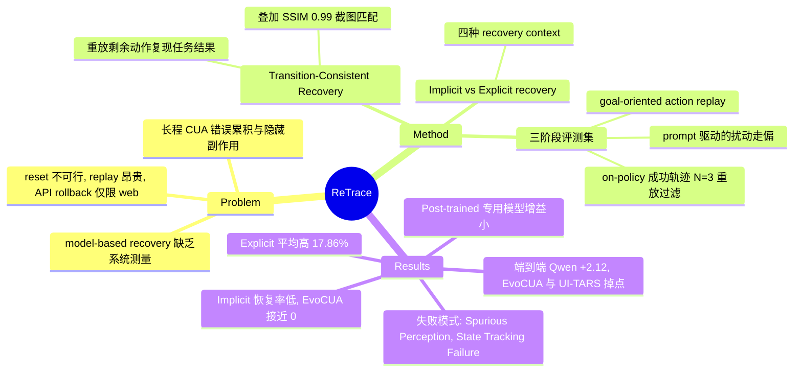

## Summary
ReTrace 是一个评测 computer-use agent "回到先前正确状态"能力的框架：把恢复成功定义为 Transition-Consistent Recovery（从恢复态重放原轨迹剩余动作仍能完成任务）并叠加 SSIM≥0.99 的截图匹配，在 OSWorld 与 WindowsAgentArena 上通过受控扰动构造 error state。结论是：现有 agent 基本不会自发恢复（implicit recovery 成功率多在个位数到二十几），显式 recovery prompt 平均提升 17.86%，但 post-trained 专用模型（EvoCUA-32B、UI-TARS-1.5-7B）提升很小。端到端接入 recovery 后，Qwen3.5-9B 平均 +2.12，EvoCUA-32B 和 UI-TARS-1.5-7B 则出现下降。

## Problem & Motivation
长程 GUI 任务里，早期错误会一路累积，有些已执行的动作还会留下不可见的副作用（例如静默覆盖文件）。现有补救手段各有前提：environment reset 在生产网站/真实 OS 上通常做不到；action replay（reset 后重放前缀）同样依赖 reset，长程下代价很高；API rollback（Playwright 的 go-back、URL 重定向）只覆盖 web，而 OSWorld 中 87.34%、WindowsAgentArena 中 78.72% 是 non-web 任务。另一条路线（reflection、verifier、RL）只改进 forward policy，不负责把环境恢复原状。作者的判断是：既有工作把 rollback 当作推理管线里的启发式组件来用，没人系统测过"模型自己把环境恢复到先前状态"这件事，所以提出三个 RQ：恢复能否释放潜在能力？现有 agent 有没有恢复能力，是潜在的还是根本没有？准确恢复能否转化为端到端增益？

## Method
**问题形式化**。CUA 任务建模为 POMDP，状态 $s_t=(h_t,o_t)$ 由隐藏分量和观测组成。恢复函数 $f(s_t)=s_{t-d}$，d 为 recovery distance。只做截图匹配不够，因为隐藏配置被改时截图可能完全一样。借用 predictive state representation 的思路，用"相同动作产生相同后果"来定义状态等价：$\mathcal{R}_{TC}$ 要求从恢复态执行原轨迹的后续动作能复现原轨迹。单步版本需要逐中间状态的 oracle，不可行，所以实际实现退化为 goal-oriented 版本：从恢复态重放 $\tau_{gt}$ 剩余全部动作，看 benchmark 的任务 evaluator $\Phi_q$ 是否判成功。最终 oracle 为 $\mathcal{R}=\mathcal{R}_{TC}\wedge\mathcal{R}_O$，其中 $\mathcal{R}_O$ 用 SSIM 阈值 0.99。

**评测集构造（三阶段）**：
1. **On-policy rollout + transition-consistent filtering**：每个被测模型在 benchmark 上自己 rollout，只保留成功轨迹；同一动作序列重放 N=3 次且三次都成功才保留，用这种近似方式保证转移确定性（总体保留 64.4%）。
2. **Trajectory drift via perturbation**：在采样的 seed step 处重放到 $s_{target}$（GPT-5-Mini 做状态核验），再由同 backbone 的 perturbation agent 被 prompt 故意走偏，扰动步数等于 d（short horizon d=1，GPT-5.4-CUA 因总以 screenshot 动作开头而用 2；long horizon d=5）。只保留走偏后 oracle 判失败的样本；用 SSIM 去掉 error 态与 target 态过于相似的样本，并去重。
3. **Goal-oriented action replay**：从 $s_{error}$ 起让 recovery policy 最多执行 r∈{1,3,10} 步，然后重放剩余动作判定。

**两类 recovery policy**：
- **Implicit**：forward policy 原样继续执行，不加任何恢复指令，测它会不会自发恢复。
- **Explicit**：在系统 prompt 和指令前加恢复前缀，并提供 target 观测 $o_{target}$ 和描述隐藏状态的 recovery context $\mathcal{C}$。context 有四种：0-E（到 error step 的历史）、0-R（到 target step 的历史）、w/o History、Recovery Target Contextualization（由 Claude-Sonnet-4.6 把通往 target 的转移历史摘要成紧凑描述）。

**被测模型**：Claude-Sonnet-4.6、GPT-5.4-CUA（闭源 generalist），Qwen3.5-9B-Thinking（未做任务特定 post-training 的开源 generalist），EvoCUA-32B、UI-TARS-1.5-7B（post-trained 专用 CUA）。

**端到端协议**：forward 与 recovery agent 共用同一 backbone。Qwen3.6-Plus 担任 error-step detector（每步查询一次，触发后冻结 5 步）和 recovery-step detector。recovery agent 每次最多 10 步，每个 episode 最多触发 {1,3,5} 次。恢复完成后，forward agent 的消息历史截断到恢复边界继续执行。

## Key Results
**Ideal recovery（§4，EvoCUA-32B，OSWorld，83 个 forward 失败样本）**：在 oracle 条件下（通过 reset+重放前缀精确复现过去状态）从 E-1、随机过去步或 LLM 选定步继续，Success@K 均高于 R=0（完全 reset），差距在小 K 时最大，K 增大后收窄。Figure 3 的具体数值未出现在文本中。

**现有 agent 不会自发恢复（§5.4.2，Table 8）**：OSWorld 上 implicit recovery 成功率（三个独立采样评测集的均值），按 Max 2/4/5/10 步：Claude-Sonnet-4.6 为 26.98/13.34/8.76/6.37，GPT-5.4-CUA 为 17.85/6.30/5.81/5.15，Qwen3.5-9B 为 12.04/7.29/6.12/5.29，EvoCUA-32B 为 0.86/2.00/0.86/1.44，UI-TARS-1.5-7B 为 7.26/7.81/12.31/7.82。多数模型的成功率随步数预算增加而下降。正文称 EvoCUA-32B 平均恢复率低于 1%。

**Explicit recovery 能把能力引出来**：跨 Linux/Windows，explicit 比 implicit 平均高 17.86%，增益主要来自 generalist（Claude、GPT-5.4、Qwen）。post-trained 模型增益小得多，作者据此推测，在单向任务完成轨迹上做大量 post-training 可能削弱恢复能力（Finding 4）。即使最强模型配上 explicit recovery，也做不到完全恢复。Figure 4/5/7 的逐模型数值不在文本中。

**超参数鲁棒性（Table 9/10）**：用 Recovery Target Contextualization 时，EvoCUA-32B 在 OSWorld 的 short horizon 成功率为 0.00–4.39，long horizon 为 4.76–20.63（temp 0.0、32768 tokens 时为 20.63）；UI-TARS-1.5-7B 的 short horizon 为 26.67–31.67。WindowsAgentArena 上 EvoCUA-32B 为 14–20。

**Oracle 可靠性（Table 1/11/12/13）**：人评只在 ReTrace 与各替代 evaluator 判定**不一致**的样本上进行，每个 variant 50 个，共 150 个，12 名标注者。ReTrace 的胜率：对 w/o $\mathcal{R}_O$ 为 82.0%，对 w/o $\mathcal{R}_{TC}$ 为 63.0%，对 GPT-5.4 evaluator 为 54.0%。标注者之间一致率 82%，Cohen's κ=0.45。86.0% 的 ReTrace 判定不受随机环境动态影响。在两个 oracle 互相矛盾的样本上，与人评的对齐率为：$\mathcal{R}_{TC}$ 单独 38.8%，$\mathcal{R}_O$ 单独 61.2%，二者联合 81.2%。SSIM 阈值从 0.99 降到 0.91 时，对齐率从 56.9% 降到 26.6%。

**端到端（Table 2/3，OSWorld）**：
- Qwen3.5-9B 在各 recovery context 下的 SR（三次运行）：baseline 39.38，Contextualizer 41.06（+1.68），0~R 44.26（+4.88），0~E 40.49（+1.11），w/o History 40.2（+0.82），平均 +2.12。
- Recovery Target Contextualization 设置下（两次运行）：Sonnet-4.6 从 70.27 到 71.81，Qwen3.5-9B 从 38.76±0.64 到 41.56±4.14，UI-TARS-1.5-7B 从 17.25 降到 15.74，EvoCUA-32B 从 54.88 降到 51.55。
- 恢复能力弱的模型接入 recovery 后反而掉点，作者的解释是：恢复不准会把轨迹带向更糟的状态（Finding 6）。

**定性 failure mode（Table 4/14）**：恢复不完美之后，forward agent 出现两类错误。一是 Spurious Perception：被恢复态中残留的 hover 等 UI 元素吸引，跳过了必要的前置动作。二是 State Tracking Failure：默认恢复态就等于 target 态，按并不存在的界面去操作。

## Evidence Ledger

| Claim ID | Claim | Type | Source locator | Evidence excerpt | Status |
|:--|:--|:--|:--|:--|:--|
| C1 | OSWorld 中 non-web 任务占 87.34%，WindowsAgentArena 中占 78.72% | number | Appendix A.1, Table 5 | "OSWorld 12.66 87.34 … WindowsAgentArena 21.28 78.72" | source-verified |
| C2 | Transition-consistent filtering 重放 N=3 次且全部成功才保留，保留率 64.4% | number | Appendix A.1 On-Policy Rollout, Table 6 | "successful oracle evaluation in three consecutive replays (N=3) … retaining 64.4% of recovery trajectories" | source-verified |
| C3 | 最终 oracle 为 R_TC 与 R_O 的合取，R_O 使用 SSIM 阈值 0.99 | benchmark-setting | §5.1; Appendix A.2 Recovery Verification | "we use SSIM (Wang et al., 2004) with a threshold of 0.99 to detect visual mismatches" | source-verified |
| C4 | 实际 R_TC 判定方式为从恢复态重放剩余全部动作，再看 benchmark 任务 evaluator 是否判成功，并非逐步状态比对 | benchmark-setting | §5.2 Goal-Oriented Action Replay | "replaying the remaining actions of τgt from the recovered state reproduces the original task outcome" | source-verified |
| C5 | Short horizon 的 recovery distance d=1，long horizon 为 d=5；recovery 步数预算 r∈{1,3,10} | benchmark-setting | §5.4.1 Inference Configurations | "with recovery distance d set to 1 and 5, respectively … r∈{1,3,10}" | source-verified |
| C6 | Ideal recovery 实验以 EvoCUA-32B 在 OSWorld 上进行，排除重放失败后共 83 个样本，指标为 Success@5 | number | Appendix B.1 | "We measure Success@5 on 83 samples after excluding instances where action replay fails." | source-verified |
| C7 | 所有非零 recovery step 策略的 Success@K 都高于完全 reset（R=0），低 K 时优势最大 | comparison | §4 Results, Figure 3 | "every non-zero recovery strategy outperforms complete environment resets ( R=0 ), with the largest advantage observed in the low- K regime" | source-verified |
| C8 | EvoCUA-32B 平均恢复率低于 1%（正文表述） | number | §5.4.2 Agents Fail to Recover | "EvoCUA-32B, exhibits a near-complete inability to restore previous states, with an average recovery rate below 1%" | source-verified |
| C9 | OSWorld 上 Claude-Sonnet-4.6 的 implicit recovery 成功率从 Max 2 步的 26.98% 降到 Max 10 步的 6.37% | number | Appendix C, Table 8 | "Claude-Sonnet-4.6 26.98 13.34 8.76 6.37" | source-verified |
| C10 | OSWorld 上 EvoCUA-32B 的 implicit recovery 成功率在各预算下为 0.86/2.00/0.86/1.44% | number | Appendix C, Table 8 | "EvoCUA-32B 0.86 2.00 0.86 1.44" | source-verified |
| C11 | 跨 Linux 与 Windows 环境，explicit recovery 比 implicit recovery 平均高 17.86% | comparison | §5.4.2 Analysis on Explicit Recovery, Figures 4/5 | "explicit model-based recovery substantially outperforms implicit recovery, by an average margin of 17.86% across the Linux and Windows environments" | source-verified |
| C12 | Post-trained 开源 agent 的 explicit recovery 增益明显更小，作者推测大量单向轨迹 post-training 可能削弱恢复能力 | causal-mechanism | §5.4.2 Finding 4 | "extensive post-training on one-directional task-completion trajectories may weaken their inherent recovery capability" | source-verified |
| C13 | Recovery Target Contextualization 下，EvoCUA-32B 在 OSWorld long horizon 的恢复成功率于 temp 0.0、32768 tokens 时达 20.63% | number | Appendix C, Table 9 | "0.0 32768 3.51 20.63" | source-verified |
| C14 | 人评中 ReTrace 的胜率为：对 w/o R_O 82.0%，对 w/o R_TC 63.0%，对 GPT-5.4 evaluator 54.0% | number | §5.4.2 Efficacy of ReTrace, Table 1 | "w/o R_O 82.0% w/o R_TC 63.0% GPT-5.4 Evaluator 54.0%" | source-verified |
| C15 | 人评样本只取 ReTrace 与替代 evaluator 判定不一致的案例，每个 variant 50 个，共 150 个 | benchmark-setting | Appendix B.3 | "We collect cases where the evaluation decisions produced by the oracle implemented in ReTrace differ from those of the alternative evaluators" | source-verified |
| C16 | 标注者之间平均一致率 82%，Cohen's kappa 为 0.45 | number | §5.4.2; Appendix B.3 | "we additionally observed an average agreement rate of 82% and a Cohen's kappa coefficient of 0.45" | source-verified |
| C17 | 人评指南把视觉相似性列为首要判断依据 | benchmark-setting | Appendix E, Evaluation Principles | "1. Prioritize Visual Similarity The primary signal is the visual similarity between the Final Recovery Screenshot and the Goal Screenshot." | source-verified |
| C18 | 在 R_O 与 R_TC 互相矛盾的样本上，与人评的对齐率为 R_TC 38.8%、R_O 61.2%、ReTrace 81.2% | number | Appendix C, Table 12 | "R_TC 38.8 (%) R_O 61.2 (%) ReTrace 81.2 (%)" | source-verified |
| C19 | 86.0% 的 ReTrace 判定不受随机环境动态影响 | number | Appendix C, Table 11 | "86.0% of the ReTrace judgments were favorable decisions unaffected by stochastic environmental dynamics" | source-verified |
| C20 | Qwen3.5-9B 端到端 SR：baseline 39.38，0~R 44.26（+4.88），各 recovery 设置平均增益 2.12% | number | §6.2, Table 2 | "improves Qwen3.5-9B over the no-recovery baseline under every recovery setting, with an average gain of 2.12%" | source-verified |
| C21 | Recovery Target Contextualization 下 EvoCUA-32B 端到端 SR 从 54.88 降到 51.55，UI-TARS-1.5-7B 从 17.25 降到 15.74 | comparison | §6.2, Table 3 | "EvoCUA-32B Baseline 54.88±4.39 w/ Recovery 51.55±2.54" | source-verified |
| C22 | Recovery Target Contextualization 下 Qwen3.5-9B 端到端 SR 从 38.76±0.64 升到 41.56±4.14，Sonnet-4.6 从 70.27 升到 71.81（两次运行） | number | §6.2, Table 3 | "Qwen3.5-9B Baseline 38.76±0.64 w/ Recovery 41.56±4.14" | source-verified |
| C23 | 端到端实验中 EvoCUA-32B 的温度从默认 0.0 改为 0.7，目的是避免恢复后重复相同动作 | benchmark-setting | Appendix B.2 Forward agents | "its default temperature of 0.0 produces deterministic outputs … so we set it to 0.7" | source-verified |
| C24 | SSIM 阈值从 0.99 降到 0.91 时，R_O 与人评的对齐率从 56.9% 降到 26.6% | number | Appendix C, Table 13 | "0.99 56.9 (%) 0.95 33.9 (%) 0.91 26.6 (%)" | source-verified |
| C25 | 代码与数据集已在 GitHub 公开 | license-code | Abstract | "Our code and dataset is available at https://github.com/BangProx/ReTRACE." | source-verified |

## Strengths & Weaknesses
**亮点**
- **问题拆分清楚**：把"恢复"从 forward policy 中独立出来，作为一项可单独测量的能力，并设 implicit/explicit 对照，区分"不会恢复"和"有能力但不去用"。Finding 2/3 的组合（自发恢复率极低，加 prompt 后大幅提升）对 GUI agent 的 harness 设计有直接意义：恢复要显式触发，不能指望 forward policy 自己想到。
- **TC 判定的思路正确**：用"后续动作能否复现原结果"来定义状态等价，抓住了截图看不到的隐藏状态。对 GUI 领域依赖截图相似度的 verifier 来说，这是更有原则的替代方案。
- **负结果诚实**：Table 3 直接报告了 EvoCUA-32B 和 UI-TARS-1.5-7B 接入 recovery 后掉点，Limitations 也承认框架只做测量、不负责提升能力。
- **failure mode 有用**：Spurious Perception 和 State Tracking Failure 两类错误说明，"恢复后继续执行"本身就是一个独立的难点，后续工作不能只看恢复成功率。

**局限与疑点**
- **人评与核心论点有张力**：论文的出发点是"截图不够，要看隐藏状态"，但人评指南把视觉相似性列为首要依据（C17），标注者能看到的也主要是截图和轨迹。在两个 oracle 互相矛盾的样本上，$\mathcal{R}_{TC}$ 单独与人评的对齐率只有 38.8%，低于 $\mathcal{R}_O$ 的 61.2%（C18）。人评偏向视觉判断，这一结果没能证明隐藏状态检查必要；如何解读它，正文没有讨论。
- **Oracle 验证样本有偏且强度有限**：胜率只在判定不一致的样本上计算（C15），而对 GPT-5.4 evaluator 的胜率 54.0% 与掷硬币相差不大；κ=0.45 也只是中等一致。"confirming the reliability" 的说法偏强。
- **TC 判定实际很粗**：goal-oriented replay 只看任务最终 evaluator 的结果（C4）。如果 evaluator 不检查恢复所涉及的状态，就会误判成功；如果后续动作对 UI 布局敏感（pyautogui 坐标点击），恢复态和 target 态"功能等价但像素不同"也会被判失败。这两类误差，论文只部分量化了后者（Table 11）。
- **Short horizon 场景偏简单**：d=1，扰动只有一步，而且扰动来自 prompt 故意走偏，并非 agent 自然出错。真实失败通常在多步之后才被发现，副作用也更隐蔽，结论能否外推到自然错误分布还是未知数。
- **Finding 4 的因果证据不足**：post-trained 组只有 EvoCUA-32B 和 UI-TARS-1.5-7B 两个模型，与 generalist 组的规模、模型家族、action space（Claude 用专有 action space）都不相同。论文没有做同一 base 模型在 post-training 前后的对比，"post-training 削弱恢复"只能算推测（作者用了 may）。
- **数字前后不完全一致**：正文说 EvoCUA-32B 平均恢复率低于 1%（C8），但 Table 8 的四个预算平均约 1.29%。Table 9 中 EvoCUA-32B 的 long horizon explicit 成功率在 temp 0.0 时达 20.63%（C13），可端到端实验把 EvoCUA 温度改成了 0.7（C23），EvoCUA 端到端掉点可能部分是超参选择造成的。Appendix B.2 写端到端只用三个开源 forward agent，Table 3 却包含 Sonnet-4.6。Qwen3.5-9B 的 baseline 在 Table 2 和 Table 3 中分别为 39.38 和 38.76（运行次数不同）。
- **端到端增益很小、方差很大**：Qwen3.5-9B 的 +2.80 对应的标准差是 4.14，而且只有两次运行（C22），Sonnet-4.6 的 +1.54 也在噪声范围内。"measurable end-to-end gains" 的统计支撑偏弱。
- **Ideal recovery 本身就依赖 action replay**：§4 的"理想恢复"是通过 reset 加重放前缀实现的，恰好是引言里批评为不可扩展的方案。它只能给出恢复收益的上界，不能说明 model-based recovery 实际可行。

**适用边界**：结论限于可 Docker 化、可确定性重放的 OSWorld/WAA 环境（排除了 proxy 和 Google Drive 任务），以及恢复目标为"已知的过去状态"的设定。不可逆操作（发邮件、删云端数据）不在讨论范围内。

## Mind Map

## Notes
- [[2504-WebRollback]]：同一问题的 web 侧方案，用 URL 重定向做显式 rollback；ReTrace 引言把它归为"API rollback 仅限 web"一类，本文测的是它无法覆盖的 desktop 场景下 agent 自己做恢复的能力。
- [[2600-BeapAgentBacktrackableExecution]]：OSWorld 上的 DFS 回溯框架，把 backtrack 用作推理启发式；ReTrace 正好可以作为它的恢复环节的独立测量协议，二者可组合。
- [[2601-EvoCUA]]：本文主要的 forward policy 之一。EvoCUA 在 forward 任务上很强（OSWorld 约 55%），恢复能力却接近 0，这是 Finding 4 的主要证据，提示单向轨迹的 SFT/RFT/DPO 训练可能没有覆盖"逆向"技能。
- [[2505-BacktrackAgent]]：mobile 端的 verifier 加 backtrack 框架，回退依赖环境能力而非模型本身；可对照看"环境恢复"与"model-based 恢复"两条路线的取舍。
