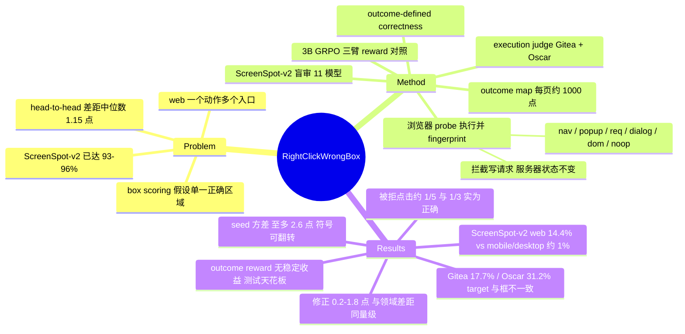

## Summary
GUI grounding benchmark 把"点在标注框内"当作正确的唯一判据，但网页常把同一个动作暴露在多个元素上（重复链接、checkbox 的 label、logo 旁的标题）。作者把正确性改成"执行这一下点击是否产生与点击标注目标相同的 outcome"，用一个在浏览器里逐点执行并给结果做 fingerprint 的 probe 生成 outcome map 和 execution judge：在 Gitea / Django Oscar 上，被 box scoring 判错的点击中约 1/5 与 1/3 其实达成了目标 outcome；ScreenSpot-v2 盲审 11 个模型，web 截图上这一比例为 14.4%，带来 0.2–1.8 点的单向修正，与该领域报告的 head-to-head 差距（中位数 1.15 点）同量级。把等价点击计入 GRPO reward 在 3B 模型、3 个 seed、4 个测试集上没有稳定收益，作者因此主张修正应放在评测端而非训练端。

## Problem & Motivation
头部 GUI grounder 在 ScreenSpot-v2 上已达 93–96%，作者编码的 29 篇近期 grounding 论文中，新模型与同尺寸最强前作的 head-to-head 差距中位数只有 1.15 点。在这个精度区间，真正的问题已经不再是"还有多少点击落在框外"，而是"剩下的错误到底是不是错误"（类比 ImageNet 剩余错误复审时近一半并非错误）。box scoring 隐含假设"每条指令只有一个正确区域"，而 web 界面恰恰相反：commit 列表里作者名都链到同一个 profile，form label 会 focus 其控件，商品卡片的图片和标题都打开同一页。反过来，标注框里也可能有点了没反应的 inert 区域。作者强调这不是标注错误，而是评分规则不完整；并且这种偏差是**单向 bias**，不是能靠多跑 seed 抹掉的 noise。

## Method
**定义（Sec. 3.1）**：状态 s、点 p 的点击 outcome 记为 o(s,p)。目标 outcome o_b 取框内点中出现最多的非空 outcome（框中心破平局）。点击 outcome-correct 当且仅当 o(s,p)=o_b；等价区域 E(s,b)={p: o(s,p)=o_b}。box scoring 用 b 代替 E：E\b 是被误拒的正确点击，b\E 是被误收的 inert 点击。

**Probe（Sec. 3.2）**：Chromium 1280×720；每点先 hover 120 ms 记录状态，点击后等请求结束（≥250 ms，额外至多 1.5 s，忽略长连接/streaming），再记录状态。outcome 取固定优先级的第一个匹配签名：main-frame navigation（method + 归一化 URL + 表单字段）> 新窗口 > non-GET request > dialog > 可见页面变化 > noop。navigation 和 non-GET 请求一律被拦截中止，服务器状态不变；text field 获得 focus 算 outcome，其他元素 focus 不算；时钟类自变节点从 idle snapshot 中识别后排除。

**Outcome map（Sec. 3.3）**：对每个可见交互元素在框内点 3×3 网格 + 各边外 3 px 一点，再叠加整屏 48 px 网格（每页 ≤1,500 点）。对每个 live target 判三类不一致：存在 distinct equivalent（另一个元素达成同一 outcome）、框内 ≥10% inert、框外紧邻仍可达成 outcome。每页随机 10% 点从新加载重 probe 测可重复性。环境：Gitea 1.25（94 页，类 WebArena GitLab）与 Django Oscar 4.2（60 页，类 WebArena shopping；中间件回滚每个事务）。

**Execution judge（Sec. 3.4）**：每个有可见文字的 live target 生成模板指令 `Click the <role> "<text>"`（每页 ≤40 条），执行模型预测点并比对 outcome；框中心作为参照点同样执行，用来界定 mapping 与 judging 之间的环境漂移。

**Screenshot audit（Sec. 3.5）**：ScreenSpot-v2 不能执行，改为人工按同一定义盲审 11 个模型的框外点击：合并近邻点击得 1,036 个 audit unit，抽 40-unit pilot + 360-unit main；标签为 E-same（点在目标控件的框外部分）/ E-dup（点在功能相同的另一控件）/ N / U；两名独立 reviewer 复审 60 个 unit。所有决策规则、阈值、抽样 seed 均在数据产生前带时间戳与 checksum 预登记，后续修改作为 amendment 记录（Supp. H）。

**训练对照（Sec. 5）**：Gitea 按页面 layout 切分，去掉 base 模型 8 个 sample 全中的无梯度条目后剩 1,589 条训练数据（313 条含等价元素）。Qwen2.5-VL-3B-Instruct + LoRA（rank 16），用 GTA1 的 GRPO 实现，8 samples/item、2 epochs（396 updates）。三臂只差 reward：Box、Outcome（目标框或任一等价元素框内即得分）、GUI-Libra（box reward + KL β=0.001 + success-adaptive 负优势缩放）。每臂 3 seed。

## Key Results
**Outcome map**：Gitea 4,970 个 live target 中 17.7% 与其 box 不一致，主体是 distinct equivalent（15.1%），其中重复链接最多（85 个高可重复页上 774 个不一致 target 中 566 个），label↔control 次之（86）；限制到可重复性 ≥95% 的页面仍为 17.4%，去掉最易误报的"无 label 的页面变化"类仍为 16.1%。Oscar 56 页 1,224 个 target 中 31.2% 不一致（distinct equivalent 27.5%）。

**Execution judging（Tab. 3）**：Gitea 3,586 条、Oscar 1,147 条。三个 7–8B grounder（UI-Venus-1.5-8B / GTA1-7B / Qwen3-VL-8B）在 Gitea 上被 box 拒绝的点击中 17.6–20.5% 达成目标 outcome，Oscar 上 29.7–38.1%；准确率普遍上升约 2 点（Gitea +2.0~+2.2，Oscar +1.7~+2.4）。框中心参照点在 Gitea / Oscar 上复现 mapped outcome 98.1% / 98.7%。收益集中在 193 条"指令文本匹配多个同 outcome 元素"的条目：box 准确率 28.5–35.2%，outcome 准确率 90.7–100%；3,092 条唯一匹配条目上 outcome 准确率反而略低于 box。Oscar 上 GTA1-7B 在 box 下落后 Qwen3-VL-8B 0.17 点、在 outcome 下领先 0.26 点。

**自然语言指令**：用 Qwen3-4B-Instruct-2507 把模板指令改写为用户任务（抽读 100 条中 10 条明显不合格），box 准确率降 10–16 点，但被拒点击中达成 outcome 的比例仍为 Gitea 14.3%、Oscar 34.8%；outcome scoring 带来的提升变为 Gitea +2.5~+3.2、Oscar +6.2~+8.4 点。

**Mind2Web**：发布的页面剥掉了 link target，只能通过 label 关系识别等价，4,838 个 click step 中仅 1.3% 可见静态等价（作者称为下界），box 与 outcome 差 ≤0.26 点。

**ScreenSpot-v2 盲审（Tab. 4）**：360 个 unit 总体 E share 6.4% [4.3, 9.5]；web 14.4%，mobile 1.0%，desktop 0.9%。U 全计为 N 或全计为 E 时总体在 6.1%–10.8% 之间。reviewer 间 κ=0.95，与作者标签 κ=0.89 / 0.84。含 7–8B grounder 点击的 unit 中 20.6% 为等价，仅含 3B 模型点击的 unit 中为 2.9%——越强的模型，剩余错误里"其实点对了"的比例越高。

**训练对照（Tab. 5）**：三臂在 held-out Gitea 上均比 base 提升 6–7 点、ScreenSpot-v2 提升 4–6 点、Mind2Web 约 3 点；Outcome − Box 均值差为 −0.18（Gitea）/ +0.06（Oscar）/ −0.08（ScreenSpot-v2）/ +0.23（Mind2Web）。在未见过的 Oscar 上所有训练臂反而比 base（91.0）低 0.8–1.4 点。原因分析：held-out 中 96 条有同 outcome 副本的条目，base 已达 92%，所有训练模型均达 100%，但选中被标注那个副本的只有 27–29%——此处天花板太低，无法检验 reward 价值。

**Bias vs noise（Sec. 6）**：同配方换 seed，ScreenSpot-v2 波动 box reward 最高 1.3 点、outcome reward 最高 2.6 点；seed 42 下 outcome reward 显著胜（McNemar p=0.03），seed 44 下 box reward 显著胜（p=0.02）。1,272 条测试集的配对 bootstrap 半宽 1.26–1.54 点。outcome 修正使 ScreenSpot-v2 准确率上升 0.2–1.8 点，GTA1-7B 获益最大，与 UI-Venus-1.5-8B 的差距从 2.9 缩至 1.7 点；3 对点估计内的排序翻转，但加入 audit 不确定性后三对区间均含 0。58 个 head-to-head 比较中提出方领先 38 个，其中 21 个领先幅度 ≤ 单 seed 效应（1.42 点）；29 篇论文无一报告 ScreenSpot-v2 的 run-to-run 方差。

## Evidence Ledger

| Claim ID | Claim | Type | Source locator | Evidence excerpt | Status |
|:--|:--|:--|:--|:--|:--|
| C1 | 29 篇近期 grounding 论文中，新模型与同尺寸最强前作在 ScreenSpot-v2 上的 head-to-head 绝对差距中位数为 1.15 点 | number | Sec. 1; Sec. 6 Reported margins | "across 29 recent grounding papers the median absolute gap between a new model and the strongest prior model of its size is 1.15 points" | source-verified |
| C2 | Gitea 4,970 个 live target 中 17.7% 与其标注框不一致 | number | Sec. 4.1; Supp. A Page statistics | "Of 4,970 live targets, 17.7% disagree with their box." | source-verified |
| C3 | Gitea 上 distinct equivalent 占 target 的 15.1%，是不一致的主要来源；重复链接为最大类（85 个 ≥95% 可重复页子集上 566/774） | number | Sec. 4.1; Tab. 2 | "Most disagreements come from distinct equivalents (15.1% of targets). Duplicated links form the largest group" | source-verified |
| C4 | Oscar 56 个达标页 1,224 个 live target 中 31.2% 与框不一致，distinct equivalent 占 27.5% | number | Sec. 4.1 | "31.2% of 1,224 live targets disagree with their box, mostly through distinct equivalents (27.5%)" | source-verified |
| C5 | 去掉"无 label 的页面变化"类等价后，Gitea 不一致率仍为 16.1%；只看可重复性 ≥95% 的页面为 17.4% | number | Sec. 4.1 | "Restricting the analysis to pages with at least 95% repeatability leaves the rate at 17.4%... still leaves 16.1%" | source-verified |
| C6 | Gitea 上三个 7–8B grounder 被 box 拒绝的点击中 17.6%–20.5% 达成目标 outcome | number | Tab. 3 | "UI-Venus-1.5-8B ... 130 (20.5%) ... Qwen3-VL-8B ... 128 (17.6%)" | source-verified |
| C7 | Oscar 上三个 grounder 被拒点击中 29.7%–38.1% 达成目标 outcome | number | Tab. 3 | "GTA1-7B 90.1 92.6 +2.4 [1.2, 3.6] 43 (38.1%) ... Qwen3-VL-8B ... 33 (29.7%)" | source-verified |
| C8 | 框中心参照点在 Gitea / Oscar 上分别复现 mapped outcome 98.1% / 98.7% | number | Tab. 1; Tab. 3; Sec. 3.4 | "Box centre reaches mapped outcome 98.1 / 98.7%" | source-verified |
| C9 | Gitea 上 193 条同 outcome 多副本条目，box 准确率 28.5–35.2%，outcome 准确率 90.7–100% | number | Sec. 4.2; Tab. S2 | "box accuracy stays at 28.5–35.2%. Outcome accuracy on these items is 90.7–100%." | source-verified |
| C10 | Oscar 上 GTA1-7B 在 box scoring 下落后 Qwen3-VL-8B 0.17 点，在 outcome scoring 下领先 0.26 点 | comparison | Sec. 4.2 | "GTA1-7B trails Qwen3-VL-8B by 0.17 points under box scoring and leads by 0.26 under outcome scoring" | source-verified |
| C11 | 自然语言指令下 box 准确率降 10–16 点，被拒点击中达成 outcome 的比例在 Gitea 为 14.3%、Oscar 为 34.8%（三模型合并） | number | Sec. 4.2 Natural instructions | "box accuracy drops by 10 to 16 points... stays high, at 14.3% on Gitea ... and 34.8% on Oscar" | source-verified |
| C12 | 自然语言指令下 outcome scoring 使准确率在 Gitea 提升 2.5–3.2 点、Oscar 提升 6.2–8.4 点 | number | Sec. 4.2; Tab. S3 | "Outcome scoring now raises accuracy by 2.5–3.2 points on Gitea and 6.2–8.4 points on Oscar." | source-verified |
| C13 | 100 条随机改写指令中 10 条明显不合格 | number | Sec. 4.2 Natural instructions | "In a reading of 100 random rewrites, 10 were clearly unfit" | source-verified |
| C14 | Mind2Web 4,838 个 click step 中仅 1.3% 有可见静态等价（作者称为下界，只测 label 通道），三模型 box 与 outcome 准确率差 ≤0.26 点 | number | Sec. 4.3 Mind2Web | "Such static equivalents are visible for 1.3% of the 4,838 click steps... differ by at most 0.26 points" | source-verified |
| C15 | ScreenSpot-v2 盲审 360 unit 总体 E share 6.4%，web 14.4%，mobile 1.0%，desktop 0.9% | number | Tab. 4 | "Web 145 8 12 119 6 14.4 [9.5, 21.2] ... All 360 9 13 321 17 6.4 [4.3, 9.5]" | source-verified |
| C16 | 两名独立 reviewer 之间 Cohen's κ=0.95，与作者标签 κ=0.89 / 0.84（60 unit） | number | Tab. 1; Tab. S4 | "Reviewer A vs reviewer B, κ 0.95 ... Ours vs reviewers, κ 0.89, 0.84" | source-verified |
| C17 | 含 7–8B grounder 点击的 audit unit 中 20.6% 为 outcome-correct，仅含 3B 模型点击的 unit 中为 2.9% | comparison | Sec. 4.4 | "20.6% [12.7, 31.6] of rejected clicks are outcome-correct... the share is 2.9% [1.5, 5.6]" | source-verified |
| C18 | Outcome reward 与 box reward 的三 seed 均值差在四个测试集上均在 0.25 点以内（−0.18 / +0.06 / −0.08 / +0.23） | comparison | Tab. 5; Sec. 5 Results | "outcome and box rewards lie within a quarter of a point of each other on every test set" | source-verified |
| C19 | 在未见过的 Oscar 上，所有训练臂比 base 模型低 0.8–1.4 点 | number | Sec. 5 Results; Tab. 5 | "On the unseen shop every arm ends 0.8 to 1.4 points below a strong base model" | source-verified |
| C20 | 96 条 held-out 多副本条目上 base 已达 92% outcome 正确，所有训练模型达 100%，但只有 27–29% 选中被标注副本 | number | Sec. 5 Why the extra credit adds little | "the base model already reaches the target outcome on 92%. Every trained model ... reaches 100%, while picking the annotated copy only 27–29%" | source-verified |
| C21 | 同一配方换 seed，ScreenSpot-v2 准确率波动 box reward 至多 1.3 点、outcome reward 至多 2.6 点；seed 42 与 seed 44 给出方向相反的显著结论（p=0.03 / p=0.02） | number | Sec. 6 Seeds; Fig. 5a | "changes ScreenSpot-v2 accuracy by up to 1.3 points for box rewards and up to 2.6 points for outcome rewards" | source-verified |
| C22 | ScreenSpot-v2 1,272 条测试集的配对 bootstrap 区间半宽为 1.26–1.54 点（三个 7–8B grounder） | number | Sec. 6 Test-set sampling | "The half-width of the interval on a difference is 1.26–1.54 points." | source-verified |
| C23 | Outcome 修正使 ScreenSpot-v2 准确率提升 0.2–1.8 点，GTA1-7B 与 UI-Venus-1.5-8B 的差距从 2.9 缩至 1.7 点 | number | Sec. 6 Scoring; Tab. S5 | "GTA1-7B gains the most, so its gap to UI-Venus-1.5-8B shrinks from 2.9 to 1.7 points" | source-verified |
| C24 | 点估计下有 3 对模型排序翻转，但加入 audit 不确定性后三对区间均包含 0 | causal-mechanism | Sec. 6 Scoring; Tab. S6 | "gives intervals that include zero for all three pairs (Tab. S6), so the corrected order of these pairs is not resolved" | source-verified |
| C25 | 58 个 head-to-head 比较中提出方领先 38 个，其中 21 个领先 ≤ 单 seed 效应；29 篇论文均未报告 ScreenSpot-v2 run-to-run 方差 | number | Sec. 6 Reported margins | "The proposed model leads in 38 of them, and in 21 of these the lead is no larger than a single-seed effect." | source-verified |

## Strengths & Weaknesses
**Strengths**
- **问题重设比方法更有价值**：没有提出新模型，而是指出 box scoring 的规则缺陷，并把"正确"改用行为后果定义。这和 WebArena/OSWorld 用终态判任务成功的原则一致，只是下沉到单次点击。定义简单，可迁移到任何能执行的界面。
- **bias 与 noise 的拆分很干净**：seed 方差、测试采样方差、评分偏差三者被放在同一刻度上比较，结论是前两者靠多 seed + 配对区间可控，第三者不随重复消失。"seed 42 显著胜、seed 44 显著负"这个反例对整个 grounding 领域的单 seed 报告习惯是直接打脸。
- **实验纪律罕见地好**：规则预登记 + checksum + amendment 日志；probe 改版需复现旧版 outcome（99.4% 一致）才被接受；pilot 设了"<5% 就停"的停止规则；audit 双人盲审；对自己 self-check 中的 2/30 误报如实报告。作者会主动报告对自己不利的结果，例如 unique 条目上 outcome 准确率略低于 box、Oscar 训练后反而下降。
- **负结果诚实且有解释**：GRPO 实验没有把"outcome reward 无效"说成普遍结论，而是指出 held-out 多副本条目 base 已 92%、训练后 100%，问题在于测试集天花板。

**Weaknesses / 隐含假设**
- **live 证据只有两个自建 web 应用，且主实验用模板指令**：`Click the <role> "<text>"` 天然让同文字副本与目标等价可选，抬高了 rescued 比例。自然语言改写缓解了这点，但改写是 Qwen3-4B 在看不到屏幕的情况下做的，抽读 10% 明显不合格；而且 Gitea unique 条目的 rescued 比例从 2.8% 升到 6.8%，可能部分来自改写引入的歧义，而不是真实等价。
- **"等价"由 fingerprint 决定，粒度有盲区**：只看第一个匹配签名，self-check 已暴露出三个不同 Delete 共用确认对话框被合并为同一 outcome 的情况；non-GET 请求被拦截，所以只看请求形态，看不到真实的服务器副作用。"导航到同一 URL"在大多数情况下等价，但如果 referrer、埋点或页面滚动位置对下游有影响，单步等价不保证多步等价。作者在 Scope 中承认等价只针对单一界面状态定义。
- **ScreenSpot-v2 per-model 修正的样本很薄**：最强的 UI-Venus-1.5-8B 只有 20 个 audit unit（3 个 E），GTA1-7B 33 个，而"0.2–1.8 点修正"和"差距从 2.9 缩到 1.7"正是由这些小样本外推出来的。修正公式 acc_box + err_box × E share 默认 audit 样本对该模型的全部错误有代表性，并且忽略了截图上看不到的"框内 inert"误收（作者有说明），所以修正值只能算单向下界式的估计。
- **"越强模型被误读越多"可能有选择效应**：强模型的框外错误本来就少，剩下的自然更可能是"点了另一个副本"。这更像强模型错误分布的特征，不一定说明 box scoring 对强模型系统性更不公平。另外 7–8B 只有 3 个，3B 的 8 个全部来自同一 base 的变体，跨模型泛化的证据有限。
- **训练结论的适用边界很窄**：3B + LoRA + 396 updates，且 outcome reward 用"等价元素的框"近似执行（与执行判决一致率 98.6%），在测试集已饱和的条件下得出"无稳定收益"。对多步任务、长训练、或等价元素更丰富的数据，这一结论不能外推；作者自己也写明 "remains unshown at this scale"。
- 未给出 code / probe 的公开 URL（正文仅写 "We release"），可用性有待确认。

**对领域的影响**：这对 GUI grounding 的榜单文化是一次低成本、高杠杆的修正。web benchmark 随条目附带等价元素列表，并同时报告 box 与 outcome 两个分数，同时要求多 seed + 配对区间，这两条建议都很容易落地。对 CUA-Survey 中"grounding 已接近饱和"的判断，这篇给了一个更细的说法：web 上的剩余错误中有相当一部分是评分假象，mobile/desktop 上则基本是真错误。

## Mind Map

## Notes
- [[2602-GUILibra]]：同一问题的训练端版本。GUI-Libra 认为 step-wise RLVR 存在 partial verifiability（多个合法动作只 verify 一个），本文在单步 grounding 上实测这种歧义的发生率，并把 GUI-Libra 作为训练对照臂，结论是在 3B 规模下把等价点击计入 reward 没有带来稳定收益。两篇的结论在"修正放在 reward 还是 eval"上存在张力。
- [[2512-MobiBench]]：思路相同（多合法动作标注 → 单路径评测低估成功率），但 MobiBench 在 mobile 多步任务上靠人工标注 branch，本文在 web 单步上靠执行自动获得等价集合，并发现 mobile 截图上的等价率只有约 1%。两者合起来看，"多合法动作"问题的严重程度强烈依赖平台和任务粒度。
- [[2410-OSAtlas]]：ScreenSpot-v2 的出处（重标 11.3% 样本修正错框与歧义指令）。本文不改标签而审计评分规则，与 ScreenSpot-v2 的修正思路可以互补。
- [[2608-UIVenus2]]：UI-Venus 系列是本文 execution judging 中最强的 grounder（UI-Venus-1.5-8B）；本文的修正显示它对 GTA1-7B 的 ScreenSpot-v2 领先从 2.9 缩至 1.7 点，引用其榜单数字时应注意这一偏差。
