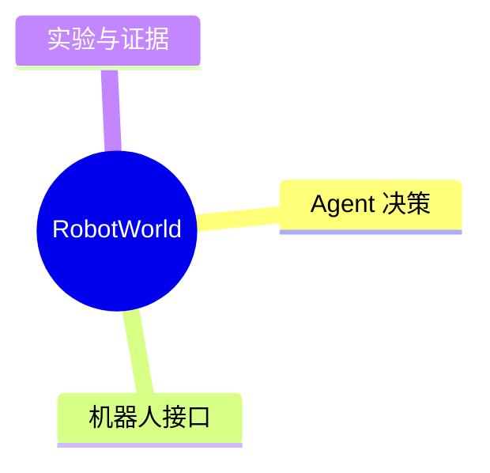

## Summary

RobotWorld 在统一多模态交互协议下测试通用 Agent 能否控制不同形态的仿真机器人。 [原文](https://arxiv.org/html/2610.10409v1)

## Problem & Motivation

单类桌面操控基准难以判断同一 Agent 的机器人使用能力能否覆盖移动、行走、驾驶或飞行。

## Method

任务向 Agent 提供目标和观测，Agent 主要通过机器人动作工具执行。主实验限制在环境端运行自定义控制程序，部分环境仍许可独立辅助计算。预算和可执行验收器统一记录。

## Key Results

基准含 84 项任务、五类领域、七类 embodiment。每模型每任务保留一个 rollout。Astra 完成 16/84，Opus 5.5 为 13/84，至少一个模型完成的任务为 21/84。

## Evidence Ledger

| Claim ID | Claim | Type | Source locator | Evidence excerpt | Status |
|:--|:--|:--|:--|:--|:--|
| C1 | 五领域 84 个仿真任务，主实验只以机器人动作工具改变环境 | benchmark-setting | §§4.1–4.4, 5.1 | RobotWorld Benchmark | source-verified |
| C2 | 每模型任务一个保留回合，Astra 16/84、Opus 13/84、至少一模型 21/84 | number | §§5.2–5.3 Table 3 | Main Results | source-verified |
| C3 | 非动作预算校准、仿真暂停和本体任务覆盖限制外推 | benchmark-setting | §§5.2, 7 | Evaluation Protocol | source-verified |

## Strengths & Weaknesses

推理期仿真暂停，非动作预算部分参考 Astra 轨迹确定。各本体的任务不同，形态影响无法从这些结果单独推断。每个 model-task 的样本数也不支持稳健排名。

## Mind Map

## Notes

- [[Topics/RobotUseAgents-Survey]]
