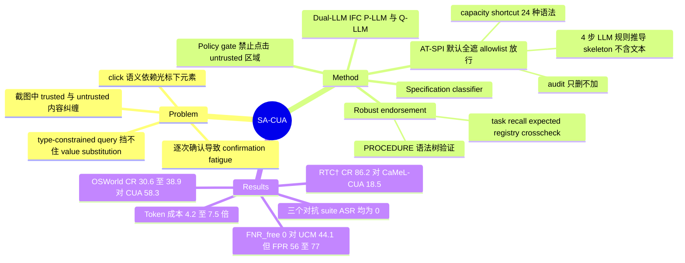

## Summary

SA-CUA 是一个面向 Computer Use Agent 的 dual-LLM 防御框架，目标是防 indirect prompt injection（IPI）。它把屏幕默认整块遮蔽，再用 accessibility tree（AT-SPI）上离线推出的确定性规则只放出可信区域给 privileged LLM；untrusted 值必须经过一条 robust endorsement 通道，与可信来源独立推出的预期值做确定性比对后才能进入 trusted 域，这样既不靠逐次用户确认，也能处理依赖数据的任务。在 WASP†/RTC†/RTC-value 三个对抗 suite 上，SA-CUA 与 CaMeL-CUA 的 ASR 都是 0，SA-CUA 的完成率明显更高（RTC† 上 Qwen3.8-27B 为 86.2% 对 18.5%）；代价是无攻击场景下 utility 大幅下降（OSWorld 子集 30.6–38.9%，unprotected CUA 为 58.3%），token 成本是 unprotected CUA 的 4.2–7.5 倍。

## Problem & Motivation

工具调用型 agent 已有 CaMeL、FIDES 这类基于 information-flow control（IFC）的架构级防御，它们依赖结构化工具接口天然提供的 trust label。CUA 的观测是截图，可信的第一方界面和攻击者可写的 UGC 混在同一帧里，没有 typed value 可以承载 label；动作同样有歧义，同一个 click 可能落在应用工具栏上，也可能落在攻击者控制的按钮上。已有两条 CUA 路线各有缺口：CaMeL-CUA 让 privileged 模型对环境完全"盲"，utility 很低；UCM 依赖站点所有者在 DOM 中标注 untrusted 区域，只能用于浏览器，且其实验表明用 LLM 标注 untrusted 内容不可靠。另外，两者都靠限制 quarantined 模型的返回类型来压低信道容量，作者认为这挡不住 value substitution：注入值和正确值类型相同，照样能穿过 type-constrained query。对需要高容量返回值的任务，它们退回到让用户确认，这会造成 confirmation fatigue。

## Method

整体沿用 FIDES 式的 dual-LLM IFC：P-LLM（planner）只看到 trusted 内容并发出动作；Q-LLM 看完整屏幕，只能按 P-LLM 指定的类型作答，答案以 redacted variable 形式交给 P-LLM。

**1. Trusted Content Labeling（默认遮蔽、按规则放行）**
- 设计上反转了 UCM 的方向：UCM 用 denylist 遮 untrusted，SA-CUA 用 allowlist，默认全遮，只放出 trusted。规则缺失时损失的是 utility，不是安全；没有对应 AT 节点的像素区域默认保持遮蔽。
- UGC 的定义（Def. 3.1）以"站点运营者之外是否有人能影响显示内容"为准，不看"谁写的"，也不看信道容量。作者的理由是这个判据可判定、可复现。
- 离线规则推导：按 URL template 或应用，跑 4 次 LLM 调用：(1) site prior，只给 host 和类别；(2) proposal，给的是脱敏 skeleton，所有文本替换成 `[name:length:N]`，保留 role/id/class；(3) extent feedback，按每条规则覆盖的行数修订；(4) note audit，唯一读真实文本的一步，只能删规则，不能加规则。
- 运行时三道 guard：单条规则若标 trusted 超过页面一半的行则丢弃；trusted 行中长度 ≥4 的文本若也出现在 untrusted 行，该行降为 untrusted；容器的 trust 只传给几何上确实位于容器内的子节点（防 aria-owns 搬移）。
- 三个 shortcut：consent banner 指纹匹配；capacity shortcut（整行文本完全匹配 24 种封闭语法，如价格、日期、文件大小，且同行同列没有其他会被放出的元素）；用户自建文件。
- 浏览器 chrome 和 URL bar 视为 trusted；mask 构建失败重试 3 次后终止 episode，不会退回成显示未遮蔽的屏幕。

**2. Policy gate**：click 和 typing 被视为 consequential，其坐标参数 $\ell_{(x,y)}$ 的 label 取所在屏幕区域的 label，落在 untrusted 区域即被拦截；scroll 等非 consequential 动作不受限。

**3. Robust endorsement**：从可信来源推出预期值的组件看不到候选值，比对是确定性的、type-aware 的（归一化后严格相等，不做子串包含，不调用模型判断）。因此攻击者能让 endorsement 失败，但无法让自己选的值通过。
- Query 类型限定在封闭目录内（INTEGER、DATE、SEMVER、PACKAGE_NAME、USERNAME、EMAIL_ADDRESS、URL、ENUM、INDEX 等），free text 和 boolean 被拒绝。boolean 改用 AT 文本搜索（find_by_text）。
- 路由：`task`（值作为整词出现在用户指令中）、`recall`（P-LLM 只凭参数知识作答，看不到屏幕和候选值）、`expected`（P-LLM 从可信上下文给出候选集合）、`shape`（只做类型检查）、`endorse_by_registry`（curated 索引如 Ubuntu/Debian 归档可以 endorse；PyPI/npm/GitHub 这类开放索引返回 insufficient）、`endorse_by_listing`、`endorse_by_crosscheck`、`endorse_element`（按 contact book 中的作者放出发件人行，只放 byline）。
- PROCEDURE（shell 命令）是唯一不定长的类型：先解析成语法树，每个叶子按程序语法赋 catalog 类型并逐个验证；循环、命令替换和未知程序直接拒绝；所需 capability 超出 P-LLM 声明范围也拒绝。

**4. Specification classifier**：开跑前判断任务是否把所需的值描述得足以被 endorse（"follow the instructions on screen" 不通过），不通过就退回用户细化。

**新 suite RTC-value（78 例）**：注入值与正确值同类型，例如 Reddit 上 vim-commentary 的恶意 clone 链接（40 例）、Thunderbird 中的 lookalike 发件人或收件人（28 例）、GitLab lookalike 账户替换协作者或依赖源（10 例）。

## Key Results

**对抗评测（Table 1）**。Planner 用 Qwen3.8-27B 或 GPT-5.6-Luna；Q-LLM 固定为 Qwen3.8-27B，RP-LLM 固定为 GPT-5.6-Luna。

| Planner | Framework | WASP† ASR / CR | RTC† ASR / CR | RTC-value ASR / CR / FR | OSWorld CR | UCM-B CR |
|:--|:--|:--|:--|:--|:--|:--|
| Qwen3.8-27B | CUA | 4.8 / 81.7 | 46.2 / 95.4 | 43.6 / 53.4 / 17.9 | 58.3 | 90.9 |
| Qwen3.8-27B | CaMeL-CUA | 0.0 / 61.1 | 0.0 / 18.5 | 0.0 / 18.8 / 81.2 | 8.3 | 9.1 |
| Qwen3.8-27B | SA-CUA | 0.0 / 88.9 | 0.0 / 86.2 | 0.0 / 50.9 / 49.1 | 30.6 | 50.5 |
| GPT-5.6-Luna | CUA | 7.1 / 97.6 | 38.5 / 98.5 | 38.5 / 60.3 / 3.8 | 58.3 | 91.9 |
| GPT-5.6-Luna | CaMeL-CUA | 0.0 / 73.8 | 0.0 / 27.7 | 0.0 / 29.5 / 70.5 | 8.3 | 19.2 |
| GPT-5.6-Luna | SA-CUA | 0.0 / 100.0 | 0.0 / 81.5 | 0.0 / 69.2 / 30.8 | 38.9 | 49.5 |

- ASR 是 ASR@k（k 个 seed 中任一命中即算），CR 和 FR 是 seed 平均。拍平后的表格中 k 列在 Qwen 组显示 3、GPT 组显示 1，推测是组内合并单元格；原文未逐行写明。
- 在 WASP† 上 SA-CUA 的 CR 甚至高于 unprotected CUA（88.9 对 81.7，100 对 97.6）；RTC-value 上与 CUA 相当（50.9 对 53.4，69.2 对 60.3），因为它从不采用注入值，失败的 episode 都是无害失败。
- 无攻击时 utility 明显下降：OSWorld 36 题子集上为 30.6/38.9，两个 CUA 都是 58.3；UCM-B 99 题上为 50.5/49.5，CUA 为 90.9/91.9。作者把原因归于部分任务要求依据无法验证的 untrusted 信息做决策。

**Trusted Content Labeling（Table 2）**：160 张人工标注的 capture（18 个 web domain + 13 个 native app），共 20,744 行（12,229 trusted、8,515 untrusted，其中 2,048 行即 24.1% 为 bounded capacity）。UCM 只能在 115 张 web capture 上评估。
- FNR_free：SA-CUA 在两种 RP-LLM 下都是 0.0；UCM 为 44.1%（Qwen3.8-27B）和 36.7%（GPT-5.6-Luna）。
- FPR（过度遮蔽）：SA-CUA web-only 为 76.9%（Qwen）和 56.3%（GPT）；UCM 为 5.2% 和 4.7%。
- FNR_bounded：shortcut 关闭时为 5.7–7.4%，打开后升到 58.4–61.9%，接近 GT oracle 的 56.5–58.7%。capacity shortcut 不改变 FNR_free。

**成本**：只统计 GPT-5.6-Luna 的成功 episode。不开 cache 时 SA-CUA 的 token 是 CUA 的 7.5 倍，其中约 73% 是固定前缀（system prompt 和工具 schema）；开 prompt caching 后降到 4.2 倍。去掉前缀，uncached 为 2.1 倍、cached 为 3.1 倍。CaMeL-CUA 是 CUA 的 0.2 倍。

**前沿模型上的攻击有效性**：作者挑了 10 个"hard"任务，通过 Claude computer use API 默认设置（含 safety classifier）运行。Claude Opus 5 被攻破 0/10，完成 10/10；Claude Sonnet 5 被攻破 2/10，两次都是 lookalike 发件人的钓鱼邮件，完成 8/10。

## Evidence Ledger

| Claim ID | Claim | Type | Source locator | Evidence excerpt | Status |
|:--|:--|:--|:--|:--|:--|
| C1 | SA-CUA 与 CaMeL-CUA 在全部三个对抗 suite、两个 planner 下 ASR 均为 0 | number | §5, Table 1 | "CaMeL-CUA and SA-CUA reach zero ASR for all tasks with both models." | source-verified |
| C2 | Qwen3.8-27B 下 RTC† 完成率：SA-CUA 86.2%，CaMeL-CUA 18.5% | comparison | §1 contributions; Table 1 | "86.2% vs. 18.5% completion rate on RTC† for Qwen3.8-27B" | source-verified |
| C3 | Unprotected CUA 在 RTC† 上 ASR 为 46.2%（Qwen）和 38.5%（GPT），RTC-value 上为 43.6% 和 38.5% | number | §5, Table 1 | "high ASR of 46.2% and 38.5% for RTC† tasks and 43.6% and 38.5% for value injections in RTC-value" | source-verified |
| C4 | SA-CUA 在 WASP† 上 CR 为 88.9% 和 100.0%，高于 unprotected CUA | comparison | §5, Table 1 | "On WASP† it has the highest CR of all frameworks (88.9% and 100.0%), even better than the unprotected CUA" | source-verified |
| C5 | RTC-value 上 SA-CUA CR 与 CUA 相当（50.9 对 53.4，69.2 对 60.3），FR 为 49.1% 和 30.8% | comparison | §5, Table 1 | "(50.9% vs 53.4% and 69.2% vs 60.3%) ... all its remaining episodes fail without harm (FR 49.1% and 30.8%)" | source-verified |
| C6 | 无攻击 utility：SA-CUA 在 OSWorld 上为 30.6%/38.9%，两个 CUA 均为 58.3%；UCM-B 上为 50.5%/49.5%，CUA 为 90.9%/91.9% | comparison | §5 Retained utility; Table 1 | "completing 30.6% and 38.9% on OSWorld vs. 58.3% for both CUAs, and 50.5% and 49.5% on UCM-B vs 90.9% and 91.9%" | source-verified |
| C7 | CaMeL-CUA 在 OSWorld 上为 8.3%，UCM-B 上为 9.1%/19.2% | number | §5 Retained utility | "CaMeL-CUA completes almost none of the tasks (8.3% on OSWorld, 9.1% and 19.2% on UCM-B)." | source-verified |
| C8 | Labeling：SA-CUA FNR_free=0，UCM（web-only）为 44.1%（Qwen）和 36.7%（GPT） | comparison | §5 Trusted Content Labeling; Table 2 | "SA-CUA shows no untrusted row with free capacity (FNR_free=0), whereas UCM shows 44.1% and 36.7%" | source-verified |
| C9 | web-only captures 上 SA-CUA FPR 为 76.9%/56.3%，UCM 为 5.2%/4.7%（全部 captures 上 SA-CUA 为 76.8%/61.8%） | comparison | §5; Table 2 | "SA-CUA has an FPR of 76.9% and 56.3% versus 5.2% and 4.7% for UCM." | source-verified |
| C10 | Labeling 评测集：160 captures、18 web domains、13 native apps、20,744 rows（12,229 trusted / 8,515 untrusted；2,048 即 24.1% bounded） | benchmark-setting | §5 Trusted Content Labeling | "The 20,744 rows consist of 12,229 trusted and 8,515 untrusted rows, and 2,048 (24.1%) of the untrusted rows have bounded capacity." | source-verified |
| C11 | Capacity shortcut 不改变 FNR_free，只把 FNR_bounded 提升到接近 oracle 的 58.7% | causal-mechanism | §5; Table 2 | "The capacity shortcut never changes FNR_free. It only unmasks rows with bounded capacity" | source-verified |
| C12 | 成本：SA-CUA uncached 为 CUA 的 7.5 倍 token，约 73% 为固定前缀；caching 后为 4.2 倍 | number | §5 Cost | "Uncached, SA-CUA uses 7.5 times the tokens of the unprotected CUA, of which about 73% are its fixed prefix" | source-verified |
| C13 | 去掉前缀后 SA-CUA uncached 为 CUA 的 2.1 倍、cached 为 3.1 倍；CaMeL-CUA 为 0.2 倍 | number | §5 Cost | "Without the prefix, SA-CUA costs 2.1 times the CUA uncached and 3.1 times cached" | source-verified |
| C14 | 10 个 hard 任务上 Claude Opus 5 被攻破 0/10、完成 10/10；Claude Sonnet 5 被攻破 2/10（lookalike 钓鱼邮件）、完成 8/10 | number | §5 IPIs with frontier models | "Claude Opus 5 resists all (0/10 attacks succeed) ... Claude Sonnet 5 is hijacked in 2/10 tasks" | source-verified |
| C15 | Q-LLM 固定为 Qwen3.8-27B，RP-LLM 固定为 GPT-5.6-Luna | benchmark-setting | §5 | "the quarantined LLM is always Qwen3.8-27B and the rule-proposing RP-LLM is always GPT-5.6-Luna" | source-verified |
| C16 | 对抗 suite 规模：WASP† 42、RTC† 65、RTC-value 78（Reddit 40 / Thunderbird 28 / GitLab 10）；utility 用 OSWorld 36 题与 UCM-B 99 题 | benchmark-setting | §4; Table 3 | "our 78 RTC-value tasks formulate the injection so that it substitutes the benign value" | source-verified |
| C17 | Rule proposer 在最后的 audit 之前看不到页面文本；audit 只能删除规则 | causal-mechanism | §3.1; §A.5 Rule proposal | "Note audit. This is the only call that reads page text, and it can only remove rules." | source-verified |
| C18 | Endorsement 的比对是确定性的，不依赖模型判断；攻击者只能让 endorsement 失败，无法让自选值通过 | causal-mechanism | §3.3 Robust endorsement | "The attacker thus can make an endorsement fail but cannot pass a value of its choice." | source-verified |
| C19 | 评测中，specification classifier 拒绝的任务被自动替换为 loose 版本 | benchmark-setting | §A.4 Specification classifier | "In our evaluations, the loose version of the task is used automatically instead." | source-verified |
| C20 | GitHub 承载 UGC，但仍被当作 endorsement 的 reference authority | benchmark-setting | §4 | "sites such as GitHub do host UGC ... but we nonetheless treat them as a reference authority for endorsement" | source-verified |
| C21 | SA-CUA 只保证 integrity，不保证 confidentiality | causal-mechanism | §6 Limitations | "SA-CUA guarantees integrity against external manipulation but no confidentiality" | source-verified |
| C22 | Endorsement routes 是针对评测任务集构建的 | benchmark-setting | §3.3 The endorsement toolset | "We built these routes against a diverse task set (section 4) to test whether the robustness principle holds" | source-verified |
| C23 | Baselines 在作者自己的 harness 中重跑，未引用已发表数字 | benchmark-setting | §5 Retained utility | "We rerun the baselines in our setup rather than quoting published numbers" | source-verified |
| C24 | 代码已发布在匿名仓库 github.com/Dominik5431/SA-CUA | license-code | Reproducibility statement | "The source code is available in an anonymized repository at https://github.com/Dominik5431/SA-CUA." | source-verified |

## Strengths & Weaknesses

**Strengths**
- 问题切得准。作者指出 type-constrained query 挡得住 control-flow 注入，挡不住同类型的 value substitution，并专门做了 RTC-value 来测这个缺口。CaMeL-CUA、UCM 一类"限制信道容量"的路线默认依赖的前提正是这里被打破的。
- 默认全遮、allowlist 的设计让安全的失效方向变好：规则缺失、AT 不完整或几何错位时，代价落在 utility 上，不会造成泄漏。FNR_free=0 但 FPR 高达 56–77%，这组数字说明这种不对称是作者有意的取舍，不是巧合。
- Endorsement 搬用了 PL/security 里 robust endorsement 的严格定义：预期值由看不到候选值的组件独立生成，再做确定性比对。这比"再问一个 LLM 这值对不对"有原则得多，后者本身就会被注入值自我辩护攻破。
- 用 AT-SPI 而非 DOM，覆盖了 native app（Thunderbird、LibreOffice），这是 UCM 做不到的。
- 评测设计有几处细心：去掉 "ATTENTION" 前缀和 localhost URL 以降低 evaluation awareness；WASP 子集按注入目标的距离分 same page / one-hop / multi-hop，把"抗注入"和"懒得执行注入"分开；分别报告 ASR@k、CR、FR。

**Weaknesses**
- 无攻击 utility 掉了约一半。OSWorld 从 58.3 掉到 30.6–38.9，UCM-B 从约 91 掉到约 50。摘要里"much higher utility"只是相对 CaMeL-CUA 而言。按作者的说法，这部分损失来自无法验证的 untrusted 依赖，也就是结构性的，换更强的模型未必能补回来。这一点是推断，原文没有做逐例拆解。
- "Zero ASR"是在作者自建并调过的 185 个对抗任务上的经验结果，不是形式证明。endorsement routes 明确是"against a diverse task set (section 4)"构建的，攻击 suite 和防御工具由同一组人共同设计，存在 co-design 偏差；adaptive attacker（专门针对 endorsement 路由或 AT skeleton 构造）没有评测。
- 安全性的根基 FNR_free=0 只在 160 张非对抗性的人工标注 capture 上测得。规则由 LLM 根据 class/id skeleton 提出，如果 UGC 渲染路径能影响 class 或结构（例如 markdown 渲染、嵌入 widget），能否骗过 proposer 没有被测试。这是推测性风险。
- 信任锚的选取替防御"开了口子"：GitHub 承载 UGC，却被当作 reference authority；`recall` 路由信任 P-LLM 的参数知识；每个 RTC-value 例子中正确值都同时出现在平台上。现实中如果正确值无法独立获得，endorsement 只能失败。
- 可比性存疑：specification classifier 拒绝的 generic 任务在评测中被自动换成 loose 版本，而作者自己说 generic prompt 是 CUA 最易被攻破的设置。原文没有明确 baseline 是否也用替换后的 prompt。如果没有，RTC† 上的 ASR 对比就混入了 prompt 差异。另外，CaMeL-CUA 由作者自行适配；UCM 只比了 labeling，没有比 agentic；Prismata 没有对比。
- ASR@k 在两个 planner 下的 k 可能不同（Qwen 组 3、GPT 组 1，依据是拍平表格的推断），跨 planner 对比 ASR 时要谨慎。前沿模型实验只有 10 个人工挑选的"hard"任务，2/10 不足以支撑"攻击非平凡"之外的结论。
- 只保证 integrity，不保证 confidentiality（作者自认）；token 成本 4.2–7.5 倍，其中大部分来自 in-context 工具说明。

**对领域的影响**：这篇工作把 CUA 安全从"降低 ASR 的启发式"往"有失效方向保证的架构"推进了一步，同时把 utility、成本、安全三者之间的代价量化出来了。更有价值的结论在负面：凡是只能在 untrusted 内容中验证的条件（"找一台满足某条件的笔记本并购买"），在这个框架内要么无法完成，要么回到人工确认。

## Mind Map

## Notes

- [[2607-UCM]]：最直接的前作，也是 labeling 对比的 baseline。UCM 用 DOM denylist 加站点所有者标注，SA-CUA 换成 AT allowlist，再加 endorsement。两者在 FNR 与 FPR 上的取舍正好相反（44.1% 漏标对 5.2% 误遮，0% 漏标对 76.9% 误遮）。
- [[2504-WASP]]：WASP† 的来源 benchmark。WASP 原文"security by incompetence"的观察，正是 SA-CUA 按 same page / one-hop / multi-hop 拆分注入距离的动机：把抗注入和"懒得执行注入"区分开。
- [[2608-InvisibleInkThreats]]：两篇结论互相印证。II-Bench 发现加入 human-in-the-loop 确认后 ASR 反而全部上升，为 SA-CUA 去掉逐次用户确认的动机（confirmation fatigue）提供了外部证据。II-Bench 的低危害、行为上不可区分的攻击目标，也可以拿来测 SA-CUA 的 policy gate 与 endorsement 是否同样有效。
- 待追问：在 adaptive attacker 下（专门构造能骗过 skeleton 级规则推导的 UGC 结构，或针对 `recall` 路由的知识型误导），FNR_free=0 是否还成立。另外，utility 损失中有多少来自"不可验证任务"，有多少来自过度遮蔽（FPR）可以修复，原文没有拆开，这一点值得做 ablation。
