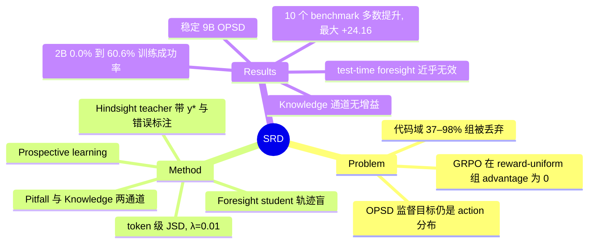

## Summary
SRD 提出 prospective learning：把已完成轨迹作为 privileged hindsight，蒸馏到同一 policy 在交互前（trajectory-blind）生成的 pitfall/knowledge foresight 上，作为 GRPO / OPSD / RLSD 的辅助 token 级 JSD 损失（λ=0.01），推理时不需要显式生成 foresight。在 Qwen3.5-4B/9B 的 10 个 math/code/search/agentic benchmark 上，+SRD 相对各自 base 多数提升，最大 +24.16 pp；reward-uniform 组占 37–98% 时仍能提供梯度，2B 代码设置中 GRPO 终值 0.0% 而加 SRD 达 60.6% 训练成功率。

## Problem & Motivation
group-relative RLVR 在一组 rollout 奖励全相同时 advantage 恒为 0，标准做法是丢弃并重采样（DAPO dynamic sampling），浪费轨迹中已暴露的任务要求与失败模式。作者统计代码域四个模型规模下 reward-uniform 组占 98.0/39.1/37.0/41.3%，弱模型偏 all-fail、强模型偏 all-success。已有 on-policy self-distillation（OPSD、RLSD）用 privileged 解答条件化 teacher 去锐化"下一步该做什么"，监督目标仍是 action 分布；SRD 改变目标，让 hindsight 监督"交互前能预见什么"。

## Method
- **形式化**：foresight 分布 p_fore = π_θ(·|x,e,c)，hindsight 分布 p_hind = π_θ̄(·|x,e,f,c)，f=(τ, 金标准答案 y*, 错误标注 ε)，θ̄ 为 stop-gradient 的自身副本；c 是 prospection 指令。
- **两种视角**：Knowledge（r=1 的轨迹，预测任务可能需要的知识）与 Pitfall（r=0 的轨迹，预测可能遇到的失败）。reward 只决定"教哪种课"，不决定"是否教"，所以 all-fail / all-success 组也有监督。
- **损失**：student 先采样 foresight 序列 z_fore，teacher 在同一 student 前缀上带 f 打分，两者做 token 级 generalized JSD；L_SRD 以 λ=0.01 加到 GRPO / OPSD / RLSD 上。主表 +SRD 行只蒸馏 pitfall。
- **训练**：Qwen3.5-4B/9B-Thinking，8×H200，每步 16 prompts × 8 rollouts，最多 8 轮交互，temperature 1.0。Math/Code/Search 联合训练，ALFWorld/WebShop 另一混合。

## Key Results
- **主表（avg@8，Table 1）**：4B GRPO 加 SRD，Math avg 46.22→56.25（+10.03），Code 36.85→45.18（+8.33），Search 48.29→56.34（+8.05），ALFWorld 67.75→71.00，WebShop 77.21→83.13。9B OPSD 加 SRD，Math avg 39.70→56.92（+17.22）；最大单项增益为 9B OPSD 的 AIME26 +24.16。
- **回归**：9B OPSD 的 WebShop -3.61；4B RLSD 的 OJBench -0.97；9B GRPO 的 2Wiki -0.51。RLSD+SRD 在多数列只有 0.5–1.5 pp 的小幅增益。
- **纯 OPSD 不稳定**：9B OPSD 在 HotpotQA/2Wiki/LCB-v6 低于未训练的 Vanilla（-5.50/-3.76/-2.18 pp），Math avg 出现 9B(39.70) 低于 4B(41.81) 的反向 scaling；加 SRD 后恢复单调。
- **RQ1 通道**：Pitfall 单通道已足够，加 Knowledge 不带来稳定增益（9B AIME26 从 65.42 降到 62.92；论文称 4B AMO 降约 4 pp，这是 hindsight+knowledge 11.50 对 raw-trace baseline 15.50 的口径，对 hindsight baseline 13.25 只低 1.75）；pitfall 的散度训练中下降 47%/30%，knowledge 基本持平。
- **RQ3 reward-uniform**：2B 代码设置 98% 组为 all-failure，GRPO 峰值训练成功率 1.6%、终值 0.0%，加 SRD 达 60.6%（训练成功率，非 held-out）。
- **RQ4 机制**：held-out 代码集上 SRD 沿 GRPO 方向多走 30%（α/‖A‖=1.30），并附加相当量级的正交分量（‖E⊥‖/‖E‖=0.49）；对 OPSD 则像锚点，位移从 1.97 缩到 0.57。
- **RQ5 test-time foresight**：推理时显式输出 foresight 几乎无作用，8 个 arm 中无一在 ALFWorld 全部 6 类任务上同时提升；Look 类任务变化范围 -20.13 到 +40.28 pp。
- **成本**：SRD 使每步 wall-clock 由 197s 增至 217s（4B，trace 前缀 OPSD）。

## Evidence Ledger
| Claim ID | Claim | Type | Source locator | Evidence excerpt | Status |
|:--|:--|:--|:--|:--|:--|
| C1 | 摘要称 SRD 在 10 个 tool-integrated reasoning 与长程 agentic 任务上相对 RLVR 与 self-distillation baseline 的增益最高 24.2 pp | number | Abstract | gains of up to 24.2 pp | source-verified |
| C2 | 最大单项增益 +24.16 pp 出现在 9B OPSD+SRD 的 AIME26 | number | Table 1 (Qwen3.5-9B, OPSD) | + 24.16 | source-verified |
| C3 | 2B 设置中 98% 的 rollout 组为 all-failure，RLVR 训练终值 0.0% 成功率，加 SRD 达 60.6% | number | Abstract; §5 RQ3 | RLVR training ends up at 0.0% success, while adding SRD reaches 60.6% under the same rollout budget | source-verified |
| C4 | 2B 基线训练成功率峰值仅 1.6%，SRD 在训练中达 60.6%（为训练成功率而非 held-out 评测） | benchmark-setting | §5 RQ3 | 1.6% peak training success, 0.0% final), whereas the same budget with SRD reaches 60.6% in training | source-verified |
| C5 | 代码域四个模型规模的 discarded 比例依次为 98.0/39.1/37.0/41.3，可用预算份额不超过 63% | number | §5 RQ3, Figure 4 | the usable share of the budget never exceeds 63% | source-verified |
| C6 | 4B GRPO+SRD 的 Math avg 由 46.22 提升到 56.25（+10.03） | number | Table 1 (Qwen3.5-4B) | For 4B GRPO, adding SRD improves the Math, Code, and Search averages by 10.03 , 8.33 , and 8.05 pp | source-verified |
| C7 | 4B GRPO+SRD 的 Search avg 由 48.29 提升到 56.34，且 BrowseComp-Plus +9.52 | number | Table 1 | improves five of six settings there, by up to 9.52 pp | source-verified |
| C8 | 9B OPSD+SRD 的 Math avg 从 39.70% 升到 56.92%（+17.22 pp） | number | §4.2; Table 1 | OPSD+SRD raises the Math average from 39.70% to 56.92% ( +17.22 pp) | source-verified |
| C9 | SRD 只有一处明显回归：9B OPSD 的 WebShop -3.61 pp（Table 1 另有 4B RLSD OJBench -0.97、9B GRPO 2Wiki -0.51 等小幅负值） | comparison | §4.2; Table 1 | with only one regression—WebShop under 9B OPSD ( -3.61 pp) | source-verified |
| C10 | 9B 纯 OPSD 在 HotpotQA/2Wiki/LCB-v6 低于未训练 policy，降幅 5.50/3.76/2.18 pp | comparison | §4.2 | OPSD alone ends up below the untrained policy — by 5.50 pp on HotpotQA, 3.76 pp on 2Wiki and 2.18 pp on LCB-v6 | source-verified |
| C11 | OPSD 的 Math avg 随规模反向（9B 39.70 低于 4B 41.81） | comparison | §4.2 | the 9B run landing 2.11 pp below the 4B one ( 39.70% vs. 41.81% ) | source-verified |
| C12 | 主表所有 +SRD 行仅蒸馏 pitfall hindsight，辅助损失权重 λ=0.01 | benchmark-setting | §4.1; §4.2 | every +SRD row distills the pitfall hindsight alone | source-verified |
| C13 | 加入 Knowledge 通道不带来收益，部分设置低于 baseline，如 9B AIME26 62.92 vs 65.42（Table 2 中 pitfall-only 行也有低于 baseline 的格子，故"唯一"不成立） | comparison | §5 RQ1, Table 2 | adding the knowledge channel on top of pitfalls then buys nothing and potentially risks | source-verified |
| C14 | Pitfall 通道散度训练中下降 47% 与 30%，knowledge 通道保持平坦 | causal-mechanism | §5 RQ1, Table 2 top center | the pitfall channel’s divergence falls steadily by 47% and 30% over training | source-verified |
| C15 | SRD 沿 GRPO 更新方向多走 30%，并附加相当量级的正交位移，cos(A,E)=+0.81 | causal-mechanism | §5 RQ4 | the + SRD run travels 30% further along GRPO’s own direction | source-verified |
| C16 | 对 OPSD，SRD 把位移从 1.97 缩到 0.57，起类似 anchor 的作用 | causal-mechanism | §5 RQ4 | shortens the large OPSD one ( 1.97\rightarrow 0.57 ) along the same ray | source-verified |
| C17 | 推理时显式输出 foresight 基本无增益，四个 checkpoint 中仅一个 +5.00 pp | comparison | §5 RQ5, Table 3 | The test-time axis is nearly inert | source-verified |
| C18 | 8 个 arm 中无一在 ALFWorld 全部 6 个任务类型上同时提升 | comparison | §5 RQ5 | Not one of the eight arms improves all six ALFWorld task types over its own base | source-verified |
| C19 | RLSD 下 Knowledge 通道使 ALFWorld 比 base 低 6.88 pp，作者承认仅为两目标一规模一 seed 的推测 | benchmark-setting | §5 RQ5 | with two objectives at one scale and one seed we can only offer that as a conjecture | source-verified |
| C20 | SRD 每步训练耗时增加（4B OPSD trace 前缀 197s 到 217s） | number | Table 2 left | 197 / 217 | source-verified |
| C21 | 训练使用 Qwen3.5-4B 与 9B-Thinking，每步 16 prompts × 8 rollouts，最多 8 轮交互 | benchmark-setting | Appendix C.2 | giving 128 trajectories before dynamic-sampling resampling | source-verified |
| C22 | 新颖性：现有 self-distillation 的监督目标均为 action 分布，SRD 将 hindsight 重定向到 foresight | sota-novelty | §6 | SRD changes the target, redirecting hindsight from behavior to foresight | source-verified |
| C23 | 代码链接：全文未给出代码或模型发布地址 | license-code | 全文（未检索到 GitHub 链接） | unknown | source-verified |

## Strengths & Weaknesses
**Strengths**
- 问题选得准：直接针对 GRPO 在 reward-uniform 组梯度为零这一结构性浪费，并给出 4 个规模上的占比统计，而非只报 benchmark 数字。
- 方法简单：一个 λ=0.01 的辅助损失，可叠加到三种 host 目标上，推理零开销。
- 分析诚实：RQ4/RQ5 与附录披露了回归、per-task 的此消彼长，并在 E.6 撤回了一个因代数恒等式而无意义的统计量。
- 暴露 OPSD 的不稳定（9B 低于 Vanilla），SRD 作为稳定项的论述有数据支撑。

**Weaknesses 与边界**
- **依赖 privileged 标注**：f 包含金标准答案 y* 与错误标注 ε，只适用于有 verifiable gold 的任务；开放式 GUI / 真实环境任务中这些很难获得。
- **增益归因不清**：host 之间差距大（RLSD 上多数仅 0.5–1.5 pp，GRPO/OPSD 上 8–17 pp），部分大增益来自修复不稳定的 OPSD 而非超过强 baseline；未与"仅保留 hindsight 文本的 SFT/auxiliary loss"之类的简单对照比较，无法区分是 foresight 目标本身还是额外一项 self-teacher 正则在起作用。
- **统计证据薄**：作者自述部分对比为单 seed、单规模（C19）；avg@8 无置信区间；跨目标的 Pick/Look 等任务类型波动达数十 pp，说明单次运行噪声大。
- **2B 的 60.6% 是训练成功率**，且 baseline 峰值仅 1.6%，更像"让训练启动"的故事，不等价于 held-out 提升。
- **机制解释偏描述性**：RQ2/RQ4 显示 token 分布和位移方向变化，但没有干预实验证明 foresight 内容本身是增益来源（Pitfall 与 Knowledge 的差异也无法说明 foresight 质量）。
- **范围有限**：只有 Qwen3.5 4B/9B（RQ3 含 2B/更小规模仅代码）；agentic 仅 ALFWorld 与 WebShop 两个文本模拟环境，8 轮交互上限，不涉及 GUI / 真实视觉环境。
- 代码未给出（未在全文检索到链接），复现需自建。

## Mind Map

## Notes
- 与 [[2607-SEED]] 最相近：同样把 hindsight 作为训练期 privileged 信息、推理零开销，并在 ALFWorld / WebShop 上对 GRPO；区别在 SEED 用 hindsight skill 蒸馏 action token，SRD 则蒸馏交互前的 foresight 文本。两者可作为同一设计轴（hindsight 监督什么）的对照。
- [[2608-GatedHindsight]]：GUI 域的 hindsight 蒸馏（next screenshot 作 privileged），gate 只在 student 失败时施加；SRD 的 pitfall-only 结论与其"失败样本才有信息"的设计互相呼应，但 SRD 无 gate。
- [[2605-AntiSD]]：认为 on-policy self-distillation 有结构性缺陷（PMI 视角），与 SRD 观察到的 OPSD 不稳定、需要 anchor 类辅助项的结论方向一致，可对照两种修复。
- 待查：把 SRD 的"失败轨迹→pitfall foresight"搬到无 gold answer 的 GUI agent 时，y* 由什么替代（verifier 反馈？）；是否可与 2608-GatedHindsight 的 gate 组合。
