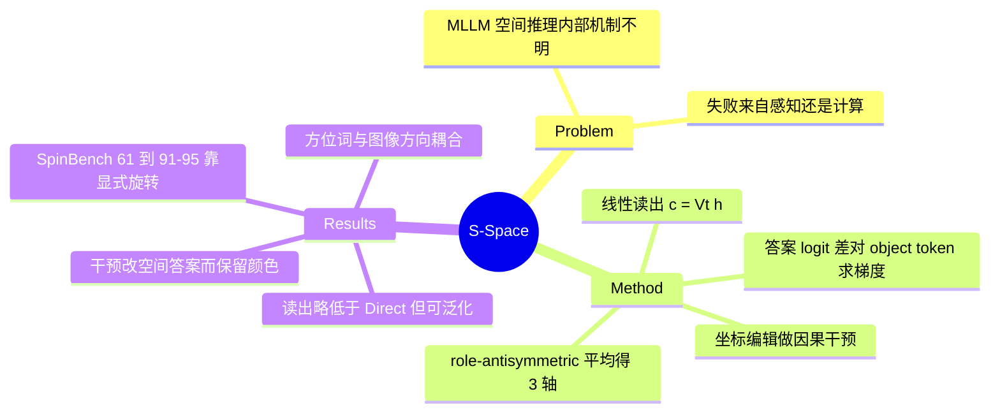

## Summary
S-Space 是 MLLM 中间层里一个由梯度法识别出的 3 维线性子空间：object-name token 的 hidden state 在其上的投影给出水平/垂直/距离三轴的连续坐标，且对空间 QA 有因果作用、在非空间提问下仍可读出。作者据此把空间推理失败拆成 perception 与 computation 两段：在 SpinBench 视角变换任务上，对读出坐标做显式旋转可把准确率从约 61% 提到 91-95%，说明瓶颈在模型内部的空间变换而非感知。属于机制解释型工作，不提出新训练方法。

## Problem & Motivation
MLLM 在 spatial reasoning benchmark 上与人类仍有明显差距，但只看最终答案无法判断失败发生在 "看没看对" 还是 "算没算对"。已有工作研究了空间编码与表征偏置，但缺少一个统一的解释：空间信息如何被编码、变换、并被语言输出使用。作者借用人类认知中 mental workspace 的类比，问 MLLM 是否有类似的内部空间工作区；若有，它既能当 probe，也能定位失败环节。

## Method
- **识别**：对每个相对空间问题（"apple 在 cup 的左边还是右边？"），取答案 logit 差 s（right-left、above-below、close-far）对 query 与 reference 两个 object-name token 隐状态的梯度，做 role-antisymmetric 差 a = (∇h_q s − ∇h_r s)/2，在 5 个 prompt 模板、原/交换物体顺序、样本上平均并归一化得到 v_x, v_y, v_z；S-Space = span{v_x, v_y, v_z}。每个 (模型, 层) 一组固定方向，跨 token 位置共享。
- **识别数据**：COCO-2017 训练图每图一对物体，6 种关系各 1000 例用于识别轴、300 例用于选层（共 6000 + 1800 张图）；选层取中间层（早层仍贴近输入，晚层偏向 next-token）。水平/垂直用图像平面坐标，深度用 Depth Anything V2-Small 的逆深度，不显式处理透视。
- **读出**：c_t = Vᵀ h_t；相对判断用 m_g = c_q,g − c_r,g 的符号，不需要模型生成答案。
- **因果干预**：读出坐标、编辑（swap / shift / 随机方向同范数）、写回隐状态后继续生成，对比空间问题与颜色问题的答案保留率。
- **诊断**：(1) SpinBench 视角变换：读 S-Space 坐标 → 按目标视角施加固定旋转（R_left(x,z)=(z,−x) 等）→ 确定性规则出答案，与 Direct / CoT 对比；(2) 在受控 CoT 各阶段读同一物体的坐标，观察逐步被变换；(3) 从 Qwen3.6-27B 的 CoT 里收集 north/south 等方位词，投影到 S-Space 观察 reference-frame coupling。
- 模型：Molmo2-ER、MolmoAct2-Pretrain、MolmoAct2（后两者为 Molmo2-ER 经动作训练得到的 VLA）、Qwen3.5-4B、Qwen3.6-27B。

## Key Results
- **读出准确**：Molmo2-ER 选定层（L22）上，S-Space 读出在 CV-Bench / EmbSpatial / SpatialTunnel 的准确率为 91.92 / 86.92 / 96.50，对应 Direct 为 94.40 / 90.42 / 97.83，即读出略低于直接回答（正文称 "comparable"）。Qwen3.5-4B 上读出反而更高（EmbSpatial 86.42 vs 78.50，SpatialTunnel 90.08 vs 86.33）。
- **因果且选择性**：Molmo2-ER L17、800 条 EmbSpatial（另有 L13–L20 层扫描，每任务 80 例），只移动一个物体的坐标，绝对位置问题答案保留率随 β=±30 降到 41.05%，同一干预下颜色问题保留 78.13%；相对位置问题在两物体同时平移时按预期不变。
- **持久性**：把 pairwise 提问换成单物体提问甚至颜色提问，同一读出仍能支持空间判断（Figure 5，具体数值仅见图）。
- **视角变换瓶颈**（SpinBench，146 题无 premise / 144 题有 premise）：无 premise 下 Direct 均为 60.96；Molmo2-ER 的 S-Space+Rotation 为 94.52；Qwen3.5-4B CoT 62.33、S-Space+Rotation 91.10；Qwen3.6-27B CoT 83.56、S-Space+Rotation 95.21。有 premise 下 S-Space+Rotation 达 99.31 / 97.92 / 99.31，而 Qwen3.5-4B CoT 仅 72.22，Qwen3.6-27B CoT 91.67。
- **CoT 逐步变换**：受控 CoT 中，坐标读出从旋转后读出占优逐步转为直接读出占优，说明模型在内部部分模拟视角变换，但不完整。
- **Reference-frame coupling**：MMSI-Bench 的 191 题子集上，east 与 right、north 与 above 在 S-Space 中对齐（1,311 次方位词出现）。
- **案例**：未见物体（跳水门将指向的球）、观察者 token "you" 落在 close 端；socialist / conservative 分别落在水平轴左/右端；MolmoAct2 系列在 InstructPart 的 part–whole 深度比较上随动作训练阶段逐步变准（仅有图，无表）。

## Evidence Ledger

| Claim ID | Claim | Type | Source locator | Evidence excerpt | Status |
|:--|:--|:--|:--|:--|:--|
| C1 | 作者声称首次系统识别并刻画 MLLM 内部空间工作区 | novelty | Sec 1, contributions | "we are the first to systematically identify and characterize an internal spatial workspace in MLLMs" | source-verified |
| C2 | S-Space 是 3 维线性子空间，由答案 logit 差对 object token 激活的梯度识别 | mechanism | Sec 2.1-2.2, Eq. 1-2 | "differentiating the models' responses to relative spatial questions with respect to object-token activations" | source-verified |
| C3 | 识别用 COCO：6000 张图识别轴、1800 张图选层，每图一对物体 | setup | App C.1 | "Axis identification and layer selection use disjoint sets of 6,000 and 1,800 COCO-2017 training images" | source-verified |
| C4 | 水平/垂直轴用图像平面坐标而非世界坐标，不处理透视 | assumption | Sec 2.2 footnote 2 | "we use image-plane coordinates rather than world coordinates, without explicitly disentangling depth-dependent perspective effects" | source-verified |
| C5 | S-Space 读出在 CV-Bench / EmbSpatial / SpatialTunnel 上准确率与直接回答相当 | benchmark | Sec 3.1, Fig 3c | "this simple coordinate-based readout achieves accuracy comparable to the models' direct verbal answers" | source-verified |
| C6 | Molmo2-ER L22 的 S-Space 读出准确率为 91.92 / 86.92 / 96.50（CV-Bench / EmbSpatial / SpatialTunnel），Direct 为 94.40 / 90.42 / 97.83 | number | App C.2, Table 3 | "Molmo2-ER 22 94.40 91.92 90.42 86.92 97.83 96.50" | source-verified |
| C7 | Qwen3.5-4B 在 SpatialTunnel 上 S-Space 读出（90.08）高于 Direct（86.33），EmbSpatial 上为 86.42 vs 78.50（原 claim 误标为 EmbSpatial，经 verifier 纠正） | number | App C.2, Table 3 / Table 6 | "Qwen3.5-4B 15 73.60 89.36 78.50 86.42 86.33 90.08" | source-verified |
| C8 | 读出坐标与 ground-truth 位置在三轴上强相关（Spearman） | number | Sec 3.1, Fig 3a-b | "both individual object coordinates and pairwise coordinate differences strongly correlate with their ground-truth counterparts" | source-verified |
| C9 | 编辑 S-Space 坐标显著改变空间判断，而对颜色判断影响小 | causal | Sec 3.2, Fig 4 | "The same intervention that strongly alters spatial answers have little effect on unrelated color judgments." | source-verified |
| C10 | 移动单个物体 β=±30 时，绝对位置问题答案保留率 41.05%，颜色问题 78.13% | number | App C.3, Table 7 | "100.00 | 95.15 | 89.23 | 80.62 | 68.37 | 52.49 | 41.05" | source-verified |
| C11 | 干预实验仅在 Molmo2-ER 上做；Fig 4 主结果用 L17、800 条 EmbSpatial，另有 L13–L20 层扫描（每任务 80 例，Tables 8–9）（原 claim 把范围误写成只有 L17/800 例，经 verifier 纠正） | scope | App C.3 Main results / Layer sweep | "We use Molmo2-ER for all interventions. Figure 4 uses 800 EmbSpatial examples at L17." / "We use Molmo2-ER at L13–L20, with 80 examples per task" | source-verified |
| C12 | 换成单物体提问和颜色提问，同一读出仍支持准确空间判断 | mechanism | Sec 3.3, Fig 5 | "despite substantial change in prompt structure and computational context, the resulting coordinates continue to support accurate spatial judgments" | source-verified |
| C13 | 观察者 token "you" 投影到距离轴的 close 端 | mechanism | Sec 4, Fig 6b | "even the observer, represented by the abstract token you, projects toward the close end of the distance axis" | source-verified |
| C14 | socialist / conservative 分别投影到水平轴左/右端 | mechanism | Sec 4, Fig 7 | "socialist ... also projects toward the left end of the horizontal axis, and conservative toward the right" | source-verified |
| C15 | S-Space 源于预测空间语言的大规模训练（假设） | causal | Sec 4 | "We hypothesize that S-Space emerges from the objective of predicting spatial language during large-scale training." | source-verified |
| C16 | SpinBench 无 premise：Direct 三个模型均为 60.96 | number | Sec 5.1, Table 1 | "Molmo2-ER 60.96 ... Qwen3.5-4B 60.96 ... Qwen3.6-27B 60.96" | source-verified |
| C17 | SpinBench 无 premise：S-Space+Rotation 为 94.52 / 91.10 / 95.21（Molmo2-ER / Qwen3.5-4B / Qwen3.6-27B） | number | Sec 5.1, Table 1 | "94.52 (+33.56) ... 91.10 (+30.14) ... 95.21 (+34.25)" | source-verified |
| C18 | SpinBench 无 premise：CoT 仅 Qwen3.5-4B 62.33、Qwen3.6-27B 83.56 | number | Sec 5.1, Table 1 | "62.33 (+1.37) ... 83.56 (+22.60)" | source-verified |
| C19 | SpinBench 有 premise：S-Space+Rotation 为 99.31 / 97.92 / 99.31，CoT 为 72.22 / 91.67 | number | Sec 5.1, Table 1 | "99.31 (+37.50) ... 97.92 (+37.50) ... 99.31 (+26.39)" | source-verified |
| C20 | 给出正确源视角关系后模型生成仍常答错，而 S-Space 表征近乎完美 | mechanism | Sec 5.1 | "Even with this relation supplied, models often fail to produce the correct target-view answer." | source-verified |
| C21 | 瓶颈在空间变换而非感知：MLLM 能形成可用空间表征但跨视角推理不可靠 | mechanism | Abstract; Sec 5.1 | "MLLMs can form capable spatial representations, yet fall short in the spatial transformations required to reason reliably" | source-verified |
| C22 | CoT 逐步变换 S-Space 坐标（Qwen3.6-27B，受控手写 CoT 模板） | mechanism | Sec 5.2, Fig 9 | "the objects' relative coordinates become increasingly aligned with the viewpoint requested by the question" | source-verified |
| C23 | 方位词在 S-Space 中与图像相对方向耦合：east 对 right，north 对 above | mechanism | Sec 5.3, Fig 10b | "east aligns with right in S-Space, north with above, and northeast reflects both directions" | source-verified |
| C24 | 动作训练使 part–whole 深度几何逐步更准（Molmo2-ER → MolmoAct2-Pretrain → MolmoAct2） | mechanism | App C.6, Fig 14 | "from the VLM through the action-model pretrain to the VLA, this local geometry becomes increasingly faithful" | source-verified |
| C25 | 代码与项目页公开 | code | Sec 0 metadata | "[Code] https://github.com/mirros-lab/s-space" | source-verified |

## Strengths & Weaknesses
**优点**
- 方法极简：一次梯度 + 平均得到 3 个方向，读出只需一次前向；"先用线性读出，再用干预证明因果" 的论证链完整，且有颜色问题作为 specificity 对照。
- perception / computation 拆分是最有信息量的部分：它把 "VLM 空间推理差" 具体化为 "表征在，变换不会"，并指向 agentic spatial reasoning（外挂旋转/模拟/记忆工具）这一可操作方向。
- 跨 5 个模型、3 个外部 benchmark 的泛化检验，并含 VLM → VLA 的对照。

**弱点与隐含假设**
- S-Space+Rotation 不是可部署方法：旋转角由题目给定，答案由人写的确定性规则产生，相当于 oracle 的上界，不能直接推出 "模型已有足够信息、只差一步计算" 的普适结论；在 SpinBench 这类只含左/右/后三种视角的简单几何任务上才成立。
- 读出并不优于直接回答（Molmo2-ER 三个 benchmark 均低 1.3-3.5 点；MolmoAct2 系列与 Qwen3.6-27B 也有同类差距），"comparable" 是偏宽松的表述。方向层面存在系统性短板：附录按方向拆分的表显示个别方向（如 far）读出明显低于 Direct，说明单一线性轴对部分概念不稳。
- 因果证据只在 Molmo2-ER 一个模型上做（主结果 L17，层扫描 L13–L20 每任务仅 80 例）；编辑尺度大时同时影响颜色问题（β=±30 保留 78%），"选择性" 是相对而言。
- 轴定义依赖 COCO 的 bbox 中心与单目深度估计（Depth Anything V2-Small）作 ground truth，且水平/垂直为图像平面坐标，因此 S-Space 编码的是 viewer-centered 的 2.5D 关系，不等于 3D 场景几何；多视角、遮挡、世界坐标等情形仅有零散附录案例。
- 起源（预测空间语言）与 coupling 的 "预训练偏置" 解释均为假设，未做训练期因果检验；政治语义案例展示 S-Space 会混入抽象含义，但作为 "语言继承" 的证据偏轶事。
- SpinBench 样本只有 146 / 144 题，且三模型 Direct 同为 60.96，易引起对统计波动的疑问（单题 ≈0.68 点）。
- 无与既有 probing / steering 空间方向工作（如 SpatialTunnel 所用方法）的定量对照。

**影响**：为空间推理提供了一个廉价 probe 与失败定位工具；对 embodied / VLA 的意义在于，若 "表征足够、变换不足" 成立，则改进重点是外部或显式的变换模块，而不是继续堆感知数据。尚需在更复杂的视角/3D 任务和更多模型上验证。

## Mind Map

## Notes
- [[2401-SpatialVLM]]：同为 VLM 空间推理，SpatialVLM 靠合成 3D 空间 VQA 数据补能力；S-Space 则说明模型内部已有空间表征，差距在变换环节，两者可组合（数据补感知、工具/显式变换补计算）。
- [[2606-SpaceMind]]：通过 camera-guided 模态融合增强空间推理；S-Space 的诊断可用于判断这类结构改动提升的是 perception 还是 computation。
- [[2606-Thinkwith3D]]：从有限视角用几何想象做空间推理，对应 S-Space 指出的跨视角变换瓶颈，是 "显式变换" 思路的一种训练实现。
- [[2601-VisualProjectionSpace]]：同属 MLLM 内部表征分析（projector 空间），可对照 "线性可读出的子空间" 这一思路。
- 疑问：在 VLA 里把 S-Space 读出接到显式几何模块（旋转/规划）是否比端到端微调更有效；S-Space 方向在不同 checkpoint 间是否可对齐迁移。
