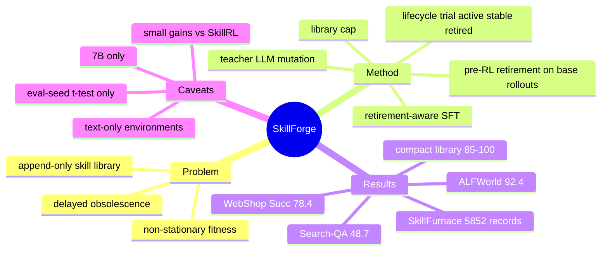

## Summary
SkillForge 在 SkillRL 的 skill-augmented GRPO 框架上，给 skill library 加了 fitness 驱动的生命周期（trial / active / stable / retired）、pre-RL 预淘汰和 teacher-LLM 驱动的 mutation，使 library 随策略一起演化而不是只增不减。Qwen2.5-7B 上 ALFWorld 92.4 / WebShop Succ 78.4 / Search-Aug QA 48.7，相对 SkillRL 的提升是 2.8% / 7.8%（relative）/ +1.9 点，同时 library 保持在 85-100 条；另发布 5,852 条记录的 SkillFurnace 数据集。收益较小，且证据来自单次训练 run，更像"给 SkillRL 加 library 维护"的增量工作。

## Problem & Motivation
现有 skill-augmented RL（SkillRL 等）把 skill library 当 append-only：低质量 skill 污染 context，library 无限膨胀，且一个曾经有效的 skill 会随策略变强而变得有害。作者把后者命名为 delayed obsolescence（fitness 曾达 stable 后又跌破 retire 阈值）。SkillsBench 已报告 curated library 里含有降低性能的 skill、library 越大边际收益递减，所以 library 质量控制是一个真实问题。关键难点是 skill fitness 在联合训练中非平稳（随策略变化）。

## Method
三阶段流程，初始 library 直接用 SkillRL 发布的 seed library（ALFWorld 44 / WebShop 66 / Search-QA 41 条）：
1. **Pre-retirement（SkillFurnace 初始化）**：用 base model 带 skill 跑 M 个 rollout，统计每条 skill 的 usage U 与 success C；proto-fitness f̂=C/U 低于 δ_pre（=0.3）且 U≥N_min（=3）的 skill 被预淘汰。SFT 数据只保留成功且未检索到被淘汰 skill 的轨迹，得到 π_sft，同时作 RL 初始化和 π_ref。
2. **Fitness tracking**：episode 级信用分配，一个 episode 内检索到的 K 条 skill 共享同一个二值 reward；f=C/U（U≥N_warm 才可信，否则默认值），累计平均而非 EMA。
3. **Lifecycle + mutation（每 10 步一个 forging cycle）**：状态 trial→active（U≥N_promote）→stable（f≥δ_stable=0.7 且 U≥N_stable）；stable 跌破阈值先降级回 active，active 且 f<δ_retire=0.4 才可被淘汰（每 cycle 最多 K_retire=3 条）。原始 distilled skill（generation 0）有更高的保护用量 N_protect。f 落在 [δ_low,δ_high] 的 active skill 按 P∝1-f 抽样为 parent（每 cycle 最多 K_mutate=5 个），把 parent 内容、fitness 和近期失败轨迹喂给 teacher（Kimi-K2.5，刻意选不同于策略的模型家族）生成 child，child 以 trial 状态进入，generation+1。library 有总上限 S_max，超限时淘汰最低 fitness 的 active skill。
4. 训练：verl + GRPO，200 步，lr 1e-6，G=8，β=0.001，64×H200；fixed π_ref 不随 library 更新（附录 F 论证 KL 在 library 变化下仍 well-defined）。

## Key Results
- **主结果（Table 2，Qwen2.5-7B-Instruct）**：ALFWorld All 92.4（SkillRL 89.9，GRPO 77.6，GPT-4o 48.0，Gemini-2.5-Pro 60.3）；WebShop Score 87.8 / Succ 78.4（SkillRL 85.2 / 72.7）。Look 子任务 86.6 vs 71.4，Clean 89.8 vs 90.0 基本持平。
- **Search-Augmented QA（Table 10）**：micro-avg 48.7（SkillRL 46.8，EvolveR 45.8，ZeroSearch 45.2）；Bamboogle 77.2 vs 73.8（该集仅 125 样本）；2Wiki 40.4 vs 40.3，MuSiQue 20.3 vs 20.2，几乎无差别。
- **消融（Table 3）**：去掉整个 forging 在 ALFWorld/WebShop/Search-QA 分别 -2.6/-5.8/-2.4；去 pre-retirement -1.7/-3.5/-1.2；去 retirement -1.0/-2.5/-0.8（library 涨到 132/121/111）；去 mutation -0.6/-1.6/-0.5。单项消融之和大于 w/o forging 的总降幅（作者称 sub-additive）。
- **Library 动态**：ALFWorld 200 步共创建 132 条、淘汰 32 条，最终 100 条（76 stable）；mutation 共 213 个 child，存活率 64.8% / 52.7% / 62.9%。
- **SkillFurnace（Table 1, 9）**：1,013 SFT 轨迹 + 4,521 library snapshot + 318 retirement events = 5,852 条；被淘汰 skill 平均 peak fitness 0.667、淘汰时下跌 0.278、57.2% 曾达 stable；8 类人工失败标注中 "overly rigid ordering" 占 74.5%，仅 3.1% 属 redundant with policy。
- **显著性**：5 个评测 seed 的 one-sample t-test 对 SkillRL 点估计，三个环境 p 均 <1e-3。

## Evidence Ledger
| Claim ID | Claim | Type | Source locator | Evidence excerpt | Status |
|:--|:--|:--|:--|:--|:--|
| C1 | SkillForge 在 ALFWorld 上 All 成功率为 92.4%，SkillRL 为 89.9% | number | Table 2 | "SkillRL ... 89.9 ▲75.1"; "SkillForge ... 92.4 ▲77.6" (flattened rows) | source-verified |
| C2 | SkillForge 在 WebShop 上 Succ 为 78.4%，SkillRL 为 72.7%（相对 +7.8%） | number | Table 2; Sec 5.2 | "improving over SkillRL by 2.8% relative on ALFWorld and 7.8% relative on WebShop" | source-verified |
| C3 | SkillForge 在 WebShop Score 上为 87.8，SkillRL 为 85.2 | number | Table 2 | "87.8 ▲61.4" vs "85.2 ▲58.8" (flattened rows) | source-verified |
| C4 | SkillForge 在 Search-Augmented QA 上 micro-avg 为 48.7，SkillRL 为 46.8 | number | Table 10 | "SkillRL 45.9 63.3 45.9 43.2 40.3 20.2 73.8 46.8 SkillForge (Ours) 48.2 65.0 50.1 43.9 40.4 20.3 77.2 48.7" | source-verified |
| C5 | Search-QA 表中非 SkillForge 行的单数据集数字取自各自原论文，Overall 在统一的 51,713 样本上重新计算 | benchmark-setting | Table 10 caption | "Per-dataset cells for non-SkillForge rows are taken from their respective source papers." | source-verified |
| C6 | ALFWorld Look 子任务 SkillForge 86.6 vs SkillRL 71.4（相对 +21.3%），Clean 基本持平 | comparison | Table 2; Sec 5.2 | "largest per-subtask relative improvement over SkillRL is on ALFWorld's Look at 21.3%" | source-verified |
| C7 | Search-QA 上 Bamboogle 77.2 vs 73.8，该测试集仅 125 样本 | number | Table 10 | "Bamboogle ... 125" ; "73.8 ... 77.2" | source-verified |
| C8 | 消融：去掉整个 forging 使 WebShop 下降 5.8 点（78.4→72.6），ALFWorld 下降 2.6，Search-QA 下降 2.4 | number | Table 3 | "w/o forging 44 89.8 ▼2.6 66 72.6 ▼5.8 41 46.3 ▼2.4" | source-verified |
| C9 | 去 pre-retirement 分别下降 1.7 / 3.5 / 1.2，作者称其为单项最重要组件 | causal-mechanism | Table 3; Sec 5.3 | "Pre-retirement is the single most impactful component" | source-verified |
| C10 | 去 retirement 使 library 涨到 132/121/111 且成功率低于完整方法 | comparison | Table 3 | "w/o retirement 132 91.4 ▼1.0 121 75.9 ▼2.5 111 47.9 ▼0.8" | source-verified |
| C11 | 去 mutation 仅下降 0.6 / 1.6 / 0.5 | number | Table 3 | "w/o mutation 44 91.8 ▼0.6 66 76.8 ▼1.6 41 48.2 ▼0.5" | source-verified |
| C12 | 基础模型 Qwen2.5-7B-Instruct，GRPO 200 步，group size 8，mutation teacher 为 Kimi-K2.5，forging 每 10 步一次 | benchmark-setting | Sec 5.1 Implementation | "The forging cycle executes every 10 training steps, with up to K_mutate=5 mutations and K_retire=3 retirements per cycle" | source-verified |
| C13 | 初始 library 直接继承 SkillRL 发布版本（44/66/41 条） | benchmark-setting | Appendix B Training configuration | "all inherited from the SkillRL release" | source-verified |
| C14 | 每个报告分数是 best validation checkpoint 上 5 个评测采样 seed 的均值（ALFWorld 92.4±0.5） | benchmark-setting | Appendix H Evaluation protocol | "averaged over five evaluation runs of the best validation checkpoint with sampling seeds {30,40,42,50,62}" | source-verified |
| C15 | 显著性检验是对 SkillRL 点估计的 one-sample t-test（n=5, df=4），三个环境 p<1e-3 | causal-mechanism | Appendix H Statistical significance | "one-sample t-test against the SkillRL point estimate ... (n=5, df=4)" | source-verified |
| C16 | Fitness 为 episode 级信用，一个 episode 内检索到的 K 条 skill 共享同一 reward；作者承认无法区分个体贡献 | causal-mechanism | Sec 4.2; Appendix G | "the signal cannot distinguish individual skill contributions" | source-verified |
| C17 | SkillFurnace 共 5,852 条记录（1,013 SFT + 4,521 snapshot + 318 retirement events） | number | Table 1; Appendix C | "In total, SkillFurnace contains 5,852 annotated records across the three environments" | source-verified |
| C18 | 被淘汰 skill 平均 peak fitness 0.667、淘汰时下降 0.278，57.2% 曾达 stable（delayed obsolescence） | number | Table 1 | "Stable before retirement (%) 60.1 58.7 47.5 57.2" | source-verified |
| C19 | 318 个 retirement event 的 8 类标注中 overly rigid ordering 占 74.5%，仅 10 条（3.1%）为 redundant with policy | number | Appendix E.2 | "Only 10 of the 318 retirement events (3.1%) are labeled redundant with policy" | source-verified |
| C20 | 人工标注为 2 位标注者，初次一致性 Cohen's κ=0.5，分歧经讨论解决 | benchmark-setting | Appendix E.2 | "an initial pass reached Cohen's κ=0.5 inter-annotator agreement" | source-verified |
| C21 | 318 个 retirement event 聚合自主训练 run 以及此前记录的消融/重复 seed run，因此多于主 run 的淘汰数 | benchmark-setting | Appendix C | "additional previously recorded training runs (ablation variants and replicate seeds)" | source-verified |
| C22 | 共 213 个 mutant，存活率 64.8% / 52.7% / 62.9% | number | Appendix H Mutation survival | "the mutant survival rate is 64.8%, 52.7%, and 62.9% respectively" | source-verified |
| C23 | 作者声称 SkillForge 相对此前 skill-augmented RL 的新颖点是 library 非 append-only（retire + mutation） | sota-novelty | Sec 1, 2 | "In all of them the repository is monotone: entries persist once added and cannot be corrected" | source-verified |
| C24 | 全部实验只用 7B 基座，作者承认更大模型上的生命周期动态可能不同 | causal-mechanism | Appendix G | "All experiments use a 7B base model; lifecycle dynamics under larger models may differ" | source-verified |

## Strengths & Weaknesses
**Strengths**
- 问题抓得准：skill library 的质量控制和策略变强后的 skill 失效确实是 skill-augmented RL 的盲点；把 fitness 当成非平稳量处理、用 "先降级再淘汰" 的双门槛避免瞬时波动误杀，设计清楚。
- 消融信息量足：不仅报成功率，还报 library 大小。"w/o retirement 的 library 涨到 132 但成功率更低" 是 "quality 不是 scale" 的直接证据。
- SkillFurnace 的失败标注有独立价值：318 个事件里 74.5% 是 "overly rigid ordering"，仅 3.1% 是 "策略已经内化了这条 skill"。这反驳了 "obsolete skill 只是无害拐杖" 的想当然，说明 LLM 蒸馏出的 skill 的主要缺陷是过度规定步骤顺序。

**Weaknesses**
- **增益小且统计口径弱**：Search-QA 上 +1.9，2Wiki +0.1、MuSiQue +0.1；WebShop 的 +7.8% 是 relative，绝对 +5.7 点。显著性检验是对 *同一个训练好的模型* 的 5 个评测采样 seed 做 one-sample t-test，对象是 SkillRL 的单个点估计；它度量的是评测采样噪声，不是训练 seed 方差，也没说明 SkillRL 的数字是否同设置下复现（Table 2 未注明来源，Table 10 明说取自原论文）。训练 run 数量未说明（附录 C 提到有 "replicate seeds"，但主结果仍是单模型）。p=1e-6 的 t 值在这个设计下没有太大意义。
- **组件归因不干净**：pre-retirement 是最大贡献（-1.2 到 -3.5），但它本质是对 SFT 数据的过滤，且 seed library 只有 41-66 条，实际预淘汰 "typically 0-3 skills"。也就是说最大的收益来自删 0-3 条 skill 对 SFT 数据的影响，这个机制没有被单独检验（比如只过滤 SFT 数据而不改 library）。mutation 贡献最小（-0.5 到 -1.6），而它是 "co-evolution" 叙事里最有新意的部分。
- **Teacher 依赖与信息泄漏边界**：mutation 由 Kimi-K2.5 完成，baseline 里没有"同样调用 teacher 但不做 lifecycle"的对照（如 teacher 周期性重写全库），无法区分增益来自 lifecycle 还是来自更强 teacher 的额外信息。
- **信用分配粗糙**：episode 级共享 reward，作者以 "共检索频率 <15%" 作缓解，但这依赖 applicability-conditioned retrieval 把 skill 按 task type 切开，换成开放任务分布时假设不成立。
- **评测范围窄**：三个环境都是文本交互环境、任务分布固定且 library 小（<=100），WebShop 是文本化模拟而非真实 GUI/浏览器；只有 7B 模型；未验证 library 规模大到检索噪声成为瓶颈（正是引言的动机）时的表现。
- 无代码链接；SkillFurnace 的 release 形式与许可在文中仅描述，未给出 URL。
- 失败标注 κ=0.5 只属 moderate agreement；8 类分类学由作者预设，"rigid ordering 占 74.5%" 的比例会受类别定义影响。

## Mind Map

## Notes
- **同名辨析**：`[[2607-RethinkSkillEvolve]]` 中提到的 "SkillRevise/SkillForge"（diagnosis-oriented 的自演化 skill 系统）是 2026-07 之前的工作，而本文 arXiv 提交于 2026-10-07，且是 agentic RL 训练方法，不是 diagnosis-oriented 的推理期 skill 更新系统。RethinkSkillEvolve 笔记里没有给出该 SkillForge 的 arXiv id，因此这是两个不同的系统（同名，不是同一篇论文）的推断，依据是时间先后与方法类型，未能进一步核对对方的出处。
- 与 SkillRL 的关系：本文以 SkillRL 的 seed library、训练配方和 benchmark 为底座，增益全部相对 SkillRL 度量；SkillRL 本身在 vault 中没有独立笔记（`[[2604-Skill0]]` 把它当 baseline，并指出其 inference token 开销为 2.21k/0.87k）。
- `[[2604-Skill0]]`：同一问题的反向解法——不是维护 library，而是通过 in-context RL 把 skill 内化进参数、推理期不再带 skill；SkillForge 的 "策略变强后 skill 变有害" 与 Skill0 的 "skill 最终应被内化" 可以互相印证，但 SkillForge 的 SkillFurnace 中仅 3.1% 的退役属于 "已被策略内化"，这与 Skill0 的叙事有张力。
- `[[2605-Skill1]]`：同样做 skill-augmented agent 的统一演化 RL，可组合性问题是 skill 选择/生成是否也进入 RL 目标，而 SkillForge 的 lifecycle 是外部启发式规则。
- `[[2601-MemRL]]`：SkillForge 的 baseline 之一（MemRL 在 ALFWorld 上仅 21.4），说明 episodic memory RL 在该设置下不敌 skill 类方法。
- 标签说明：WebShop 虽为 web 环境，但是文本化的购物模拟，评测不涉及 GUI observation/action，故不加 `gui-agent`/`web-agent` umbrella。
