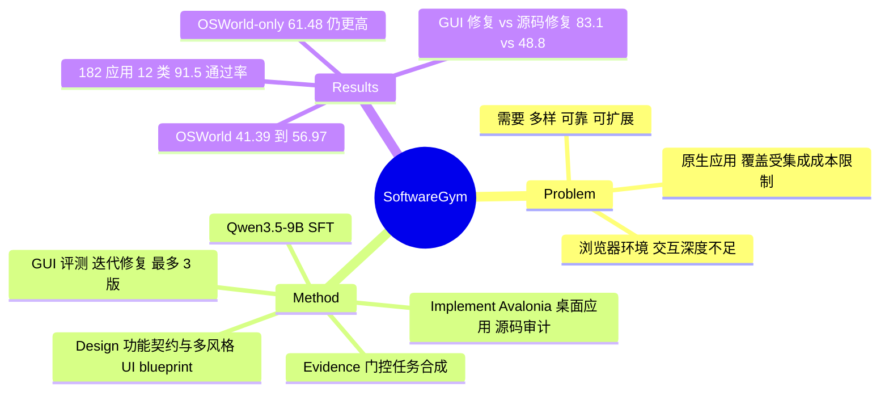

## Summary
SoftwareGym 用 Codex CLI agents（GPT-5.5）走"设计 → 实现 → GUI 评测并修复"三阶段流水线，批量合成独立的 Avalonia 桌面应用作为 CUA 训练环境，得到 182 个应用、12 个类别、平均 GUI 任务通过率 91.5%。仅用这些应用上收集的轨迹对 Qwen3.5-9B 做 SFT，OSWorld（8 个应用域、244 题）Pass@3 从 41.39% 升至 56.97%，且训练中不含任何 OSWorld 应用/任务/轨迹。关键对照显示：同等规模的 OSWorld 原生轨迹训练得 61.48%，合成环境尚未超过原生环境，但两者合并在 SoftwareGym-Bench 上更优（47.5%）。

## Problem & Motivation
CUA 训练需要大量可执行、多样、可靠的软件环境。作者把现有路线分成两类：在已有桌面/移动应用上合成任务与轨迹（OS-Genesis、AgentSynth、EvoCUA 等），应用覆盖受集成成本限制，且反复在固定软件池上训练有 application-specific overfitting 风险；合成浏览器托管环境（InfiniteWeb、AutoWebWorld、GUI-GENESIS、ScaleWoB），部署简单，但共享的 browser/HTML/DOM 底座限制了交互深度和持久化工作流。论文提出同时满足三点：界面与交互多样性、功能可靠性、低工程成本可扩展。

## Method
三阶段多 agent 流水线（§3，均由 Codex CLI + GPT-5.5 驱动；GUI 测试由 Seed 2.1 Pro 执行）：
- **Software Design**：FunctionDesigner 把软件类型扩展成 Software Specification，每个功能写成含用户入口、动作、预期状态更新、可见 GUI 响应、验收 checkpoint 的"实现与评测契约"。StyleDesigner 为同一功能规格生成多套 Avalonia UI blueprint，要求任意两个变体至少在两个 layout 维度上不同；对 blueprint 的 layout tree 计算 pairwise tree-edit distance，低于阈值则重生成最相似的一个。IconDesigner/SubIconDesigner 为每个变体生成结构不同的 SVG 图标。
- **Implementation & Evaluation**：Coder 实现完整应用并写 functional manual，DevCoder 做源码审计；EvalTaskGenerateAgent 基于 manual 生成 GUI 测试用例（首轮后固定、跨修复轮复用）；GUIAgent 以鼠标键盘执行，输出 trace、失败位置与修复建议，回灌给 Coder。最多 3 个版本（v1-v3），全通过即早停。另有 visual-fidelity 分数检查修复后界面是否偏离 blueprint。
- **Task Synthesis**：只用"被 GUI 测试通过证据支撑"的 capability 建 function tree；按 easy/normal/hard 三档（hard 为前一阶段状态是后一阶段前提的多阶段工作流）和 file-based/blank-state 两类生成任务，并做确定性校验。
- **训练**：用两个 GPT-5.5 judge 分别打 outcome 与 process 分，两者均 ≥0.8 才保留轨迹；每个 frozen semantic group 最多留 2 条；对 Qwen3.5-9B 做 full-parameter SFT（1 epoch，lr 5e-6，冻结 visual encoder 与 merger），无 RL。
- **SoftwareGym-Bench**：12 类各选 1 个应用，每应用 10 个人工核验任务，共 120 题，含 distractor 与 protected object，程序化判分。

## Key Results
- **OSWorld（Table 1，Pass@3，8 个应用域，244 题）**：Qwen3.5-9B Base 41.39% → SFT 56.97%（+15.58）；八个域全部提升，但 Calc 仅 27.66 → 31.91。对比同量级开源模型：EvoCUA-8B 56.56%、DART-GUI-7B 50.41%、OpenCUA-7B 35.25%、UI-TARS-1.5-7B 33.20%；对比 32B：EvoCUA-32B 67.62%、OpenCUA-32B 48.77%；闭源 GPT-5.5 71.31%、Gemini 3.1 Pro 79.10%、Seed 2.1 Pro 79.51%。即 56.97% 与 EvoCUA-8B 基本持平。
- **SoftwareGym-Bench（Table 2）**：9B Base 25.8% → 40.0%；高于 Qwen3.7-Plus 38.3%、EvoCUA-32B 35.0%、Qwen3-VL-235B-Thinking 31.7%；低于 GPT-5.5 73.3%、GPT-5.4 74.2%、Kimi K2.5 62.5%。SFT 后 Slides 30→20、Table 20→10 反而下降。
- **训练数据来源消融（Table 3）**：OSWorld-only 在 OSWorld 61.48%、在 SoftwareGym-Bench 33.3%；SoftwareGym-only 为 56.97% / 40.0%；二者合并为 58.61% / 47.5%。两个单源数据集各自对齐到 3,715 条轨迹、55,263 序列化样本，合并组为二者直接拼接（并非三组对齐）；overlength 过滤后 49,445（SG）、49,496（OSWorld）、98,941（合并）。
- **合成质量**：182 个应用；GUI 任务平均通过率 v1 54.9% → v2 81.1% → v3 91.5%。121 个应用（8 个与 OSWorld 对齐的类别）上，GUI 证据覆盖全部 49 个 major module 和平均 78.8% 的 concrete native function。
- **消融**：Full Design vs simplified，macro 结构多样性 83.6 vs 4.9；GUI-guided repair 50.4% → 83.1%，source-only repair 50.4% → 48.8%（36 个应用，GUI-guided 在 36/36 个应用上胜出）。
- **成本**：抽样 20 个应用，平均每个 237.3 分钟、14.8M tokens、1,718 次模型调用、约 $70.76。

## Evidence Ledger
| Claim ID | Claim | Type | Source locator | Evidence excerpt | Status |
|:--|:--|:--|:--|:--|:--|
| C1 | 合成了 182 个应用、12 个类别，平均 GUI 任务通过率 91.5% | number | Abstract; §1 | "we synthesize 182 applications across twelve categories and achieve a mean GUI task pass rate of 91.5%" | source-verified |
| C2 | SFT 后 Qwen3.5-9B 在 OSWorld Pass@3 从 41.39% 升至 56.97% | number | Abstract; Table 1 | "improves Pass@3 from 41.39% to 56.97% on the strictly out-of-domain OSWorld benchmark" | source-verified |
| C3 | 训练中没有使用任何 OSWorld 应用、任务或轨迹（SoftwareGym-only 模型） | benchmark-setting | §1; App. C.3 | "Without using any OSWorld applications, tasks, or trajectories for training" | source-verified |
| C4 | OSWorld 评测使用 8 个应用域共 244 题 | benchmark-setting | §4.1 Evaluation and Baselines | "OSWorld uses 244 tasks from eight application domains" | source-verified |
| C5 | SoftwareGym-Bench 共 120 题：12 类各 1 个应用、每应用 10 个人工核验任务 | benchmark-setting | §4.1 SoftwareGym-Bench | "We select one application from each of twelve software categories and ten manually verified tasks per application, yielding 120 tasks" | source-verified |
| C6 | 9B 模型在 SoftwareGym-Bench 上从 25.8% 提升到 40.0% Pass@3 | number | §4.2; Table 2 | "raising Pass@3 by 14.2 points from 25.8% to 40.0%" | source-verified |
| C7 | SFT 模型在 SoftwareGym-Bench 上高于 Qwen3.7-Plus（38.3%）与若干更大的专用 CUA | comparison | §4.2; Table 2 | "The resulting model exceeds Qwen3.7-Plus and several substantially larger specialized CUAs." | source-verified |
| C8 | 8B EvoCUA 在 OSWorld 子集上 Pass@3 为 56.56%，与本文 56.97% 基本持平 | comparison | Table 1 | "EvoCUA-8B ... 56.56" (table row, flattened) | source-verified |
| C9 | OSWorld-only 训练的模型在 OSWorld 上为 61.48%，高于 SoftwareGym-only 的 56.97% | comparison | Table 3(a); App. C.3 | "compared with 61.48% for the OSWorld-only model" | source-verified |
| C10 | 合并两种来源后 SoftwareGym-Bench 为 47.5%，OSWorld 为 58.61% | number | Table 3; App. C.3 | "reaching 47.5% on SoftwareGym-Bench while retaining 58.61% on OSWorld" | source-verified |
| C11 | SoftwareGym-only 与 OSWorld-only 两个单源数据集各对齐到 3,715 条轨迹、55,263 序列化样本；合并组为直接拼接（原 claim 误写为"三组对齐"，经 verifier 纠正） | benchmark-setting | App. C.3 | "each matched to 3,715 trajectories and 55,263 serialized examples" | source-verified |
| C12 | 训练为 Qwen3.5-9B full-parameter SFT 一个 epoch，visual encoder 与 merger 冻结，lr 5e-6 | benchmark-setting | App. C.3 | "full-parameter SFT of the language model for one epoch; the visual encoder and merger are frozen" | source-verified |
| C13 | 轨迹仅在两个 GPT-5.5 judge 的 outcome 与 process 分数均 ≥0.8 时保留 | causal-mechanism | App. E.1 | "We retain an attempt only when both scores are at least 0.8." | source-verified |
| C14 | 迭代修复使平均 GUI 通过率 v1 54.9% → v2 81.1% → v3 91.5% | number | §4.2 Software Synthesis Analysis; Fig. 6 | "increases from 54.9% at v1 to 81.1% at v2 and 91.5% at v3" | source-verified |
| C15 | GUI-guided repair 从 50.4% 升到 83.1%，source-only repair 终为 48.8% | comparison | §4.3; App. C.2 Table 5 | "Starting from the same initial pass rate of 50.4%, GUI-guided repair reaches 83.1%, whereas source-only repair ends at 48.8%" | source-verified |
| C16 | GUI-guided repair 在 36/36 个应用上胜出，差距 34.3 点（95% CI 28.2-41.0） | number | App. C.2 | "GUI-guided repair wins on all 36 applications." | source-verified |
| C17 | 结构化 style design 使 macro 多样性得分从 4.9 升到 83.6 | number | §4.3 Style Design; App. C.1 | "Full Design improves the macro-average diversity score from 4.9 to 83.6" | source-verified |
| C18 | 121 个应用上 GUI 证据覆盖全部 49 个 major module 与平均 78.8% concrete native function | number | §4.2; Fig. 4(b) | "GUI evaluations cover all 49 major functional modules and 78.8% of concrete functions on average" | source-verified |
| C19 | 每个应用平均 237.3 分钟、14.8M tokens、1,718 次调用、约 $70.76（20 个抽样应用） | number | §4.2; Fig. 5 | "Each application requires 237.3 minutes, 14.8 million tokens, 1,718 model calls, and an estimated $70.76 on average." | source-verified |
| C20 | 合成使用 Codex CLI + GPT-5.5，GUI 评估由 Seed 2.1 Pro 执行，每用例最多 50 步，最多 3 个版本 | benchmark-setting | §4.1 Software Synthesis | "Seed 2.1 Pro evaluates each version through mouse-and-keyboard interaction for up to 50 steps per case" | source-verified |
| C21 | 评测统一为 temperature 1、100 步预算、3 次独立 rollout，报告 Pass@3 | benchmark-setting | §4.1 Evaluation and Baselines | "We set the temperature to 1 and the interaction budget to 100 steps. Each task is evaluated with three independent rollouts." | source-verified |
| C22 | 差异化论断：与 browser-hosted 合成方法不同，本文合成独立桌面应用 | sota-novelty | §2 | "SoftwareGym instead synthesizes standalone desktop applications." | source-verified |
| C23 | 代码与模型已公开（GitHub 与 HuggingFace 链接） | license-code | Abstract 首页 Code/Model 条目 | "https://github.com/MrKiing-Jin/SoftwareGym" | source-verified |

## Strengths & Weaknesses
**优点**
- 问题表述清楚：把"环境多样性 / 功能可靠性 / 扩展成本"拆成可测量的三项，并各给一个机制（layout tree-edit distance 约束、GUI 证据门控、全自动流水线）。
- 最有信息量的是 C.2 消融：source-only repair 不仅不涨，还从 50.4% 掉到 48.8%，说明"LLM 自己读代码修代码"在 GUI 功能上会无效甚至退化，运行时 GUI 反馈是必要信号。这是对"代码 agent 自我修复"的一个干净反例，且 36/36 应用一致。
- 任务生成用"被 GUI 通过证据支撑的 capability"做门控，避免任务依赖未被验证的功能，这是合成环境里常被忽略的一致性问题。
- 训练来源消融对齐了轨迹数与样本数，源头是主要变量，设计较克制。

**缺点与边界**
- **合成环境没有胜过原生环境**：OSWorld-only 训练得 61.48%，高于 SoftwareGym-only 的 56.97%；对 OSWorld 而言合成数据只是"够用的替代"，而非更优。文中"strong out-of-domain generalization"措辞比数据更强。另一方面，合并后 OSWorld 反降到 58.61%（低于 OSWorld-only），说明简单拼接并无互补收益，仅 SoftwareGym-Bench 上受益（该基准本身与合成分布同源）。
- **与同量级基线几乎持平**：56.97% vs EvoCUA-8B 56.56%，OSWorld 子集上没有显示合成环境路线优于已有合成轨迹路线；两者训练数据、基座、规模均不同，因果归因做不到。
- **基准口径**：只用 OSWorld 的 8 个应用域 244 题，并非完整 OSWorld；指标是 Pass@3（3 次 rollout 任一成功），不是 Pass@1/平均成功率，高估实际部署可靠性。12 个类别显然是按 OSWorld 应用类型挑选的（Chrome/GIMP/Calc/Impress/Writer/Thunderbird/VLC/VS Code 对应 Browser/Pic/Table/Slides/Writer/Mail/Video/Code），所以"strictly out-of-domain"仅指实例层面，类别层面是对齐的；可迁移性到类别外软件未检验。
- **SoftwareGym-Bench 同源**：基准由同一应用库构建，Pass@3 = 40.0% 的"打败更大 CUA"比较不是公平的 out-of-distribution 对比；120 题、每类仅 10 题，类别粒度结论噪声大（单题 10 个百分点）。SFT 后 Slides 与 Table 反而下降。
- **轨迹教师与蒸馏混淆**：正文未明确谁生成训练轨迹（附录只提 "teacher schema"，并由 GPT-5.5 judge 过滤）。若教师是 Seed 2.1 Pro 等强闭源模型，则增益部分来自蒸馏而不是环境本身。此点论文未交代，属于"不知道"。
- **只做 SFT**：叫 "Gym" 却没有在环境里做 RL 或在线交互，未验证环境作为 RL 环境的价值（reward、可重置性、并行吞吐）；合成与评测用的 verifier 本身也由 LLM 驱动。
- **可靠性定义内生**：91.5% 通过率是用同一个 GUI agent 与由 manual 生成的用例衡量，用例在 v1 后固定，存在"为通过测试而修"的风险；通过率不等于功能真实正确。
- **成本**：约 $70.76/个应用、近 4 小时，整库 182 个应用约 $12.9k（由作者的单应用均值外推，非论文数字）；对比其声称的"远低于手工开发"未给人工开发成本数据。
- 单次运行、无多 seed 方差；多个对比（C8）差距在噪声内。

## Mind Map

## Notes
- 同一问题（合成可训练 CUA 环境）：[[2606-CUAGym]] 做可验证训练环境与任务的规模化，路线是对真实应用建环境；SoftwareGym 与之互补，从零合成应用。可对照两者在 OSWorld 上的增益。
- [[2600-GuiGenesisAutomatedSynthesis]]：浏览器托管的合成环境（本文的直接对立面），本文声称因 HTML/DOM 底座限制交互深度；但本文未与其做实验对比。
- [[2600-InfinitewebScalableWebEnvironment]]：同属合成环境路线，限于网页；可组合点是把 web 与桌面合成统一进一个多样性度量。
- 可深挖：C.2 的"source-only 修复退化"结论与 survey 中"环境/奖励自我修复"类主张存在张力，值得在 CUA-Survey 中作为反证记录。
