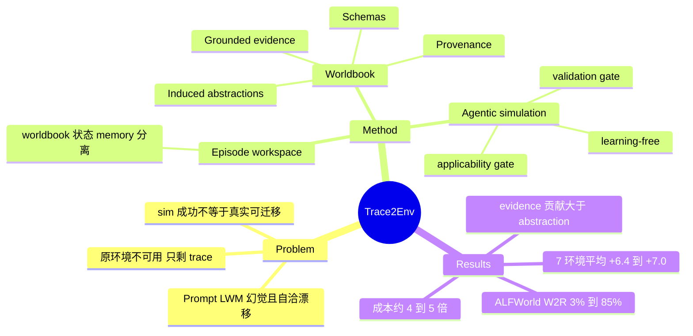

## Summary
Trace2Env 在"原环境不可用、只剩历史交互 trace"的设定下，用 LLM 把 trace 离线重构成一个非可执行的 environment worldbook（schema + grounded evidence + induced abstraction + provenance），在线时由一个 world model agent 查阅 worldbook 并配合持久 episode state 来预测观察与状态变化，再经 harness 校验后提交。learning-free；在 7 个 next-observation 环境上平均分比 Direct Prompting 高 6.43/7.04 分，在 ALFWorld 上把"sim 中的动作序列回放到真实环境"的成功率从 3% 提到 85%。注意：这是 environment simulator / language world model 的工作，并未把合成环境用于 agent 训练（作者列为 future work）。

## Problem & Motivation
真实环境副本对训练和评测 LLM agent 越来越有价值，但原系统可能无法访问或难以复现。已有 language world model（LWM）多是单次 prompt 预测下一观察，存在两个问题：(1) 参数知识与真实环境行为不一致，细节（格式、约束、前置条件）容易幻觉；(2) 一次幻觉转移之后模型会在虚假状态上自洽地继续，导致 sim 内"成功"但回放到真实环境失败。作者形式化的设定是 trace-based environment reconstruction：输入只有 N 条历史 trace，LWM 参数固定，原环境实现与隐状态不可见，目标是逼近新动作序列下的可观察行为。

## Method
- **Worldbook（离线，一次构建、不可变）**：由构建模型（gpt-5.6-sol）从 trace 抽取四类内容——Schemas（动作接口与可维护状态变量）、Grounded evidence（原始转移与示范，歧义归因的效应被剔除）、Induced abstractions（条件效应、约束、observation contract，规则需用支持/对照案例复核：成功-失败对比提示缺失前置条件，反例收窄规则）、Provenance（回链到 trace 与 turn）。
- **Persistent episode workspace** $\mathcal{W}_t=(K_\mathcal{E},\hat s_t,M_t)$：worldbook（环境怎么运作）、episode 状态（当前什么为真）、episodic memory（之前发生过什么）三者分离，避免把跨 episode 事实当成本 episode 的事实；缺失的状态项视为 unknown 而非"不存在"。
- **Agentic simulation**：world model agent 按需检索/检查 workspace，并用 applicability gate 把检索到的条目标成 supporting / uncertain / format-only（相关不等于适用）；输出 transition proposal（候选状态效应 + 观察），harness 在状态副本上做 validation gate（对照 schema、规则支持、状态约束），通过才提交。
- 同一 worldbook 可被不同 backbone 复用（gpt-5.6-sol 构建，deepseek-v4.1-flash 运行）。

## Key Results
- **Next-observation（AgentWorldBench 的 Terminal/SWE/Android/Web + EnvScaler 的 Food/Shopping/Benefits）**：平均分 75.94（gpt-5.6-sol）与 75.75（deepseek-v4.1-flash），比 Direct Prompting（69.51 / 68.71）高 6.43 / 7.04；14 个 environment-backbone 对中 11 个最优，且从不低于 Direct Prompting。Terminal 上 gpt 从 55.76 到 65.42。
- **基线梯度**：Trace RAG Prompting 73.76、Worldbook Prompting（静态塞进 prompt）74.35、Harness only（无 worldbook）70.79、完整 Trace2Env 75.94（gpt）。worldbook 与 runtime 互补，但 Worldbook Prompting 与完整系统只差 1.6 分，且 Worldbook Prompting 在 14 对中有若干对略优于完整系统。
- **Long-horizon consistency（Table 2）**：ALFWorld 上 Direct Prompting 的 WM 成功率 97% 但 W2R 仅 3%（CR 0.032），Trace2Env 为 88% / 85%（CR 0.914）；SciWorld 上 DP 92.5% / 45%（CR 0.529），Trace2Env 87.5% / 60%（CR 0.706）。即 sim 内成功率更高反而更不可信。
- **Worldbook 消融（Terminal）**：schema-only 62.05；加 evidence +2.45±0.89；仅加 abstraction −1.12±0.90；已有 evidence 时再加 abstraction 仅 +0.69±0.63，而已有 abstraction 时加 evidence +4.26±1.02。即 evidence 是主要贡献，abstraction 单独无益。
- **Agent 侧消融**：去掉 adaptive loop −1.79±0.91，去掉 state tracking −0.97±0.78。
- **Trace 规模**：Terminal 上 20 trace 64.89 → 36 trace 66.42，曲线仍在上升；5-15 trace 不稳定。
- **成本**：Terminal 上 Trace2Env 每条 5.0 次调用、约 $0.187、38.1 s，Direct Prompting 1.0 次、约 $0.04、26.0 s。
- **未见任务**：Terminal/Web/SWE 上构建集中没有的任务，增益仍显著（Appendix B.3）。

## Evidence Ledger
| Claim ID | Claim | Type | Source locator | Evidence excerpt | Status |
|:--|:--|:--|:--|:--|:--|
| C1 | 评测覆盖 9 个环境：7 个 next-observation 环境 + 2 个 multi-turn 文本游戏 | benchmark-setting | §5.1 Environments | "For multi-turn interaction, we use two text-game environments, ALFWorld and SciWorld" | source-verified |
| C2 | Trace2Env 平均分 75.94（gpt）/75.75（deepseek），比 Direct Prompting 高 6.43/7.04 | number | §5.2; Table 1 | "improving over Direct Prompting by 6.43 and 7.04 points respectively" | source-verified |
| C3 | Direct Prompting 平均分为 69.51（gpt）/68.71（deepseek） | number | Table 1 (表格被拍平，Avg 列按行序推定) | "Direct Prompting 55.76 65.87 62.80 54.23 81.67 77.32 88.89 69.51" | source-verified |
| C4 | 14 个 environment-backbone 对中 Trace2Env 最优 11 个，且从未低于 Direct Prompting | comparison | §5.2 | "It is best in 11 of 14 environment–backbone pairs and never underperforms Direct Prompting." | source-verified |
| C5 | Terminal 上 gpt-5.6-sol 下 Trace2Env 65.42，Direct Prompting 55.76 | number | Table 1 (flattened rows) | "Trace2Env 65.42 70.59 65.10 59.55 87.43 85.36 98.11 75.94" | source-verified |
| C6 | Worldbook Prompting 平均 74.35（gpt）、Harness only 70.79（gpt）、Trace RAG 73.76（gpt） | number | §5.2; Table 1 | "raises the average from 73.76 to 74.35 with GPT and from 73.06 to 74.86 with DeepSeek" | source-verified |
| C7 | ALFWorld：Direct Prompting WM 97%、W2R 3%、CR 0.032；Trace2Env 88%/85%/0.914 | number | Table 2 | "Direct Prompting 93% 97% 3% 0.032 Trace2Env 93% 88% 85% 0.914" | source-verified |
| C8 | SciWorld：Direct Prompting WM 92.5%、W2R 45%、CR 0.529；Trace2Env 87.5%/60%/0.706 | number | Table 2 | "Direct Prompting 85% 92.5% 45% 0.529 Trace2Env 85% 87.5% 60% 0.706" | source-verified |
| C9 | Table 2 的 multi-turn 对比只含 Direct Prompting，不含 Trace RAG / Worldbook Prompting 基线 | benchmark-setting | Table 2; §5.1 Compared methods | "Direct Prompting 93% 97% 3% 0.032" (Table 2 仅两行方法) | source-verified |
| C10 | SciWorld 评测任务数为 40（由 Table 4 的 "40 tasks" 与 5pp 粒度推断，行归属未直接确认） | benchmark-setting | Table 4 (flattened) | "40 tasks" | source-verified |
| C11 | ALFWorld 评测用 held-out 的前 100 个 Word2World test task | benchmark-setting | Appendix A | "we hold out the first 100 Word2World test tasks for evaluation" | source-verified |
| C12 | Terminal 消融：evidence 单独 +2.45±0.89，abstraction 单独 −1.12±0.90 | number | Table 3 | "evidence provides the stronger standalone gain, improving the schema-only variant by +2.45±0.89 , while abstraction alone does not help" | source-verified |
| C13 | 给定 abstraction 加 evidence +4.26±1.02；给定 evidence 加 abstraction +0.69±0.63 | number | §5.4; Table 3 | "adding evidence to an abstracted worldbook gives +4.26±1.02" | source-verified |
| C14 | 去 adaptive loop −1.79±0.91，去 state tracking −0.97±0.78 | number | Appendix B.4 Agent-side components | "Removing the adaptive loop reduces performance by 1.79±0.91 , while removing persistent state tracking reduces it by 0.97±0.78" | source-verified |
| C15 | Terminal worldbook 从 20 trace 64.89 升到 36 trace 66.42，曲线仍上升 | number | §5.4; Figure 3 | "improves steadily from 64.89 at 20 traces to 66.42 at 36 traces" | source-verified |
| C16 | Terminal 上 Trace2Env 每条记录 5.0 次模型调用、约 $0.187、38.1 s；Direct Prompting 1.0 次、约 $0.04、26.0 s | number | Appendix B.5 Table 10 | "Trace2Env 64.89 5.0 0.187 38.1" | source-verified |
| C17 | 构建 trace 数量：Terminal 20（Terminal-Bench 2.0）、Web 50（WebArena）、ALFWorld 40、SciWorld 30 | number | §5.1 Trace collection | "20 trajectories on Terminal-Bench 2.0 and 50 trajectories on WebArena" | source-verified |
| C18 | 所有 worldbook 由 gpt-5.6-sol 一次构建并跨 backbone 固定 | benchmark-setting | §5.1 | "All worldbooks are reconstructed once using gpt-5.6-sol and then kept fixed across world model backbones." | source-verified |
| C19 | next-observation 打分由 gpt-5.2 作 judge，五个维度 Format/Factuality/Consistency/Realism/Quality | benchmark-setting | §5.1 Metrics | "gpt-5.2 scores each prediction on Format, Factuality, Consistency, Realism, and Quality from 1 to 5" | source-verified |
| C20 | AgentWorldBench 上 trajectory-clustered CI 在两个 backbone 的每个环境都不含 0 | comparison | §5.2; Appendix B.2 | "trajectory-clustered confidence intervals for the gain over Direct Prompting exclude zero in every environment for both backbones" | source-verified |
| C21 | 构建集中没有的任务上增益仍显著（Terminal/Web/SWE） | comparison | §5.2; Appendix B.3 | "gains remain significant on Terminal, Web, and SWE records whose tasks are absent from the construction set" | source-verified |
| C22 | Android 与 SWE 的 worldbook 用 benchmark 轨迹做 task-grouped 五折 cross-fitting 构建 | benchmark-setting | §5.1; Appendix A | "we instead construct worldbooks from the benchmark trajectories using task-grouped five-fold cross-fitting" | source-verified |
| C23 | novelty：与 WorldEvolver 不同，Trace2Env 不假设能持续从原环境获得结果；与 Terminal-Universe 不同，worldbook 非可执行 | sota-novelty | §2 Related Work | "WorldEvolver ... assumes continued outcome from the original environment for updating its memories and rules." | source-verified |
| C24 | Trace2Env 是 learning-free 方法（LWM 参数固定，无训练） | causal-mechanism | Abstract; §3.2; Appendix B.5 | "Trace2Env is learning-free, so its additional computation comes from one-time worldbook construction and the agentic inference loop" | source-verified |
| C25 | 代码公开于 github.com/ruyue0001/trace2env（license 未在正文确认） | license-code | 论文首页 \codeurl | "https://github.com/ruyue0001/trace2env" | source-verified |

## Strengths & Weaknesses
**亮点**
- 问题设定干净：把"没有原环境、只有 trace"明确为 LWM 的输入约束，并用 W2R / CR 衡量"sim 里学到的行为回到真实环境是否还成立"。ALFWorld 上 DP 的 sim 成功率 97% 而 W2R 只有 3%，这个对比本身比主表更有信息量：sim 内成功率不是可信的 environment replica 指标，对 DreamGym 一类用合成环境训练 policy 的工作是直接的警示。
- 消融诚实且有价值：abstraction 单独无益甚至为负（−1.12），evidence 才是主要增益；这与"induced rules 是核心贡献"的直觉相反，说明结构化 worldbook 的收益很大一部分来自保留原始 grounded transitions，而非归纳。
- 把 workspace 拆成 worldbook / state / memory 三个作用域、missing 视为 unknown，是对"跨 episode 事实污染"的具体设计。

**局限与硬伤**
- **没有下游效用证据**：全文没有用 Trace2Env 训练或评测任何 agent；fidelity 全靠 gpt-5.2 judge 打分，multi-turn 也只用 ALFWorld/SciWorld 两个文本游戏（SciWorld 约 40 任务，一个任务 2.5pp，Trace2Env 与 DP 的 W2R 差距 60% vs 45% 仅约 6 个任务）。题目与摘要里的"训练 agent 环境"价值只是 future work。
- **归因不清**：multi-turn 只对比了 Direct Prompting，没有 Trace RAG / Worldbook Prompting / Harness only，因此 3% → 85% 里多少来自 trace 信息、多少来自 persistent state 与 validation gate 无法区分；next-observation 上 Worldbook Prompting 已达 74.35，与完整系统 75.94 差距不大，agentic 部分的增益在该设定下较小，却把调用数从 1 提到 5、成本从约 $0.04 提到 $0.187。
- **数据泄漏边界**：构建与评测 trace 来自同一 agent（gpt-5.6-sol）和同一任务分布，ALFWorld 用 goal-family 签名去重，Android/SWE 用 cross-fitting；这些控制是合理的，但 worldbook 的覆盖上限由 trace 决定（作者承认 fidelity "bounded by what the traces reveal"），对未被 trace 覆盖的状态空间（长尾行为、错误路径）是否泛化只有 Terminal/Web/SWE 的 unseen-task 分析。
- 增益幅度：next-observation 平均 +6 分（0-100 的 LLM judge 分），且 EnvScaler 三环境本身天花板较高（Benefits 98+）；Android/Web 上的绝对分仍只有约 60。
- 构建与运行都依赖前沿闭源模型（gpt-5.6-sol 构建），deepseek 只作运行 backbone；构建成本随 trace 量增长（Figure 3）。
- 假设：trace 里观察是完整、可对齐到动作的文本；对 GUI 截图/视觉环境这套 schema-and-rule 重构是否成立未验证（Android/Web 此处均为文本化观察）。

## Mind Map

## Notes
- 与训练型合成环境的关系：[[2511-DreamGym]] 用 LLM 经验模型合成状态转移来训练 policy，Trace2Env 的 LWM 就是这类 "experience model" 的一种构建方式；DreamGym 缺少的 W2R 一致性检验恰好是 Trace2Env 的评估重点，两者可组合（用 worldbook-LWM 作 DreamGym 的 experience model，再看训练收益）。
- [[2604-AgentWorld]] 走相反路线：从工具文档/MCP 合成可执行的有状态环境并 RL 训练；Trace2Env 是非可执行、基于 trace 的模拟，适用于拿不到环境实现的场景，但没有 Agent-World 那样的训练闭环证据。
- [[2610-SoftwareGym]] 用 coding agent 批量合成可执行的 Avalonia GUI 应用作 CUA 训练环境并给出 SFT 增益；可作为"可执行合成 vs 语言模拟"的对照：前者有下游 OSWorld 收益，后者目前只有 fidelity 指标。
- [[2608-WorldProxy]] 的 agent-centric world proxy 立场（world model 服务于 agent 的 interaction step）与 Trace2Env 的 world model agent 思路一致，后者可看作一个具体实例。
- 待跟进问题：evidence 比 abstraction 重要，是否意味着 LWM 的瓶颈在检索与条件化而不在规则归纳？Trace RAG 用更强检索是否能追平 worldbook？
