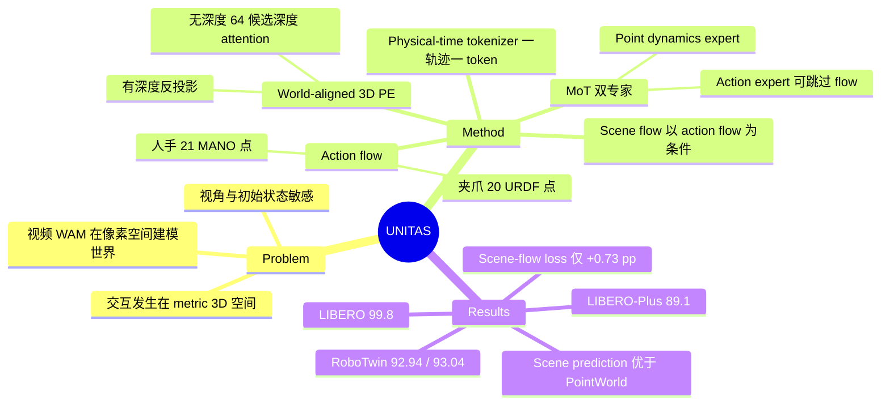

## Summary
UNITAS 把 world action model（WAM）从 image/video latent 搬到 metric 3D 空间：观测用 world-aligned 3D position embedding 落到同一坐标系，机器人夹爪与人手都表示成 3D 点轨迹（action flow），环境响应表示成以 action flow 为条件的 scene flow，每条点轨迹经 physical-time tokenizer 压成一个 token。1.7B 参数下，它在 LIBERO（99.8%）、LIBERO-Plus（89.1%）、RoboTwin 2.0、VLABench 与 2 个真机任务上报告领先，并在 RoboTwin action-conditioned scene prediction 四项指标上优于 PointWorld。

## Problem & Motivation
主流 WAM（Fast-WAM、Motus、Cosmos Policy、LingBot-VA 等）建在预训练视频生成器上，用图像或视觉 latent 表示"世界如何演化"。但机器人交互发生在 metric 3D 空间，图像只是依赖视角的投影：同一动作在不同视角下产生不同像素变化，相同像素位移也不对应相同物理距离，且相机内参与 camera-to-robot pose 随 embodiment 变化。作者引用的鲁棒性研究显示视频 WAM 对视角和机器人初始状态变化敏感。已有 3D 工作要么把几何当输入线索或辅助目标（LaMP、GeomVLA、X-WAM 的 4D 预测），要么像 PointWorld 那样只做"给定外部机器人动作→预测 scene flow"，不从语言指令生成动作。UNITAS 的目标是让观测、动作、场景变化在同一 metric frame 中被统一建模。

## Method
**联合分布分解**：$p(\mathbf{A},\mathbf{u},\mathbf{S}\mid\mathcal{C},\mathbf{q}_0)=p(\mathbf{A}\mid\mathcal{C})\,p(\mathbf{u}\mid\mathcal{C},\mathbf{q}_0)\,p(\mathbf{S}\mid\mathbf{A},\mathcal{C})$。其中 $\mathbf{A}$ 为 action flow，$\mathbf{u}$ 为可执行 end-effector action chunk，$\mathbf{S}$ 为 scene flow，context $\mathcal{C}$ 含指令、多视角观测、相机标定与历史 action flow。注意 $\mathbf{u}$ 与 $\mathbf{A}$ 在给定 context 下**并行、互不条件**。

1. **World-Aligned 3D Position Embedding**：有深度时把每个像素反投影到 world frame，Fourier 编码后加到视觉 token 上；无深度时沿相机射线在 0.1–2.0 m 均匀采样 M=64 个候选深度，用 patch feature 做 attention 加权（key 为 camera-frame 位置、value 为 world-frame 位置），并在有可靠深度的区域用 Fourier 特征匹配损失 $\mathcal{L}_{\mathrm{PE}}$ 蒸馏监督。因此可混合 RGB 与 RGB-D 数据训练，推理时深度可缺省（相机标定仍需提供）。
2. **Action flow / Scene flow**：机器人从 URDF 定义的夹爪几何每臂采样 20 个点，经 forward kinematics 得轨迹；人手用 21 个 MANO keypoint。scene flow 沿用 PointWorld 的做法：URDF mask 掉机器人像素后反投影 RGB-D 采样 scene query 点；仿真提供 ground-truth 对应关系。
3. **Physical-Time Trajectory Tokenizer**：用秒而非帧号编码时间（共享 $T_{\max}=3$ s），FiLM 调制的 MLP encoder 把整条点轨迹 pool 成一个 latent，decoder 可在任意请求时刻读出位移。action flow、scene flow、history 共享该 tokenizer，先单独做重建训练再冻结。token 用当前 3D 位置的 Fourier 特征做空间锚定。
4. **耦合专家（Mixture-of-Transformers）**：VLM 为 Florence-2-large；point dynamics expert（28 层、826M）生成 action flow 与 scene flow，较小的 action expert（28 层、256M）逐层读取 dynamics expert 的观测/语言 KV 生成 action chunk。attention mask 设计：scene token 只看 clean action flow 不看 noisy action flow；action chunk token 不看任何未来 flow token，因此**纯 policy 推理可完全跳过两个 flow 分支**。
5. **训练与推理**：rectified flow，四项损失 $\mathcal{L}_{\mathrm{A}}+\mathcal{L}_{\mathrm{scene}}+\mathcal{L}_{\mathrm{ctrl}}+0.1\mathcal{L}_{\mathrm{PE}}$，缺失标注处 mask。训练时 scene flow 以 demo 的 clean action flow 为条件。两种模式：policy mode 直接出动作；simulator mode 以外部给定 action flow 预测 scene flow。预训练混合 9 个数据源（RoboTwin、LIBERO、VLABench、DROID、AgiBot、RoboMIND、RH20T、VITRA 人手视频、自采 W1），200K steps、batch 1,024，64 张 BW1000_H DCU。

## Key Results
**Policy（Table 1）**：
- LIBERO avg：99.8%（无预训练 99.5%），最强基线 LaMP 98.3%、ABot-M0 98.6%。
- LIBERO-Plus overall：89.1%（无预训练 86.5%），$\pi_{0.5}$ 85.7%；camera 扰动 82.1%，Cosmos Policy 75.8%、LaMP 64.5%。该评测为 OOD：只在标准 LIBERO 上训练，未在 LIBERO-Plus 上适配。
- RoboTwin 2.0（50 任务 × 100 episodes）：Clean 92.94 / Randomized 93.04；LingBot-VA 92.93 / 91.55，Fast-WAM 91.88 / 91.78，Motus 88.66 / 87.02。Clean 条件与 LingBot-VA 只差 0.01。
- VLABench：SR 56.2 vs $\pi_{0.5}$ 48.1；但 intention score（IS）69.3 低于 X-VLA 70.2，也低于自身无预训练版本 71.2。
- 真机（每任务 20 trials）：Organize Books 18/20（90%）vs $\pi_{0.5}$ 75%、Fast-WAM 65%；Pack the Ball 16/20（80%）vs 55%、60%。摘要中"real-world 平均 85%"即这两个任务的均值。

**消融（Table 3，LIBERO-Plus，无预训练）**：参考模型（无 scene-flow loss）85.74%；去掉 visual 3D PE → 81.35%（camera 79.11→66.73）；去掉 action-flow loss → 78.89%；去掉 history tokens → 75.92%；三者全去（VLA-style baseline）→ 67.58%；加 scene-flow loss → 86.47%（+0.73 pp）。

**无深度推理（Table 9）**：routed PE 84.43% vs GT depth PE 84.68% vs 无 3D PE 81.35%（100K steps checkpoint）。

**Action-conditioned scene prediction（Table 4，RoboTwin 550 clips）**：Moving ADE 0.427 / Static ADE 0.043 / Moving FDE 0.825 cm / Moving Acc@1cm 92.31%，PointWorld 为 0.656 / 0.084 / 1.050 / 88.22。摘要的"up to 49% lower"对应 Static ADE（背景漂移）；对运动点的 Moving ADE 降低 35%、Moving FDE 降低 21%。视频基线 Ctrl-World / X-WAM 须经 SpatialTrackerV2（及 Depth Anything 3）lift 到 3D，误差远大于两种原生 3D 方法。

**闭环 action–scene 一致性（Table 13，3 个 RoboTwin 任务、60 trials）**：UNITAS Moving ADE 1.211 cm、Acc@1cm 64.26%；视频 WAM 中 Moving ADE 最好的是 X-WAM+STv2（2.579 cm），Acc@1cm 最好的是 Motus+STv2（35.66%）。

**效率（Table 8，RTX 5090 D）**：actions-only 55.77 ms/chunk，比 Fast-WAM（w/o video，156.81 ms）快 2.81×；actions + 两种 flow 在 1,024 / 3,000 个 scene query 下为 305.49 / 561.60 ms。

## Evidence Ledger
| Claim ID | Claim | Type | Source locator | Evidence excerpt | Status |
|:--|:--|:--|:--|:--|:--|
| C1 | 总参数 1,694.5M（含冻结 tokenizer）；Florence-2-large 570.7M、point dynamics expert 826.3M、action expert 256.0M | number | Table 7 (App. A.3) | VLM Florence-2-large 570.7 ... Point dynamics expert ... 826.3 ... Action expert ... 256.0 ... Total 1,694.5 | source-verified |
| C2 | 作者（hedged "to our knowledge"）声称是首个在共享 metric frame 中对齐观测、动作、场景动态的 3D-native WAM（限定在每个 prediction window 内） | sota-novelty | Abstract; §1 contributions | To our knowledge, Unitas is the first 3D-native world action model that aligns observations, actions, and scene dynamics in a shared metric frame | source-verified |
| C3 | 夹爪每臂 20 个 URDF 点；人手 21 个 MANO keypoint | number | §3.4; App. A.3 | we sample N_g=20 points from the URDF-defined gripper geometry of each arm ... Human demonstrations use 21 MANO-derived keypoints | source-verified |
| C4 | Tokenizer 一条轨迹一个 token，T_max=3 s，latent 256 维，先训练后冻结 | causal-mechanism | §3.4; §3.5; App. A.2 | T_max=3 s shared across datasets ... latent dimension d_z=256 ... first train the trajectory tokenizer ... then freeze it | source-verified |
| C5 | Action chunk token 不看未来 flow token，纯 policy 推理跳过两个 flow 分支 | causal-mechanism | §3.5 Attention structure | They do not attend to future action-flow or scene-flow tokens, so policy-only inference can skip both future-flow branches | source-verified |
| C6 | 无深度时沿射线在 0.1–2.0 m 采样 M=64 个候选深度做 attention | number | §3.3 | we draw M=64 depths uniformly from 0.1 to 2.0 m, back-project them by Eq. 4 | source-verified |
| C7 | LIBERO avg 99.8%（无预训练 99.5%） | number | Table 1; §4.2 | state-of-the-art average success rate of 99.8% ... Without mixed-dataset pretraining, it achieves 99.5% | source-verified |
| C8 | LIBERO-Plus 89.1% vs π0.5 85.7%；camera 82.1% vs Cosmos Policy 75.8%、LaMP 64.5% | comparison | Table 1; Table 10; §4.2 | Under camera perturbations, it achieves 82.1%, compared with 75.8% for Cosmos Policy and 64.5% for LaMP. | source-verified |
| C9 | RoboTwin 2.0 92.94/93.04 vs LingBot-VA 92.93/91.55、Fast-WAM 91.88/91.78；50 任务×100 episodes | comparison | Table 1; App. E | Each setting contains 50 tasks with 100 evaluation episodes per task | source-verified |
| C10 | VLABench SR 56.2 vs π0.5 48.1；IS 69.3 低于 X-VLA 70.2 与 w/o Pretrain 71.2 | comparison | Table 1; Table 11 Avg. | Unitas (w/o Pretrain) ... 50.3 64.3 71.2; Unitas ... 56.2 67.6 69.3 | source-verified |
| C11 | 真机 Organize Books 18/20 vs 75%/65%；Pack the Ball 16/20 vs 55%/60% | comparison | Table 2; §4.3 | Unitas 18/20 (90%) ... Pack the Ball π0.5 11/20 (55%) Fast-WAM 12/20 (60%) Unitas 16/20 (80%) | source-verified |
| C12 | Pack the Ball 成功率内部矛盾：§1 写 65%，Table 2/§4.3 写 80% | number | §1 vs Table 2 / §4.3 | Real-robot success reaches 90% on Organize Books and 65% on Pack the Ball | source-verified |
| C13 | 消融：85.74→81.35（-3D PE，camera 79.11→66.73）/78.89/75.92/67.58；+scene-flow 86.47 | number | Table 3; §4.4 | reference model without scene-flow supervision, which achieves 85.74% ... reduces success to 81.35% | source-verified |
| C14 | Scene prediction 0.427/0.043/0.825/92.31 vs PointWorld 0.656/0.084/1.050/88.22；49% 对应 Static ADE，Moving ADE -35%、FDE -21% | comparison | Table 4; §1; App. F.1 | reducing Moving ADE, Moving FDE, and Static ADE by 35%, 21%, and 49% | source-verified |
| C15 | 视频基线经 SpatialTrackerV2（Ctrl-World 另加 Depth Anything 3）lift 到 3D，仅用首帧 GT depth 标定；"含重建误差"仅在 F.2 明说，Table 4 为协议推论 | benchmark-setting | §5; App. F.1; App. F.2 | Video predictions are lifted to 3D using SpatialTrackerV2 ... calibrated using only initial-frame ground-truth depth. | source-verified |
| C16 | 无深度 routed PE 84.43% vs GT depth 84.68% vs 无 3D PE 81.35%（100K steps，标定仍可用） | number | Table 9; App. B.1 | routed PE achieves 84.43% overall success, closely matching the 84.68% obtained with ground-truth depth PE | source-verified |
| C17 | actions-only 55.77 ms，比 Fast-WAM w/o video 快 2.81×；两种 flow 305.49/561.60 ms | number | Table 8; App. A.4 | in 55.77 ms per chunk ... 2.81× faster than Fast-WAM without video generation | source-verified |
| C18 | 预训练：robot 84.8→94.2、language 77.6→85.0，但 noise 89.8→84.5 | comparison | Table 10; §4.2 | largest gains under robot initial-state changes from 84.8% to 94.2%, and language perturbations from 77.6% to 85.0% | source-verified |
| C19 | 9 个预训练数据源；200K steps、batch 1,024、64 张 BW1000_H DCU | number | App. A.1; App. A.3 | We pretrain for 200K steps with a total batch size of 1,024 ... Training uses 64 BW1000_H DCUs | source-verified |
| C20 | Scene-flow 监督仅来自仿真；真实场景预测仅定性且无 GT；仿真可视化用训练 clip | benchmark-setting | §5; App. G.1; App. G.2 | Despite receiving scene-flow supervision only from simulation ... No scene-trajectory ground truth is shown. | source-verified |
| C21 | 闭环一致性：UNITAS 1.211 cm / 64.26%；视频 WAM 中 Moving ADE 最好为 X-WAM+STv2 2.579 cm，Acc@1cm 最好为 Motus+STv2 35.66%（初稿误将 35.55% 归为最好，已按 verifier 更正） | comparison | Table 13; App. F.2 | X-WAM + STv2 2.579 0.166 4.056 35.55 ... Motus + STv2 3.216 0.318 6.778 35.66 ... Unitas 1.211 0.054 2.020 64.26 | contradicted → corrected |
| C22 | 代码声明开源于 github.com/DexForce/UNITAS（repo 内容未核查） | license-code | Abstract | The code is available at https://github.com/DexForce/UNITAS. | source-verified |
| C23 | 论文 license CC BY 4.0；2026-10-08 提交 | license-code | arXiv header | License: CC BY 4.0 ... arXiv:2610.12099v1 [cs.RO] 08 Oct 2026 | source-verified |

> 核查说明：上表状态由独立 verifier 对照 arXiv HTML 全文（v1）给出，Table 1/2/4/10/11 已逐格对照原始 HTML；source-verified 仅表示原文一致，不代表结果被独立复现。C21 初稿措辞被判 contradicted，已按原文更正。

## Strengths & Weaknesses
**Strengths**
- **问题表述清楚**：把"视频 WAM 的世界状态在像素空间、而交互在 metric 空间"这个错位作为出发点，并用统一点轨迹同时覆盖夹爪、人手和场景，跨 embodiment 的接口设计简洁（夹爪 20 点 / 人手 21 点，都是 world-frame 中的点）。
- **Physical-time tokenizer 合理**：按秒对齐不同频率数据源、一条轨迹一个 token，避免逐帧 token 在不同采样率下分配不均；App. A.2 给出了冻结 tokenizer 在 9 个数据源上毫米级的 held-out 重建误差，这个"先确认接口不丢信息"的检查是好习惯。
- **消融信息量高**：3D PE 主要贡献 camera 鲁棒性（79.11→66.73），history tokens 主要贡献 robot initial-state 鲁棒性，机制归因和扰动类型能对上；无深度 routed PE 几乎追平 GT depth（0.25 pp 差距），说明深度只在训练时必需。
- **小模型 + 低延迟**：1.7B、policy mode 55.77 ms/chunk，比 6B Fast-WAM 和 8B Motus 都小得多。

**Weaknesses / 需要追问的地方**
- **"world model"在 policy mode 中只是辅助监督**：action chunk 与 action flow 并行生成、不互相条件，policy 推理完全跳过 flow 分支。scene-flow loss 对 LIBERO-Plus 的增益只有 +0.73 pp（85.74→86.47），未报告 seed 方差。实际起作用的更像是 3D PE + action-flow 辅助损失 + history，而非"想象场景后果"。这与 Fast-WAM 的结论（测试时不必想象未来）一致，但也削弱了"3D-native WAM"在控制侧的必要性论证。
- **Abstract 数字的选择性表述**：标题级的"up to 49% lower displacement errors than PointWorld"来自 Static ADE（背景漂移），对运动点的提升是 35%/21%。PointWorld 在该评测中是否在 RoboTwin 上重训/微调，正文未说明（推测：若直接用其公开 checkpoint，则存在训练分布不匹配的不公平）。
- **视频基线的 3D 比较含 lifting 误差**：Ctrl-World / X-WAM 需经 SpatialTrackerV2 + 深度估计 lift 到 3D。作者在闭环评测（Table 13）中明确说误差包含 video-to-3D 重建误差；Table 4 未明说，但按其协议同样如此；所以 Table 4/13 对视频 WAM 的大幅领先不能直接解读为"3D 世界模型比视频世界模型更懂物理"。
- **RoboTwin 领先边际很小**：Clean 92.94 vs LingBot-VA 92.93，实质持平；Randomized 领先 1.5 pp。VLABench IS 不是最优；预训练让 LIBERO-Plus noise 扰动从 89.8 降到 84.5、VLABench IS 从 71.2 降到 69.3，作者未讨论负迁移。
- **基线数字来源不明**：Table 1 中大部分基线数字未说明是否自行复现或引自原文（不知道），不同论文的评测协议可能不完全一致。
- **真机评测规模小且有内部矛盾**：只有 2 个任务、每任务 20 trials；Introduction 写 Pack the Ball 为 65%，而 Table 2 与 §4.3 为 80%（16/20），摘要的 85% 平均与 80% 一致，应为正文笔误。
- **scene flow 只有仿真监督**：真实场景（DROID/RH20T）scene prediction 只有定性图且无 GT；Fig. 5 与 App. G.1 的仿真可视化用的是训练 clip。world model 部分在真实世界的定量能力未知。
- **依赖相机标定与 URDF**：world frame 的构建需要相机内外参，action flow 需要 URDF + 关节状态；对于无标定的 in-the-wild 视频（人手数据靠 VITRA 的相机位姿），扩展性受限。

**对领域的意义**：这是 WAM 线中"把预测目标从像素换成 3D 点轨迹"的代表性实现，与 PointWorld（只做 action→scene）、LaMP/GeomVLA（3D flow 作为 latent prior）形成清晰谱系。最有价值的信号可能不是"3D world model 更强"，而是"world-frame grounding + 点轨迹辅助监督"在小模型上就能拿到视频 WAM 的效果；scene-flow 预测对控制的边际收益仍待更严格的证据。

## Mind Map

## Notes
- 相关笔记：[[2606-PointWorld]]（scene flow 构造与基线来源）、[[2512-Motus]]（被比较的视频 WAM）、[[2610-LongWAM]]、[[2607-FlowWAM]]（用 2D optical flow 作统一动作表示，可与 UNITAS 的 3D 点轨迹对照）。
- 开放问题：如果 action chunk 显式条件于生成的 action flow / scene flow（串行而非并行），控制性能会变好还是变差？这能直接检验"想象后果"对控制是否有用。
- 可检验的推测：3D PE 带来的 camera 鲁棒性是否主要来自"相机外参被显式注入"，而非 3D 本身？对照实验可以是只注入 camera pose embedding 而不做逐 patch 反投影。
