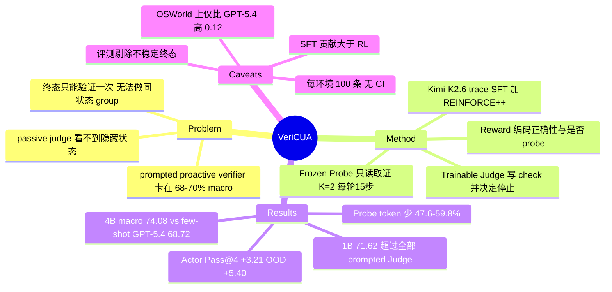

## Summary
VeriCUA 把 proactive GUI reward agent 拆成可训练的 Judge（决定查什么、何时停）和冻结的 Probe（在 Actor 终态环境里执行检查），用"每个终态只能验证一次"约束下的 REINFORCE++（batch 内跨终态归一化 return）训练 Judge，reward 同时编码判决正确性与是否调用了 Probe。仅在 OSWorld 上训练的 VeriCUA-4B 在 OSWorld / MobileWorld / WebArena-Verified 上 macro agreement 达 74.08%，比 few-shot GPT-5.4 高 5.36 点、Probe token 少 47.6%–59.8%，1B 版本（71.62%）也超过所有 prompted Judge。作为 Actor RL reward，它让 Qwen3-VL-4B Actor 的 Pass@4 提升 3.21 点（MultiApp OOD 提升 5.40 点）。

## Problem & Motivation
CUA 的 RL 需要可扩展的任务完成 reward：rule-based evaluator 精确但难扩展，passive VLM judge 只能看到截图里暴露的证据，保存的文件内容、隐藏设置等决定性状态看不见。ProRe、VAGEN、Interactive Reward Agent 等 proactive verifier 已经会在 post-execution 环境里交互取证，但"查什么、何时停"仍交给 prompted foundation model。作者的诊断有两层。第一，这个策略靠 scale 和 few-shot 解决不了：同一 Judge–Probe loop 下，从 Qwen3-VL-4B 到 GPT-5.4 的 prompted Judge 的 macro agreement 都卡在 68.13%–69.62%。他们给的解释是，一条检查值不值得做，取决于证据藏在哪、Actor 留下了什么状态、Probe 能否够得着，读任务描述看不出来，只有执行后才知道。第二，从执行中学习有 single-attempt 约束：Actor 终态由一次随机执行产生，重放不一定复现，相同截图下应用状态可能不同，Probe 自己也会改变状态，所以无法像 GRPO 那样在同一状态上采一组 verifier rollout 做比较。

## Method
- **Judge–Probe loop**：Judge $J_\phi$ 输入任务 $x$ 与 $\psi(\tau)$（Actor 动作历史 + 最近若干截图），在 $k=0$ 生成 3–5 条 task-success check，并给每条标注 satisfied / violated / unresolved。全部 satisfied 判 success，任一 violated 判 failure，否则判 uncertain。为 uncertain 且 $k<K$ 时，只把 unresolved 子集发给 Probe。check 文本在 $k=0$ 后固定，后续轮次只更新 status。
- **Frozen Probe**：Probe 是 GUI agent（OSWorld / WebArena-V 用 Holo3.1-35B-A3B，MobileWorld 用 GUI-Owl-1.5-32B-Think），在 prompt 中被限定为只观察、不修改、不替 Actor 完成任务。它通过 `criteria` 工具逐条回写 status 和证据截图，Judge 只拿到返回的证据，看不到 Probe 的完整轨迹。每次 Probe 调用从上一次 Probe 留下的状态继续，但不带之前的交互历史。预算为 $K=2$ 轮、每轮最多 15 步。
- **Single-attempt reward**（Table 9）：不调 Probe 判对 +1.0、调了 Probe 判对 +0.7、不调 Probe 判错 −0.7、调了 Probe 判错 −0.3、unresolved/invalid −1.0。Probe 使用 $p_i$ 是二值量（至少调用一次即为 1），与 Probe 执行了多少步无关。这种不对称让"截图下判决可能出错时才 probe"成为最优策略。ground truth $Y_i$ 是 Probe 交互之前记录的 executable outcome。
- **训练**：先用约 1,270 条 Kimi-K2.6 teacher trace 做 rejection-sampled SFT（只保留判决与 executable outcome 一致的 trace；冻结 vision tower 与 projector），再在 OSWorld 280 个任务上做 online RL。RL 用 REINFORCE++：每个 Actor 终态只采一条验证轨迹，advantage 等于 batch 内跨终态归一化的 terminal return，只回传给新生成的 Judge token，并使用 PPO-style clip。不需要 environment forking，也不需要 value model。
- **下游使用**：冻结 VeriCUA，把 success 判决映射为 0/1 reward，用 vanilla GRPO 训练 Qwen3-VL-4B-Thinking Actor（206 个 OSWorld single-app 任务，8 tasks × 8 rollouts，30-step horizon）。

## Key Results
- **Reward agreement**（Table 1，Avg@4，以 executable evaluator 为 GT；OSWorld 414 / MobileWorld 100 / WebArena-V Hard 100 条轨迹，来自 5 个 Actor）：VeriCUA-4B 在 OSWorld / MobileWorld / WebArena-V 上分别为 82.00 / 77.50 / 62.75，macro 74.08。few-shot GPT-5.4 为 81.40 / 66.25 / 58.50，macro 68.72。prompted Kimi-K2.6 macro 69.62，prompted 4B macro 69.58。passive baseline DistRL / DigiRL / ZeroGUI* 的 macro 为 62.51 / 63.24 / 65.17，VAGEN（4B）为 63.95。
- **Scale plateau**：prompted Judge 从 4B 到 GPT-5.4 的 macro 落在 68.13%–69.62%，few-shot 最多使区间移动 1.02 点。按正向增益算，few-shot 最多只加 0.59 点（GPT-5.4：68.13→68.72），Kimi 加 few-shot 后反而降了 1.02 点。
- **相对 GPT-5.4 的优势分布不均**：OSWorld 上 VeriCUA-4B 只比 zero-shot GPT-5.4 高 0.12 点（82.00 vs 81.88）；正文另称 OSWorld 上 Probe token 少 56.9%，但未写明该节省相对的是 zero-shot 还是 few-shot GPT-5.4。MobileWorld 和 WebArena-V 上相对 few-shot GPT-5.4 的差距分别为 11.25 和 4.25 点。
- **训练对小模型收益最大**：在 backbone、Probe、prompt、预算都固定的条件下，训练相对 prompted 版本把 macro 提升 4.50（4B）/ 8.62（2B）/ 21.11（1B）点。VeriCUA-1B（MiniCPM-V-4.6）macro 71.62，超过所有 prompted Judge。
- **训练阶段**（Fig 5a，OSWorld，4B）：prompted 73.73 → SFT 79.41 → online RL 82.00，RL 只贡献 2.59 点，大部分增益来自 SFT。
- **Probe 预算**（Fig 5b）：trained 4B 在 $K=0$（不 probe）时 OSWorld 74.09，$K=2$ 时 82.00，大部分增益来自第一轮。
- **Probe 规模鲁棒性**（Table 4）：Judge 固定，Holo3.1 Probe 取 35B-A3B / 9B / 4B 时 agreement 为 82.00 / 82.73 / 82.07，两两检验 p > 0.58。
- **行为分析**（Table 3，33 个证据在轨迹中缺失的 OSWorld case）：direct-evidence probe 比例从 GPT-5.4 的 47.6% 升到 61.9%，aimless scroll/wait 从 16.2% 降到 5.5%。
- **下游 Actor RL**（Table 2，Pass@4）：初始 Actor 为 43.93 / 53.40 / 17.57（All / ID / OOD）。ZeroGUI reward 训练后为 45.36 / 54.37 / 20.27，prompted VeriCUA 为 45.71 / 54.85 / 20.27，trained VeriCUA 为 47.14 / 55.83 / 22.97。
- **Actor RL 过程中的 verifier 行为**（Table 10）：trained 对 prompted，agreement 81.4% vs 77.8%，false-negative 4.6% vs 10.0%，Probe attempt 率 4.28% vs 5.70%，failed Probe dispatch 3.2% vs 16.6%。

## Evidence Ledger

| Claim ID | Claim | Type | Source locator | Evidence excerpt | Status |
|:--|:--|:--|:--|:--|:--|
| C1 | 同一 verification loop 下，prompted Judge 从 4B 到 GPT-5.4 的 macro agreement 落在 68.13%–69.62% | number | §3.2；Table 1 | "Prompted Judges from a 4B model to GPT-5.4 plateau at 68.13% – 69.62% macro-average agreement" | source-verified |
| C2 | few-shot 示例使 prompted Judge 的 macro 区间最多移动 1.02 点（Intro 表述为最多增加 0.6 点） | number | §3.2；§1 | "few-shot examples shift this range by at most 1.02 points" | source-verified |
| C3 | VeriCUA-4B 在 OSWorld / MobileWorld / WebArena-V 上 Avg@4 agreement 为 82.00 / 77.50 / 62.75，macro 74.08 | number | Table 1 | "VeriCUA (ours) Trained 82.00 77.50 62.75 74.08" | source-verified |
| C4 | VeriCUA-4B 的 macro agreement 比 few-shot GPT-5.4 高 5.36 点（68.72→74.08），Probe token 少 47.6%–59.8% | comparison | §3.2；Fig 4 | "improves macro-average agreement by 5.36 points ( 68.72%→74.08% ) with 47.6% – 59.8% fewer Probe tokens" | source-verified |
| C5 | OSWorld 上 VeriCUA-4B 只略高于 zero-shot GPT-5.4（82.00 vs 81.88），且正文称 Probe token 少 56.9%（对照的 GPT-5.4 设置未写明） | comparison | §3.2；Table 1 | "On OSWorld, where GPT-5.4 is strongest, VeriCUA-4B still leads while using 56.9% fewer tokens" | source-verified |
| C6 | MobileWorld 和 WebArena-V 上 VeriCUA-4B 相对 few-shot GPT-5.4 的差距为 11.25 和 4.25 点 | comparison | §3.2 | "its margin widens to 11.25 and 4.25 points on MobileWorld and WebArena-Verified" | source-verified |
| C7 | VeriCUA-1B（MiniCPM-V-4.6-Thinking）macro 71.62%，超过所有 prompted Judge（含 GPT-5.4 与 Kimi-K2.6） | sota-novelty | §3.2；Table 1 | "Even VeriCUA-1B ( 71.62% ) exceeds every prompted Judge." | source-verified |
| C8 | backbone、Probe、prompt、预算固定时，训练把 macro 提升 4.50 / 8.62 / 21.11 点（4B / 2B / 1B） | causal-mechanism | §3.2；Table 1 | "Macro-average agreement rises by 4.50 , 8.62 , and 21.11 points over the prompted 4B, 2B, and 1B Judges" | source-verified |
| C9 | passive verifier DistRL / DigiRL / ZeroGUI* 的 macro 为 62.51 / 63.24 / 65.17，prompted VAGEN（4B）为 63.95 | number | Table 1 | "DistRL Passive 61.78 68.00 57.75 62.51" | source-verified |
| C10 | 评测集为 OSWorld 414、MobileWorld 100、WebArena-Verified Hard 100 条轨迹，来自 5 个 Actor | benchmark-setting | §3.1 Benchmarks | "using 414 , 100 , and 100 trajectories, respectively" | source-verified |
| C11 | 只保留 6 次 re-execution 的 executable outcome 一致、且末 3 帧 pHash 均值 >0.95 的轨迹 | benchmark-setting | Appendix D | "retain it only when all six re-executions yield the same executable outcome and the mean pHash similarity" | source-verified |
| C12 | Judge 只在 OSWorld 上训练，MobileWorld 与 WebArena-V 为 zero-shot transfer（Probe 按环境更换） | benchmark-setting | §3.1 Training data；Table 5 | "We train the Judge only on OSWorld and keep it frozen thereafter, so MobileWorld and WebArena-Verified test zero-shot transfer." | source-verified |
| C13 | terminal reward：不调 Probe 判对 +1.0、调 Probe 判对 +0.7、不调判错 −0.7、调了判错 −0.3、unresolved/invalid −1.0 | benchmark-setting | Appendix G Table 9 | "Correct No +1.0 Correct Yes +0.7 Incorrect No -0.7 Incorrect Yes -0.3" | source-verified |
| C14 | 每个 Actor 终态只采一条验证轨迹，用 REINFORCE++ 做 batch 内跨终态归一化，不需要 environment forking | causal-mechanism | §2.4 | "We therefore collect one verification trajectory per Actor terminal environment, without environment forking" | source-verified |
| C15 | SFT 初始化使用约 1,270 条经 rejection sampling 保留的 Kimi-K2.6 verification trace | number | Appendix G | "fully SFT-tuned on approximately 1,270 Kimi-K2.6 verification traces retained by the rejection-sampling procedure" | source-verified |
| C16 | OSWorld 上 4B Judge 的 agreement 为 prompted 73.73 → SFT 79.41 → online RL 82.00，RL 贡献 2.59 点 | number | §3.3；Fig 5(a) | "Agreement rises from 73.73% for the prompted Judge to 79.41% after SFT and 82.00% after online RL" | source-verified |
| C17 | trained 4B Judge 在 OSWorld 上 K=0 时 agreement 74.09%，K=2 时 82.00% | number | §3.3；Fig 5(b) | "Agreement increases from 74.09% at K=0 to 82.00% at K=2" | source-verified |
| C18 | Judge 固定时，Holo3.1 Probe 取 35B-A3B / 9B / 4B，OSWorld agreement 为 82.00 / 82.73 / 82.07 | number | Appendix C Table 4 | "Agreement stays within 0.73 points across the three Probe models." | source-verified |
| C19 | 在 33 个 OSWorld case 上，direct-evidence probe 比例 61.9% vs GPT-5.4 47.6%，aimless scroll/wait 5.5% vs 16.2% | comparison | §3.3；Appendix B Table 3 | "VeriCUA-4B directs 61.9% of Probe actions toward task-relevant evidence, compared with 47.6% for prompted GPT-5.4" | source-verified |
| C20 | 以 trained VeriCUA 为 reward 时，Actor Pass@4 从 43.93 升到 47.14（+3.21），MultiApp OOD 从 17.57 升到 22.97（+5.40） | number | §3.4；Table 2 | "Overall Pass@ 4 rises from 43.93% for the initial Actor to 47.14% , a gain of 3.21 percentage points." | source-verified |
| C21 | ZeroGUI 与 prompted VeriCUA 作 reward 时 Actor Pass@4 All 为 45.36 / 45.71，OOD 均为 20.27 | comparison | Table 2 | "ZeroGUI 45.36 54.37 20.27 +1.43" | source-verified |
| C22 | 下游 Actor RL 中 trained 对 prompted VeriCUA：agreement 81.4% vs 77.8%，false-negative 4.6% vs 10.0%，Probe attempt 4.28% vs 5.70% | comparison | §3.4；Appendix H Table 10 | "agreement with executable outcomes is higher ( 81.4% vs. 77.8% ), the false-negative rate is lower ( 4.6% vs. 10.0% )" | source-verified |
| C23 | 下游 RL 中 failed Probe dispatch 从 16.6% 降到 3.2% | number | Appendix H Table 10 | "Failed Probe dispatch falls from 16.6% to 3.2%" | source-verified |
| C24 | 成本只计 frozen Probe token，Judge token 不计；VAGEN 没有独立 Probe，按整个 loop 计费 | benchmark-setting | Appendix D | "We measure cost in Probe tokens because this is the cost the verification strategy controls." | source-verified |
| C25 | 代码在 github.com/Jeffjeno/VeriCUA 公开；正文未声明代码 license | license-code | Abstract | "Code is available at https://github.com/Jeffjeno/VeriCUA." | source-verified |

## Strengths & Weaknesses
**Strengths**
- **Problem formulation 清晰**：把 proactive verification 的可靠性归结为两个耦合决策（what to check / when to stop），把"终态不可复现，只能验证一次"明确列为学习约束。这一约束是 GUI verifier 和数学/代码 verifier（如 AgentV-RL 可以复制问题、采多次验证）的本质差别。用跨终态的 batch 归一化代替 same-state group，再用 reward 中的 probe-usage 项替代 sibling 比较来学停止决策，方案简单，也说得通。
- **对照设计干净**：prompted VeriCUA 与 trained VeriCUA 共享架构、prompt、Probe 和预算，只有 Judge 权重不同，所以 4.50 / 8.62 / 21.11 的增益可以归给学到的策略。Probe 冻结后，"策略在 Judge 里"这个说法也能检验：Probe 从 35B 换到 4B，agreement 基本不变（Table 4）。
- **行为证据有信息量**：直接训练 Judge 写出带位置的 check（例如写明 "Tools→Options"），比扩大 Probe 更有效。dispatch 失败率从 16.6% 降到 3.2%，说明 prompted Judge 很大一部分失败是"发出了 Probe 执行不了的检查"，问题在接口层而不在推理能力。
- **对小模型友好**：1B Judge 超过 GPT-5.4，对 RL 训练中每个 rollout 都要调用的 reward 来说成本意义很大。

**Weaknesses / 隐含假设**
- **评测样本小、无置信区间**：Table 1 没有 CI。MobileWorld 和 WebArena-V 各只有 100 条轨迹，WebArena-V 上 trained 4B 只比 prompted 4B 高 1.25 点，大约相当于每次 run 多判对 1 条，处在噪声量级。OOD 的 Actor 收益 17.57→22.97 对应 74 个任务中多解出约 4 个；trained 与 prompted VeriCUA 在 OOD 上只差约 2 个任务，且 Table 2 只报单次训练，没有 seed 方差。
- **"strategy > scale" 的证据在 OSWorld 上很弱**：VeriCUA-4B 在 OSWorld 上只比 zero-shot GPT-5.4 高 0.12 点，macro 优势主要来自 MobileWorld（+11.25）。而 MobileWorld 用的是另一个 Probe（GUI-Owl-1.5-32B），不能排除 GPT-5.4 的 check 写法不适配这个 Probe 的接口（推测）。所以"scale 无用"更准确的说法是"prompted 大模型不会给这个特定的 frozen Probe 写可执行的 check"。
- **评测筛选偏向确定性 case**：只保留 6 次 re-execution 结果一致且 pHash > 0.95 的轨迹，等于剔除了终态不稳定的 case。而这恰恰是 single-attempt 约束最难处理的场景。agreement 数字因此不代表真实 RL rollout 分布上的可靠性（下游 RL 中测到的 agreement 是 81.4%，可作旁证）。
- **成本口径有利于 VeriCUA**：成本只计 Probe token，Judge token 不计。对 1B–4B Judge 来说这个口径没问题，但"Pareto frontier"只是 Probe 成本维度上的 frontier。
- **ground truth 依赖 executable evaluator**：GT 本身可能有误判，而且只测 agreement，未区分 false positive 与 false negative 在 Table 1 中的分布（FN 只在下游 RL 时报告）。对 reward hacking 而言，false positive 才是更危险的方向，正文没有单独分析。
- **训练与评测的独立性**：作者称 RL 用的是"newly collected OSWorld trajectories, all disjoint from evaluation"，但训练用 280 个 OSWorld 任务，评测用 414 条 OSWorld 轨迹，任务层面是否重叠没有说明（推测可能重叠），所以 OSWorld 上的 82.00 不应读作泛化结果。训练和评测的 Actor 池也部分重合（EvoCUA-32B、Holo3.1、Qwen3-VL-4B）。
- **few-shot 对照有混杂**：OSWorld few-shot reference 2 正是 Figure 1 中"每页 slide 加 notes"的任务（criteria 不含 verdict）。few-shot 设置只提供格式示例、不提供证据，不能把它看作"prompt 工程上限"。
- **SFT 才是大头**：+5.68 来自 SFT，online RL 只 +2.59。标题强调的"learning proactive verification via RL"在 OSWorld 上的边际贡献，比摘要给人的印象小。
- **适用边界**：Probe 被限定为只读（不保存、不删除），仍然会改变 UI 状态（打开对话框、滚动），而 $Y_i$ 是在 Probe 之前记录的。对"未保存编辑"这类易失状态，Probe 本身可能破坏证据，正文没有给出这类 failure 的比例。

## Mind Map

## Notes
- [[2602-VAGEN]]：同属 post-execution proactive verifier。VAGEN 自报在 OSWorld-Verified 上达到 92.9% acc（使用强 backbone、以人评为 GT），本文用 Qwen3-VL-4B 重跑 VAGEN 只得 65.34（OSWorld）。两者 GT 口径和 backbone 都不同，数字不可直接比，但说明 VAGEN 的可靠性高度依赖 backbone 能力，与本文"prompted 策略不随 scale 改进"的结论存在张力。
- [[2607-InteractiveRewardAgent]]：propose-then-verify 结构，先提出完成条件再逐条核验，与 VeriCUA 的 check/status 设计几乎同构。IRA 依赖 prompted VLM 加 system/application 工具；VeriCUA 只用 GUI Probe，但把 check 生成与停止决策训练出来。两者可组合，即用学到的 Judge 驱动 IRA 的 system 工具。
- [[2607-OSReward]]：OSReward 发现 judge 普遍偏宽松（把失败判成 success），本文却只在下游 RL 中报告了 false-negative 下降，没有单独报告 false positive。将 VeriCUA 放到 OSReward-Hard 上测 leniency bias，是检验其 reward 安全性的直接方式。
- [[2510-CUARewardBench]]：同样以 OSWorld 轨迹评测 CUA reward model，CUARewardBench 用 UPE 弃权换 precision。VeriCUA 的 uncertain→probe 机制可以看作把"弃权"变成"去取证"，两种处理不确定性的路线可以对照。
