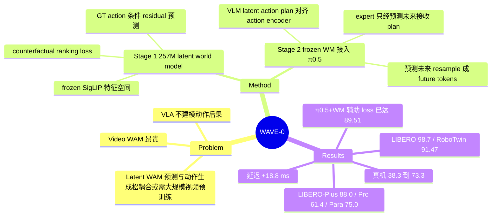

## Summary

WAVE-0 在 pretrained π0.5 上外挂一个 257M 的 latent world model：Stage 1 只用带 ground-truth action 的 robot demonstrations（无视频预训练、无像素重建）在 frozen SigLIP 特征空间里学 action-conditioned 的未来表示预测，并用 counterfactual ranking loss 强迫预测依赖 action；Stage 2 冻结该 world model，让 VLM 产出 latent action plan → world model 预测未来表示 → resampler 压成 future tokens 条件化 action expert（训练和推理都走这条路）。结果：LIBERO 98.7% / RoboTwin 2.0 91.47%（π0.5 为 96.9% / 80.38%），LIBERO-Plus / Pro 88.0% / 61.4%，真机 3 任务 π0.5 38.3% → 73.3%；但同一 world model 只当辅助 loss（π0.5 + WM）在 RoboTwin 已到 89.51%，"推理时显式条件化"本身只多贡献约 2 个点。

## Problem & Motivation

VLA 直接做 observation → action 映射，不显式建模 action 对环境的后果；WAM（world action model）把未来预测纳入动作生成，但主流基于 video generation backbone，算力花在与动作无关的像素细节上、推理慢。latent 路线中，VLA-JEPA / JEPA-WAM 只把未来预测当表示学习的监督、不让动作生成直接 condition 在预测的未来上；LaWAM 用 predicted latent visual subgoal 引导动作，但其 latent action 由 inverse dynamics 从视觉 transition 反推，且需要约 4,500 小时视频预训练 + policy-integration 预训练。作者的问题是：当目标域 demonstrations 本身已带可执行的 ground-truth action，大规模间接预训练是否真的比直接用 action 训 world model 更好？

## Method

整体分解为 latent action planning → future world state prediction → future-conditioned action generation，全部建在 pretrained π0.5（PaliGemma VLM + flow-matching action expert）之上。

**Stage 1：Latent World Model（257M 可训练参数）**
- 世界状态 $S_t$：frozen 的 π0.5 SigLIP encoder + visual projector 提取 2048 维特征，空间 pool 成每相机 4×4 = 16 tokens。
- Action encoder 把 GT action chunk（以当前 proprio 为条件）编码成 $Z_a$；state encoder 编码 $s_t$。
- 12 层 Transformer（hidden 1024，AdaLN-Zero 以 action 为条件）预测 latent residual $\Delta \hat S$，$\hat S_{t+h} = S_t + \Delta \hat S$。
- Loss：$\mathcal{L}_{future}$（token-wise cosine distance）+ 0.5 $\mathcal{L}_{delta}$（residual 的 SmoothL1）+ 0.1 $\mathcal{L}_{rank}$。
- **Counterfactual ranking**：同一观测下把 GT action 换成 mismatched action 序列，hinge loss 要求 GT action 的预测比 mismatched 的预测更接近真实未来（margin 0.1，对未变化的负样本 mask）。

**Stage 2：Future-Conditioned Policy Fine-tuning（world model 冻结）**
- 在 VLM 输入序列后追加 learnable latent action queries，输出经 LN + 线性投影得到 latent action plan $\hat Z_a$，用 cosine + SmoothL1 对齐到 frozen action encoder 给出的 $Z_a$（$\mathcal{L}_{align}$）。
- Frozen world model 以 $\hat Z_a$ 为条件预测未来表示，并用 $\mathcal{L}_{world}$（future + 0.5 delta）监督。
- Resampler 把预测未来 pool 成每相机 2×2 并投影成 12 个 future tokens，prepend 到 action expert 的 noisy action tokens 前；latent action query tokens **不进入** expert 的 context——planning 分支只能通过"预测的视觉后果"影响动作，expert 仍可看原始 VLM context。
- $\mathcal{L}_{stage2} = \mathcal{L}_{flow} + \lambda_{WAM}\mathcal{L}_{world} + \lambda_{align}\mathcal{L}_{align}$。

**关键配置**：action chunk H = 32；world model horizon h 在 LIBERO 为 9、RoboTwin 为 31、真机为 32；全模型约 4.3B 参数。

## Key Results

| Benchmark | WAVE-0 | π0.5 | 关键对照 |
|:--|:--|:--|:--|
| LIBERO avg | 98.7 | 96.9 | LaWAM 98.6；Long 92.4 → 97.6 |
| RoboTwin 2.0 avg（clean+rand） | 91.47 | 80.38 | ImageWAM 93.38、AHA-WAM 92.80、LingBot-VA 92.20、Fast-WAM 91.83 均高于 WAVE-0；LaWAM 91.22 |
| RoboTwin 2.0 π0.5 + WM（只作辅助 loss） | — | — | 89.51；WAVE-0 在 clean / rand 各高 1.98 / 1.94 |
| LIBERO-Plus（zero-shot） | 88.0 | 84.5 | 7 类中 6 类提升，Noise −3.7 |
| LIBERO-Pro | 61.4 | 53.0 | LaWAM 52.7 |
| LIBERO-Para | 75.0 | 71.4 | 只对比 π0.5 |
| 真机 3 任务（各 20 trials） | 73.3 | 38.3 | LaWAM 43.3、ImageWAM 40.0 |

- **Ranking loss 消融**：去掉 $\mathcal{L}_{rank}$ 时 action sensitivity gap（错 action 与对 action 的预测误差差）只有 0.0020，margin 满足率 0%；加上后 0.1648 / 89.5%。下游 LIBERO-Plus 85.4 → 88.0、LIBERO-Pro 58.4 → 61.4。
- **Stage 2 目标消融**：flow-only 84.6 / 58.0 → +world 85.3 / 59.7 → +align 88.0 / 61.4（LIBERO-Plus / Pro）。
- **训练成本**：RoboTwin 上 WAVE-0 约 670 H100 GPU 小时、76.8M examples，vs LaWAM 仅 benchmark-specific 训练就 1,280 H100 小时、102.4M；真机 3 任务 33.28M vs 345.60M examples（LaWAM 含共享预训练）。
- **推理延迟**：π0.5 287.1 ms → WAVE-0 305.9 ms（+18.8 ms）；ImageWAM 582.6 ms；LaWAM 223.9 ms（2.3B，输出 18 步 vs WAVE-0 32 步）。

## Evidence Ledger

| Claim ID | Claim | Type | Source locator | Evidence excerpt | Status |
|:--|:--|:--|:--|:--|:--|
| C1 | Stage 1 的 world model + action encoder + state encoder 约 257M 可训练参数；全模型约 4.3B，基于 pretrained π0.5 | number | Sec 4.1, p.6 | "together comprise approximately 257M trainable parameters in Stage 1, while the full WAVE-0 contains approximately 4.3B parameters" | source-verified |
| C2 | Stage-1 目标 = L_future + 0.5 L_delta + 0.1 L_rank；L_rank 为同观测下 GT vs mismatched action 的 hinge ranking，margin 0.1（另有 mask 跳过未变化负样本） | causal-mechanism | Sec 3.2, Eq 6-8 | "Keeping the current observation fixed, we replace the demonstrated actions with a mismatched sequence" | source-verified |
| C3 | Stage 2 冻结 world model；latent action query tokens 不进 expert context，plan 只经 resampler 后的 predicted future 影响动作 | causal-mechanism | Sec 3.2, Eq 12 | "We exclude latent-action query tokens from the context passed to the expert" | source-verified |
| C4 | LIBERO avg WAVE-0 98.7 vs π0.5 96.9、LaWAM 98.6；Long 92.4 → 97.6 | number + comparison | Table 1a; Sec 4.2 | "average success rate of 98.7% ... success increases from 92.4% to 97.6%" | source-verified |
| C5 | RoboTwin 2.0 avg 91.47 vs π0.5 80.38；ImageWAM 93.38、AHA-WAM 92.80、LingBot-VA 92.20、Fast-WAM 91.83 高于 WAVE-0 | number + comparison | Table 1b | Avg column: ImageWAM 93.38, AHA-WAM 92.80, LingBot-VA 92.20, Fast-WAM 91.83, WAVE-0 91.47 | source-verified |
| C6 | π0.5 + WM（同一 frozen WM 仅作辅助训练 loss）RoboTwin 89.51；WAVE-0 在 clean / rand 各高 1.98 / 1.94 | number + causal-mechanism | Sec 4.7.1; Table 1b; Fig 1(3) | "auxiliary supervision improves average success from 80.38% to 89.51% ... outperforming π0.5 + WM by 1.98 and 1.94" | source-verified |
| C7 | LIBERO 训练模型不再微调：LIBERO-Plus 88.0（π0.5 84.5，Noise −3.7）、Pro 61.4（53.0）、Para 71.4 → 75.0 | number + benchmark-setting | Table 2; Sec 4.4 | "directly using the model trained on LIBERO without additional fine-tuning"; "improves success from 71.4% to 75.0%" | source-verified |
| C8 | 真机 3 任务（AgileX Piper，每任务 200 demo、20 trials）：π0.5 38.3 → 73.3；LaWAM 43.3、ImageWAM 40.0 | number + benchmark-setting | Table 3; Sec 4.5 | "we collect 200 demonstrations ... evaluate it over 20 trials" | source-verified |
| C9 | 真机中 WAVE-0 Stage-1 WM 用全部 600 条 demo 训练，baselines 逐任务 200 条 | benchmark-setting | App A.2, p.13-14 | "pretrained for 40k steps using all 600 real-robot demonstrations collected from the three manipulation tasks" | source-verified |
| C10 | 去 L_rank：gap 0.0020 vs 0.1648、margin 满足率 0% vs 89.5%；成功率 LIBERO-Plus 85.4 → 88.0、Pro 58.4 → 61.4 | number + causal-mechanism | Sec 4.7.2; Fig 4(a-c) | "increases the gap to 0.1648 and margin satisfaction to 89.5% at 20k steps, compared with 0.0020 and 0%" | source-verified |
| C11 | Stage 2 消融：flow-only 84.6/58.0 → +world 85.3/59.7 → +align 88.0/61.4 | number | Sec 4.7.2; Fig 4(d) | "adding Lworld improves success by 0.7 and 1.7 ... Adding Lalign yields further gains of 2.7 and 1.7" | source-verified |
| C12 | RoboTwin 训练 ~670 H100 小时 / 76.8M examples vs LaWAM benchmark-specific 1,280 小时 / 102.4M；真机 33.28M vs 345.60M | number + comparison | Sec 4.6; Table 4 | "approximately 670 H100 GPU hours and processes 76.8M examples, compared with 1,280 H100 GPU hours and 102.4M" | source-verified |
| C13 | 延迟 π0.5 287.1 / WAVE-0 305.9 / ImageWAM 582.6 / LaWAM 223.9 ms（LaWAM 2.3B） | number | App A.2; Table 11 | "LaWAM achieves a lower latency of 223.9 ms with a smaller model of 2.3B parameters" | source-verified |
| C14 | 论文列出 GitHub repo 与 project page；repo 可访问且根目录含源码与 LICENSE（未检查完整性） | license-code | p.1 | "GitHub Repo: https://github.com/AutoLab-SAI-SJTU/WAVE-0" | source-verified |
| C15 | WM horizon h：LIBERO 9、RoboTwin 31、真机 32；action chunk H 均为 32 | number | Tables 5, 6, 8 | "World model horizon ℎ 9" / "31" / "32"; "Action chunk size 𝐻 32" | source-verified |

## Strengths & Weaknesses

**Strengths**
- **最有信息量的是 π0.5 + WM 这个 ablation**（Table 1b / Sec 4.7.1）：同一个 frozen world model 只当辅助训练 loss、推理路径不变，RoboTwin 就从 80.38 → 89.51（+9.1）；显式 future conditioning 再 +1.96。换言之，大部分收益来自"用 action-grounded latent dynamics 监督 VLA backbone"，而非"推理时想象未来"。这与 Fast-WAM（"WAM 需要 test-time future imagination 吗？"）的问题直接相关——WAVE-0 给出的答案是"需要，但边际只有 ~2 点"，而作者正文倾向强调后者。
- Counterfactual ranking 的诊断干净：没有它，world model 对 action 几乎不敏感（gap 0.0020）——这暴露了 action-conditioned latent predictor 的一个常见退化：只靠当前观测就能把未来预测得不错，action 条件被忽略。该现象很可能在其他 latent WAM 中同样存在，但多数论文不测。
- 工程上轻：257M 额外模块、+18.8 ms 延迟，无需视频预训练，Stage 1 在 LIBERO 约 10 小时 / 8 卡。

**Weaknesses / 隐含假设**
- **"无需大规模预训练"建立在 π0.5 已有大规模机器人预训练之上**：SigLIP 表示空间与 VLM 都来自 π0.5。对比 LaWAM 的"训练样本数"不把 π0.5 本身的预训练成本计入，efficiency 比较的口径偏向 WAVE-0（Table 4 也只数 examples 不数 FLOPs）。
- **真机对比存在数据混杂**：WAVE-0 的 Stage-1 world model 用 3 个任务全部 600 条 demo 训练，而 π0.5 / LaWAM / ImageWAM 都是逐任务 200 条（App A.2）；正文 Sec 4.5 写的是 "train a separate model for each method on the same data"，这一差异只在附录披露。73.3 vs 38.3 的差距里多少来自跨任务数据无法分离；每任务仅 20 trials，置信区间宽。baselines 的 chunk / 执行步数也不同（LaWAM 18/8、ImageWAM 16/8 vs WAVE-0 32/10）。
- **SOTA 措辞要分 benchmark**：LIBERO 对 LaWAM 只高 0.1（98.7 vs 98.6，饱和区）；RoboTwin 2.0 上 WAVE-0 不是最好，ImageWAM / AHA-WAM / LingBot-VA / Fast-WAM 都更高。真正领先的是 LIBERO-Plus / Pro 的 OOD 分数。
- **对照缺口**：vault 中 [[Papers/2608-JEPAWAM]] 报告 π0.5 + JEPA 辅助监督在 LIBERO-Plus 达 86.3%（据该笔记，未在本论文核查），本文 Table 2 列了 JEPA-WAM（79.2，无预训练的 0.5B 版本）而未列 π0.5 + JEPA。最公平的同类对照（"同样基于 π0.5 的 latent future 辅助监督"）缺位；本文自己的 π0.5 + WM 也只在 RoboTwin 上做，未在 LIBERO-Plus / Pro 上报告。
- LIBERO-Plus 的 Noise 类下降 3.7——预测未来表示依赖 SigLIP 特征，传感器噪声可能先污染了 world model 输入。论文未讨论。
- Attention 可视化（Fig 3b）是少量挑选样例，不构成机制证据。

**对领域的意义**：这是"latent WAM 是否需要 video pretraining"一线上的又一个数据点：在已有强 VLA 的前提下，用目标域 GT action 训一个小 latent dynamics model 就够用。更值得追的问题是 π0.5 + WM 的 +9 点从哪来——是 world model 监督改善了 VLM 表示，还是只是多了一个正则项。

## Mind Map

## Notes

- 与 [[Papers/2608-JEPAWAM]]（π0.5 + latent future 辅助监督，但 action tokens 不 attend future tokens）构成直接对照：WAVE-0 的 π0.5 + WM 变体相当于"辅助监督"路线，WAVE-0 本体是"显式条件化"路线；两篇放在一起才能判断 explicit conditioning 的增量。
- 与 [[Papers/2512-Motus]] 同在 RoboTwin 2.0 表中（Motus 87.84）。
- 待验证问题：π0.5 + WM 的增益是否在 LIBERO-Plus / Pro 同样占大头？若是，"WAM 的价值主要在训练期 dynamics 监督"可能是比 WAVE-0 标题更重要的结论。
