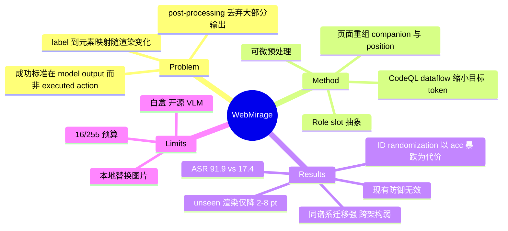

## Summary
WebMirage 把视觉 web agent 的红队测试重新表述为"grounding-to-execution"端到端问题：攻击成功以浏览器实际执行的动作为准，而非模型输出。它用 role-slot 抽象 + 页面重组（companion variation / positional shift）覆盖页面渲染变化，并用 CodeQL 数据流分析把优化目标缩到真正进入 `execute()` 的 action token。在白盒、仅控制一张局部图片（l∞=16/255）的设定下，四种 agent 配置平均 ASR-S 91.9%，最强 baseline（Chameleon）17.4%，三种现有 agent 级防御几乎无效。

## Problem & Motivation
- 现有视觉攻击（VWA-Adv、Chameleon）以模型推理输出为成功标准；作者按"浏览器实际执行的动作"重测后，二者平均 ASR 不超过 17.4%，但这不代表 agent 鲁棒。
- 三个被忽略的环节：(1) 攻击者只控制一个小元素，要与同语义角色的其他候选竞争；(2) 动态加载/重排/layout reflow 会同时改变截图、候选集以及 label→元素的映射，同一个输出 identifier 在不同渲染下对应不同元素；(3) agent 并不直接执行原始输出，正则/结构化抽取只保留少量子串（如 `Click [21]`），推理文本被丢弃。
- 威胁模型：离线阶段对 agent 代码和开源 VLM 白盒；测试阶段只能通过一张第三方局部图片（商品缩略图/头像）施加影响，不能改 DOM、文本、runtime、用户请求；测试时不知道目标元素会被分配哪个 label。

## Method
- **Observation 建模**：O=(I_screen, C_cand)，页面分解为带 bbox 的视觉区域；每个候选有 label ℓ_i。Role slot：同语义角色且宽高相对差 ≤ε 的可互换位置集合 K_slot；角色标签靠人工标注（每站点一次）或轻量分类器。
- **页面重组**：每个优化 step 联合采样 companion 图像（从同类图池 Z 取，如 CelebA、Places365、商品图）和目标所处 slot k，重建截图、候选集和目标输出 y_{t,k}（label 随映射变化）。目标 = 所有采样页面上期望 NLL 最小。
- **扰动**：l∞-ball 约束（主实验 16/255）；将 agent 的 PIL 预处理（resize、patch extraction）用 PyTorch 可微算子重写以回传梯度。
- **Dataflow 对齐**：用 CodeQL 做 context-/flow-sensitive 的跨过程静态分析，以 raw response 为 source、传入 execute 的参数为 sink，配合 string analysis 与 field-sensitive 的聚合结构跟踪，只保留影响命令的 token（y^action）。分析是保守的，仍使优化目标 token 平均减少 87.4%。
- **评测设置**：SeeAct、WebVoyager（5 个 backbone：LLaVA-v1.5-13B、LLaVA-v1.6-34B、MiniCPM-o-8B、Phi-3-Vision-4B、Qwen2-VL-7B）在 13 个公开网站（零售/住宿/家政/辅导）；VisualWebArena OneStopShop + CogVLM（AcTree 与 SoM 两种观察）。公开站通过本地受控浏览器替换一张图，不真实上传。只保留 clean run 成功且在目标 step 选了非目标候选的任务：1,710 + 540 = 2,250。

## Key Results
- **主结果（Table 1，seen rendering）**：ASR-S：SeeAct 90.0%、WebVoyager 85.4%、VWA-AcTree 96.2%、VWA-SoM 95.8%；Chameleon 16.6-18.4%，VWA-Adv 8.9-15.6%，EIA 4.8-9.6%。MTR（误触发率）1.8-3.0%。
- **多步**：SeeAct 5 个 backbone 平均 ASR-S 90.0%、ASR-M 86.9%（掉 3.1 pt）；265 个"选中但任务未完成"的 run 中 popup 31.7%、auth/login 43.4%、network 15.5%、context drift 仅 9.4%。Home Service 最低（ASR-S 69.0-80.1%），归因于缩略图小、查询偏属性匹配（作者推测）。
- **泛化到 unseen 渲染（Table 4）**：WebMirage 在 Retail/住宿/辅导掉 1.6-4.8 pt，Home 掉 5.2-8.1 pt；VWA-Adv unseen 0-5.5%，Chameleon ≤12.5%。受控实验（420 个 Retail 任务，4 候选）：位置偏移 3 次时 ASR-S 85.6%，companion 与位置同时变化为 80.0%。
- **请求改写**：每任务 30 条 GPT-5.5 改写，ASR-S 94.1%→89.8%。
- **迁移（Table 6）**：同谱系（如 MiniCPM-o→MiniCPM-V 2.5、CogVLM→CogAgent）ASR 81.2-93.5%；跨架构仅 4.5-23.8%（NLL 仍降 31.6-70.0%），即黑盒跨族迁移不可靠。
- **Ablation**：budget 8/255→16/255→32/255 平均 ASR-S 73.2%→93.8%→98.9%；raw-output 监督 vs execution-aligned：70.4%→91.9%，目标长度 88.0→9.5 token，收敛 441 epoch（raw 在 1500 epoch 内四种配置均未收敛）。目标占截图面积 2%/5%/10% 时 ASR-S 62.8/85.3/97.4%。
- **防御（Table 8）**：JPEG 75.2%、blur 82.5%、uniform noise(8/255) 81.4%（clean acc 90.2%）；noise 16/255 降到 45.7%，但 clean acc 58.5%。WebSentinel 86.5%、Consistency Check 90.5%、WebGuard 91.9%（无效）。自适应的 identifier randomization 将 ASR-S 93.8%→11.7%，但 clean acc 降到 15.9%。

## Evidence Ledger

| Claim ID | Claim | Type | Source locator | Evidence excerpt | Status |
|:--|:--|:--|:--|:--|:--|
| C1 | WebMirage 在四种 agent 配置、六个 VLM backbone、2,250 个任务上平均 ASR 为 91.9%，最强 baseline 为 17.4% | number | Abstract; §1; §6 | "WebMirage achieves an average attack success rate of 91.9%, compared with 17.4% for the strongest baseline" | source-verified |
| C2 | Table 1 中 WebMirage 的 ASR-S 为 SeeAct 90.0%、WebVoyager 85.4%、VWA(AcTree) 96.2%、VWA(SoM) 95.8% | number | Table 1 | "WebMirage 90.0% 1.8%"（SeeAct 行，表格拍平，其余三行同表） | source-verified |
| C3 | 最强 baseline Chameleon 在四种配置上 ASR-S 为 16.6-18.4%，WebMirage 领先 67.5-79.2 pt | comparison | §5.2, Table 1 | "exceeding the strongest baseline, Chameleon (16.6–18.4%), by 67.5–79.2 percentage points" | source-verified |
| C4 | WebMirage 的 MTR 在 1.8%-3.0% 之间 | number | §5.2, Table 1 | "Its MTR remains between 1.8% and 3.0%" | source-verified |
| C5 | 评测共 2,250 个任务（1,710 公开站 + 540 sandbox），仅保留 clean run 成功且在目标 step 选了非目标候选的任务 | benchmark-setting | §5.1 Scenarios and Tasks | "This yields 1,710 public-site tasks and 540 sandbox tasks, for a total of 2,250 tasks." | source-verified |
| C6 | 所有扰动类攻击使用相同 l∞ 预算 16/255，仅作用于攻击者控制的图像，baseline 被改配置以诱导同一 CLICK 目标 | benchmark-setting | §5.1 Baselines | "all perturbation-based attacks use the same \ell_{\infty} budget of 16/255, applied only to the attacker-controlled image" | source-verified |
| C7 | 公开站实验通过本地受控浏览器替换一张元素图片，未向真实平台上传对抗内容 | benchmark-setting | §5.1; Appendix A | "we never uploaded adversarial content to production services" | source-verified |
| C8 | SeeAct 上平均 ASR-S 90.0%、ASR-M 86.9%，下降 3.1 pt | number | §5.2 Multi-Step; Tables 2-3 | "WebMirage averages 90.0% ASR-S and 86.9% ASR-M, a drop of 3.1 percentage points" | source-verified |
| C9 | 多步失败中 90.6% 来自页面加载错误、弹窗或认证，仅 9.4% 为 context drift（265 个 run） | number | §5.2; Appendix E.1, Table 11 | "90.6% of the remaining failures arise from page-loading errors, blocking pop-ups, or authentication requirements" | source-verified |
| C10 | EIA、VWA-Adv、Chameleon 的多步 ASR-M 未报告，仅报告 WebMirage | benchmark-setting | §5.2 Multi-Step | "we therefore report ASR-M only for WebMirage" | source-verified |
| C11 | unseen 渲染下 WebMirage 在 Retail/Accomm./Tutoring 的 ASR-S 仅下降 1.6-4.8 pt，Home Service 下降 5.2-8.1 pt | comparison | §5.3.1, Table 4 | "decreases from seen to unseen renderings by only 1.6–4.8 percentage points in Retail, Accommodation, and Tutoring" | source-verified |
| C12 | VWA-Adv 在 unseen 渲染上降至 0-5.5%，Chameleon 不超过 12.5% | number | §5.3.1, Table 4 | "VWA-Adv falls to 0–5.5% ASR-S on unseen renderings" | source-verified |
| C13 | 4 候选受控实验：companion 与位置同时变化（3 次位置偏移）时平均 ASR-S 为 80.0% | number | §5.3.1, Fig. 5(c) | "the mean ASR-S across five backbones is 80.0% under three positional shifts" | source-verified |
| C14 | 请求改写（每任务 30 条）使平均 ASR-S 从 94.1% 降到 89.8% | number | §5.3.2, Table 5 | "ASR-S decreases from 94.1% to 89.8%, a 4.6% relative drop" | source-verified |
| C15 | 同谱系迁移 ASR 为 81.2-93.5% | number | §5.3.3, Table 6 | "Table 6 (top) reports ASR between 81.2% and 93.5% across all pairings" | source-verified |
| C16 | 跨架构迁移 ASR 仅 4.5-23.8%，说明不提供可靠的执行级控制 | number | §5.3.3, Table 6 | "ASR falls to 4.5–23.8%, showing that perturbations optimized on one family do not reliably produce attacker-controlled selection" | source-verified |
| C17 | 扰动预算 8/255、16/255、32/255 对应平均 ASR-S 73.2%、93.8%、98.9% | number | §5.4, Fig. 6 | "increases from 73.2% at 8/255 to 93.8% at 16/255 and 98.9% at 32/255" | source-verified |
| C18 | execution-aligned 监督将平均 ASR-S 从 70.4% 提到 91.9%，目标长度从 88.0 降到 9.5 token，raw 目标在 1500 epoch 内均未收敛 | causal-mechanism | §5.4, Table 7 | "increases mean ASR-S from 70.4% to 91.9% and reduces the mean target length from 88.0 to 9.5 tokens" | source-verified |
| C19 | 数据流分析使优化的目标 token 数平均减少 87.4% | number | §4.4 | "the analysis reduces the number of optimized target tokens by 87.4% on average" | source-verified |
| C20 | 目标占截图 2%/5%/10% 面积时平均 ASR-S 为 62.8%/85.3%/97.4% | number | Appendix E.2, Table 12 | "Mean ASR-S increases from 62.8% at a 2% footprint to 85.3% at 5% and 97.4% at 10%" | source-verified |
| C21 | WebSentinel、Consistency Check、WebGuard 下 ASR-S 为 86.5%-91.9%，最多比无防御低 5.4 pt | comparison | §5.5, Table 8 | "WebMirage's ASR-S remains between 86.5% and 91.9%, at most 5.4 percentage points below the undefended setting" | source-verified |
| C22 | 图像级 uniform noise(16/255) 将 ASR-S 降到 45.7%，同时 clean accuracy 降到 58.5% | comparison | §5.5, Table 8 | "Stronger uniform noise reduces ASR-S to 45.7%, but also lowers clean accuracy to 58.5%" | source-verified |
| C23 | Identifier randomization 使平均 ASR-S 93.8%→11.7%，clean accuracy 降到 15.9% | comparison | §5.5, Table 9 | "reduces average ASR-S from 93.8% to 11.7%... clean accuracy also falls from 100% to 15.9%" | source-verified |
| C24 | 代码（优化、可微预处理、CodeQL 脚本）已开源于 github.com/MoonTea0416/WebMirage | license-code | Appendix B | "The artifact is available at: https://github.com/MoonTea0416/WebMirage" | source-verified |
| C25 | 先前攻击 VWA-Adv 假设固定网页上下文，Chameleon 把所有样本优化到同一个硬编码模型输出（novelty 对比陈述） | sota-novelty | §1 | "optimizes the trigger toward the same hard-coded model output across all samples" | source-verified |

## Strengths & Weaknesses
**Strengths**
- Problem formulation 是真正的贡献：把成功标准从 model output 挪到 executed browser action，并指出 label→元素映射随渲染变化这个被忽略的变量。这解释了为什么 Chameleon（固定 CLICK [k]）在 unseen 渲染掉到 ≤12.5%，而按渲染重建 y_{t,k} 的 WebMirage 只掉几个点。
- Ablation 信息量高：raw-output 目标在 1500 epoch 内未收敛，execution-aligned 目标 6-16 token 即可收敛并多 +21.5 pt，说明主要增益来自目标缩短，而不是更强的优化器。
- 报告了 negative result：跨架构迁移仅 4.5-23.8%，自适应防御（identifier randomization）能压到 11.7%，以及小目标面积（2%）下 ASR 降到 62.8%，诚实标出适用边界。

**Weaknesses / 边界**
- 白盒且只测小/中型开源 VLM（4B-34B）：没有 GPT-4o/Claude/Gemini 等闭源 agent 的结果，跨架构迁移又很弱，所以"hijack web agents"的标题对真实部署的外推基于推测。
- 扰动预算 16/255 不小，8/255 时 ASR-S 掉到 73.2%；作者只给 Appendix 的裁剪对比，没有人类可感知性评估。
- 主表（Table 1）是 seen rendering 数字，且 baseline 的 unseen 数字只给了 VWA-Adv 与 Chameleon，EIA 缺失；baseline 被改写成统一 CLICK 目标，EIA 本为隐私泄露攻击，比较的是"改造后的 baseline"，17.4% 不应当当作这些方法本身的上限。
- 任务过滤（只保留 clean 成功且选了非目标候选）使 ASR 的分母是"原本正常工作的 step"，且只在被攻击的单个 decision point 注入；多步 ASR-M 只报告了 WebMirage 自己。
- 公开站点是本地替换图片，不涉及真实平台的图片上传预处理（压缩、缩放、重编码）；作者自己的实验显示 JPEG q=75 即降到 75.2%，说明真实管线的变换可能带来额外损失，但没有 end-to-end 测试。
- 依赖人工 role 标注（每站点一次）、Python 源码可得（CodeQL 静态分析）；对闭源 agent 或坐标式 agent 不适用（Appendix C 明确排除 coordinate-based agents）。
- 防御评测中的 identifier randomization 使 clean acc 降到 15.9%，主要原因很可能是没有针对随机 ID 做过训练（作者也只是推测"训练后可能恢复"），因此不能据此断言该防御本身不可行。

## Mind Map

## Notes
- 与 [[2409-EIA]]：EIA 是文本注入类攻击，本文把它作为 baseline（ASR-S 4.8-9.6%）；注意本文改写了其目标，并非原始隐私泄露设定。
- 与 [[2610-AdvSim2Real]]：同周的 web agent 防御论文，针对文本 prompt injection；本文说明视觉 grounding 通道攻击不会产生文本注入信号，此类防御（及 WebSentinel）覆盖不到。
- 与 [[2505-EVA- Red-Teaming GUI Agents via Evolving Indirect Prompt Injection]]：同属 GUI agent 红队，EVA 走文本/间接注入进化路线，本文走梯度视觉扰动 + 执行管线对齐，威胁面互补。
- 与 [[2606-DualMirage]]：名称相近但无关，DualMirage 用对抗幻觉 CAPTCHA 识别 MLLM agent，属防守侧。
- 疑问：在 coordinate-based grounding agent（UI-TARS 类）上，"candidate identifier"消失后攻击面如何变化？本文明确排除，是一个空白。
