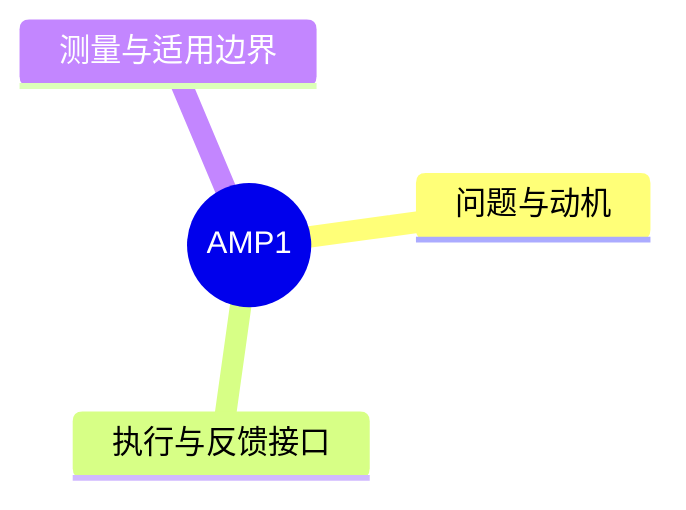

## Summary

AMP1 将通用多模态模型作为操作策略，通过具身 harness 读取环境和发出细粒度控制，并测量模型能力与接口设计的交互。 [原文与版本](https://arxiv.org/html/2611.09892v1)

## Problem & Motivation

机器人技能接口的抽象程度通常由系统开发者预先决定。更强模型可能利用原始反馈现场修正动作，较弱模型则可能受益于预定义抓放帮助。

## Method

基础 harness 接收模型的动作请求并返回图像及状态。辅助条件增加可调用的抓取和放置例程。RoboLab-120 消融保持观测与提示基本一致，在不同基座模型下比较两种动作接口。

## Key Results

Figure 5B 中从 basic 改为 assistive，Gemini 4 Argon 85.6%→83.2%，Opus 5.5 82.8%→75.3%，Qwen3.6-35B-A3B 14.2%→31.8%。论文另报告真实机器人试验，与基准消融分开陈述。

## Evidence Ledger

| Claim ID | Claim | Type | Source locator | Evidence excerpt | Status |
|:--|:--|:--|:--|:--|:--|
| C1 | AMP1 通过通用模型与具身 harness 获取视觉状态、执行受约束动作 | causal-mechanism | §§2D, 4A | Harness | source-verified |
| C2 | 同模型下辅助抓放使前四个强模型下降、末组六个上升 | comparison | §2D.2, Figure 5B | Fig. 5 | source-verified |

## Strengths & Weaknesses

同一接口的收益方向随模型而变。作者提出辅助动作可能隐藏有用反馈，实验没有把反馈信息和动作原语实现分别作因果消融。RoboLab-120 的方向也需用独立硬件任务再验证。

## Mind Map

## Notes

- [[Topics/AgenticRobotArm-Survey]]
