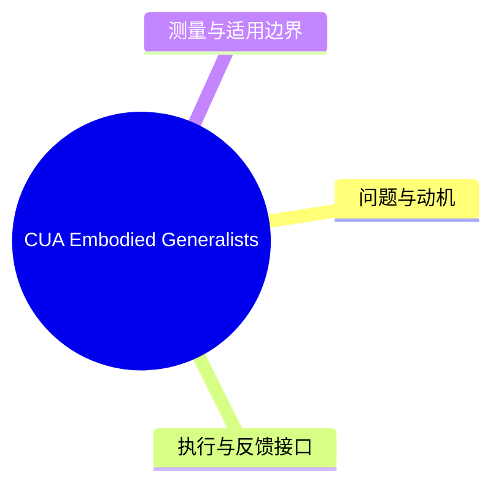

## Summary

作者把多个具身任务封装为可由同一个 CUA 操作的软件，并另做双臂仿真实验考察文本动作输出。 [原文与版本](https://arxiv.org/html/2611.09847v1)

## Problem & Motivation

专用模型与接口使具身任务难以共享通用 Agent。本文把渲染、动作和领域计算包装为软件界面，保留既有 CUA 的输入输出形式。

## Method

四个任务适配器分别处理三维导航、对话导航、点云分割和视频分割。GUI / 文本 API 对照共享相应的底层软件动作。另有一个独立双臂实验，用自然语言模型生成文本序列表示的低层动作。

## Key Results

四项比赛报告第 1、2、3、6 名。用各自指标比较同软件上的 GUI 和 API，四个验证设置的差距均在 4.0 点内。双臂仿真在同 1,000 条训练演示和两个装礼盒任务的 1,000 个未见实例中，文本动作 Qwen3.5-9B 完成 56%，π0.5 为 59%。

## Evidence Ledger

| Claim ID | Claim | Type | Source locator | Evidence excerpt | Status |
|:--|:--|:--|:--|:--|:--|
| C1 | 同一 CUA 并入四项软件包裹的导航或分割任务 | benchmark-setting | §§2–3, Table 1 | Competition results | source-verified |
| C2 | GUI 对文本 API 的四个局部差值绝对值至多 4.0 个各自指标点 | comparison | §3.2 Table 2 | GUI operations or text APIs | source-verified |
| C3 | 独立双臂仿真中，文本动作策略 56%，π0.5 59%，同 1,000 条演示 | comparison | §4 Claim 2 | 1,000 unseen instances | source-verified |

## Strengths & Weaknesses

比较显示统一软件接口可以调度多类具身工具。仿真装盒使用另一种文本动作模型与单独训练，四项比赛与真机低层控制之间还有数据、时延和感知差异。

## Mind Map

## Notes

- [[Topics/AgenticRobotArm-Survey]]
