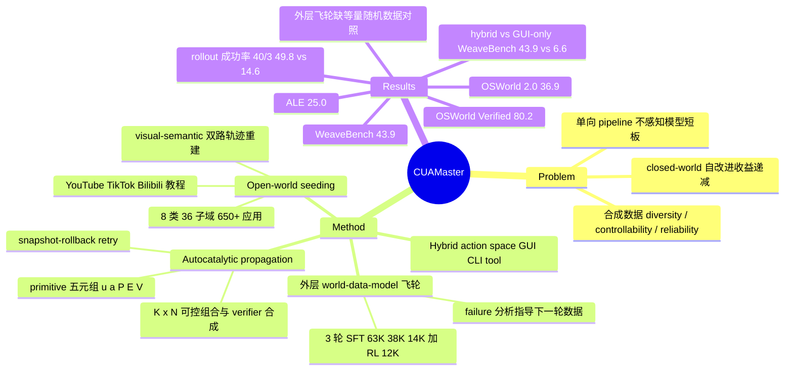

## Summary

CUA-Master 是一套 CUA 数据-训练双层飞轮：内层从 YouTube/TikTok/Bilibili 教程视频挖掘 seed task，用 visual-semantic 双路触发重建轨迹，再把 seed 抽象成带 precondition/environment/verifier 的 primitive，按"primitive 数 K × 应用数 N"可控组合出可验证任务，并用 feedback-guided snapshot-rollback retry 提高 rollout 成功率；外层按每轮模型的失败分析调整下一轮数据。从 Qwen-3.5-27B 起步，经 3 轮 SFT（累计约 115K 轨迹）加 1 轮 RL（约 12K 任务），CUA-Master-27B 在 OSWorld Verified / OSWorld 2.0 / WeaveBench / Agents' Last Exam 上得 80.2 / 36.9 / 43.9 / 25.0，在 GUI+CLI hybrid 基准上超过 Qwen-CUA-397B-A17B，但在 OSWorld Verified 上仍低于同尺寸通用模型 Qwen-3.8-27B（81.2）。最扎实的证据是 snapshot-rollback 让高难度合成任务的 rollout 成功率大幅提升（K/N=40/3 时 49.8% vs 14.6%）；"weakness-guided 外层飞轮"本身没有与等量随机加数据的对照，因果贡献未被隔离。

## Problem & Motivation

作者把 CUA 训练的瓶颈归为两层。系统层：主流 pipeline 是"先造数据再训练"的单向流程，数据构造不感知模型当前短板；已有的 recursive improvement（WebRL、Self-Challenging Agents 等）只用模型自生成经验，属于 closed-world，受限于模型自身能力、易放大分布偏差、边际收益递减。数据层：合成数据面临 diversity（来源同质、加量即饱和）、controllability（instruction rewriting / 模板难以控制操作类型、复杂度和跨应用依赖）、reliability（任务越复杂 rollout 成功率越低）三重问题。论文的立场是：外部知识必须持续注入（open-world），且合成复杂度要有显式旋钮。

隐含假设：(1) 教程视频中的工作流分布与目标 benchmark 的任务分布足够接近、且"真实"即"有用"；(2) primitive 的 environment/verifier 规格可以被强模型自动构造且基本可靠；(3) 模型的 failure analysis 能被转化为有效的数据配比调整——这一步在文中是 "in-house assessment"，没有给出可复现的算法。

## Method

**任务与动作空间。** 任务定义为 (instruction, environment, verifier) 三元组；每步可输出一个或一批 atomic action。统一 hybrid action space：`computer.*` 鼠标键盘（坐标归一化到 [0,1000]）、`shell.exec` 结构化 shell 命令、`tool.call`、`finish`（Table 7）。GUI 观测是截图，CLI 观测是 stdout/stderr/exit status。

**环境基建。** backend-agnostic 的 VM 编排层，支持 Linux/Windows/macOS；手工准备覆盖 Table 9 应用组合的 base image，再程序化扰动（随机删应用、重排桌面）派生变体；immutable base image + 可丢弃 writable overlay，overlay 内可预装 Codex / Claude Code / OpenClaw 等 harness。宣称支持 100+ 种 CUA 环境、2,000+ 并发 VM。

**Open-world seeding（内层飞轮的"注入"力）。**
1. Corpus harvesting：按 8 大类 / 36 子域 / 650+ 应用的 taxonomy 加 "tutorial / how to / guide" 等关键词组合检索 YouTube、TikTok、Bilibili；按来源与标题去重，metadata gate（时长、上传时间、可用性、应用归属）加噪声过滤（广告、娱乐、语言学习等）；Faster-Whisper（Whisper-Large-v3）转写后由 annotator 给 0–5 的 CUA suitability 分。
2. Seed task mining：把视频切成多个独立任务段（start/end timestamp + goal），剔除片头、广告、口播、纯幻灯片段。
3. Dual-path trajectory reconstruction：semantic path 从转写中按连接词切子句并用 "click / press / scroll / drag" 等动词识别操作子句；visual path 用 FFmpeg 帧间外观变化分数超阈值作为界面转换触发；两路在时间窗 T 内重合的点作为候选；annotator 依次担任 action rechecker（增删拆合候选）、action annotator（输出坐标、输入文本等）、trajectory verifier（去重、按断点切分、过滤）。

**Autocatalytic propagation（内层飞轮的"放大"力）。**
1. Primitivization：annotator 把 (seed task, trajectory) 抽成 primitive 序列，每个 primitive 是五元组（应用 u、能力 a、precondition P、environment requirement E、verifier spec V），E/V 的自动构造沿用并改进了 [52, 28]（ScaleCUA 等）的策略；入库后语义等价者 canonicalize 去重。
2. Composable task synthesis：给定 primitive 数 K 和应用集合（N 个），先检查 precondition / environment 兼容性，冲突者不可组合；annotator 生成连贯 instruction，同时把各 primitive 的 E 合成任务级环境、把各 V 合成任务级 verifier。N=1 为单应用任务，N>1 为跨应用任务。复杂度通过 (K, N) 显式控制而非语言改写。
3. Resilient trajectory collection：verifier 失败或检测到低效时，annotator 作为 detector 读取 verifier residual、轨迹与环境，输出最早分歧步 ŝ 与执行反馈 F（只描述失败现象，不泄露 privileged action 解法，以减轻 distribution mismatch）；环境回滚到 ŝ 之前最近的增量 snapshot（存 VM 状态 + 轻量 state signature：活动应用、窗口布局、相关文件、controller 元数据），policy 保留前缀、丢弃后缀，以反馈为 hint 续跑，直到通过或 retry budget 用尽；只保留成功且最高效的分支。机制受 [6]（Recovering policy-induced errors, ICML 2026）启发。

**外层 world-data-model 飞轮与训练。** 每轮做一次完整优化：前几轮 SFT，每轮依据 domain/application 级失败案例和 rollout 成功率的 in-house 分析决定下一轮数据扩充方向；每轮 SFT 都从同一 base checkpoint（Qwen-3.5-27B）在累积数据上重训。三轮 SFT 分别新增 63K / 38K / 14K 条任务-轨迹（累计约 115K），SFT 饱和后最后一轮转 RL：沿用 ScaleCUA 的 online RL 框架（GRPO 变体，含 frontier sampling 与 visual context segmentation），每任务在真实 VM 采样 8 条轨迹，outcome reward 直接来自合成时产出的 task verifier，约 12K 高质量任务。训练硬件 16 节点 × 8 H200。

## Key Results

**主结果（Table 1；所有 baseline 由作者在统一协议下重测）。** ALE 报 full-pass rate，其余三个报 average score。

| 模型 | OSWorld Verified | OSWorld 2.0 | WeaveBench | Agents' Last Exam |
|:--|--:|--:|--:|--:|
| Qwen-3.5-27B（起点） | 54.6 | 0.8 | 13.5 | 1.3 |
| Qwen-3.8-27B | 81.2 | 36.5 | 14.1 | 19.1 |
| UI-Mate-27B | 77.6 | 24.0 | 18.3 | 13.2 |
| Qwen-CUA-397B-A17B | 84.0 | 43.6 | 35.1 | 21.1 |
| Kimi-K3-2.8T-A104B | 84.2 | 55.9 | 43.2 | 25.0 |
| GPT-5.6-Sol* | 83.6 | 59.0 | 50.6 | 26.3 |
| Claude-Opus-5* | 86.3 | 64.2 | 55.7 | 28.3 |
| **CUA-Master-27B** | **80.2** | **36.9** | **43.9** | **25.0** |

- 相对 UI-Mate-27B 四项分别 +2.6 / +12.9 / +25.6 / +11.8。
- 在 GUI-only 两项上与 Qwen-3.8-27B 持平或略低（OSWorld Verified 80.2 vs 81.2），真正的差距拉开在 hybrid 基准（WeaveBench 43.9 vs 14.1）。
- ALE 上作者称仅落后 GPT-5.6-Sol 与 Claude-Opus-5；但与 Kimi-K3、Qwen-3.8-Max 同为 25.0，是靠"full-pass 相同时比 average score"的附加规则排在其前。
- 效率：OSWorld 2.0 上以 36.9 vs 36.5 略超 Qwen-3.8-27B 且 runtime 少 24%（1h7m vs 1h28m）；WeaveBench 上与 GPT-5.6-Luna 分数相当（43.9 vs 44.0）、runtime 少 28%；ALE 上与 Kimi-K3 / Qwen-3.8-Max 同分、时间少 34–36%。

**跨平台（Table 2）。** WindowsAgentArena 56.2、MacOSWorld 43.0、MacAgentBench 59.9。但 UI-Mate-27B 在 WAA 更高（63.2），Qwen-CUA-397B-A17B 在 MacAgentBench 更高（65.3）；CUA-Master 只在 MacOSWorld 上是表内最高。

**Hybrid action space 消融（§3.3.1，图为 Figure 6，正文误引为 Figure 7）。** WeaveBench：hybrid 43.9 vs GUI-only 6.6 vs CLI-only 11.5，步数比 GUI-only 少 23.8%；ALE：GUI-only 5.9 → hybrid 25.0，步数少 26.7%；OSWorld 2.0：分数相当、步数少 43.8%。

**数据飞轮（Table 3，正文误引为 Table 7）。** rollout 成功率，baseline 为同 retry budget 但每次从头重跑：

| K / N | Baseline | Ours |
|:--|--:|--:|
| 5 / 1 | 74.0% | 95.4% |
| 20 / 1 | 31.5% | 83.7% |
| 40 / 3 | 14.6% | 49.8% |
| 50 / 8 | 0.0% | 18.7% |

t-SNE（Figure 7）显示合成任务覆盖 AgentNet、VideoCUA、ScaleCUA、WildGUI、CUA-Gym、ProCUA-SFT 的分布并延伸到稀疏区域（定性）。

**外层飞轮（§3.3.3；正文两处都引 Figure 9，迭代趋势实为 Figure 8）。** 迭代使 OSWorld Verified 与 WeaveBench 各升 25+ 分；SFT 饱和后 RL 阶段在 OSWorld 2.0 与 ALE 上各约 +15 分。更强的 annotator 一致带来更大增益；用每轮自身模型当 annotator（self-policy）只有有限增益。具体曲线数值只在图中，文本不可定位。

**分域（Table 4–6）。** OSWorld Verified 中 Workflow 域最低（70.7，93 题）；WeaveBench 中 Spatial/CAD（25.9）与 Design（26.3）最弱，Web Frontend（58.4）最强。

## Evidence Ledger

| Claim ID | Claim | Type | Source locator | Evidence excerpt | Status |
|:--|:--|:--|:--|:--|:--|
| C1 | CUA-Master-27B 在 OSWorld Verified / OSWorld 2.0 / WeaveBench / Agents' Last Exam 分别得 80.2 / 36.9 / 43.9 / 25.0 | number | Abstract; Table 1; §3.2.1 | "scoring 80.2 on OSWorld Verified, 36.9 on OSWorld 2.0, 43.9 on WeaveBench, and 25.0 on Agents' Last Exam" | source-verified |
| C2 | 模型从 Qwen-3.5-27B 初始化，该起点在四项上为 54.6 / 0.8 / 13.5 / 1.3 | number | §3.1.3; Table 1 (Qwen-3.5-27B row) | "Initialized from Qwen-3.5-27B [35], we first perform SFT" | source-verified |
| C3 | 相对 UI-Mate-27B 四项提升 2.6 / 12.9 / 25.6 / 11.8 | comparison | §3.2.1 | "it consistently improves performance by 2.6, 12.9, 25.6, and 11.8 across the four benchmarks" | source-verified |
| C4 | 在 OSWorld Verified 上 Qwen-3.8-27B（81.2）高于 CUA-Master-27B（80.2），作者表述为 GUI-only 上"comparable" | comparison | Table 1; §3.2.1 | "our model achieves comparable performance of Qwen-3.8-27B on GUI-only tasks" | source-verified |
| C5 | ALE 上 CUA-Master 只落后 GPT-5.6-Sol（26.3）与 Claude-Opus-5（28.3），与 Kimi-K3、Qwen-3.8-Max 同为 25.0 时按 average score 排序 | sota-novelty | §3.2.1; Table 1 | "it only lags behind GPT-5.6-Sol and Claude-Opus-5, and surpasses all other counterparts (when full-pass rate is equal, compare the average score)" | source-verified |
| C6 | CUA-Master 在 GUI-only 基准上低于 Qwen-CUA-397B-A17B（84.0 / 43.6），在 hybrid 基准上超过它（43.9 vs 35.1；25.0 vs 21.1） | comparison | §3.2.1; Table 1 | "competitive performance against Qwen-CUA-397B-A17B on GUI-only benchmarks, while even outperforming it on hybrid benchmarks" | source-verified |
| C7 | 所有 baseline 由作者在统一环境配置、动作接口与评测标准下重测 | benchmark-setting | §3.1.1 | "we re-evaluate all baseline models under a consistent benchmark protocol, using the same environment configurations, action interfaces, and evaluation criteria" | source-verified |
| C8 | ALE 报 full-pass rate，OSWorld Verified / OSWorld 2.0 / WeaveBench 报 average score | benchmark-setting | §3.1.2 | "For Agents' Last Exam, we calculate the full-pass rate, while reporting average scores for the other three benchmarks." | source-verified |
| C9 | OSWorld 2.0 上以 36.9 vs 36.5 略超 Qwen-3.8-27B，runtime 减少 24% | comparison | §3.2.2; Table 1 | "it slightly surpasses Qwen-3.8-27B (36.9 vs. 36.5) while reducing runtime by 24%" | source-verified |
| C10 | WeaveBench 上与 GPT-5.6-Luna 分数相当且 runtime 少 28%；ALE 上与 Kimi-K3 / Qwen-3.8-Max 同分且时间少 34–36% | comparison | §3.2.2; Table 1; Figure 3 | "matching GPT-5.6-Luna and with 28% less runtime" / "requiring 34-36% less time" | source-verified |
| C11 | 跨平台得分 WindowsAgentArena 56.2、MacOSWorld 43.0、MacAgentBench 59.9；UI-Mate-27B 在 WAA（63.2）、Qwen-CUA 在 MacAgentBench（65.3）更高 | number | §3.2.3; Table 2（正文误引为 Table 4） | "achieving scores of 56.2, 43.0, and 59.9 on WindowsAgentArena, MacOSWorld, and MacAgentBench, respectively" | source-verified |
| C12 | WeaveBench 上 hybrid 43.9 vs GUI-only 6.6 vs CLI-only 11.5，步数比 GUI-only 少 23.8% | number | §3.3.1; Figure 6（正文误引为 Figure 7） | "the hybrid mode achieves a score of 43.9, outperforming GUI-only (6.6) and CLI-only (11.5)" | source-verified |
| C13 | ALE 上 hybrid 使分数从 GUI-only 的 5.9 升到 25.0、步数少 26.7%；OSWorld 2.0 步数少 43.8% | number | §3.3.1 | "hybrid execution improves the score from 5.9 to 25.0 over GUI-only, with 26.7% fewer steps" | source-verified |
| C14 | K/N=40/3 时 rollout 成功率 49.8% vs baseline 14.6%；K/N=50/8 时 18.7% vs 0.0% | number | Table 3（正文误引为 Table 7）; §3.3.2 | "achieving 18.7% versus 0.0% at K/N=50/8" | source-verified |
| C15 | Table 3 的 baseline 使用相同 retry budget 但每次从头重新 rollout（naive environments） | benchmark-setting | §3.3.2 | "which utilizes naive environments to rollout with the same retry budget but re-rollout from the start" | source-verified |
| C16 | 作者称 K=40、N=3 的合成任务难度与 ALE 平均难度相当 | causal-mechanism | §3.3.2 | "with K=40 primitives across N=3 applications, which is comparable to the average difficulty of Agents' Last Exam" | source-verified |
| C17 | 三轮 SFT 分别新增 63K / 38K / 14K 任务-轨迹，累计约 115K；RL 用约 12K 任务 | number | §3.1.3; Appendix B | "we include 63K, 38K, 14K tasks and corresponding trajectories respectively, thus the total training data at the last SFT iteration is about 115K" | source-verified |
| C18 | 每轮 SFT 都从同一 base checkpoint 在累积数据上重训 | benchmark-setting | §2.5.2 | "each iteration of SFT is trained starting from the same base checkpoint, with the updated data from each iteration added" | source-verified |
| C19 | 迭代使 OSWorld Verified 与 WeaveBench 各升 25+ 分；RL 阶段在 OSWorld 2.0 与 ALE 上各约 +15 分（具体数值仅在图中） | number | §3.3.3; Figure 8（正文引为 Figure 9）；曲线数值 unknown | "with OSWorld Verified and WeaveBench increasing by over 25 points" | source-verified |
| C20 | 更强 annotator 一致带来更大增益；以每轮自身模型作 annotator 的 self-policy 增益有限 | causal-mechanism | §3.3.3; Figure 9 | "The self-policy strategy ... can bring about some improvements, but its gains are relatively limited." | source-verified |
| C21 | 正文未点名 annotator 的具体模型，只称其通常为更强模型（Table 8 标题提到 allowed models，但 HTML 表中无该列） | benchmark-setting | §2.3.1; Table 8 | "we use an annotator A, normally a more powerful model, as the score evaluator" | source-verified |
| C22 | Open-world taxonomy 含 8 大类、36 子域、650+ 应用，检索来源为 YouTube、TikTok、Bilibili | number | §2.3.1; Table 9; Appendix B | "including 8 main categories, 36 subdomains, and over 650 applications" | source-verified |
| C23 | 基建支持 100+ 种 CUA 环境与 2,000+ 并发 VM | number | §2.1.3 | "supports over 100 different CUA environments and allows over 2,000 concurrently running VMs" | source-verified |
| C24 | Detector 反馈只描述失败或低效现象，不泄露 privileged action 解法，以减轻 distribution mismatch | causal-mechanism | §2.4.2 | "without exposing a privileged action solution, alleviating potential distribution mismatch" | source-verified |
| C25 | 项目公开了 GitHub 代码与 HuggingFace 上的 CUAMaster-27B 权重链接；文中未声明代码/权重/数据 license | license-code | 首页 header links | "https://github.com/xlyu0106/CUA-Master.git Code ... https://huggingface.co/yxl66666/CUAMaster-27B Model" | source-verified |

## Strengths & Weaknesses

**Strengths**

1. **可控合成复杂度的旋钮是真设计。** 把 seed 抽成带 precondition / environment / verifier 的 primitive，再以 (K, N) 组合，使"任务难度"从语言改写的副产品变成显式参数，并天然给 RL 提供难度分层。这比 instruction rewriting 更有结构，也让 Table 3 这种按难度分层的成功率对比成为可能。
2. **Snapshot-rollback retry 的证据最硬。** Table 3 在同 retry budget 下比较，难度越高优势越大（5/1 时 +21pp，40/3 时 +35pp，50/8 时 0% → 18.7%），机制清晰：长任务失败多是局部误操作，保留前缀即可节省大量重跑。对长程任务的数据产出率，这是可迁移的工程结论。
3. **Hybrid action space 的消融揭示了真正的增益来源。** WeaveBench 上 GUI-only 只有 6.6、hybrid 43.9；与 Qwen-3.8-27B 相比，GUI-only 基准持平，hybrid 基准差 30 分。说明这篇论文最大的增益来自"学会何时用 shell"，而不是 GUI 能力本身。
4. **报告效率指标。** 同时给出 step / token / wall-clock，并沿用 cua-speedrun 的 runtime 口径，比只报分数信息量更大。

**Weaknesses**

1. **外层"weakness-guided"飞轮没有被隔离。** 核心卖点是"用模型短板指导下一轮数据"，但没有与等量、随机配比数据的对照；三轮新增数据 63K → 38K → 14K，迭代增益与数据总量同步增长，无法区分是"guided"还是"更多数据"。weakness → 数据配比的映射也只写成 in-house assessment，不可复现。
2. **组件贡献对最终模型分数缺消融。** 没有"去掉 open-world seeding 只用合成"、"去掉 rollback 只用常规 rollout 数据"对最终 benchmark 分数的消融；Table 3 证明的是数据产出率，不是模型效果。
3. **annotator 是黑箱且是上限。** 8 个 annotator 角色的具体模型未点名，Figure 9 说明更强 annotator 带来更大增益、self-policy 增益有限，Limitations 也承认"数据质量上限取决于 annotator"。这其实削弱了"open-world 摆脱 closed-world 上限"的叙事：增益很可能主要来自对更强（可能闭源）模型的蒸馏，而不是视频本身的外部知识。
4. **benchmark 污染未讨论。** 训练环境覆盖 OSWorld 类应用（LibreOffice 等）且 Linux/Windows/macOS 都在 VM 池中，教程视频与 benchmark 任务可能高度相似；全文未见去污染流程。因此"跨平台 generalization"也不是严格的 out-of-distribution（并且 WAA 与 MacAgentBench 上并非表内最佳）。
5. **baseline 全部重测，数字与原论文不一致。** 例如 vault 笔记记录的自报值：UI-Mate-27B OSWorld-Verified 77.0（此处重测 77.6），Qwen-CUA 86.2（此处 84.0）。重测统一了协议，但 hybrid 基准中 GUI-only specialist（UI-Mate、Qwen-CUA）的 action interface 是如何适配的未说明，hybrid 基准上的大幅领先可能部分来自对手被迫使用不擅长的接口。
6. **度量口径需要小心。** WeaveBench 此处报 average score，不是原 benchmark 的 PassRate（WeaveBench 原文最高 PassRate 41.2%），不能与原 benchmark 数字直接比；ALE 的"仅次于两个闭源模型"依赖同分时的附加排序规则。
7. **写作粗糙。** 正文多处图表引用错位（Table 3 写成 Table 7、Table 2 写成 Table 4、Figure 6 写成 Figure 7、Figure 8 写成 Figure 9、Appendix D 写成"Tables 6, 6, and 6"），迭代曲线和 annotator 对比的数值只在图中，文本无法核对。
8. **"K=40/N=3 相当于 ALE 平均难度"** 没有给出度量方法，是一个未证明的对齐断言。

**适用边界。** 结论成立的前提是：有大规模 VM 基建（2,000+ 并发）、可调用强 annotator、目标任务分布接近桌面生产力软件教程。对 GUI-only 场景，该方法相对同期更强的通用基座（Qwen-3.8-27B）没有明显优势。

## Mind Map

## Notes

- [[2607-SCALECUA]]：CUA-Master 的 RL 阶段直接沿用 SCALECUA 的 online RL 框架（frontier sampling + visual context segmentation），primitive 的 environment/verifier 自动构造也基于其 VeriGen 一类策略；SCALECUA 自己的人工审计显示"judge 可执行 ≠ 任务有效"，这一问题在 CUA-Master 的组合式 verifier 合成中同样存在且未被审计。
- [[2606-WeaveBench]]：WeaveBench 的核心发现是 harness 效应远大于模型效应、35.2% 的失败是 reward hacking；CUA-Master 在 WeaveBench 上的 43.9 是 average score 且未报 trajectory-aware 判分，与原 benchmark 的 PassRate 口径不可直接比较。
- [[2608-UIMate]]：同为 27B 开权重桌面 CUA 的直接对照；UI-Mate 自报 OSWorld-Verified 77.0、WAA 66.2，CUA-Master 重测为 77.6 / 63.2，并且 WAA 上 UI-Mate 仍领先，说明 CUA-Master 的优势集中在 hybrid 场景。
- [[2605-Video2GUI]]：同样从 YouTube 教程大规模挖掘 GUI 轨迹（WildGUI，1270 万条）；CUA-Master 的区别是把视频当作 seed 和 primitive 来源而非直接当训练轨迹，二者可组合，但 CUA-Master 没有直接对比"视频轨迹直接训练"这一路线。
