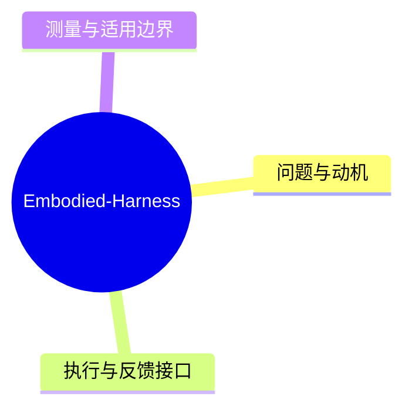

## Summary

Embodied-Harness 由冻结 Actor 执行，Reflector 从真实执行记录或仿真轨迹抽取诊断，并将指导写回下一轮的 harness。 [原文与版本](https://arxiv.org/html/2611.27689v2)

## Problem & Motivation

长程操作需要保留回合内进度，也需要跨回合复用经验。基于最终分数的反思难以区分夹爪、接触、几何与任务次序造成的失效。

## Method

Actor 读取机器人观测、状态、工具反馈与历史。短期记忆跟踪当前回合，长期记忆保存可复用经验。Reflector 用轨迹与结果定位失败，生成可执行指导供后续回合调用。更新作用在 harness，Actor 和 Reflector 保持冻结。

## Key Results

Piper 机械臂真实执行三任务各 10 次，完整系统 29/30 对比 π0.5 的 12/30。RoboTwin C2R 在仿真中从第 0 到第 4 轮 59.2%→82.4%，RoboSPA-Long 43.0%→59.5%。

## Evidence Ledger

| Claim ID | Claim | Type | Source locator | Evidence excerpt | Status |
|:--|:--|:--|:--|:--|:--|
| C1 | Actor 与 Reflector 冻结，基于执行证据更新操作指导 | causal-mechanism | §§3.1–3.4 | Reflector | source-verified |
| C2 | Piper 真机三任务各 10 次，系统 96.7%、π0.5 40.0% | comparison | §4.1, Table 5 | Table 5 | source-verified |
| C3 | 第 0 至 4 轮，RoboTwin C2R 59.2→82.4%，RoboSPA-Long 43.0→59.5% | number | §4.4 Figure 6b | Figure 6 | source-verified |

## Strengths & Weaknesses

小样本真机对照检验了整套系统。多轮改进曲线来自仿真，不能用于估算真机持续学习幅度。是否迁移到预先隔离的新任务族或不同机器人，还有待独立设计。

## Mind Map

## Notes

- [[Topics/AgenticRobotArm-Survey]]
