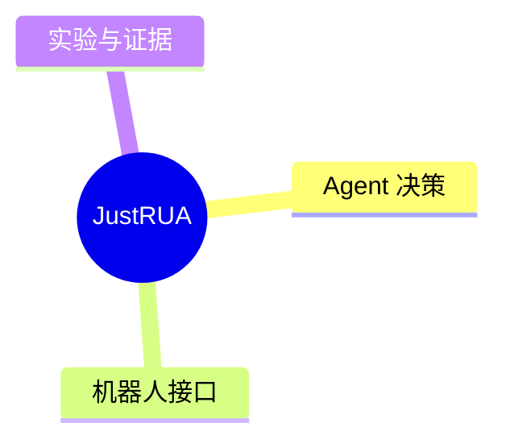

## Summary

JustRUA 固定推理模型并逐步改变 history、动作长度、几何感知与经验设置，分析 Robot-Use 性能从何而来。 [原文](https://arxiv.org/html/2611.16009v1)

## Problem & Motivation

不同 RUA 的整体指标同时反映模型、接口、感知和资源，不能用来说明单个部件的作用。

## Method

以 RoboProbe 参考设置为基础，分别试验保留回合图像历史、限制动作时长、引入机器人状态、预测深度和运行几何代码。探索从示范或自改进轨迹复用经验。

## Key Results

42 项 RoboDojo 仿真任务共 111 个评估回合，过程分从 29.7 到 50.3。最终一步还解除旧配置的 100 次决策上限。经验对照中的默认分为 38.0，自建技能库为 37.0，局部行为改善没有转为整体分数增益。

## Evidence Ledger

| Claim ID | Claim | Type | Source locator | Evidence excerpt | Status |
|:--|:--|:--|:--|:--|:--|
| C1 | 仿真子集覆盖 42 个任务和 111 回合 | benchmark-setting | §2.4, Appendix D | Evaluation Set | source-verified |
| C2 | 过程分 29.7→50.3，最终步骤同时改变几何代码和模型决策上限 | comparison | §§3, 5.4, Table 1 | Table 1 | source-verified |
| C3 | 默认 38.0 与自建技能库 37.0，经验改变动作行为而总分未增 | comparison | §4.2 Table 4 | Self-Improvement Loop | source-verified |

## Strengths & Weaknesses

主要实证是同模型下的诊断。最终配置仍受 500 个控制步约束。各阶段呈递进比较，只能给出组合增益，真机和资源匹配需要额外测试。

## Mind Map

## Notes

- [[Topics/RobotUseAgents-Survey]]
