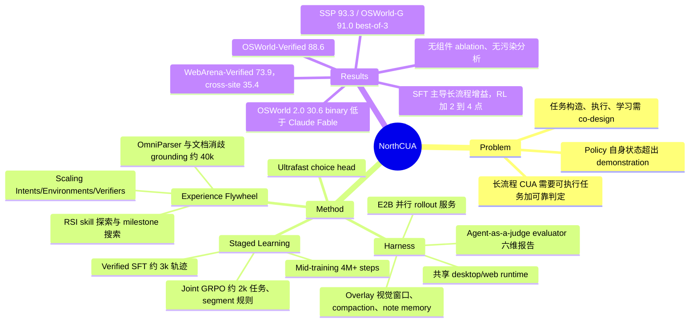

## Summary

NorthCUA 是一份系统型技术报告：Harness（共享 desktop/web runtime + agent-as-a-judge evaluator + 批量 rollout 服务）、Experience Flywheel（grounding 数据 + 三条任务构造路线 + RSI 难题采集）和 Staged Learning（mid-training → verified long-horizon SFT → joint desktop–web GRPO）三件套，基座是 Qwen3.5 的 9B/35B/397B 三档。Pro 报告 SSP 93.3、OSWorld-G 91.0、OSWorld-Verified 88.6、WebArena-Verified 73.9、WebTestBench F1 60.3，在其对比表中均为最高；但 OSWorld 2.0 的 30.6 binary 仍明显低于 Claude Fable 5/5.1。全文几乎没有组件级 ablation，所有"为什么 work"的证据只来自三个训练阶段之间的 checkpoint 对比。

## Problem & Motivation

CUA 从单步操作走向长流程软件工作时，瓶颈在 experience：需要大量带初始环境与可靠成功判定的可执行任务；需要能维持长交互、记录决策并核查结果的 harness；还需要让 policy 在自己走到的、demonstration 未覆盖的状态上拿到 outcome feedback。作者主张这三者必须 co-design（任务怎么造、agent 怎么跑、experience 怎么用），而不是分别优化。动机本身合理，但这是工程整合论点，论文并未给出"co-design 优于分别设计"的对照实验。

## Method

**1. NorthCUA Harness**
- **Agent Kit 共享 runtime**：ReAct 式循环，Session/Round/Step 三层 scope；desktop agent 只看截图、发键鼠动作，web agent 额外有 DOM 信息与 element-reference 动作；允许单次响应发多个 action call（串行执行）。
- **长程上下文三件套**：(a) action-aware visual context：最多 k 帧滑动窗口，历史帧叠加 click/drag/scroll/text overlay，最新帧保持 clean；(b) task-preserving compaction：保护任务请求、最新观测和最近几步，摘要保留目标/约束/事实/未完成项，并过滤过期的坐标与 element ref；(c) structured working memory：agent 主动调用的 text-only note 工具。
- **Agentic outcome evaluator**：agent-as-a-judge，既检索录制的轨迹与 artifact，也能用只读 shell、GUI、browser 工具检查仍存活的 workspace；报告按 task completion / process quality / efficiency / side effects / failure diagnosis / uncertainty 六维（Table 2）输出，用于按 cohort 调阈值筛数据。
- **Batch Rollout Service**：E2B 隔离沙箱、task-bound 预准备队列、分阶段并发上限和 controller 压力反馈。

**2. Experience Flywheel**
- **Grounding**：OmniParser 加 accessibility 元数据生成 control record，再由 LLM 生成多种 query；另有 documentation-grounded 路线，由 agent 检索在线手册、经 CLIP 相似度取 top-k 候选、再结合 GUI 上下文消歧控件功能（如 Inkscape 的对象对齐 vs 段落对齐）。经几何与多模态正确性检查、去重后约 40k 条。
- **三条任务构造路线**（统一打包成 CaseSpec）：Scaling Intents（从软件功能 + 文件内容 + persona 生成请求；长程任务用 scenario blueprint 依赖图）；Scaling Environments（为外部来源的请求搭 workspace，或从公开 URL 重建网站）；Scaling Verifiers（对已有 task–verifier 对做 decomposition / variation / composition，并用 GUI trial 加正负 outcome probe 测试 verifier）。
- **RSI 难题采集**：skill-guided exploration（探索 → skill creator 写文本 skill → 独立 agent 验证 → 再试）；milestone-guided search（读 verifier 代码拆 milestone，通过即存 E2B snapshot 加 agent context，形成搜索树，最终由原 verifier 验收）。辅助轨迹在上下文中保留所用 skill/milestone guidance。

**3. Staged Learning**
- **Mid-training**：>100k 轨迹 / >4M GUI steps（desktop 约 100k query、约 4.2M steps；web 约 10k、约 280k）+ 约 40k grounding + evaluator 轨迹（训练模型的评判能力），由 evaluator 筛选。坐标统一归一到 [0,1000]。
- **Verified long-horizon SFT**：约 3,000 条轨迹 / 约 310k steps（desktop 平均约 120 步，web 约 70 步），只收原 task verifier 通过的轨迹，优先长依赖。
- **Joint desktop–web GRPO**：从与 SFT 数据关联的人审任务中，用 SFT policy 每题跑 ≥5 次，保留结果有方差的任务，得到约 1,500 desktop + 500 web 任务池。Experience Adapter 有两条规则：只在 prefix 严格延续（文本 + 图像 digest + behavior 版本一致）时合并调用，否则另起 segment；advantage 按完整 attempt 计算一次、所有 segment 共享，loss 按 attempt 的 target token 归一后再跨 attempt 平均（沿用 Qwen-CUA 的 trajectory-mean）。另有异步权重发布、图像预处理复用、无损 tensor 压缩。
- **NorthCUA-Ultrafast**：在 pre-RL Nano 上加 Jev 式 choice head，对 click/hover/checkbox 这类有限选择直接分类出 tool call，fill 文本和其他动作走原生生成；分 Head-only（4.21M 参数）和 Head + LoRA（47.49M）两种变体。

## Key Results

- **Grounding**（SFT checkpoint）：Pro 在 SSP 93.3、OSWorld-G 91.0；本文自测的 Claude Opus 5.5 为 88.1 / 89.9。Mini 为 92.4 / 87.9，Nano 为 72.9 / 83.0。注意 NorthCUA 的 OSWorld-G 报的是三次完整运行中最好的一次，Pro 三次均值 90.2±0.80，比 Claude Opus 5.5 只高 0.3。另外 Pro 与 Nano/Mini 用的 click schema 不同。
- **OSWorld-Verified**（361 任务，排除 8 个 Google Drive 任务，100 步）：Nano/Mini/Pro 为 78.9 / 85.3 / 88.6。Pro 比 Qwen-CUA-Max 报告的 87.6 高 1.0，但后者的 87.6 是 360 任务上的 earned credit，与本文的 success 口径不同。
- **OSWorld 2.0**（108 任务，500 步）：Pro 为 30.6 binary / 66.8 partial，正文只强调比 GPT-5.6 Sol 高 3.2 / 4.1；同表 Claude Opus 5（31.4/68.3）、Fable 5（36.1/72.9）、Fable 5.1（41.7/77.9）均高于 Pro。
- **WebArena-Verified**（812 任务）：Pro 73.9，比并列最高参照 71.6（Kimi-K3 报告值、GPT-6 Astra 自测值）高 2.3。cross-site 只有 17/48（35.4%），single-site 为 583/764（76.3%）。
- **WebTestBench**（gold checklist、oracle 设定）：Pro F1 60.3，GPT-6 Astra 为 58.2。
- **阶段对比**：Mid→SFT 的 OSWorld-Verified 增益为 +7.4 / +15.0 / +10.0；Pro 的 WebArena 只从 69.1 涨到 69.6（+0.5）；OSWorld 2.0 上 Pro 的 binary 从 9.3 涨到 27.3。SFT→RL 的 OSWorld-Verified 增益为 +2.9 / +2.0 / +2.8，WebArena 为 +3.0 / +2.5 / +4.3；Mini 的 OSWorld 2.0 binary 停在 18.5 没动。
- **Ultrafast**：WebArena-Verified 成功率 Full generation 64.2、Head + LoRA 60.6；平均任务耗时从 616.8 s 降到 266.8 s（2.3×），但这个耗时只在 320 个"各方法都成功"的子集上测量。
- **工程**：无损编码让 image-tensor payload 减少 97.2%。

## Evidence Ledger

| Claim ID | Claim | Type | Source locator | Evidence excerpt | Status |
|:--|:--|:--|:--|:--|:--|
| C1 | NorthCUA-Pro（SFT checkpoint）在 ScreenSpot-Pro 上 93.3%、OSWorld-G 上 91.0% | number | §6.2 / Table 6 | "with Pro reaching 93.3% on SSP and 91.0% on OSWorld-G" | source-verified |
| C2 | 本文自测 Claude Opus 5.5 为 SSP 88.1%、OSWorld-G 89.9%，是对比表中最强参照 | comparison | §6.2 / Table 6 | "scoring 88.1% on SSP and 89.9% on OSWorld-G in our evaluation" | source-verified |
| C3 | Mini 在 SSP 92.4%、OSWorld-G 87.9%；Nano 为 72.9% / 83.0% | number | §6.2 | "Mini reaches 92.4% on SSP and 87.9% on OSWorld-G" | source-verified |
| C4 | NorthCUA 的 OSWorld-G 主表数字取三次完整运行中的最好一次 | benchmark-setting | §6.1 Grounding protocol | "NorthCUA's OSWorld-G entries use best-complete-run accuracy." | source-verified |
| C5 | Pro 在 OSWorld-G 三次均值为 90.2±0.80（best run 91.0，pass@3 94.0） | number | Appendix I / Table 29（表格行，单元格分隔符已省略） | "NorthCUA-Pro 93.3 95.6 $90.2\pm 0.80$ 91.0 94.0" | source-verified |
| C6 | OSWorld-G 上 Pro 用的 click schema 与 Nano/Mini 不同 | benchmark-setting | Appendix I（Table 29 后文） | "Pro uses the frozen NorthCUA desktop click schema, whose descriptions refer to desktop interaction" | source-verified |
| C7 | OSWorld-Verified 上 Pro/Mini/Nano 为 88.6/85.3/78.9，Pro 为对比系统中最高 | sota-novelty | §6.3 / Table 8 | "NorthCUA-Pro reaches 88.6% on OSWorld-Verified, the highest score among the compared systems." | source-verified |
| C8 | 本文 OSWorld-Verified 用 361 任务，排除 8 个 Google Drive 任务，100 步上限 | benchmark-setting | §6.1 Interactive evaluation | "excluding eight Google Drive tasks that require separate account configuration" | source-verified |
| C9 | Pro 比 Qwen-CUA-Max 报告的 87.6% 高 1.0 个百分点 | comparison | §6.3 | "Pro exceeds Qwen-CUA-Max's reported 87.6% by 1.0 percentage points" | source-verified |
| C10 | 被比较的 Qwen-CUA 86.2 是 360 任务上的 earned credit，与本文 success 口径不同 | benchmark-setting | Appendix I / Table 34 | "The reported 86.2 is earned credit on 360 tasks with a 100-step limit." | source-verified |
| C11 | Nex-N2.5 的 provider 报告分数使用 NorthCUA harness family | benchmark-setting | Appendix I / Table 34 | "Provider-reported computer/browser scores use the NorthCUA harness family." | source-verified |
| C12 | OSWorld 2.0 全 108 任务上 Pro 为 30.6% binary / 66.8% partial | number | §6.3 / Table 9 | "Pro reaches 30.6% binary completion and 66.8% partial credit on the full 108-task set." | source-verified |
| C13 | 同表 Claude Fable 5.1 为 41.7/77.9（Claude Opus 5 31.4/68.3，Fable 5 36.1/72.9），均高于 Pro | comparison | Table 9（表格行，单元格分隔符已省略） | "Claude Fable 5.1 (Anthropic, 2026a) Undisclosed 41.7 77.9" | source-verified |
| C14 | WebArena-Verified 上 Pro 73.9%，比并列最高参照 71.6% 高 2.3 | sota-novelty | §6.4 / Table 10 | "Pro's score is 2.3 points above the joint-highest reference score of 71.6%" | source-verified |
| C15 | Pro 在 cross-site 任务只完成 17/48（35.4%），single-site 为 583/764（76.3%） | number | §6.4 / Figure 27 | "Pro completes 17 of 48 tasks (35.4%), compared with 583 of 764 single-site tasks (76.3%)." | source-verified |
| C16 | WebTestBench（gold checklist）上 Pro F1 60.3%，最强对比 GPT-6 Astra 为 58.2% | comparison | §6.4 / Table 11 | "NorthCUA-Pro achieves the highest F1 at 60.3%, exceeding the strongest comparison model, GPT-6 Astra at 58.2%" | source-verified |
| C17 | Verified long-horizon SFT cohort 约 3,000 条轨迹、约 310,000 GUI steps（mid-training >100k 轨迹 / >4M steps） | number | §5.2 / Table 3 / Table 16 | "The cohort contains approximately 3,000 trajectories and 310,000 GUI interaction steps." | source-verified |
| C18 | RL 任务选择：每个候选任务用 SFT checkpoint 至少跑 5 次，保留结果有方差的任务（池约 1,500 desktop + 500 web） | benchmark-setting | §5.3.1 / §6.6 | "we collect at least five rollouts under the SFT checkpoint with fixed task and execution settings" | source-verified |
| C19 | Joint RL 让 OSWorld-Verified 提升 2.9/2.0/2.8（Nano/Mini/Pro），WebArena 提升 3.0/2.5/4.3 | comparison | §6.6 / Table 13 | "OSWorld-Verified success rises by 2.9 points for Nano, 2.0 for Mini, and 2.8 for Pro." | source-verified |
| C20 | RL 后 Mini 的 OSWorld 2.0 binary 停在 18.5%，partial 从 46.3% 升到 50.1% | number | §6.6 / Table 13 | "Mini's binary score stays at 18.5% as its partial score rises from 46.3% to 50.1%." | source-verified |
| C21 | Mid→SFT 后 Pro 的 WebArena-Verified 仅从 69.1% 升到 69.6%（desktop 增益为 +7.4/+15.0/+10.0） | comparison | §6.5 / Table 12 | "Pro improves from 69.1% to 69.6%, a smaller gain of 0.5 points." | source-verified |
| C22 | Mid→SFT 后 Pro 的 OSWorld 2.0 binary 从 9.3% 升到 27.3% | number | §6.5 / Table 12 | "Binary completion also increases in every tier, with Pro rising from 9.3% to 27.3%." | source-verified |
| C23 | Ultrafast 的耗时与步数只在 320 个"各方法都成功"的子集上测量；成功率 Full 64.2 vs Head + LoRA 60.6，耗时 616.8 s → 266.8 s | benchmark-setting | §6.8 / Table 14 | "timing and step counts use a fixed 320-task subset selected from tasks jointly successful in the timing snapshot" | source-verified |
| C24 | 无损编码让 image-tensor payload 减少 97.2% | number | §6.6 / Figure 29 | "encoding reduces the summed image-tensor payload by 97.2%, leaving 2.8% of the original representation size." | source-verified |
| C25 | 作者发布三个模型和完整 NorthCUA Harness 代码（未声明发布训练数据） | license-code | §1 / §9 | "We release all three models, the full NorthCUA Harness code, and this technical report" | source-verified |

## Strengths & Weaknesses

**Strengths**
- **工程完整度高，且开源 harness**：从任务构造、执行、评估到 RL sample 构造的全链路都有协议级描述，对复现 CUA 训练基础设施有直接参考价值。两条 sample-construction 规则（只在 prefix 严格延续时合并 segment；advantage 与 loss 权重按完整 attempt 计）把 context management 与 RL objective 的耦合讲得很清楚，可迁移到任何带 compaction 的 agentic RL。
- **Verifier 也被当成测试对象**：Scaling Verifiers 用正例、负例、near-miss 和合法替代输出四类 probe 来测 verifier，比"LLM 写 verifier 就直接用"严谨。
- **报告比较诚实地保留了负面信号**：cross-site 只有 35.4%；Mini 的 OSWorld 2.0 binary 在 RL 后没动；Pro 的 web 在 SFT 阶段几乎不涨；Ultrafast 有 3.6 点质量损失。Appendix I 逐条列出对比模型的口径差异。
- **阶段对比本身有信息量**：Mid→SFT 在 OSWorld 2.0 上让 Pro binary 从 9.3 到 27.3，说明约 3k 条 verified 长轨迹对长流程完成率的作用远大于后续 RL（+3.3）。这与 SFT 数据质量主导、RL 只做微调的直觉一致（推测，没有更换数据量的对照）。

**Weaknesses**
- **几乎没有组件级 ablation**：overlay、compaction、note 工具、documentation-grounded grounding、evaluator 筛选、RSI（skill / milestone）、segment 规则都没有"去掉它会怎样"的实验。RSI 只给了 TERRA 和 ORBIT BOTANICA 两个 case study，连 RSI 贡献了多少 SFT 轨迹都没报（"source contributions that remain to be reported"）。因此任何具体设计"为什么 work"都无法从本文得出，只能归因到"整个系统 + Qwen3.5 基座 + 数据量"。
- **evaluator 未经校准**：agent-as-a-judge 决定了 mid-training 主语料的取舍，但论文没有报告它与人工标注或 executable verifier 的一致率。Limitations 节承认 feedback quality 取决于 model judgment 的 calibration，却没有给出测量。
- **benchmark 污染风险未讨论**：Scaling Environments 会从公开 URL 重建网站、收集开源网站 frontend；Scaling Verifiers 的 seed 来自"task datasets"；RL 任务池来自"与 SFT 数据关联"的任务。全文没有任何针对 OSWorld / WebArena 任务或网站的去重、去污染声明（只说 source-grouped split）。在 WebArena 站点本身开源的情况下，这是最大的可比性隐患。
- **对比口径选择性**：OSWorld-G 报 best-of-3（均值只比 Claude Opus 5.5 高 0.3）；Pro 与 Nano/Mini 的 click schema 不同；比 Qwen-CUA 的 1.0 点优势跨了 success 与 earned credit 两种口径；OSWorld 2.0 正文只挑 GPT-5.6 Sol 来比，回避了同表更强的 Claude 系列。大量 baseline 是 provider 报告值，step 预算、动作接口（CLI、batched actions）各异，所以"SOTA"只在"reported evaluation settings"下成立。作者已加这个限定语，但 Figure 1 的视觉呈现不会带上这些限定。
- **单次运行、无方差**：交互式 benchmark（OSWorld-Verified / 2.0 / WebArena）看起来都是单次运行，没有报 SD。+2.0 到 +4.3 的 RL 增益是否超出 run-to-run 噪声不得而知（OSWorld-Verified 的 1 点约等于 3.6 个任务）。
- **Ultrafast 的 2.3× 有选择偏差**：耗时只在各方法都成功的 320 题上测，排除了失败任务（失败任务往往更长），而且质量下降 3.6 点。"质量–延迟 tradeoff"的结论成立，但 2.3× 不能当作全分布加速。

**潜在影响**：作为 open-weight 397B CUA，若 OSWorld-Verified 88.6 能被独立复现，它会成为开源 CUA 的新基线。Harness 的 segment/attempt 规则和 verifier probe 协议，比模型分数更值得 vault 吸收。

## Mind Map

## Notes

- [[2608-QwenCUA]]：同为 Qwen 397B-A17B 底座的 CUA，NorthCUA 直接沿用其 trajectory-mean loss 归一化，并在 OSWorld-Verified 上以 88.6 对比其 86.2/87.6。注意 Qwen-CUA 报的是 earned credit，两者口径不同，NorthCUA 是否真正超越需要同口径重测。
- [[2607-SCALECUA]]：ScaleCUA 的 history masking 与 segment 共享 advantage 是 NorthCUA Experience Adapter 的直接前身。ScaleCUA 的人工审计指出"judge 可执行不等于任务有效"，而 NorthCUA 的 agent-as-a-judge 恰好缺少这类审计，两篇可对照着读。
- [[2606-OSWorld2]]：NorthCUA 在 OSWorld 2.0 上 binary 30.6，已超过该 benchmark 原文最强的 Claude Opus 4.8（20.6），但仍低于 Claude Fable 5.1（41.7）。长依赖流程的 full completion 依然是开放问题，与 cross-site 35.4% 的信号一致。
- [[2606-CUAGym]]：都做 task、initial state、verifier 的联合合成。NorthCUA 在此基础上加了 verifier probe 测试和 RSI 难题采集，可比较两者在 verifier 可靠性验证上的差异。
