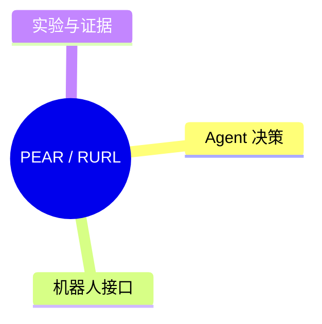

## Summary

PEAR 用仿真 RL 训练通用推理模型按机器人接口输出动作，并验证学习能否迁移到真机。 [原文](https://arxiv.org/html/2611.18562v2)

## Problem & Motivation

零样本 Agent 能读环境和控制说明，但其动作质量、空间精度和多步交互效率仍有较大提升空间。

## Method

训练过程使用仿真结果奖励。模型读多视角图像和机器人状态并发末端指令。部署仍需相机、IK、运动控制、反馈与上下文记录。

## Key Results

同一真机双臂 YAM、两类任务共 30 次，基础模型成功 0 次，LIBERO RL 成功 7 次，再加入两类对应 RoboDojo 仿真任务后为 18 次。LIBERO-Pro 相对优势随位置变化、指令改写和外观变化而变。

## Evidence Ledger

| Claim ID | Claim | Type | Source locator | Evidence excerpt | Status |
|:--|:--|:--|:--|:--|:--|
| C1 | 直接机器人动作策略以仿真 RL 后训练，部署仍使用观测和控制器 | causal-mechanism | §§3.1–3.3 | Robot-use agent | source-verified |
| C2 | YAM 在两类任务各训练条件为 0/30、7/30、18/30 | comparison | §4.4 Figure 7, Appendix G Table 7 | Sim-to-real transfer | source-verified |
| C3 | 强弱随新任务、改写和外观变化而异 | comparison | §4.2 Figure 4, Appendix C Table 3 | Robustness and instruction following | source-verified |

## Strengths & Weaknesses

真机定量对照支持同类任务从仿真到真实硬件，训练阶段可接触对应技能。额外的未见任务展示使用详细提示，尚需同等规模的配对评测。

## Mind Map

## Notes

- [[Topics/RobotUseAgents-Survey]]
