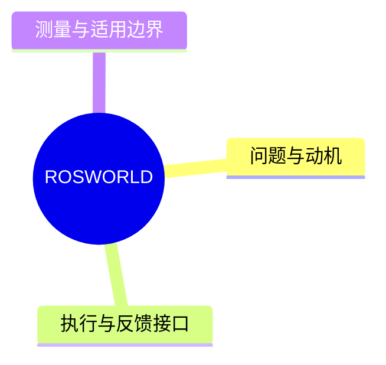

## Summary

ROSWORLD 用真实 OSWorld 桌面环境和仿真机械臂构造配对评测，测量原有数字任务能力经物理执行保留多少。 [原文与版本](https://arxiv.org/html/2611.27467v1)

## Problem & Motivation

软件端键鼠原语通常可直接发出系统事件。机械臂需要先获取足够的工作站状态，再让施力和运动产生输入事件。两次观察之间还可能发生软件焦点或应用状态变化。

## Method

工作站由标定相机、机器人本体状态和触觉信号观测。VLM 选择有界的末端相对运动，经 IK 与低层控制执行。仿真外设的输入事件送入真实运行的 OSWorld，最终由官方 evaluator 判定。推理时物理仿真暂停。

## Key Results

五个模型各完成 40 个同目标评测，原生 185/200，单臂探杆 49/200，双臂 47/200。若条件限定为同一模型原生成功的 185 个配对，单臂保留 48 个，双臂保留 47 个。Astra 单臂 23/40、双臂 28/40，Opus 11/40、3/40。物理轨迹 304 个失败 episode 中有 239 个耗尽决策预算。

## Evidence Ledger

| Claim ID | Claim | Type | Source locator | Evidence excerpt | Status |
|:--|:--|:--|:--|:--|:--|
| C1 | 五模型、40 配对目标、同官方 evaluator、最多 100 次决策，机器人和外设接触仿真 | benchmark-setting | §§3.2–3.3, 4.1, Table 2 | 100 model decisions | source-verified |
| C2 | 原生 185/200、单臂 49/200、双臂 47/200；条件保留 48/185、47/185 | number | §5.1 Table 3 | Table 3 | source-verified |
| C3 | Astra 单臂 23/40、双臂 28/40，Opus 单臂 11/40、双臂 3/40 | comparison | §5.1 Table 3 | Table 3 | source-verified |
| C4 | 239/304 失败耗尽预算，另见触点偏差和焦点错误 | number | §5.4 Table 4, Figures 7–8 | Table 4 | source-verified |

## Strengths & Weaknesses

同目标同 verifier 便于追踪物理约束对任务的影响。配对同时改变观察和动作接口，不能直接作某一硬件变量的因果估计。真实键鼠、机器人和连续时延尚需硬件测量。

## Mind Map

## Notes

- [[Topics/AgenticRobotArm-Survey]]
