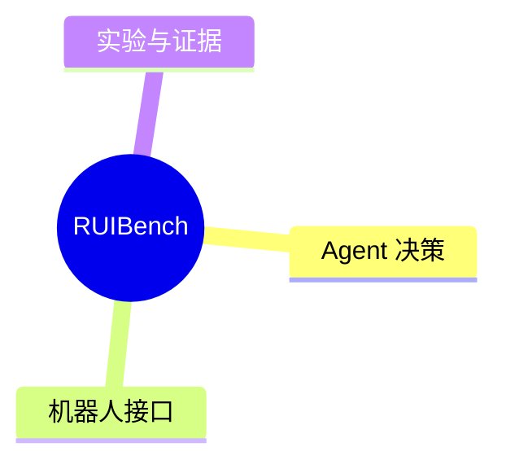

## Summary

RUIBench 通过交叉改变动作抽象和交互形式，研究哪种 Robot-Use 接口能让同一 Agent 更有效地操作。 [原文](https://arxiv.org/html/2611.31115v1)

## Problem & Motivation

接口同时决定模型能观察什么、能控制到多细，以及一轮内可以做多少事。评测需要把这些设计选择从基座模型区别开。

## Method

把六个动作抽象与逐次、程序两种交互形式组合，再加入自由接口。比较共享环境的表现，分别记录回复、调用成本和实际结果。仿真每回复推进固定时间，真机采用墙钟。

## Key Results

真机 FR3 的两个 Agent、13 种接口、五任务五布局共 650 回合。在匹配五任务设置，Claude Code 的程序接口仿真比逐动作高 23.3 个百分点，真机为 36.0% 对 42.0%。

## Evidence Ledger

| Claim ID | Claim | Type | Source locator | Evidence excerpt | Status |
|:--|:--|:--|:--|:--|:--|
| C1 | 六级抽象与两种交互形式，加自由接口形成 13 种接口 | benchmark-setting | §§3–4 | Interface configurations | source-verified |
| C2 | 650 真机回合来自 2×13×5×5 配置 | benchmark-setting | §5.4 Table 5, Appendix C.3 | Real-robot evaluation | source-verified |
| C3 | Claude Code 程序对逐次在匹配仿真领先 23.3pp，真机 36.0% 对 42.0% | comparison | §5.4 Table 5 | Table 5 | source-verified |

## Strengths & Weaknesses

匹配设置中有反转，但真机来自一个机器人和少量任务。额外仿真消融区分了压缩动作和程序内条件反馈。失败回合中自报成功的比例与完成声明的总体准确率需要分别计算。

## Mind Map

## Notes

- [[Topics/RobotUseAgents-Survey]]
