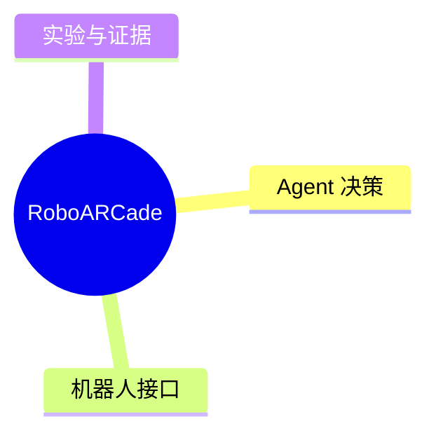

## Summary

RoboARCade 在一组可替换接口的长程仿真任务上，评估 Agent 直接控制和适应的能力。 [原文](https://arxiv.org/html/2611.08209v2)

## Problem & Motivation

策略报告通常汇总是否完成整任务。较长的操作链需要同时理解推进、错误完成声明、经验和成本。

## Method

22 项任务涉及三类仿真机器人配置。基准允许按任务替换感知接口，并用评分规则独立核验已完成的子任务。

## Key Results

在 VIA 接口下，Astra 和 Opus 对已尝试子任务的错误完成声明比例为 24% 和 39%。变化反映提前结束或提前推进。丰富视觉接口提高部分模型的子任务 rubric 分并增加推理成本。

## Evidence Ledger

| Claim ID | Claim | Type | Source locator | Evidence excerpt | Status |
|:--|:--|:--|:--|:--|:--|
| C1 | 三类机器人、22 项长程仿真任务，Success 为子任务 rubric 聚合 | benchmark-setting | §§3, 4.1–4.2 | Zero-shot Evaluation | source-verified |
| C2 | Astra 和 Opus VIA 的错误成功声明为已尝试子任务的 24% 与 39% | comparison | §4.2 Figure 3D | Incorrect Success Claim | source-verified |
| C3 | 提高观测丰富度同时提高部分模型的任务分与每次试验成本 | comparison | §4.2 Table 1, Appendix A.5 | Table 1 | source-verified |

## Strengths & Weaknesses

全部结果基于仿真。论文 Success 口径按子任务度量，跨论文比较要报告分母。少样本适应实验只覆盖筛选后的五项任务。

## Mind Map

## Notes

- [[Topics/RobotUseAgents-Survey]]
