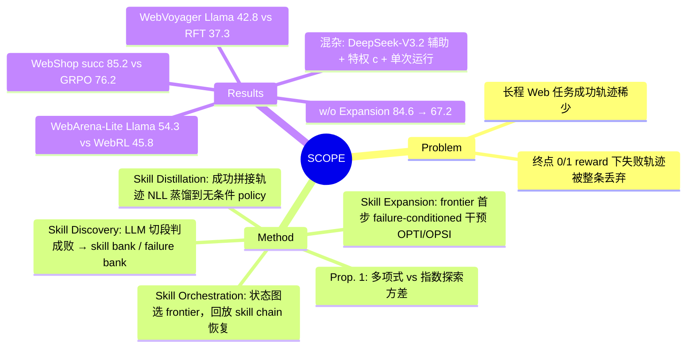

## Summary

SCOPE 针对长程 Web 任务中"成功轨迹稀少、失败轨迹被整条丢弃"的探索瓶颈，用辅助 LLM 把历史 rollout 切成经环境反馈判定成败的子任务段，成功段存为 skill、失败段存为 failure experience；下一轮 rollout 先回放 skill chain 把环境恢复到选定的 frontier state，再在该点注入一个由 failure 条件化的动作（OPTI 由 teacher 产生，OPSI 由 policy 自己产生），最后把凑成的成功轨迹用 SFT 式 agentic on-policy distillation 蒸回 policy。Llama3.1-8B 在 WebArena-Lite（134 题过滤子集）上 54.3 vs WebRL 45.8，WebVoyager 42.8 vs RFT 37.3，WebShop 成功率 85.2 vs GRPO 76.2。本质上是 Go-Explore 式"存档—回到 frontier—再探索"加 LLM 判定的子目标分段和 failure-conditioned 纠正，增益的一部分很可能来自 DeepSeek-V3.2 辅助模型和训练期使用的评测器特权信息。

## Problem & Motivation

现有 Web agent 训练（RFT、WebRL、GRPO 类）多是从初始状态端到端采样整条轨迹、靠终点 0/1 reward 学习。作者指出两个问题：(1) Sparse Successes：长程任务中端到端采样很难拿到完整成功轨迹；(2) Unexploited Failures：失败轨迹即使包含有效的局部进展（如已经导航到订单页），也被整条丢弃。作者的关键观察是中间网页观测（状态跳转、界面变化、报错）本身就是 sparse reward 之外的反馈，可以把失败轨迹拆成"已验证的局部进展"和"失败分支"。动机借用 Fitts & Posner 的技能习得三阶段理论（分解→组合→内化），但这个类比只是叙事框架，方法本身不依赖它。

## Method

一轮训练 = 初始 rollout + J 次（WebArena/WebVoyager J=5，WebShop J=4）渐进探索迭代 + 一次蒸馏。

- **Skill Discovery**：辅助 LLM（`Discover`）读入任务目标 G、辅助信息 c 和轨迹 τ，把轨迹切成语义连续的子任务段 ξ=(s_start, A, s_end; m)，并判 y∈{0,1}。y=1 进 skill bank，y=0 进 failure bank。c 来自评测答案信息：WebArena 是目标 URL 与目标元素状态，WebShop 是目标商品约束，WebVoyager 用 LLM-as-judge 的评判理由；prompt 中明确叫 "Privileged Info"。
- **Skill Orchestration**：skill bank 看成状态图（节点=页面状态，边=已验证 skill）。`Select` 从可达 frontier state 集合中挑一个 s*（带访问计数，让 LLM 降权高频状态，即 Go-Explore 式探索奖励），回溯出 s0→s* 的 skill chain p*，下一次 rollout 先回放 p* 恢复到 s*。为了在动态网页上回放，会把原轨迹中的元素 index 换成元素名，再在当前 AXTree/HTML 中重新 grounding。
- **Skill Expansion**：取 failure bank 中起点等于 s* 的失败经验 F*，只在 frontier 的第一个动作做干预：
  - **OPTI**：teacher（DeepSeek-V3.2）根据 (G, s*, F*) 直接生成动作替换 policy 动作；
  - **OPSI**：policy 自己在 `Summarize(G, p*, F*)` 条件下生成动作（类比 on-policy self-distillation）。
  干预后 policy 自主继续探索。
- **Skill Distillation**：所有 R=1 的拼接轨迹（policy 自身动作 + frontier 干预动作）用负对数似然在**不带 failure 条件**的 π(a|G,s) 上训练。虽然叫 "agentic on-policy distillation"，损失形式就是对成功轨迹的 SFT/RFT；作者说的 "on-policy" 指状态由 policy 自己历史 rollout 中的 skill 到达，而不是 token 级 reverse-KL 意义上的 OPD。
- **理论**：Proposition 1 在"每层局部正确概率 ≥p、每层功能模式数有界、各层 rollout 次数独立几何分布"的假设下，证明 Std(T_total)=O(L^{(1+2α)/2}/p)，与从头探索的 p^{-L} 指数增长相对。这本质上是"可存档恢复把乘积变成求和"的经典论证，结论直接来自假设。
- **设置**：policy 为 Qwen2.5-3B / Llama3.1-8B，先做 benchmark 专属 SFT warm-up（WebVoyager/WebShop 的 SFT 数据来自 DeepSeek 采样）；Llama 在 WebArena 上直接从 WebRL checkpoint 起步。观测是纯文本（HTML/AXTree）。自管理变体用 Llama3.1-8B 在预收集的 memory-management 数据上微调后替代 DeepSeek。

## Key Results

- **WebArena-Lite（Table 1，134 test tasks）**：Llama3.1-8B SCOPE(OPSI) 54.3 / (OPTI) 53.6 vs WebRL 45.8、RFT 40.9；Qwen2.5-3B SCOPE(OPTI) 41.6 / (OPSI) 40.2 vs RFT 36.5。
- **WebVoyager（Table 2，在线真实网站）**：Llama3.1-8B 42.8 vs RFT 37.3；Qwen2.5-3B 28.4 vs RFT 26.1；DeepSeek-v3.2 直接 prompting 为 42.0，即 8B 学生约等于辅助模型水平。3 次重复评测（App. H，6 个站点）：SCOPE Avg@3 38.70±2.74 vs RFT 34.76±0.55，Pass@3 60.19 vs 51.66。
- **WebShop（Table 3）**：Qwen2.5-3B score 0.933 / succ 84.6 vs GRPO 0.898 / 80.8；Llama3.1-8B 0.938 / 85.2 vs GRPO 0.889 / 76.2。
- **组件 ablation（Fig. 3d；图文均未写明设置，其 SCOPE/RFT/SFT 数值与 Table 3 的 WebShop + Qwen2.5-3B 行完全一致，据此推断）**：w/o Skill Discovery（改为每 2 步定长切段）成功率 66.6；w/o Skill Orchestration（总选最深 chain）77.0；w/o Skill Expansion（去掉 failure 干预、frontier 处 temperature=1.0 自由探索）67.2；完整 84.6。
- **辅助信息 c ablation（Table 4，WebArena Llama3.1-8B，OPTI）**：去掉 c 后 52.7 vs 53.6，但站点间波动很大（Reddit 84.2→68.4，CMS 51.4→60.0）。
- **OPTI vs OPSI**：较弱的 Qwen 上 OPTI 略好、较强的 Llama 上 OPSI 略好，作者解释为 teacher 动作利于探索、自生成动作更易内化。两者差距 1.4 和 0.7 个点，单次运行，作为证据偏弱。
- **成本（Table 5）**：WebArena 上总 model call 与 RFT 接近（Qwen +1.8%、Llama −4.6%）；WebShop 上比 RFT 少 35.5%、比 GRPO 少 55.1%。计数把 3B/8B policy 调用与 DeepSeek-V3.2 辅助调用按同一单位计。
- **Scaling**：WebVoyager 外层轮次 1→3 提升 4.25 个点；内层迭代 15 次时 rollout 成功率从 33.40% 升到 43.41%。

## Evidence Ledger

| Claim ID | Claim | Type | Source locator | Evidence excerpt | Status |
|:--|:--|:--|:--|:--|:--|
| C1 | 外部设置下 Discover/Select/Summarize/Intervene 由 DeepSeek-V3.2 实现；policy 为 Qwen2.5-3B / Llama3.1-8B | benchmark-setting | §4.1 Training Details | "the auxiliary functions Discover, Select, Summarize, and Intervene are implemented with DeepSeek-V3.2" | source-verified |
| C2 | WebArena Llama3.1-8B：OPSI 54.3、OPTI 53.6 vs WebRL 45.8（+18.6%） | number | Table 1 | "WebRL 45.8 ... SCOPE (OPTI) 53.6 (+17.0%) ... SCOPE (OPSI) 54.3 (+18.6%)" | source-verified |
| C3 | WebArena Qwen2.5-3B：OPTI 41.6 vs RFT 36.5（+14.0%），OPSI 40.2 | number | Table 1 | "RFT 36.5 ... SCOPE (OPTI) 41.6 (+14.0%) ... SCOPE (OPSI) 40.2 (+10.1%)" | source-verified |
| C4 | WebVoyager：Llama 42.8 vs RFT 37.3；Qwen 28.4 vs 26.1；DeepSeek-v3.2 prompting 42.0 | number | Table 2 | "DeepSeek-v3.2 - 42.0 ... RFT 26.1 ... SCOPE 28.4 ... RFT 37.3 ... SCOPE 42.8" | source-verified |
| C5 | WebShop：Qwen 0.933/84.6 vs GRPO 0.898/80.8；Llama 0.938/85.2 vs GRPO 0.889/76.2 | number | Table 3 | "GRPO 0.898 80.8 SCOPE 0.933 84.6 ... GRPO 0.889 76.2 SCOPE 0.938 85.2" | source-verified |
| C6 | WebArena 上 Llama3.1-8B 从 WebRL checkpoint 初始化 | benchmark-setting | App. F | "initialize from the WebRL checkpoint rather than directly from the instruct model" | source-verified |
| C7 | 辅助信息 c 来自评测答案信息（WebArena 目标 URL/元素状态；WebShop 商品约束；WebVoyager judge 理由） | benchmark-setting | App. F | "c is an auxiliary signal extracted from answer-evaluation information in the original dataset" | source-verified |
| C8 | 去掉 c：52.7 vs 53.6（WebArena Llama） | number | Table 4 / §4.5 | "53.6% with c versus 52.7% without it"（参照为 OPTI；分站 Reddit 84.2→68.4、CMS 51.4→60.0） | source-verified |
| C9 | 组件 ablation 只在 WebShop + Qwen2.5-3B；w/o Expansion 67.2 vs 84.6 | benchmark-setting | Fig. 3(d) / §4.5 | "w/o Skill Expansion 0.816 (-12.5%) 67.2 (-20.6%)"（设置未写明，按数值与 Table 3 Qwen 行一致推断） | source-verified |
| C10 | 主结果多为单次训练+评测，无 error bar；仅 WebVoyager 有 3 次评测 38.70±2.74 vs 34.76±0.55 | benchmark-setting | Checklist Q7 / App. H | "Most main comparisons use a single training run and evaluation." | source-verified |
| C11 | 划分：WebArena 551/134；WebVoyager 461/311；WebShop 6410/500 | number | Table 7 | "551 134 ... 461 311 ... 6410 500" | source-verified |
| C12 | model call 计数：WebArena Qwen +1.8%、Llama −4.6%；WebShop −35.5% vs RFT、−55.1% vs GRPO；辅助与 policy 调用同单位计 | number | Table 5 / §4.5 | "1.8% more calls with Qwen and 4.6% fewer with Llama ... 35.5% fewer ... 55.1% fewer" | source-verified |
| C13 | Prop. 1：Std(T_total)=O(L^{(1+2α)/2}/p)，证明假设各层几何分布独立 | causal-mechanism | §3.5 / App. D.2 | "Assuming {T_k} are independent under the stylized abstraction" | source-verified |
| C14 | RFT 与 SCOPE 总 rollout 次数相同 | benchmark-setting | App. F / G.1 | "The total number of rollout attempts is matched between RFT and SCOPE."（G.1 带 "Unless otherwise specified"） | source-verified |
| C15 | 自管理变体（微调 Llama3.1-8B）最终提升与外部模型设置相当 | comparison | §4.5 / Fig. 3(c) | "self-managed memory achieves a final improvement comparable to the external-model setting"（仅 Fig. 3(c)） | source-verified |
| C16 | 正文称 c-ablation 在 "Table 5"，实际表号为 Table 4 | benchmark-setting | §4.5 | "To examine this, Table 5 compares SCOPE with and without c" | source-verified |
| C17 | WebRL 45.8 的来源与测试集过滤口径 | benchmark-setting | §4.1 / App. F | "use its standard leaderboard results as the main comparison baseline"；未说明重测或按四站重算，App. F 无过滤细节 | unsupported |
| C18 | 代码仅承诺匿名提供，论文无公开 GitHub 链接 | license-code | Checklist Q5 | "We will provide anonymized code and data in the Appendix" | source-verified |

## Strengths & Weaknesses

**Strengths**

- 问题切口对：长程 Web 任务的瓶颈确实在"到不了深层状态"，而 Web 环境多数可从初始状态确定性回放，Go-Explore 式"回到 frontier 再探索"在这里比在 Atari 更自然。把失败轨迹拆成"已验证前缀 + 失败分支"复用，比整条丢弃（RFT）或只造新任务（WebRL）更省样本。
- ablation 的信息量比主表高：去掉 failure-conditioned 干预、只在 frontier 处随机探索，成功率从 84.6 跌到 67.2（WebShop），接近去掉语义切段的 66.6。这说明增益的大头在"frontier 恢复 + 有方向的第一步"，单纯回放存档不够。
- OPSI 让 policy 在 failure 条件下生成动作、再蒸馏成无条件 policy，是 privileged/self-distillation 在 agent 场景的一个干净用法，不需要外部 teacher 直接出动作。
- 报告了按任务长度拆分的探索成功率和成本拆解，并补了 WebVoyager 3 次重复评测（rebuttal 阶段加的）。

**Weaknesses / 隐含假设**

- **强辅助模型混杂**：Discover/Select/Summarize（以及 OPTI 的 Intervene）都由 DeepSeek-V3.2 做，WebVoyager/WebShop 的 SFT warm-up 数据也来自 DeepSeek 采样，而 RFT/GRPO 基线没有这个 LLM 在环。WebVoyager 上 Llama-SCOPE 42.8 ≈ DeepSeek prompting 42.0。论文没有"同样 DeepSeek 预算但不用 skill 结构"的对照（例如 DeepSeek 直接给 hint 的 RFT），所以分不清多少增益来自 skill 结构、多少来自对强模型的蒸馏。自管理变体也是在"预收集的 memory-management 数据"上微调的（§4.1 说是 Llama3.1-8B，§4.5 又说"与 policy 同 backbone"，前后不一致；结果只有 Fig. 3(c) 曲线），数据从哪来没有说明（推测来自 DeepSeek），不能算摆脱了外部模型。
- **训练期用了评测器特权信息**：c 直接取自评测答案（目标 URL、目标元素状态、商品约束、judge 理由），用来判子目标成败和选 frontier。测试时不用，所以不算泄漏，但它让"子目标是否达成"的判定比真实无标签场景容易得多。c-ablation 只在 WebArena 单次运行上做了一个点（53.6 vs 52.7），站点级数字差 ±16 个点，说明噪声远大于这 0.9 的差距，不足以支撑"c 只是轻量信号"。
- **基线可比性**：Llama 在 WebArena 上从 WebRL checkpoint 继续训练，再和 WebRL 比，实际比较的是"WebRL + 一轮 SCOPE"对"WebRL"；文中没说明 RFT 基线是否也从同一 checkpoint 起步。测试集是过滤后的 134 题、只含 Reddit/GitLab/Shopping/CMS 四站（WebArena-Lite 原为 165 题，含 Map）。正文称过滤细节见 App. F，但 App. F 里没有。WebRL 一行的分站数字沿用原文，Total 写作 45.8 并称"standard leaderboard results"；WebRL 原文报告的 Llama-3.1-8B 总分是 42.4%（[[2411-WebRL]]）。论文没有说明 45.8 是按四站重算还是重新评测（推测是四站重算）。另外按我的算术，Total SR（如 53.6、54.3）都无法写成 k/134，汇总口径不明。
- **统计证据薄弱**：主结果单次训练、单次评测，checklist 自己答 [No]。WebArena 每个站点题数少（Reddit 一题约 5.3 个点），OPTI/OPSI 之间约 1 个点的差距和 c-ablation 都在噪声内。组件 ablation 只在最简单的 WebShop + Qwen 上做，没有在 WebArena 这个真正长程的环境上验证。
- **"on-policy distillation" 名不副实**：损失是对拼接成功轨迹的 NLL，frontier 动作来自 teacher 或带 failure 条件的 policy，严格讲是 off-policy 的 SFT/RFT。作者重新定义成"状态层面 on-policy"，这个说法只在 skill chain 回放确实复现了 policy 自身轨迹时成立。
- **环境可重置性假设**：方法依赖从 s0 确定性回放 skill chain 到达 s*。WebArena、WebShop 满足；真实网站上作者自己也承认 skill 会因页面更新失效（App. I），Apple/arXiv 改版后 rebuttal 评测直接剔除了这两个站点。
- **理论贡献有限**：Prop. 1 的多项式界来自"每层独立几何分布 + frontier 数多项式有界"两条假设，等价于"能存档就不用从头再来"，没有提供关于何时会失效的非平凡信息。
- 成本比较把 671B 级辅助模型调用和 3B/8B policy 调用按同一单位计数，"model call 持平"不等于算力持平。

**对领域的意义**：SCOPE 是"失败轨迹前缀复用 + frontier 处 failure-conditioned 纠正 + 蒸馏回无条件 policy"在 Web agent 训练上的一个完整实现。它最有价值的信号是 Expansion ablation，即只给存档不给方向时增益大幅缩水。它最需要回答的问题是剥离 DeepSeek 和特权 c 之后还剩多少增益。

## Mind Map

## Notes

- 与 [[2411-WebRL]] 的分工：WebRL 从失败**造新任务**（curriculum），SCOPE 从失败**切出前缀与失败分支**、回到失败点附近再探索。两者正交，SCOPE 在 WebArena 上直接接在 WebRL checkpoint 之后训练。
- 与 [[2409-AgentWorkflowMemory]] / [[2504-SkillWeaver]] 的区别：后两者把 skill/workflow 留在推理时的 prompt 或 API 库里；SCOPE 的 skill 只在训练期用于状态恢复和探索，最后全部蒸馏进参数，测试时没有 skill memory。
- OPSI 与 [[2608-ROPSD]] 同属"privileged 条件化 self-teacher → 蒸馏回无条件学生"的思路；ROPSD 把反思当 privileged info 用在 GUI grounding 的 test-time，SCOPE 把 failure experience 当 privileged info 用在 Web 多步动作的训练期。
- **与 [[FailureConditionedRetry-GUI]] 的 prior-art 关系**：SCOPE 已经实现了"恢复到失败点附近的状态 + 用失败段条件化下一步动作 + 把条件化行为训进无条件 policy"，这和该 idea 的 P4（训练出的入口）、P5（快照恢复 vs 从头重开）高度重叠。差异在于 SCOPE 是训练期数据生成手段，从未测量部署时 retry 的 Δ，没有"错误步定位准确度决定增益"的剂量实验，也没有同预算盲重试的配对 Rescue/Harm 分解。该 idea 的 novelty 检索应补上这篇。
- 值得追问的实验：(1) RFT + 同等 DeepSeek hint 预算（不用 skill 结构）；(2) WebArena 上的组件 ablation；(3) 不用特权 c、只用 policy 自评或 ORM 判子目标成败时的退化程度。
