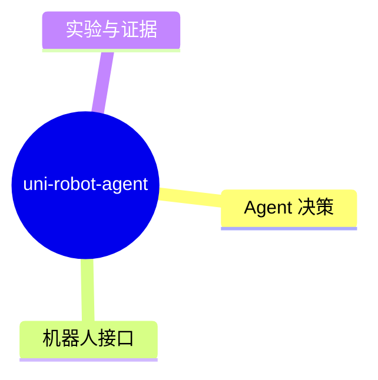

## Summary

uni-robot-agent 用统一的机器人适配器和交互 harness，评估开放权重和闭源模型的执行能力。 [原文](https://arxiv.org/html/2611.01560v2)

## Problem & Motivation

不同模型往往配不同工具和运行架构，表面差距混合了模型性能与接口质量。

## Method

同一工具契约对接不同机器人，整理一致的观测、运动状态、夹爪控制与故障回报。处理并发与重复命令，并对长历史进行管理。

## Key Results

42 项 RoboDojo 仿真任务上，Qwen3.8-Flash-Next 取得 25.00% SR 和 31.39 分，同 harness 的 Astra 为 46.67% 和 51.90 分。19 项真机任务中 Qwen 53.50、Astra 80.50，所报为 100 分 rubric。真机 Agent 能用深度，对照 VLA 和 WAM 用 RGB。

## Evidence Ledger

| Claim ID | Claim | Type | Source locator | Evidence excerpt | Status |
|:--|:--|:--|:--|:--|:--|
| C1 | 用同一接口比较开放和闭源模型，仿真 report 区分 SR 和部分成功分 | benchmark-setting | §§2, 3.1 Table 1 | Simulation Evaluation | source-verified |
| C2 | 同 harness 的 Qwen 31.39 分与 Astra 51.90 分来自 42 项仿真任务 | comparison | §3.1.1 Table 1 | Table 1 | source-verified |
| C3 | 19 项真机任务 Qwen 53.50、Astra 80.50 为综合分，Agent 有深度输入 | comparison | §3.2 Table 2, Appendix B | Table 2 | source-verified |

## Strengths & Weaknesses

同模型换 harness 的仿真比较比开放模型跨论文排名更适合归因。真机模型使用各自适配的观测和训练条件。

## Mind Map

## Notes

- [[Topics/RobotUseAgents-Survey]]
