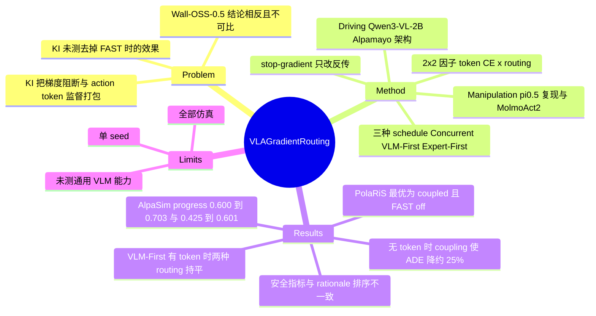

## Summary
这篇论文在 Mixture-of-Transformer VLA（VLM + flow-matching action expert，expert 读 VLM 逐层 K/V）里做了 2×2 因子实验：一个因子是 VLM 是否受 discrete action-token CE 监督，另一个是 expert 的 flow loss 梯度是否回传 VLM（coupling 还是 Knowledge Insulation 式的 stop-gradient）。结论：open-loop driving 中有 action token 时两种 routing 几乎无差别，去掉 action token 时 coupling 把 ADE 降低约 25%；concurrent 训练下，coupling 在 closed-loop driving（AlpaSim route progress +17% / +41%）和 PolaRiS 仿真 manipulation（π0.5 复现与 MolmoAct2 两个模型族）上都更好。作者据此认为，insulation 的价值取决于 action supervision、训练 schedule 和评测设置，不该当成默认 recipe。

## Problem & Motivation
π0.5、MolmoAct2、Alpamayo-R1 等主流 VLA 采用 Knowledge Insulation：flow-matching expert 的梯度不进 VLM，理由是保护 VLM 的预训练能力。但这些系统同时还在做 vision-language co-training（同样是为了防遗忘）和 FAST 等 discrete action-token 监督（直接给 VLM 喂 action 信号）。所以"insulation 有效"这个经验结论里混着两个因素：梯度阻断本身，以及 action-token 辅助监督。KI 原文没测过去掉 FAST 时 insulation 的表现，Wall-OSS-0.5 又报告 coupling 更好；两边的 recipe、初始化、数据都不一样，结论没法直接对比。作者要回答的是：action-token 监督和 expert 梯度，是否是两种可以互相替代的 action-relevant 表征学习信号。

## Method
- **架构（driving）**：Alpamayo 风格。Qwen3-VL-2B-Instruct 作 backbone，配一个同宽度、non-causal 的 flow-matching action expert，逐层 attend 对应 VLM 层的 K/V；VLM 不 attend expert。expert 预测 64 个 acceleration–curvature 控制对（6.4 s，10 Hz），再用离散 unicycle 模型积分成 waypoint。
- **因子 1：action-token CE（`1_action`）**。打开时，VLM 额外预测同一条未来控制序列的 128-token 离散化。关闭时只 mask 未来 value token 的 CE，这些 token 仍以 teacher-forcing 方式留在序列里；delimiter、VQA、rationale 继续受监督；CE 分母固定为 mask 前的监督位置数，保证其余 CE 项的权重不变。expert 的 K/V cache 截止到 `<future_start>`，读不到未来 value token。评测时 VLM 只生成 rationale，到 start token 即停，action token 从不被解码，只起辅助训练信号的作用。
- **因子 2：gradient routing**。insulated 时 `H̃ = sg(H)`，前向完全相同，只在 K/V 接口处切断 flow loss 的反传；coupled 时 flow loss 同时更新 VLM。
- **因子 3：训练 schedule**（只在 driving 上做）。Concurrent 是 300k 步联合训练；Expert-First 是 100k 步冻结 VLM 训 expert（参照 APT）再接 200k 联合；VLM-First 是 100k 步单训 VLM（参照 π0.5 / MolmoAct2 的 staged recipe）再接 200k 联合。总步数相同，但各组件实际拿到的更新次数不同（Table 6：VLM 300k/200k/300k，expert ≈145.5k/197k/97k）。
- **数据与损失**：L = L_CE + L_flow，两项权重都为 1；trajectory batch 约占 48.5%，VLM 每步都更新，expert 只在 trajectory batch 上更新。每个 run 用 64×H100，平均约 15,000 GPU-hours。
- **Manipulation 迁移**（只做 concurrent）：(a) π0.5 复现，PaliGemma-3B + 300M expert，OpenPi + LAP 的 FAST 实现，400k 步，VQA 与机器人数据各一半（机器人部分 90% DROID + 10% PolaRiS）；(b) MolmoAct2，从 Molmo2-ER 初始化、expert 重新随机初始化，300k 步，按公开源重建的 90% robot / 10% multimodal 混合数据，最后在 DROID/PolaRiS 上做 1k 步 adaptation。注意 manipulation 中关闭 FAST 的做法是直接去掉 FAST postfix，和 driving 中 mask 但保留 token 的做法不同。
- **评测**：open-loop 用 PhysicalAI-AV 的 Public Golden（1,434）和 OOD（273）两个 split，看第一个 sample 的 ADE，95% CI 来自 10,000 次 paired clip-cluster bootstrap；closed-loop 用 AlpaSim 的 827 个场景，每个场景 5 次 rollout；rationale 质量用 Lingo-Judge 的 pass rate 衡量；manipulation 在 3 个 PolaRiS 环境中各跑 50 次 rollout，主指标是 rubric-based normalized task progress。

## Key Results
- **Open-loop driving（Concurrent）**：有 action token 时，insulation 在 Golden 上 ADE 略低，OOD 上差异很小；没有 action token 时，coupling 相对 insulation 把 ADE 降低约 26%（Golden）和 24%（OOD）。三种 schedule 下，"去掉 token 后 insulation 的 ADE 更差"这一方向都成立（Fig. 3）。ADE 绝对值只在图里，正文读不到。
- **Closed-loop driving（Table 3/11）**：Concurrent 下，有 token 时 insulated 0.600 对 coupled 0.703（约 +17%）；无 token 时 0.425 对 0.601（+17.6 pp，约 +41%）。coupled 无 token（0.601）≈ insulated 有 token（0.600）。VLM-First 有 token 时 0.648 对 0.646，基本相同；Expert-First 有 token 时 0.597 对 0.625。全表最高是 Concurrent + coupled + token 的 0.703。
- **安全指标与 progress 不同向**：Concurrent 有 token 时 at-fault collision 为 0.087 对 0.090，distance to GT 为 2.378 对 2.700，coupled 偏离 GT 反而更远；staged + token 下 coupled 的 at-fault collision 更高，Expert-First 0.061 → 0.097，VLM-First 0.076 → 0.117（Table 12/13）。
- **Rationale 质量（Lingo-Judge Top-1，Table 2）**：Concurrent 有 token 时两种 routing 为 64.7% 对 64.9%；无 token 时 coupled 63.5% 对 insulated 56.6%（Golden），OOD 上方向相反（0.348 对 0.363）。两种 staged schedule 无 token 时，Golden 上都是 insulated 更高（VLM-First 0.630 对 0.613，Expert-First 0.620 对 0.612）。ADE 和 rationale 质量的排序并不一致。
- **Manipulation（PolaRiS 三任务平均 progress，Table 4）**：π0.5 复现中，FAST on 时 insulated 19.5% → coupled 30.7%，FAST off 时 10.3% → 32.9%；MolmoAct2 中，FAST on 时 22.0% → 24.3%，FAST off 时 14.5% → 36.5%。两个模型族的最佳配置都是 coupled + FAST off。作为参照，CoVeR 报告的官方 π0.5 checkpoint 为 40.0%（预训练机器人数据超过 10,000 小时，评测协议也不同）；官方 MolmoAct2 checkpoint 在作者的 adaptation 协议下为 32.9%。

## Evidence Ledger
| Claim ID | Claim | Type | Source locator | Evidence excerpt | Status |
|:--|:--|:--|:--|:--|:--|
| C1 | Concurrent、无 action token 时，coupling 相对 insulation 在 Public Golden 上降低 ADE 约 26%，在 OOD 上约 24% | number | §4.1 Open-loop driving; Fig. 3 | "Relative to insulation, coupling reduces ADE by approximately 26% on the Public Golden dataset and 24% OOD." | source-verified |
| C2 | 有 action token 时，insulation 在 Golden 上 ADE 略低，OOD 上 routing 差异很小 | comparison | §4.1; Fig. 3 | "With action-token supervision, insulation slightly lowers ADE on the Public Golden split, while the OOD routing difference is comparatively small." | source-verified |
| C3 | 三种训练 history 下，无 action token 时 insulation 都提高 mean ADE | comparison | §4.2 Open-loop driving; Fig. 3 | "insulation increases mean ADE without action-token supervision in every history" | source-verified |
| C4 | Concurrent 有 token 时，AlpaSim route progress 从 insulated 0.600 升到 coupled 0.703 | number | §4.1 Closed-loop; Table 3 / Table 11 | "coupling raises AlpaSim route progress from 0.600 to 0.703 with action-token supervision" | source-verified |
| C5 | Concurrent 无 token 时 progress 从 0.425 升到 0.601，即 +17.6 pp，相对约 41% | number | §4.1 Closed-loop; Table 3 | "from 0.425 to 0.601 without it ... The latter is a 17.6 percentage-point increase, or about 41% relative" | source-verified |
| C6 | coupled 无 token 的 route progress 约等于 insulated 有 token | comparison | §4.1 Closed-loop | "Coupling without tokens also reaches approximately the same route progress as insulated training with tokens." | source-verified |
| C7 | VLM-First 有 token 时 insulated 与 coupled 的 progress 几乎相同（0.648 对 0.646） | number | Appendix E; Table 3 / Table 13 | "the VLM-first values are nearly identical (0.648 insulated and 0.646 coupled)" | source-verified |
| C8 | 所有 history 中最高的 route progress 是 Concurrent coupled + token 的 0.703 | sota-novelty | §4.2; Appendix E | "The highest observed route progress across all three histories is 0.703 under concurrent coupled training with action-token supervision" | source-verified |
| C9 | staged 训练 + action token 下，coupled 的 at-fault collision 率更高（Expert-First 0.061→0.097，VLM-First 0.076→0.117） | number | §5; Table 12 / Table 13 | "with action-token supervision, coupled staged training has higher observed at-fault collision rates, despite higher or similar route progress" | source-verified |
| C10 | Concurrent 有 token 时，coupled 的 distance to ground truth 为 2.700，大于 insulated 的 2.378 | number | Appendix E; Table 11 | "Distance to ground truth (m) ↓ 2.378 2.471 2.700 2.732" | source-verified |
| C11 | Concurrent 有 token 时 Lingo-Judge Top-1 pass rate 为 insulated 64.7%、coupled 64.9%；无 token 时 coupled 63.5%、insulated 56.6%（Golden） | number | §4.1 Generated reasoning-trace quality; Table 2 | "nearly identical pass rates on Public Golden (64.7% and 64.9%, respectively)... (63.5% versus 56.6%)" | source-verified |
| C12 | 两种 staged schedule 无 token 时，insulated 的 Golden Lingo-Judge pass rate 更高，尽管 coupled 的 ADE 更低 | comparison | §4.2 Generated reasoning-trace quality; Table 2 | "insulated models have higher observed first-sample pass rates on Public Golden under both staged schedules, even though coupled models have lower ADE" | source-verified |
| C13 | π0.5 复现中，coupling 把 FAST off 的 progress 从 10.3% 提到 32.9%，把 FAST on 的从 19.5% 提到 30.7% | number | §4.3; Table 4 | "progress rises from 10.3% to 32.9%, compared with 19.5% to 30.7% with FAST" | source-verified |
| C14 | MolmoAct2 中，coupling 把 FAST on 的 progress 从 22.0% 提到 24.3%，把 FAST off 的从 14.5% 提到 36.5% | number | §4.3; Table 4 | "coupling increases progress from 22.0% to 24.3% with FAST and from 14.5% to 36.5% without FAST" | source-verified |
| C15 | 官方 π0.5 checkpoint 在 CoVeR 协议下为 40.0%，高于本文全部四个条件；该 checkpoint 预训练用了超过 10,000 小时机器人数据 | benchmark-setting | §4.3; Table 4 | "CoVeR reports 40.0% progress for a published π0.5 checkpoint under its PolaRiS evaluation protocol" | source-verified |
| C16 | 官方 MolmoAct2 checkpoint 在作者的 adaptation/评测协议下为 32.9% | number | §4.3; Table 4 | "the released MolmoAct2 checkpoint reaches 32.9% after our adaptation and evaluation protocol" | source-verified |
| C17 | 每个条件只训练了一个 run，training-seed 方差未测 | benchmark-setting | §5 Limitations; Appendix C | "compute constraints limited us to one training run per condition, leaving training-seed variation unmeasured" | source-verified |
| C18 | 每个 driving 训练 run 用 64 张 H100，平均约 15,000 GPU-hours | number | Appendix A.2 | "Each training run used 64 NVIDIA H100 GPUs and consumed approximately 15,000 GPU-hours on average." | source-verified |
| C19 | 总步数相同，但各 history 的组件更新次数不同（expert：Concurrent ≈145.5k，Expert-First ≈197k，VLM-First ≈97k） | benchmark-setting | Appendix A.2; Table 6 | "matching total optimizer steps across histories does not equalize component-level update budgets" | source-verified |
| C20 | VLM-First 无 token 的 warm-up 只用 vision–language 数据，有 token 的则会看到 trajectory 数据 | benchmark-setting | §3 Training schedules; Appendix A.2 | "During the VLM-first warm-up, tokens-off models use only vision–language data, whereas tokens-on models also receive trajectory data." | source-verified |
| C21 | Driving 中关闭 action token 只 mask 未来 value token 的 CE，这些 token 仍以 teacher-forcing 留在序列中；expert 的 K/V 截止于 future_start | causal-mechanism | §3; Appendix A.1 | "Disabling action-token supervision masks CE only on future-action values, which remain teacher-forced" | source-verified |
| C22 | Manipulation 中关闭 FAST 是直接去掉 FAST postfix，与 driving 的干预方式不同 | benchmark-setting | Appendix A.3 | "This implementation differs from the driving intervention, where masked future-action value tokens remain in the training sequence." | source-verified |
| C23 | 所有 closed-loop 评测都在仿真里完成，没有真机实验 | benchmark-setting | §5 Limitations | "We do not test the manipulation policies on physical robots" | source-verified |
| C24 | 作者自陈只刻画了相互作用，没有建立性能差异背后的机制 | causal-mechanism | §5 Limitations | "we characterize the interaction ... but do not establish the mechanisms underlying the observed performance differences" | source-verified |
| C25 | 项目页为 mot-vla-gradient-routing.github.io，正文未给出代码仓库链接 | license-code | 首页作者块 | "https://mot-vla-gradient-routing.github.io/" | source-verified |

## Strengths & Weaknesses
**Strengths**
- **问题提得准**。KI 一类的 recipe 把"梯度阻断"和"action-token 辅助监督"打包在一起。本文用 stop-gradient 只改反传、前向完全相同的干预，把两个因素拆开，并且做了 CE 分母固定、expert K/V 截止于 `<future_start>`（防止 expert 读到 teacher-forced 的未来值）等细节控制。这类 recipe 澄清比 +0.3% SOTA 更有价值。
- **评测维度有交叉**：open-loop ADE、closed-loop route progress、安全指标、rationale 质量都报了，而且作者如实指出它们排序不一致（如 staged 下 Lingo-Judge 偏向 insulated，coupled 偏离 GT 更远、at-fault collision 更高），没有只挑 progress 讲。
- **跨两个领域、三个模型族**，方向一致：无 token 时 coupling 收益最大，coupled 无 token 时达到或超过 insulated 有 token。由此推出的经验是："VLM 必须从某个渠道拿到直接的 action 学习信号"。
- 对 manipulation 中各自绝对性能偏低的情况有交代，并给出官方 checkpoint 作参照，没有回避。

**Weaknesses / 隐含假设**
- **单 seed**：每个条件只训一次。bootstrap CI 只覆盖评测 clip 的方差，不覆盖训练方差。MolmoAct2 FAST on 的 22.0% 对 24.3%、VLM-First 的 0.648 对 0.646 这类小差距无法判断显著性；closed-loop 和 manipulation 也没有给 CI。
- **"挑战默认 recipe"的结论对 KI 的原始设定反而偏弱**。π0.5 / MolmoAct2 实际采用 VLM-First + FAST；在这个格子里，closed-loop progress 是 0.648 对 0.646，基本相同，staged + token 下 coupled 的 at-fault collision 还更高（0.076 → 0.117）。manipulation 只做了 concurrent，没覆盖 KI 真正使用的 staged schedule。所以更准确的说法是："在 concurrent 训练、或者没有 action token 的情况下，insulation 不划算"。
- **"保护 VLM 能力"这一侧几乎没测**。KI 的核心动机是保留通用 VLM 能力，本文只用 driving rationale 的 Lingo-Judge 作诊断，没有报告 VQA 等通用 benchmark，manipulation 模型更是完全没测 VL 能力。作者自己也承认"does not establish broader VLM capability retention"。insulation 的收益一侧没有被正面检验。
- **Schedule 比较存在混杂**：总步数对齐了，但组件更新预算不同（expert 97k 到 197k，Table 6）；VLM-First 中 token on/off 连 warm-up 数据都不一样（off 时只有 VL 数据）。"Concurrent 最优"不能干净地归因于训练顺序。
- **Manipulation 的绝对水平低**：最佳 36.5% 仍低于官方 π0.5 的 40.0%（不过协议不同），官方 MolmoAct2 checkpoint 32.9% 也高于本文的 insulated + FAST 22.0%。这些结论是在训练不足、数据规模小（DROID 约 350 小时）的条件下得到的，到大规模预训练下 routing 效应是否保持还不知道。
- **两个领域关闭 token 的干预方式不同**（mask 对 删除），跨领域的"一致性"建立在不完全相同的处理上；全部是仿真评测，没有真机。
- **没有机制解释**：表征层面的探针、梯度冲突分析都没做，"partially substitutable signals"只是对现象的描述。

**对领域的影响**：这篇工作为 VLA recipe 设计提供了一条可操作的判断：先看 VLM 有没有直接的 action 监督，再决定 routing。它和 Wall-OSS-0.5（coupling 更好）、APT（expert 预热改变 routing 的相对优劣）的结论可以放进同一个解释框架。但 insulation 在保留通用能力上的真实收益，仍需要带 VL benchmark 的同类对照实验来回答。

## Mind Map

## Notes
- [[2504-Pi05]]：本文质疑的 Knowledge Insulation + VLM-First + FAST recipe 的主要代表；本文的 π0.5 复现在 PolaRiS 上明显低于官方 checkpoint，结论能否迁移到大规模预训练还有待验证。
- [[2605-MolmoAct2]]：同样采用 staged + KI。本文在其代码上做了 concurrent 因子实验，coupled + FAST off（36.5%）高于官方 checkpoint 在同一 adaptation 协议下的 32.9%，可以和原文的 recipe 选择对照阅读。
- [[2602-DM0]]：受 KI 启发做梯度解耦，同时监督 discrete action token，正好落在本文"有 token 时 insulation 代价小"的格子里，是本文结论的一个实例。
- [[2606-ERVLA]]：其 design ablation 中"No Choice + Knowledge Insulation"性能下降，与本文"insulation 不应作为默认"的方向一致，可作为跨工作的佐证（具体设置需回原文核对）。
