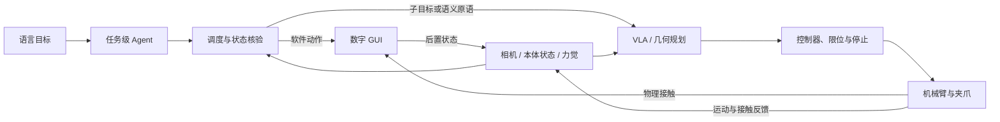

# Agentic Robot Arm：GUI、VLA 与机械臂闭环控制

Agent 通过接口调用机器人执行物理任务的研究见 [[Topics/RobotUseAgents-Survey]]。

## Overview

Agentic 机械臂的核心问题是如何用动作后的观测维持任务进度。

机械臂系统里的「闭环」至少发生在三个时间尺度。控制器用位置、速度或接触反馈维持轨迹和约束。VLA 可以滚动生成短动作序列，根据新观测修正执行。任务级 Agent 则判断当前目标是否已经实现、出现了什么偏差，以及应该重试、改变策略还是停止。执行同一个任务可能需要三层，单层实验只能支持相应尺度的结论。[[Papers/2303-DiffusionPolicy]] · [[Papers/2603-RoboClaw]] · [[Papers/2609-LIBERORecover]]

GUI 在这一系统里有四种可观察的角色。

| GUI 的角色 | 输入与输出 | 直接代表 | 证据回答的问题 |
|:--|:--|:--|:--|
| **控制界面** | 人或 CUA 看浏览器界面，键鼠动作映射成机械臂语义命令 | [[Papers/2609-ShowHarness\|Show-Harness / GUMI]] | GUI 能否提供操作或采集接口 |
| **物理操作对象** | 辨认手机界面，机械臂用笔尖实际触碰屏幕 | [[Papers/2312-RoboTest\|RoboTest]]、[[Papers/2512-SeeControl\|See-Control]]、[[Papers/2604-RFNIT\|RFNIT]] | 屏幕目标如何转为接触，以及接触后 App 是否更新 |
| **数字任务的物理入口** | 从工作站相机观测，经机械臂驱动鼠标或键盘，最终检查软件状态 | [[Papers/2611-ROSWORLD\|ROSWORLD]] | 同一个软件目标改走物理执行时，原有能力保留多少 |
| **跨域模型和接口** | 在两域共享预训练或动作表示，或把具身任务包成 CUA 可操作的软件 | [[Papers/2502-Magma\|Magma]]、[[Papers/2606-ShowUIp\|ShowUI-π]]、[[Papers/2611-CUAEmbodiedGeneralists\|Computer-Use Agents Are Embodied Generalists]] | 数据、表示或接口能否在不同执行域复用 |

对这 20 篇核心论文，实证最清楚的是两个方向。受控真机可以通过触屏执行部分手机任务，具身 Agent 也可以通过语义动作接口调度机械臂。对同一批桌面目标，ROSWORLD 显示，在机械臂和外设物理仿真中执行时，完成率远低于软件端直控。把物理和数字动作编排在同一个真机任务里，并在等预算下测出二者的边际贡献，仍是这批文献留下的证据缺口。[[Papers/2512-SeeControl#Evidence Ledger|C1–C3]] · [[Papers/2609-ShowHarness]] · [[Papers/2611-ROSWORLD#Evidence Ledger|C1–C4]]

图中两条执行路径可以完成同一数字目标，也可以在一次任务中交替。关键接口是每次动作之后能读出哪些状态，以及哪个模块有权判断成功、重试或停止。

## 1. 范围与检索

主体覆盖 2023 年至 2026 年 11 月 25 日，向前纳入 2022 年的 SayCan 作为技能编排锚点。近年的核心语料优先覆盖机械臂或夹爪动作、可归因的系统设计，以及可在原文定位的评测。工业示教界面、视觉伺服、软件测试和纯数字 GUI 在直接解释接口或评测边界时作为背景。移动底座只在与操控有关时讨论。

检索结合 OpenAlex 与公开网络。检索词覆盖 robot manipulation、VLA、agentic manipulation、robotic GUI exploration、non-intrusive touch testing、GUI teleoperation、failure recovery 与 shortcut solvability。关键对照使用论文全文、图表与版本链接。本文属于叙述性研究综述，语料按问题选取，结论的外推范围以实验设置为准。相邻综述分别按 VLA 的生命周期、具身系统组成与跨域能力组织文献。 [VLA 生命周期](https://arxiv.org/html/2611.18372) · [数据与评测](https://arxiv.org/abs/2604.23001) · [Towards Agentic Robots](https://arxiv.org/abs/2610.20442) · [From Computer-Use to Robot-Use](https://arxiv.org/abs/2610.30108)

## 2. 机械臂控制与 VLA

早期视觉—运动策略解决的是怎样从相机观测生成可执行轨迹。ACT 将若干时刻的动作一起预测，Diffusion Policy 通过条件去噪生成动作序列，再用 receding horizon 根据新观测重算。RT-2 将 VLM 扩展到机器人动作 token，使图像、语言和动作进入同一训练配方。OpenVLA 延续离散方案，π0 用连续 flow matching 输出 action chunk。OpenVLA-OFT 则表明，连续动作和并行解码也可以用于对已有 VLA 做下游微调。[[Papers/2303-DiffusionPolicy]] · [[Papers/2307-RT2]] · [[Papers/2406-OpenVLA]] · [[Papers/2410-Pi0]] · [[Papers/2502-OpenVLA-OFT]] · [ACT / ALOHA](https://arxiv.org/abs/2304.13705)

对部署而言，动作表示的选择决定了模型输出由谁解释、能否频繁更新，以及何时需要更强的局部反馈。下表按动作接口组织代表方法。

| 控制接口 | 模型输出 | 代表 | 使用条件与主要边界 |
|:--|:--|:--|:--|
| 几何规划 / 视觉伺服 | 末端位姿、轨迹或基于误差的增量 | [[Papers/2307-VoxPoser\|VoxPoser]] 的规划执行、RoboTest 的坐标映射 | 依赖可用的坐标系、可达性和观测。接触敏感时需单独处理力或顺应性 |
| 离散动作 token | 量化后的末端动作与夹爪指令 | [[Papers/2307-RT2\|RT-2]]、[[Papers/2406-OpenVLA\|OpenVLA]] | 与语言模型共享序列接口，量化、逐 token 解码和动作频率会影响部署 |
| 连续动作块 | 未来若干采样时刻的关节或末端动作 | [[Papers/2303-DiffusionPolicy\|Diffusion Policy]]、[[Papers/2410-Pi0\|π0]]、[[Papers/2502-OpenVLA-OFT\|OpenVLA-OFT]] | 能表达不同可行轨迹。重规划间隔、推理延迟和轨迹切换共同决定反应速度 |
| 可引导的层级策略 | 语言子目标和低层连续动作 | [[Papers/2604-Pi07\|π0.7]] | 作者展示人工实时语言指导，也展示学习到的高层策略给下层发指令。效果受接口粒度和训练覆盖影响 |

软件坐标、相机像素、机器人基座和工具坐标是不同状态空间。对物理触屏，通常要把屏幕位置映射到机器人可达的面内目标，再处理沿法向接近、接触、抬起和下一帧确认。对夹取和插入，末端位姿只是控制目标，执行还受夹爪、碰撞、力和轨迹约束。屏幕触点和相机中的物体框都可作为中间目标，但它们提供的深度、可达性与接触信息不同。[[Papers/2312-RoboTest]] · [[Papers/2512-SeeControl]] · [[Papers/2307-VoxPoser]]

动作块的预测长度、实际执行长度和低层伺服频率应分别报告。较长预测区间能让动作连续，较长的实际承诺区间则会推迟利用新观测的时刻。Real-Time Chunking 通过保留已经在执行或即将执行的部分来衔接异步生成的动作块。恢复场景里，LIBERO-RECOVER 另外报告了执行块缩短时的收益，实验只支持相应策略与仿真设置。部署比较还需要把传感到闭环动作的时延，以及停顿和重规划成本，一起纳入。[[Papers/2609-LIBERORecover]] · [Real-Time Execution of Action Chunking Flow Policies](https://arxiv.org/abs/2506.07339)

## 3. Agentic Manipulation 的技术路线

### 3.1 技能编排与显式几何

SayCan 用语言模型选择符合目标的技能，并以当前状态下技能可执行性的估计约束选择。VoxPoser 把语言指定的空间约束构造成 3D value maps，交给运动规划器生成轨迹。前者依赖技能库能覆盖任务，后者依赖能从感知中恢复足够的几何信息。二者都把基座模型的语言理解与机器人的可执行性通过显式接口连接起来。[[Papers/2204-SayCan]] · [[Papers/2307-VoxPoser]]

这条路线允许分别检查语义目标和物理可行性，但检测到前置条件缺失后，系统还需要知道怎样补齐条件。交互反馈因此成为后续系统的核心。Inner Monologue 给规划器回传场景、执行结果或人类反馈。RoboClaw 进一步面向长程数据采集和执行，以成功判断连接子任务，并把部分可修复失败引入恢复环。[[Papers/2603-RoboClaw]] · [Inner Monologue](https://arxiv.org/abs/2207.05608)

### 3.2 把 VLA 当作受调度的控制器

RoboClaw 用状态判断区分能直接重试的操作与需要先恢复场景的失败。Harness VLA 把几何前置动作、运输和可观察的局部 VLA 接触操作组合起来。它的 LIBERO-Pro Table 3 在同一内部协议下报告直接运行冻结策略 50.0%，few-shot Codex 72.1%、Claude Code 82.4%。方向并非在每个场景一致。标准 LIBERO 上的整体平均变化较小，某些子集下降。真机实验由人完成初态重置与结果验收。[[Papers/2603-RoboClaw]] · [[Papers/2607-HarnessVLA#Evidence Ledger|C1–C4]]

这些结果表明，改动 VLA 之外的执行方式可以改变成功率。要判断收益由什么产生，需要固定 checkpoint、传感器和重试预算，并分别移除几何原语、记忆、验证器或额外观测。用解析动作完成原本交给 VLA 的阶段，也是系统级收益的一部分。[[Papers/2607-HarnessVLA]] · [Auriga 的 planning–execution 诊断](https://arxiv.org/html/2611.01112v1)

### 3.3 让 VLM 直接执行语义动作

Show-Harness 让 VLM 输出细粒度语义操作单元，经硬件专属解释器落到末端指令。GUMI 把同一套操作单元做成浏览器界面，用于人或模型采集示范。在主评测里，模型直接发语义命令。因此，主评测支持「语义接口＋解释器能驱动真机」，GUMI 报告支持「GUI 可以用来采集操作数据」。两个实验回答的是不同问题。[[Papers/2609-ShowHarness]] · [§§3–5](https://arxiv.org/html/2609.10522v1)

AMP1 同样让通用模型借助 harness 读图与发动作，并比较基础接口和带抓放辅助例程的接口。RoboLab-120 中从基础接口换为辅助接口，Opus 5.5 从 82.8% 降至 75.3%，Qwen3.6-35B-A3B 从 14.2% 升至 31.8%。固定模型比较接口可以识别单个系统的收益，跨模型重复同一对照才能识别这种交互。[[Papers/2611-AMP1#Evidence Ledger|C1–C2]]

### 3.4 从一次恢复走向跨轮改进

一次回合内纠正抓取、跨回合写入经验和重训低层 policy 是三种干预。Embodied-Harness 使用冻结的 Actor 和 Reflector，将轨迹诊断写回 harness。预印本报告 Piper 真机三任务各 10 次，系统成功 29/30、π0.5 12/30。逐轮改进曲线来自仿真，因而真机横向对照和跨轮学习是两份证据。ENPIRE 及后续 ASPIRE 提供另一类研究设置，允许编码 Agent 通过试验改动控制程序或积累可复用技能。任务验证、自动重置覆盖与人为提供的执行基础设施决定这类循环的适用范围。[[Papers/2611-EmbodiedHarness#Evidence Ledger|C1–C3]] · [ENPIRE](https://research.nvidia.com/labs/gear/enpire/) · [ASPIRE](https://research.nvidia.com/labs/gear/aspire/)

证明跨任务改进需要冻结一次改动后的系统，在预先隔离的任务和机器人条件上重新评测。还需与同预算重试、只扩充示范和人工维护的 harness 比较，区分持久改进与对同一批试验的适配。[[Papers/2611-EmbodiedHarness]] · [[Papers/2611-AMP1]]

## 4. GUI × 机械臂的实证

物理 GUI 交互首先出现在非侵入式软件测试。RoboTest 只从外部相机观察界面，以四自由度机械臂实施触屏动作，用探索策略发现界面和潜在 bug。See-Control 把目标改为语言指定的手机任务，输入使用屏幕镜像，动作由真机械臂实施。RFNIT 提出外部摄像、LLM 推理与真实触屏的组合，正文给出视觉与物理点击原型结果，并将完整长程验证列为评测计划。[[Papers/2312-RoboTest]] · [[Papers/2512-SeeControl]] · [[Papers/2604-RFNIT]]

| 工作 | 观察与执行 | 原文实验 | 证据边界 |
|:--|:--|:--|:--|
| RoboTest，ICSE 2024 | 外部相机 → 控件提取 → 真机四自由度触屏 | 20 个 Android App，另有 XiUOS 上两个 LVGL App 的 case study | 指标为覆盖率、bug、耗时。代码覆盖通过额外 instrumentation 采集。[[Papers/2312-RoboTest#Evidence Ledger\|C1–C2]] |
| See-Control，2025 | 实时屏幕镜像 → MLLM 和定位工具 → 真机三轴单触点机械臂 | ESO 共 155 项，跨 App 完成 2/15 | 屏幕读取绕过了真实摄像障碍。执行依赖离散原语，双指等手势需要另行验证。[[Papers/2512-SeeControl#Evidence Ledger\|C1–C3]] |
| RFNIT，ICSE Companion 2026 | 外部摄像、视觉检测、真实触屏原型 | §4 在五个 Android App 上报告局部组件结果 | 长程策略和完整对照出现在 §5 Evaluation Plan。[[Papers/2604-RFNIT#Evidence Ledger\|C1–C2]] |
| Show-Harness / GUMI，2026 | 通过浏览器向机械臂发语义命令 | 论文报告 164 条真机演示，其中 Franka 101、单臂 AgileX 63 | 演示采集与主自主评测是两个实验。主评测通过语义动作接口直接执行。[[Papers/2609-ShowHarness]] · [§§4–5](https://arxiv.org/html/2609.10522v1) |
| ROSWORLD，2026 | 工作站相机与机器人状态 → 仿真末端运动 → 真实桌面软件 | 五个模型 × 40 个配对目标。原生桌面 185/200，单臂触杆 49/200，双臂 47/200 | 机械臂、外设与接触仿真。每次最多 100 次模型决策，三条件不具有相同物理时间成本。[[Papers/2611-ROSWORLD#Evidence Ledger\|C1–C4]] |
| Computer-Use Agents Are Embodied Generalists，2026 | CUA 通过为任务设计的软件观察和发动作 | 导航 / 对话导航 / 3D 分割 / 视频分割四项。独立双臂装礼盒仅在仿真 | 各任务适配器提供各自的底层能力。双臂实验采用独立的文本控制设置。[[Papers/2611-CUAEmbodiedGeneralists#Evidence Ledger\|C1–C3]] |
| Magma，CVPR 2025 | 同一预训练模型同时学习 GUI grounding 与机器人动作预测 | 软件 GUI、机器人仿真分别评测，真机桌面任务用示范微调 | 数据与表示共享已有对照。混合工作流中的跨执行器调度仍待实证。[[Papers/2502-Magma#Evidence Ledger\|C1–C3]] |
| ShowUI-π，CVPR 2026 | 软件端屏幕观测 → 连续鼠标轨迹 | ScreenDrag，5 个领域共 505 项 | 迁移的是 VLA 的连续生成方式，执行器是软件光标。[[Papers/2606-ShowUIp]] · [§§3–5](https://arxiv.org/html/2512.24965) |

ROSWORLD 的全量分母给出绝对成功率。若在原生桌面已经成功的同一 model-task pair 中计算保留率，触杆为 48/185，双臂为 47/185。触杆的 49 次绝对成功里有 1 次来自原生桌面未完成的 pair。更复杂的身体接口也没有统一收益，例如 Astra 从触杆 23/40 升至双臂 28/40，Opus 从 11/40 降至 3/40。这里能支持的是模型与身体接口存在相互作用，具体掉点还需要拆解观测、语义、几何和接触。[[Papers/2611-ROSWORLD#Evidence Ledger|C2–C4]]

用 GUI 控制机械臂，与让机械臂操作 GUI，有相反的数据流。前者把物理操作压缩成可供软件选择的动作，AccessTeleopKit 和 GUMI 分别把这种接口用于人类遥操作和示范采集。后者把软件意图展开成带几何和接触约束的运动。把两者组合进同一回合时，验证器必须同时辨别软件是否更新，以及硬件动作是否完成。单独的软件点击、夹爪到位或相机观测都可能只看到其中一部分。[[Papers/2609-ShowHarness]] · [[Papers/2512-SeeControl]] · [[Papers/2611-ROSWORLD]] · [AccessTeleopKit](https://pmc.ncbi.nlm.nih.gov/articles/PMC13015952/)

## 5. Datasets & Benchmarks

下表将训练数据、受控评测和真实机器人评测分开。选择基准时，应先决定要测训练迁移、任务完成、失败恢复还是物理 GUI 执行，再选择对应的观测和终态验证器。

| 资源 | 环境与对象 | 可回答的问题 | 比较时需要记录 |
|:--|:--|:--|:--|
| [Open X-Embodiment](https://arxiv.org/abs/2310.08864) / [DROID](https://arxiv.org/abs/2403.12945) | 多数据源机器人演示 / 多地点真实演示 | 数据如何覆盖不同硬件、场景、操作和示范方式 | 训练子集、action schema、是否存在训练和评测场景重叠 |
| [LIBERO](https://arxiv.org/abs/2306.03310) / [CALVIN](https://arxiv.org/abs/2112.03227) | 仿真操作和知识迁移 / 语言条件的连续任务 | 标准初态成功与任务链完成 | suite、checkpoint、控制频率与执行长度、任务采样和评测上限 |
| [LIBERO-Plus](https://arxiv.org/html/2510.13626) | 在 LIBERO 上分别改变视觉、语言、初态等因素 | 哪类扰动使同一 checkpoint 退化 | 原始与扰动用同版本、同聚合口径。复合扰动另报 |
| [[Papers/2609-LIBERORecover\|LIBERO-RECOVER]] | 用策略执行中的失败构造仿真恢复初态与历史 | 从失败态重启能否完成，在常规运行中是否能恢复 | 区分已告知失败、从历史自检和在线实际触发 |
| [SimplerEnv](https://simpler-env.github.io/) / [RoboTwin 2.0](https://arxiv.org/abs/2506.18088) | 以真机策略为参照的仿真 / 双臂仿真及随机化 | 受控仿真评测、环境或外观变化 | 机器人、视觉匹配或随机化配置、是仿真还是硬件成绩 |
| [[Papers/2611-AMP1\|RoboLab-120 / AMP1]] | 作者定义的操作任务与 AMP1 harness 消融 | 感知通路、模型选择、辅助接口对表现的作用 | 单独报告 benchmark 与真机试验，不把消融方向外推到不同硬件 |
| [RoboARCade](https://arxiv.org/html/2611.08209v2) | 22 项长程操作、3 种仿真 embodiment | 更换 Agent 接口，比较视觉、推理、精细执行与经验利用 | 同顶层目标也要报告相机接口、模型开销与设备动作预算 |
| [[Papers/2512-SeeControl\|ESO]] / [[Papers/2611-ROSWORLD\|ROSWORLD]] | 真机械臂手机操作 / 仿真机械臂与真实桌面软件 | 屏幕任务通过物理接触能完成多少 | 观测来源、接触模拟或真机、动作预算、独立软件终态 verifier |

对真机混合任务，一个最小报告单元包括终态成功、子目标完成、定位/接触/语义失败数、恢复后成功、人工干预、耗时与停止原因。每个任务应尽可能用同一初始状态做配对试验，并给出分母和区间。仅报告最终成功率会把「没触发输入」「输入触发但软件响应未达目标」「Agent 判断错误」混到一起。[[Papers/2611-ROSWORLD]] · [[Papers/2609-LIBERORecover]]

## 6. 失败模式与负证据

**标准分数会掩盖对观测扰动的敏感性。** LIBERO-Plus Table 1 中，OpenVLA-OFT 原始设置为 97.1%，改变相机为 59.7%，改变初始位姿为 37.2%。这是同表上的单因素结果。另有独立 benchmark audit 发现部分操作任务可被捷径完成，并指出小幅增益对抽样和评测口径敏感。因而「标准设置有高成功率」与「能根据改变过的场景可靠行动」需要不同证据。 [LIBERO-Plus §2.3 Table 1](https://arxiv.org/html/2510.13626) · [What Are We Actually Benchmarking in Robot Manipulation? §§3–6](https://arxiv.org/html/2606.04233)

**从已知失败态启动和正常执行需要各自测量。** LIBERO-RECOVER 把从已知失败状态重新启动的测试，与从标准初态出发的测试区分开来。加入恢复数据后，从失败态启动的成绩上升，标准初态的总成功率变化较小且方向不一致。标准分数仍无法直接估计在线发生失误后的条件恢复率。失败检测、及时中断和修复动作需要分别测量。[[Papers/2609-LIBERORecover#Evidence Ledger|C1–C3]]

**接口辅助的收益依赖模型与任务。** AMP1 的额外辅助抓放例程在不同模型上的消融方向相反。Harness VLA 在扰动协议中的增益也没有在标准 LIBERO 的各个子集重现。比较 agentic 架构时，接口复杂度、额外信息与执行预算都必须显式计入。[[Papers/2611-AMP1#Evidence Ledger|C2]] · [[Papers/2607-HarnessVLA#Evidence Ledger|C3]]

**物理动作与数字结果会分离。** ROSWORLD 记录了触点偏离、无意触发与输入焦点错误，且多数失败在耗尽决策预算后发生。See-Control 的跨 App 成绩说明即使具备物理接触手段，任务规划、动态页面跟踪和长程状态仍能成为瓶颈。两组实验证据来自不同任务与装置，不能把差异归给单一因素。[[Papers/2611-ROSWORLD#Evidence Ledger|C4]] · [[Papers/2512-SeeControl#Evidence Ledger|C3]]

**跨域混合数据可能降低两域表现。** Magma 的朴素混合条件在 ScreenSpot 和两个 SimplerEnv embodiment 的指标上低于各自单域配方。引入统一标记与轨迹监督后，这三项相对于同数据配方的无标记对照提高。结论对应这组数据配方与模型，跨域共享的收益还需要在混合工作流中测量。[[Papers/2502-Magma#Evidence Ledger|C3]]

## Key Evidence Matrix

`source-verified` 表示独立验源确认论文写了相应内容。`single-source` 指具体实验由一篇报告提供。`unknown` 对应当前语料无法回答的问题。所有真机或仿真结果均依各论文协议解读。

| Survey claim | State | Evidence objects | Claim IDs / locators | 反例与边界 |
|:--|:--|:--|:--|:--|
| 真臂可执行部分手机 GUI 任务，跨 App 实证有限 | 单源结果与相邻实现均有全文支持 | [[Papers/2512-SeeControl]]、[[Papers/2312-RoboTest]]、[[Papers/2604-RFNIT]] | See-Control C1–C3、RoboTest C1–C2、RFNIT C1–C2 | See-Control 使用屏幕镜像。RoboTest 评测软件探索。RFNIT 长程为研究计划 |
| 同一软件目标改走物理仿真后成功率大幅下降 | single-source | [[Papers/2611-ROSWORLD]] | C1–C4，§§3–5、Tables 2–4 | 同一目标和 verifier。身体接口附带不同观测和执行开销 |
| 由 GUI 收集真机操作数据与直接语义动作自主控制可同时存在 | single-source | [[Papers/2609-ShowHarness]] | [§§3–5、Appendix §7.2](https://arxiv.org/html/2609.10522v1) | 主成功率来自直接语义动作。尚缺 GUI 比较的独立因果估计 |
| 共享 CUA 接口可复用于多项软件包裹的具身任务 | single-source | [[Papers/2611-CUAEmbodiedGeneralists]] | C1–C3，§§2–4、Tables 1–2 | 双臂为独立仿真实验。接口统一与执行器跨域泛化是不同命题 |
| 外部编排对 VLA 的收益因协议而异 | single-source，另有相邻反例 | [[Papers/2607-HarnessVLA]]、[[Papers/2611-AMP1]] | Harness VLA C2–C3，AMP1 C2 | 前者固定 checkpoint 改调度，后者模型和辅助接口有交互 |
| 将反思写进 harness 可配合提高同类任务表现 | single-source | [[Papers/2611-EmbodiedHarness]] | C1–C3，§§3–4、Table 5 / Figure 6b | 真机横向对照与仿真逐轮曲线分离。固定留出任务族上的持久收益未知 |
| 常规任务成功率不能替代在线恢复测量 | 多源现象，恢复迁移为 single-source | [[Papers/2609-LIBERORecover]]、[LIBERO-Plus](https://arxiv.org/html/2510.13626) | LIBERO-RECOVER C1–C3，LIBERO-Plus Table 1 | OOD 扰动是鲁棒性实验，在线失误后的恢复是另一种测试 |
| 同一策略从软件操作迁移到真机物理操作的净收益 | unknown | [[Papers/2611-ROSWORLD]]、[[Papers/2512-SeeControl]]、[[Papers/2502-Magma]]、[[Papers/2606-ShowUIp]] | ROSWORLD C1–C3、See-Control C1–C3、Magma C1–C3、ShowUI-𠧧3–5 | 仿真配对、真臂触屏、共享预训练、软件轨迹迁移由不同工作覆盖 |

## Key Takeaways

1. **比较 GUI＋机械臂系统时先固定 GUI 的角色。** 真臂触屏可从 See-Control 和 RoboTest 入手，GUI 发指令可从 Show-Harness 入手，数字任务改为物理输入的配对比较可从 ROSWORLD 入手。三类任务所依赖的观测和 verifier 不同。[[Papers/2512-SeeControl]] · [[Papers/2312-RoboTest]] · [[Papers/2609-ShowHarness]] · [[Papers/2611-ROSWORLD]]
2. **同时测任务反馈与运动反馈。** 机械臂到达屏幕并不保证软件接收了预期事件。把接触事件、界面变化与终态分别记录，才能判断下一步应重做动作、换目标还是重新规划。[[Papers/2611-ROSWORLD]] · [[Papers/2609-LIBERORecover]]
3. **用等预算消融判断 agentic 模块的净收益。** 固定同一低层策略、传感与评测任务，分别打开重规划、状态核验与经验记忆。额外执行轮数或几何捷径也要记入资源与因果比较。[[Papers/2607-HarnessVLA]] · [[Papers/2611-AMP1]]
4. **对持续改进做隔离后的第二次评测。** 在已见任务上用执行反馈改 harness 之后，冻结版本，在同种能力但新任务族上评测首次成功和成本。逐轮重试曲线只能回答原试验协议下系统是否变好。[[Papers/2611-EmbodiedHarness]]

## Open Problems

**Observed Tension — GUI 到物理接触的成本来自哪里。** 以 ROSWORLD 的同任务配对为起点，在真实固定工作站复跑三个设置：原生软件输入、外部相机下的校准触屏、可观测接触的触屏。固定任务计划和软件 evaluator，分别操纵几何定位与接触确认。若修正接触后任务仍失败，才能把主要成本定位到对界面状态或进度的判断。最接近的设计是 ROSWORLD 的配对协议与 See-Control 的真机接触。[[Papers/2611-ROSWORLD]] · [[Papers/2512-SeeControl]]

**Observed Tension — GUI 作为通用前端的收益是否独立于底层执行器。** 让同一基座模型通过 GUI 和 schema-matched API 操作同一机械臂。两条件暴露相同观测、原语、历史和安全约束，另加有无 VLA 局部控制的二乘二消融。用任务成功、步骤、耗时和人工干预判断收益来自前端、执行器还是它们的交互。最近证据在 GUMI 的接口设计与 CUA 的软件对照，仍缺等口径真机机械臂结果。[[Papers/2609-ShowHarness]] · [[Papers/2611-CUAEmbodiedGeneralists]]

**Observed Tension — 如何把已知失败态下的恢复变成在线能力。** 用同一批可恢复失误，分开比较从失败快照开始、在线检测后重规划、等预算盲重试。观测指标包括误报、发现时延、恢复率和不可恢复状态比例。最接近的 prior art 是 LIBERO-RECOVER 与 RoboClaw。对 GUI 与机械臂的混合任务，错误可能仅出现在一种状态可见性里。[[Papers/2609-LIBERORecover]] · [[Papers/2603-RoboClaw]]

**Observed Tension — 经验证的经验能否在新任务继续减少干预。** 对同一机械臂、同一预算比较空白 harness、写入失败诊断、写入诊断并做独立回归验证三种设置，训练任务与测试任务按任务族隔离。主要指标用新任务首次成功、干预次数和旧任务回退。Embodied-Harness 给出接近的反思机制，AMP1 提供模型与接口交互的对照动机。[[Papers/2611-EmbodiedHarness]] · [[Papers/2611-AMP1]]

可用一个固定工作站实现最小混合任务。软件工单给出待分拣对象和容器，机械臂完成放置，软件随后录入取自物理现场的容器标记。分别核验工单状态、对象是否在正确容器、记录中的标记是否匹配。按回合记录三次状态变化的时间与证据，可以区分 GUI 定位、实体选择、接触控制和回写错误。HomeLoop 对机器人与 IoT 的仿真协同提供了时序结果评测的参照。 [HomeLoop §§3–4](https://arxiv.org/html/2611.08914)

## 核心论文索引

下表按用途列出纳入详细分析的 20 篇论文。其余链接用于基准、历史背景及延伸阅读。

| 主线 | 论文与原文 |
|:--|:--|
| VLA 与局部动作 | [[Papers/2303-DiffusionPolicy\|Diffusion Policy]] [2023](https://arxiv.org/abs/2303.04137) · [[Papers/2307-RT2\|RT-2]] [2023](https://arxiv.org/abs/2307.15818) · [[Papers/2406-OpenVLA\|OpenVLA]] [2024](https://arxiv.org/abs/2406.09246) · [[Papers/2410-Pi0\|π0]] [2024](https://arxiv.org/abs/2410.24164) · [[Papers/2502-OpenVLA-OFT\|OpenVLA-OFT]] [2025](https://arxiv.org/abs/2502.19645) |
| Agentic 真机 / VLA 编排 | [[Papers/2204-SayCan\|SayCan]] [2022](https://arxiv.org/abs/2204.01691) · [[Papers/2307-VoxPoser\|VoxPoser]] [2023](https://arxiv.org/abs/2307.05973) · [[Papers/2603-RoboClaw\|RoboClaw]] [2026](https://arxiv.org/html/2603.11558v3) · [[Papers/2607-HarnessVLA\|Harness VLA]] [2026](https://arxiv.org/html/2607.08448v5) · [[Papers/2609-ShowHarness\|Show-Harness]] [2026](https://arxiv.org/html/2609.10522v1) · [[Papers/2611-AMP1\|AMP1]] [2026](https://arxiv.org/html/2611.09892v1) · [[Papers/2611-EmbodiedHarness\|Embodied-Harness]] [2026](https://arxiv.org/html/2611.27689v2) |
| 数字—物理 GUI 联接 | [[Papers/2312-RoboTest\|RoboTest]] [ICSE 2024](https://doi.org/10.1145/3597503.3639161) · [[Papers/2512-SeeControl\|See-Control]] [2025](https://arxiv.org/html/2512.08629v1) · [[Papers/2604-RFNIT\|RFNIT]] [ICSE Companion 2026](https://doi.org/10.1145/3774748.3787623) · [[Papers/2611-ROSWORLD\|ROSWORLD]] [2026](https://arxiv.org/html/2611.27467v1) · [[Papers/2611-CUAEmbodiedGeneralists\|CUA Embodied Generalists]] [2026](https://arxiv.org/html/2611.09847v1) · [[Papers/2606-ShowUIp\|ShowUI-π]] [CVPR 2026](https://arxiv.org/html/2512.24965) |
| 跨域预训练 | [[Papers/2502-Magma\|Magma]] [CVPR 2025](https://openaccess.thecvf.com/content/CVPR2025/papers/Yang_Magma_A_Foundation_Model_for_Multimodal_AI_Agents_CVPR_2025_paper.pdf) |
| 失败恢复测量 | [[Papers/2609-LIBERORecover\|LIBERO-RECOVER]] [2026](https://arxiv.org/html/2609.05178v4) |

## 调研日志

- **调研日期** 2026-11-25。
- **覆盖缺口** 既有 VLA 笔记已覆盖动作生成和策略学习。新增检索优先处理物理 GUI、软件前端控制与失败恢复。证据正文以全文为主。
- **文献计数** 10 篇既有笔记，10 篇新 digest。2026 年近期研究集中在预印本，需按本文链接版本解释结果。
- **未解决问题** 真机配对、硬件之间的迁移和持久学习的开放问题保留在正文。相关证据建议在后续研究中纳入 EmbodiedAI Domain Map。
