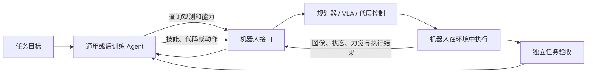

# Robot-Use Agents：通用 Agent 如何使用机器人

## Overview

Robot-Use Agents 研究通用 Agent 如何通过机器人接口完成需要物理行动的任务。

一次 Robot-Use 交互至少包含目标、可用观测、可执行指令和动作结果。Agent 可以打开相机或请求深度，选择抓取、导航等技能，也可以发末端动作或写出可执行代码，再用机器人的反馈确定下一步。机器人负责实现物理动作，Agent 对当前任务的进度和后续决策负责。研究的核心变量是 Agent 对执行有多少决定权，以及它在什么时刻能得到足够的信息修正决定。[[Papers/2610-OpenRUA]] · [[Papers/2610-RobotWorld]] · [[Papers/2611-RUIBench]]

“agent use robot” 对应论文中常用的 **Robot-Use Agent（RUA）**、**Agentic Robot Control（ARC）** 和 **Agentic Manipulation Policy（AMP）**。狭义 RUA 指模型在任务内直接发出机器人动作或写代码，并读回执行反馈。广义用法也包含模型通过技能或 VLA 调度机器人。Agentic Robots 还研究 Agent 对训练、数据、环境和运行框架的改进，本综述以执行任务期间的 **use** 为中心。 [OpenRUA §3](https://arxiv.org/html/2610.02459) · [Towards Agentic Robots §3](https://arxiv.org/html/2610.20442v1) · [On Agentic Manipulation Policies §3A](https://arxiv.org/html/2611.09892v4)

截至 2026 年 11 月，已有在受控真机中经接口直接完成多步操作的证据。开放环境覆盖、成本和可靠性仍需逐项测量。在 RobotWorld 的仿真广覆盖测试中，至少有一个模型完成的任务只有 21/84。RUIBench 的真机试验进一步表明，在仿真中受益的交互形式到了真机可能反转。[[Papers/2611-AMP1]] · [[Papers/2610-RobotWorld#Evidence Ledger|C1–C2]] · [[Papers/2611-RUIBench#Evidence Ledger|C1–C3]]

感知和行动共同构成接口。一次工具调用完成只说明执行服务返回，任务验收还要检查现实中的目标状态。

## 1. 范围、检索与相邻领域

主体检索 2023 年至 2026 年 11 月 25 日，并追溯 2022 年的 SayCan、Code as Policies 和 Inner Monologue。OpenAlex 与公开网络检索覆盖 **agent use robot**、**robot-use agents**、**robot-use interface**、**agent as policy**、**agentic robot control** 与 **robot-use reinforcement learning**。核心文献按动作接口、可观测反馈和实验设计挑选。综述为叙述性综合，涉及具体实验时链接到原文或附有定位的论文笔记。

| 研究对象 | 问题 | 代表证据 |
|:--|:--|:--|
| Robot-Use Agent | 通用 Agent 怎样通过机器人接口执行物理目标 | [[Papers/2610-OpenRUA\|OpenRUA]]、[[Papers/2611-AMP1\|AMP1]]、[[Papers/2611-RUIBench\|RUIBench]] |
| VLA | 如何从图像和语言学习机器人动作策略 | 作为可独立运行的策略，也可作为 Agent 呼叫的执行部件。[[Topics/VLA-Survey]] |
| Agentic Robots | Agent 如何参与任务执行，也如何建设机器人能力 | 涵盖 Model、Data、Environment、Harness。 [领域综述](https://arxiv.org/html/2610.20442v1) |
| Computer-Use Agent | Agent 怎样通过软件界面达成数字目标 | 与 Robot-Use 共享交互循环。机器人动作会改变物理世界，时间、接触和重置成本需另外核算。 [From Computer-Use to Robot-Use](https://arxiv.org/html/2610.30108) |

## 2. Agent 怎样使用机器人

### 2.1 调用技能和 VLA

SayCan 把语言选出的下一步技能与机器人环境中的 affordance 相乘，减少语义上合理而物理上不可执行的决定。Inner Monologue 把动作成功、对象观测和必要时的人类反馈送回规划器。早期系统由此把固定指令序列变成状态依赖的技能调度。它们的任务能力受技能库覆盖和反馈质量限制。[[Papers/2204-SayCan]] · [Inner Monologue §§3–4](https://arxiv.org/html/2207.05608)

将 VLA 接进技能库，可以把连续控制委托给已训练模型。Gemini Robotics 1.5 让 GR-ER 1.5 负责任务编排与工具调用，GR 1.5 负责动作。Harness VLA 把冻结策略用在局部接触步骤，外层以几何原语、工作记忆和执行结果决定何时调用。它在 LIBERO-Pro 同论文协议中将 πRLinf 的 50.0% 提高到 few-shot Claude Code 的 82.4%，标准 LIBERO 上增益较小。真机演示由人重置和验收。[[Papers/2510-GeminiRobotics15]] · [[Papers/2607-HarnessVLA#Evidence Ledger|C1–C4]]

具备验证器也未必会重新规划上层目标。2025 年同名《Agentic Robot》的主循环在开头分解任务，之后监测、推进或重试当前子目标，定量实验在 LIBERO 仿真。PLanAR 把预期结果写进 PDDL predicates，并用机器人观测检查用于真正重规划的状态变化。它报告 UR5e 与 Franka 真机试验，其中一个扰动对照展示了目标水果被取走后重新发现和规划。 [Agentic Robot Appendix E](https://arxiv.org/html/2505.23450v2) · [PLanAR §4.3](https://arxiv.org/html/2602.01662v4)

### 2.2 写代码，通过机器人软件栈操作

Code as Policies 用 LLM 生成调用感知和控制原语的 Python。程序内部可以消费传感结果，生成阶段通常在执行前。OpenRUA 把 coding agent 放回执行循环，让它在同一任务中使用终端、读取原生 ROS 2 接口与文档、写程序、检查新观测、再改程序。工作区和机器人 API 构成 harness，Agent 自己组织具体操作流程。[[Papers/2209-CodeAsPolicies]] · [[Papers/2610-OpenRUA]]

OpenRUA 的主要仿真结果包括 CaP-Bench 99.0% 与 LIBERO-PRO 八个测试条件 87.0%。这些数字描述的是完整系统。表内跨论文对照使用的基座模型、经验和执行预算各有不同，无法据此估计 ROS 2 接口本身的净贡献。程序化接口能合并多个动作、复用控制逻辑，也可能让计划在新观测到来前执行得过久。[[Papers/2610-OpenRUA#Evidence Ledger|C1–C3]] · [[Papers/2611-RUIBench]]

### 2.3 逐步发动作，让模型直接在执行环中

Show-Harness 将相对运动、旋转和夹爪动作做成带语义的离散指令，由硬件解释器落地。AMP1 让通用模型直接使用感知与运动接口，分析弱模型和强模型如何利用不同粒度的控制。后者的量化真机试验中，同规格 Franka 系统上 12 项任务各运行 9 次，AMP1 成功 **104/108**，FLUX 3 Action 成功 **49/108**，π0.5 成功 **30/108**。各方法使用适配自己的视角和执行接口，AMP1 的 5 分钟预算只计算运动时间。结果支持特定任务集上存在竞争力，比较并未控制所有系统差异。[[Papers/2609-ShowHarness]] · [[Papers/2611-AMP1]] · [AMP1 v4 §2A.2、§4F、Table S1](https://arxiv.org/html/2611.09892v4)

逐步动作接口让 Agent 能在接触失败、目标移动或遮挡变化后马上重新观察。调用次数也会上升。需要短时连续纠偏的部分仍可交给已稳定的控制器。RUIBench 用两种交互形式和不同动作抽象级别做交叉实验，以同一机器人的对照区分这个取舍。[[Papers/2611-RUIBench]] · [[Papers/2611-JustRUA]]

### 2.4 训练模型学会使用接口

K1 将分割、几何估计、抓取建议等做成可调用感知工具，并用带工具调用的轨迹监督较小模型。uni-robot-agent 用同一模块化接口接闭源及开放权重模型，比较运行成本、感知和控制表现。PEAR 将真实与仿真包装为同类机器人接口，用仿真中的结果训练模型发动作和推理，保留部署时的相机、本体状态、逆运动学与执行闭环。[[Papers/2609-RoboHarnessK1]] · [[Papers/2611-UniRobotAgent]] · [[Papers/2611-PEAR]]

PEAR 在双臂 YAM 上做 sim-to-real：同样的两类任务共 30 次，未做机器人后训练的 Qwen 为 **0/30**，只做 LIBERO RL 后为 **7/30**，加入对应两种 RoboDojo 仿真任务后为 **18/30**。这组正证据来自仿真相应任务到真机的迁移。额外真机新任务采用演示协议。它还报告语义改写、换物体和新任务三种扰动上的相对优势方向不同。[[Papers/2611-PEAR#Evidence Ledger|C1–C3]]

在 EmbodyAgent 的固定仿真任务中，蒸馏、SFT 和 outcome-based RL 是另一条把执行反馈写进权重的路线。ASPIRE 和 ENPIRE 则分别把反馈用于积累程序经验、搜索训练配方。按更新对象区分这些工作，有助于识别一次回合里的工具使用和跨轮训练获得的机器人能力。 [EmbodyAgent §§3–5](https://arxiv.org/html/2611.26196) · [ASPIRE §3](https://arxiv.org/html/2607.00272v2) · [ENPIRE §§2–3](https://arxiv.org/html/2606.19980v2)

## 3. Robot-Use 接口的比较

同一动作可以表示为任务技能、参数化子技能、空间原语或脚本。脚本与逐次调用是执行节奏的选择，和抽象层级可以分开设计。观测能力也可独立变化，例如能否读深度、查询遮挡、观察触觉或校验实际位置。

| 设计变量 | 取值示例 | 主要代价 | 有直接对照的工作 |
|:--|:--|:--|:--|
| 动作抽象 | 整体技能、抓取候选、末端原语、关节目标 | 高层动作减少决策和成本，原语暴露更多局部控制与修复机会 | [[Papers/2611-RUIBench]]、[[Papers/2611-AMP1]] |
| 交互形式 | 一次发一条、动作块、执行时会读反馈的代码 | 批处理减少调用。观测或接触变化越快，重新检查越重要 | [[Papers/2611-RUIBench]]、[[Papers/2611-JustRUA]] |
| 感知工具 | RGB-D、主动移动相机、分割、抓取检测、本体与力觉 | 信息更丰富也改变模型对照条件，感知错误可能沿后续动作传播 | [[Papers/2609-RoboHarnessK1]]、[[Papers/2611-UniRobotAgent]] |
| 回执与验收 | 执行状态、实际位姿、区分可恢复错误、独立物理后置条件 | 只报告“命令已发送”时，Agent 可能误判目标完成 | [[Papers/2611-RoboARCade]] · [PLanAR §3](https://arxiv.org/html/2602.01662v4) |
| 状态寿命 | 回合历史、检索经验、可执行程序、权重 | 回合内适应、同任务练习、跨任务迁移是不同检验 | [[Papers/2611-JustRUA]]、[[Papers/2611-PEAR]] |

在 RUIBench 对应设置里，Claude Code 的程序接口在仿真比逐次动作高 **23.3 个百分点**，真机则是 **36% 对 42%**。论文的工具层和任务定义允许测这种交互形式的反转。它为反馈频率的作用提供了证据，不能单凭这一对照把差异全部归给接触噪声或观察延迟。[[Papers/2611-RUIBench#Evidence Ledger|C2–C3]]

Robot-Use 也适用于移动机器人。HomeRobot 和 BUMBLE 把导航、找物、抓取和放置连接起来。TAMPAgent 将目标和未观测状态带进 belief-space 规划，让机器人在寻找对象、获取新观测和实际移动之间选择。移动操作把主动感知变成任务动作，且导航状态、物品位置和手中持物必须同时维持。RobotWorld 将覆盖扩大到移动操作、行走、驾驶和飞行的仿真；当前高强度定量真机证据仍更集中在操控。 [HomeRobot](https://arxiv.org/html/2306.11565) · [BUMBLE](https://arxiv.org/abs/2410.06237) · [TAMPAgent](https://arxiv.org/html/2611.03584) · [[Papers/2610-RobotWorld]]

## 4. Datasets & Benchmarks

同一 Robot-Use 系统可以在局部操控、任务链和开放场景上分别评测。下表给出每类基准的可解释指标和主要边界。

| 资源 | 试验对象 | 主要读数 | 解读边界 |
|:--|:--|:--|:--|
| [[Papers/2610-RobotWorld\|RobotWorld]] | 84 项任务，5 个仿真领域 | 终态成功、错误轨迹、成本 | 每个模型—任务组合一个回合。Astra 16/84、Opus 5.5 13/84，至少一个模型成功的任务 21/84 |
| [[Papers/2611-RUIBench\|RUIBench]] | 机器人接口交叉试验，仿真与 FR3 真机 | 同任务接口差异、时间成本与 sim-to-real 变化 | 真机是 2 个 Agent、13 种接口、5 个任务与 5 种布局，总计 650 回合 |
| [[Papers/2611-RoboARCade\|RoboARCade]] | 22 项长程任务、3 种仿真本体 | 子任务 rubric、错误完成声明、资源 | 子任务平均进度与整任务成功率应分别看 |
| [[Papers/2611-JustRUA\|JustRUA / RoboDojo]] | 42 项仿真任务，固定主模型的受控研究 | 五维过程评分、成本与行为回放 | 29.7→50.3 是过程分数。111 回合中，高方差任务接受较多布局试验 |
| [RobotAgentBench](https://arxiv.org/html/2610.34649) | 50 个 real-to-sim 家居布局与真机匹配子集 | 原子、短程、长程和开放场景进度 | 真机是 AgiBot G1 的代表性场景，不覆盖全部 50 个布局 |
| [[Papers/2609-LIBERORecover\|LIBERO-RECOVER]] | 从策略仿真失败回合构造的起始状态 | 给定失败态后完成原目标的比例 | 与执行时自行识别失败、决定中断及修复分别测量 |
| [HomeRobot](https://arxiv.org/html/2306.11565) / [BEHAVIOR-1K](https://arxiv.org/abs/2403.09227) | 找物导航与移动操作 / 家居长程任务 | 组成技能、进度与整任务成功 | 观测、轨迹和重置可用性决定可奖励或可验收的阶段 |

对真机系统，建议报告首次成功率、给定固定重试预算后的成功率、任务完成所需的时间、人工干预、错误完成声明和物理失败类别。把推理、传感和设备动作分别计时，才能判断改进来自控制有效性、更多试错还是更高吞吐量。跨动作接口要同时固定相机、初态、动作可达性和独立终态验收。

## 5. 失败模式与负证据

**仿真和真机可能排序相反。** RUIBench 的程序接口在仿真占优，在匹配真机任务上却低于逐次动作。AMP1 的真机表现也受相机标定、碰撞规划和工位结构约束。关掉控制器错误恢复后，AMP1 由 104/108 降至 94/108，说明错误处理本身也是系统能力的一部分。[[Papers/2611-RUIBench]] · [AMP1 §2A.2、Table S1](https://arxiv.org/html/2611.09892v4)

**Agent 可能在任务完成之前推进。** RoboARCade 统计，在各自 VIA 接口上，Astra 和 Opus 对已尝试子任务的错误成功声明分别为 24% 和 39%。现象包括提前结束或提前切换。LIBERO-RECOVER 发现恢复训练能改善从已知失败态开始的表现，标准初态下的总成功率变化没有一致方向。两条证据分别针对完成判定与恢复迁移。[[Papers/2611-RoboARCade#Evidence Ledger|C2]] · [[Papers/2609-LIBERORecover#Evidence Ledger|C1–C3]]

**更多接口、经验或推理的边际回报不稳定。** JustRUA 中部分示范和自动改进轨迹改变了动作行为，也增加了试验消耗。作者最终采用未保存经验的配置，报告未观察到稳定优于默认配置的证明。AMP1 的抓放辅助消融中，弱模型常受益，几个强模型反而下降。需要把每个额外组件的收益与配套成本一起测量。[[Papers/2611-JustRUA#Evidence Ledger|C3]] · [[Papers/2611-AMP1#Evidence Ledger|C2]]

## Key Evidence Matrix

状态表示证据在当前文献中的范围。原文核查确认实验设置和结果，跨论文复现另外判断。

| 结论 | 状态 | Evidence objects | Locator | 边界 |
|:--|:--|:--|:--|:--|
| 通用 Agent 能以代码或动作直接驱动机器人 | 多篇独立研究支持 | [[Papers/2610-OpenRUA]]、[[Papers/2611-AMP1]] | OpenRUA §3，AMP1 v4 §2A.2、§4F | 依赖控制栈、接口和任务分布 |
| 仿真优胜的动作接口可能在真机丧失优势 | single-source | [[Papers/2611-RUIBench]] | C1–C3，§5.4、Table 5 | 作者实验的 FR3、任务和配置 |
| 丰富接口的收益有计算、时间和调试成本 | 多源现象 | [[Papers/2611-RoboARCade]]、[[Papers/2611-JustRUA]] | RoboARCade C1–C3，JustRUA C1–C3 | 过程分、任务分与真实耗时分别核算 |
| 感知接口和训练都可增强 RUA | 不同任务上的实证 | [[Papers/2609-RoboHarnessK1]]、[[Papers/2611-UniRobotAgent]]、[[Papers/2611-PEAR]] | K1 §§4.5–4.7，Uni §§3–4，PEAR C1–C3 | 视角和后训练条件异质 |
| 通用跨本体真机执行与长期独立运行 | unknown | [[Papers/2610-RobotWorld]]、[[Papers/2611-AMP1]] | RobotWorld C1–C2，AMP1 v4 §4F | 多任务、多本体的广度与真机硬件对照尚未联合覆盖 |

## Key Takeaways

1. **先评估接口，再比较模型。** 机器人脚本、参数化技能、VLA 与直接动作可以共存。用同一观测、任务和控制栈改变接口，才能判断性能来自模型、先验技能，还是反馈更新频率。[[Papers/2611-RUIBench]] · [[Papers/2611-JustRUA]]
2. **任务验证与执行回执各自提供证据。** 运动到达和夹爪闭合可用于诊断，但应另验物体、布局或环境是否进入目标状态。记录误判完成与在线恢复率能暴露总成功率遗漏的失效。[[Papers/2611-RoboARCade]] · [[Papers/2609-LIBERORecover]]
3. **真机和仿真可以回答互补问题。** 仿真适合比较接口与策略的覆盖面，真机用于检查延迟、接触、标定和故障处理。最强证据来自共享任务和验收规则的配对。[[Papers/2610-RobotWorld]] · [[Papers/2611-RUIBench]]
4. **报告自主性的具体来源。** 给定人工技能库、写程序、使用预训练 VLA 和在仿真中后训练是四种不同资源。部署前为任务提供了什么，决定评测时“零样本”和“自适应”的含义。[[Papers/2610-OpenRUA]] · [[Papers/2611-PEAR]]

## Open Problems

**Observed Tension — 多细的动作接口才能兼顾成本与恢复。** 在同一模型、帧率、控制器和真机任务下，比较单次动作、带早停条件的动作块、可观察反馈的代码。随机注入可逆的遮挡或目标位移，记录重新观察后的首次有效修正和任务耗时。RUIBench 给出 sim/real 反转，JustRUA 给出受控仿真接口对照。[[Papers/2611-RUIBench]] · [[Papers/2611-JustRUA]]

**Observed Tension — 如何解决机器人报告成功但物理状态未达成。** 把同一组失败分别交给模型自判、独立传感 verifier、可计算的目标谓词，并固定重试和执行预算。分别测漏报、误报、检测时延和修复后的最终成功。RoboARCade 的误判完成与 PLanAR 的效果检查提供直接可对照的实验。[[Papers/2611-RoboARCade]] · [PLanAR §§3–4](https://arxiv.org/html/2602.01662v4)

**Observed Tension — 什么在换机器人后还能用。** 将技能级接口、ROS 2 接口和连续动作接口置于同一组机械臂和移动机器人任务中，保留目标语义而改变可达性、视角或夹持能力。分别报告工具调用协议迁移、新硬件首次成功、为新本体写适配的时间。最接近的证据来自 RobotWorld 的多本体仿真、OpenRUA 的原生接口和 PEAR 的真机迁移。[[Papers/2610-RobotWorld]] · [[Papers/2610-OpenRUA]] · [[Papers/2611-PEAR]]

## 核心论文索引

下表列出用于主要比较与证据分析的 15 篇论文。正文另链接领域综述、任务级前作和邻接研究。

| 主线 | 论文 |
|:--|:--|
| 规划、技能与代码 | [[Papers/2204-SayCan]] · [[Papers/2209-CodeAsPolicies]] · [[Papers/2510-GeminiRobotics15]] · [[Papers/2607-HarnessVLA]] |
| 直接 Robot-Use 与接口 | [[Papers/2609-ShowHarness]] · [[Papers/2610-OpenRUA]] · [[Papers/2611-AMP1]] · [[Papers/2611-RUIBench]] · [[Papers/2611-JustRUA]] |
| 感知增强与后训练 | [[Papers/2609-RoboHarnessK1]] · [[Papers/2611-UniRobotAgent]] · [[Papers/2611-PEAR]] |
| 领域评测和失败模式 | [[Papers/2610-RobotWorld]] · [[Papers/2611-RoboARCade]] · [[Papers/2609-LIBERORecover]] |

## 调研日志

- **调研日期** 2026-11-25。
- **搜索入口** agent use robot、Robot-Use Agents、Agentic Robot Control、agent as policy。
- **文献计数** 6 篇既有笔记，9 篇新 digest。近作含预印本，数字按文中可定位版本解读。
- **留待检验** 匹配预算的异构真机迁移、长时间自主运行、在线失败与复原。可将接口与反馈证据纳入 EmbodiedAI Domain Map。
