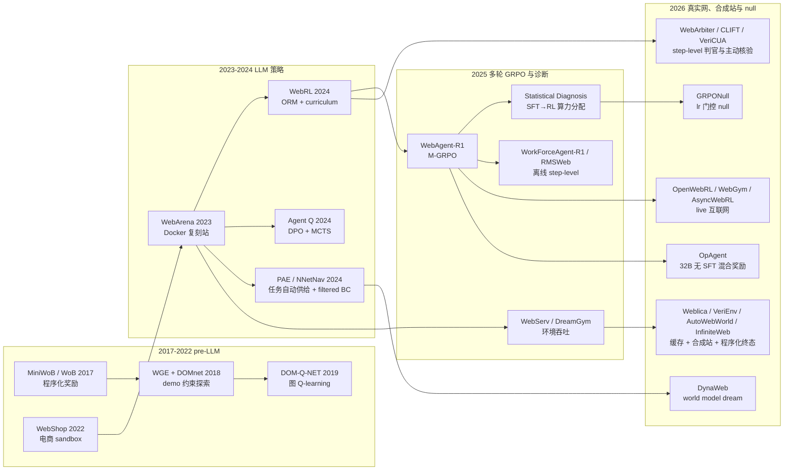

## Overview

一个 web agent 的 RL 训练能否带来增益，在训练开始之前就已经由三件事决定：策略是否还有 sampling headroom、环境能否以足够吞吐提供可复位的 rollout、奖励判官的噪声是否小于期望增益；具体用哪一种 GRPO 变体是次要变量。

区分这一族工作的四条轴：

- **交互方式**：live rollout（策略在环境里在线采样，奖励来自环境或判官）/ 离线动作匹配（在 teacher 轨迹或筛选过的关键状态上做 step-level 对齐，训练期不执行浏览器；AutoWebWorld 的 GRPO 虽在合成站上生成数据，训练时也属此类）。这是第一级分类轴，因为它决定了方法的上限是环境可达的成功率还是 teacher 的成功率。
- **环境供给**：Docker 复刻站（WebArena 系）/ 轻量容器（WebServ）/ 真实互联网（WebGym、OpenWebRL、AliyunConsoleAgent）/ HTTP 缓存与 LLM 合成站（Weblica、VeriEnv、WebFactory、Trustworthy Worlds、AutoWebWorld、InfiniteWeb）/ 学出来的 world model（DynaWeb、DreamGym）。每一种都在吞吐、可复现性与奖励可验证性之间取舍，目前没有一种同时满足三者。
- **奖励来源**：程序化规则（MiniWoB++、WorkArena 的 cheat 函数）/ 后端或插桩状态（云审计日志、数据库谓词、InfiniteWeb 的代码插桩 evaluator）/ 训练出的 ORM（WebRL，自报约 80% 准确率）/ LLM 或 VLM judge（OpenWebRL、WebGym、Weblica、DynaWeb、OpAgent）/ step-level PRM（WebArbiter、CLIFT、TGPO）/ 主动核验 judge（VeriCUA，桌面训练、web 评测）。judge 的误判率与 RL 增益常在同一量级，这使得多数跨论文数字不可直接比较；在 WebArena-Verified 上，连经 RL 训练、可在环境里主动取证的 judge 与可执行 evaluator 的一致率也只有 62.75%，比同一 judge 在 OSWorld 上低约 20 点，web 是三类平台里最难核验的。
- **起点**：SFT 热启动的必要性随 base 能力变化，不是一条与规模无关的铁律。≤8B 的 VLM 上，无 SFT 的 RL 失败或接近零增益（WebAgent-R1 3B 6.1→4.8；Statistical Diagnosis 在 WorkArena 上 RL-only 等于 Instruct 基线；OpenWebRL 4B 从 base 直接 RL 在 hard 子集上只有 +2.3 对 SFT 起点 +22.3，整体全程落后约 10 点），Weblica 在 2B/4B/8B 三个规模上 SFT→RL 都高于 Base→RL；但 32B 的 Thinking 模型（OpAgent）不经 SFT 直接在 WebArena 上做 RL 拿到 +10.7 pass@5，AgentGym-RL 的 7B 在自选 27 任务子集上也到 26.0。SFT 的作用不是加速而是把策略放进更好的行为区域（OpenWebRL 的表述），这一优势在 ≤8B 上到训练结束都没有被 RL 抹平。

证据结构有两个系统性偏斜。第一，sandbox 结果与 live 结果不互通：sandbox 上有竞争力的方法在 Online-Mind2Web 上可以低到个位数（Go-Browse WebArena 21.7 对 Online-Mind2Web 5.33），而 live 站点的成功率又随时间漂移。第二，判官是 benchmark 的一部分而非中立测量：RMSWeb 复核 WebTailBench 原生 judge 的失败判定后发现大量 false negative，其中 42% 源于 judge 只看 DOM 证据，作者因此换用自家 judge，其数字从此不与其他 harness 可比；VeriEnv 自己的程序化验证器实测只有 76% 正确。本文所有横向数字都应在"同 judge 同时期"条件下读。

范围限于浏览器内的 web/GUI 任务。deep-research 式 search agent（AEPO）、桌面（[[Papers/2508-ComputerRL]]）与移动端（[[Papers/2502-DigiQ]]）只作为边界证据引用。桌面侧 2026 年 10 月的一批 GUI RL 工作（Adaptive-Group Process Rewards、VeriCUA、MAI-Gym、[[Papers/2610-SoftwareGym]]）与 WebShop 文本环境上的 agentic RL（[[Papers/2609-PROPD]]、[[Papers/2610-SRD]]、[[Papers/2511-AgentPRM]]）同样只作边界证据：前者回答"web 上缺的对照在桌面有没有"，后者回答"无 SFT 的 GRPO 在简化环境里是否成立"。更广的 GUI RL 综述见 [[Topics/CUA-Survey]] §7.6–7.8 与 [[Papers/2604-RLGUIAgentsSurvey]]；trajectory-level reward 如何分解到步的机制讨论见 [[Topics/StepCreditAssignment-Survey]]，本文不重复。

## 技术路线

Web RL 的问题结构在 LLM 之前就已经定型。MiniWoB（Shi et al. 2017）把网页任务缩成百余个小程序化环境，奖励由任务代码直接给出；WGE（Liu et al. 2018, [arXiv 1802.08802](https://arxiv.org/abs/1802.08802)）发现纯探索在这些环境里几乎学不到东西，必须用少量演示约束探索空间，论文称相对 behavioral cloning 的样本效率提升超过 100 倍；DOM-Q-NET（Jia et al. 2019, [arXiv 1902.07257](https://arxiv.org/abs/1902.07257)）把 DOM 当图做 Q-learning。三者留下的遗产是今天仍然成立的三条约束：状态要结构化、探索要被演示引导、奖励要可程序化验证。WebShop（2022）把场景放大到电商 sandbox，[[Papers/2307-WebArena]] 再把它放大到五个 Docker 复刻站。LLM 时代改变的是策略来自预训练模型，因而瓶颈从表示学习转移到环境吞吐与奖励可验证性，这正是 2025 年之后四条路线分化的原因。

### 方法对照：优缺点总表

下表回答"给定一个训练预算与一个可用环境，该选哪条路线"。每行只保留该方法最有信息量的一个主结果；数字只在同一行内可比，跨行比较须回到 Datasets 节的 judge 说明。grounding 标注：V = vault 已有笔记，F = 已读全文、无 Paper 笔记，A = 仅摘要。

| 方法 | 交互 / 环境 / 奖励 | 起点 → 主结果 | 优点 | 缺点与边界 | G |
|:--|:--|:--|:--|:--|:--|
| WGE + DOMnet 2018 | live / MiniWoB / 程序化 | 演示约束探索；论文称样本效率优于 BC 100 倍以上 | 首次证明 demo 引导探索在 web 上必要 | 小环境、非 LLM 策略；数字未复核 | A |
| [[Papers/2411-WebRL]] | live / WebArena-Lite Docker / 训练出的 ORM | Llama-3.1-8B SFT 20.6→Filtered BC 23.0→AWR 28.5→DigiRL 30.3→WebRL 42.4；GLM-4-9B 22.4→24.8→27.9→31.5→43.0（同 SFT 起点） | 失败任务反推 curriculum + ORM + KL 约束 actor-critic 的组合首次把开源模型推过 GPT-4；8B ORM 在 WebArena-Lite 测试集上自报约 80% 准确率，高于 GPT-4 / GPT-4V 直接判定（Table 3） | ORM 80% 无后续独立复核；只在 sandbox 验证；Filtered BC / AWR 基线的离线数据来源原文表述不足以确认 | V |
| WebAgent-R1 [2505.16421](https://arxiv.org/abs/2505.16421) | live / WebArena-Lite / 规则 outcome | Qwen2.5-3B 6.1→SFT 20.0→33.9；Llama-3.1-8B 8.5→20.6→44.8（WebRL 42.4、o3 39.4） | 多轮 GRPO 的最简形式，动态上下文压缩，不需要 ORM | 无 SFT 时 RL 失败（6.1→4.8，仅见于 Fig 4a）；无方差；G 未披露，训练步数只能从图上读出约 40 | F |
| [[Papers/2509-AgentGymRL]] | live / 多环境 / 环境原生 | 无 SFT；WebArena 27 任务子集 26.0（GPT-4o 16.0、o3 34.0） | 跨环境统一框架，ScalingInter 渐进放宽交互轮数 | 自选子集；"无 SFT 可行"与 WebAgent-R1、Statistical Diagnosis 矛盾，条件不同 | V |
| AMBER [2610.07118](https://arxiv.org/abs/2610.07118) | live / WebArena-Lite 去 GitLab / 二值 | Qwen3.5-9B：WebAgent-R1 28.35 → AMBER 36.85；27B 44.57→48.82（std 约 3，重叠） | 每步追加式自由文本记忆，避免覆盖式记忆丢失环境反馈 | 无"全历史 + 训练"对照；zero-shot 全上下文 34.22 高于训练后的 WebAgent-R1 复现，未解释 | F |
| OpAgent [2602.13559](https://arxiv.org/abs/2602.13559) | live / 自托管 WebArena（阿里云 ECS）/ 混合：规则式过程奖励 RDT（Rule-based Decision Tree）+ Webjudge 三维打分 | Qwen3-VL-32B-Thinking 无 SFT：WebArena pass@5 27.4→38.1（TTI Gemma-3-12B 26.1）；配 Gemini-3-Pro 规划的框架版 71.6 | 32B 级 Thinking 模型不经 SFT 直接 RL 有效的唯一 web 案例；过程奖励与 judge 奖励混合 | pass@5 而非 pass@1；任务数与步数上限未说明；judge 准确率未报；无方差；71.6 是框架结果不是 RL 结果 | F |
| AliyunConsoleAgent [2606.09447](https://arxiv.org/abs/2606.09447) | live / 真实云控制台 / ActionTrail 审计日志 + 双 judge | Qwen3-VL-32B 43.28→SFT 56.89→63.52±1.86；GRPO 对 SFT +6.63，CI [2.97, 9.64] | 奖励建在后端审计日志上；报告置信区间；200+ 沙箱约 300 任务/小时 | 私有数据与环境，不可复现；与 Gemini 3 Pro 差异不显著 | F |
| [[Papers/2606-OpenWebRL]] | live / 真实互联网 K8s / VLM judge | 平均 39.3→SFT 52.0→RL 68.4（WebVoyager 74.1 / Online-Mind2Web 67.0 / DeepShop 64.0） | 真实网训练；412 条 SFT 轨迹即够，1.9K 反降 2 点 | 51% 失败来自 bot detection；judge 噪声约 10%；约 300 B200 GPU 小时 | V |
| [[Papers/2606-WebGym]] | live / 真实互联网 292,092 任务 / rubric judge | OOD 26.2→42.9（GPT-4o 27.1、GPT-5-Thinking 29.8） | 任务供给规模最大 | 无 baseline 的 REINFORCE 等价于 filtered BC；rubric judge 有偏 | V |
| [[Papers/2606-AsyncWebRL]] | live / 真实互联网 / 同 WebGym | OOD 42.9→45.4；吞吐 2.4–2.9 倍 | 异步 rollout 池解耦采样与更新；按 1/k 而非 1/轨迹长度归一，抑制长轨迹占比膨胀 | 性能增益小，主要是系统贡献 | V |
| Statistical Diagnosis [2507.04103](https://arxiv.org/abs/2507.04103) | live / MiniWoB++ + WorkArena / 程序化 | 8B：MiniWoB++ held-out task SFT 56.7→SFT+RL 63.3；WorkArena 26.4±2.0→28.8±2.0 | 1,370 组配置 bootstrap；SFT+RL 用约 55% 算力达到 SFT 峰值；温度 0.25 与 lr 1e-6 最稳 | WorkArena held-out task 增益不显著；14/33 任务从未解出 | F |
| [[Papers/2607-GRPONullWebAgent]] | live / MiniWoB 11 任务 ×5 种子 / 程序化 | Qwen3-VL-4B SFT 49.1→最佳 GRPO 52.7（p=0.50）；lr 1e-5 降到 33.3，2e-5 降到 0 | 受控 null + 机制（后层有效秩 9.2→1.2）；给出 headroom 判据 | 统计功效低；机制只在 4B 验证 | V |
| AEPO [2510.14545](https://arxiv.org/abs/2510.14545) | live / 搜索工具 agent（非 GUI）/ LLM judge | Qwen3-14B GAIA：GRPO 36.9 / ARPO 43.7 / AEPO 47.6（1k 样本） | entropy 平衡的 rollout 分配 | 非浏览器 GUI；无成功率消融、无种子 | F |
| WorkForceAgent-R1 [2505.22942](https://arxiv.org/abs/2505.22942) | 离线单步 GRPO / WorkArena / 规则匹配 cheat 真值 | 14B 23.79→SFT 30.20→46.79（GPT-4o 42.65）；7B 9.42→39.56；3B 2.62→36.85 | 不需要在线采样；小模型增益最大 | 同 33 任务的 held-out 配置测试；dense reward 诱发 reward hacking（Fig 8）；无探索；exact match 是作者自述的实时反馈受限下的替代 | F |
| RMSWeb [2608.00335](https://arxiv.org/abs/2608.00335) | 离线 step-level GRPO（LoRA）/ 4.5k 关键状态 / 分级 reward | Qwen3-VL-8B WV/OM2W/WTB：SFT 82.7/59.4/55.4→86.4/66.4/57.7；全量语料 RL 84.4/60.8/53.0 | 失败模式挖掘出的关键状态比全量语料有效；反思使步数降 12.9–19.7% | 实际是分级奖励的离线蒸馏；原生 judge 的 false negative 主因是只看 DOM（42%），作者换自家 judge 后 WebTailBench 数字不与其他 harness 可比；无 std | F |
| WebFactory [2603.05044](https://arxiv.org/abs/2603.05044) | 离线 replay buffer GRPO / 10 个合成 Next.js 站 / 匹配 teacher 动作 | Qwen2.5-VL-3B live 三站 TCR 53.4（GUI-R1 37.0、GPT-4o 39.5） | 确定性回放校验可复现；任务生成可执行率 31.3→86.3% | 奖励对齐 teacher 而非环境状态；10 站 100 题；teacher 封顶 | F |
| [[Papers/2408-AgentQ]] | DPO + MCTS / WebShop、OpenTable / 自评 | WebShop 50.5；OpenTable 推理期 MCTS 95.4 | 搜索 + 自评生成偏好对 | 推理期 MCTS 成本高；单站验证 | V |
| [[Papers/2502-DigiQ]] | 离线 Q-learning / Android | 移动端 | 不需要在线交互的价值函数 | 非 web；笔记数字未复核 | V |
| DynaWeb [2601.22149](https://arxiv.org/abs/2601.22149) | world model dream（≤5 步）+ GSPO / 自评 reward | Llama-3.1-8B WebArena 31.0（WebRL-offline 26.7）；WebVoyager live 38.7（WebRL 32.6） | 无需环境工程；dream 深度分析清晰 | 纯 dream 低于 SFT，需约 40% 真实轨迹；reward 是未报准确率的 self-assessment；整页转移 12% 全错 | F |
| [[Papers/2511-DreamGym]] | 经验合成 / 抽象状态 world model | WebArena 3B GRPO 7.3→13.3 | 绕开环境吞吐限制 | 绝对值低；作者在 WebArena 侧只能跑 4 路并行 | V |
| Weblica [2605.06761](https://arxiv.org/abs/2605.06761) | live / HTTP 缓存 15.6K + 合成站 2,560 / GPT-4o judge | Qwen3-VL-8B 三 live 基准 pass@1 平均 24.8→35.6（MolmoWeb-8B 42.4） | 唯一给出吞吐与训练时长；合成站泛化优于真实缓存站 | 训练与评测同为 LLM judge；缓存存活率约 10%；无后端，不能训状态变更任务 | F |
| VeriEnv [2603.10505](https://arxiv.org/abs/2603.10505) | rejection SFT / 97 个带后端克隆站 / 数据库终态程序 | Qwen3-4B WebArena-Lite 7.88→13.94；Mind2Web-Online 13.18→20.45 | 每站 3.6 USD、83.5 分钟；有后端 | 验证器实测 76% 正确；克隆成功 71%；没有 RL | F |
| Trustworthy Worlds [2608.21898](https://arxiv.org/abs/2608.21898) | PPO / 500 个验证过的合成站 / 后端状态谓词 | <10M 参数 DOM policy；WebArena 兼容子集 18.6（未验证环境 12.4） | 唯一量化 verifier P/R（F1 89.3）；缺陷→可学性因果链清晰 | policy 非 LLM，结论能否迁移未知 | F |
| AutoWebWorld [2602.14296](https://arxiv.org/abs/2602.14296) | 离线 step-level GRPO（动作类型匹配 + 坐标距离 + 格式三项奖励，对齐 FSM 校验过的 BFS 轨迹）/ 29 个 FSM 建模的合成站 / FSM 终态只校验数据，不是 RL 奖励 | 7B：WebVoyager 27.42（15 步上限；UI-TARS-1.5-7B 26.51、Claude-4-Sonnet 26.11、Qwen2.5-VL-7B 5.62）；Online-Mind2Web 随训练数据 8→16,253 条从 1.22 到 14.02 | 11,663 条校验轨迹每条 0.04 USD；FSM 使轨迹正确性可程序化判定；路线 2 里唯一给出数据 scaling 曲线的工作 | 训练期不执行浏览器，上限是 BFS 轨迹的成功率；15 步上限使 WebVoyager 数字不与其他工作可比（Claude 仅 26.11）；FSM 校验器准确率未报；7B backbone 未明示；无方差 | F |
| InfiniteWeb [2601.04126](https://arxiv.org/abs/2601.04126)（[[Papers/2600-InfinitewebScalableWebEnvironment]]） | GRPO / LLM 生成的功能站 600 任务 / 代码插桩 evaluator 的 dense reward | UI-TARS-1.5-7B：OSWorld 24.5→31.4、Online-Mind2Web 23.0→28.7；换 Claude-Code 生成的站训练 Online-Mind2Web 只有 +0.7（Table 9） | 100 个抽样任务 95 个通过人工校验；站点生成器对训练增益的直接对照 | 600 任务规模小；OSWorld 口径未限定 Chrome 子集；vault 旧笔记质量低，数字以原文为准 | F |
| [[Papers/2510-WebServ]] | 基础设施 / Incus + ZFS | 启动 1.78 s 对 8.96 s；28 MiB 对 6.78 GB；200+ 并发 | 把 Docker 复刻站变成可大规模复位的环境 | 没有端到端 RL 实验 | V |
| [[Papers/2412-PAE]] / [[Papers/2410-NNetNav]] / [[Papers/2506-GoBrowse]] / [[Papers/2502-InSTA]] / [[Papers/2502-Explorer]] | 任务自动供给 + filtered BC 或 SFT | PAE 34B WebVoyager 22.2→33.0；NNetNav 8B WebArena 16.3；Go-Browse WebArena 21.7 但 Online-Mind2Web 5.33；InSTA 1.7B 11.5→56.9；Explorer 94,949 条轨迹每条 0.28 USD | 任务与轨迹的自动供给，是所有 RL 路线的数据前置 | 多为 SFT 而非 RL；Go-Browse 显示 sandbox 到 live 不迁移 | V |
| WebArbiter [2601.21872](https://arxiv.org/abs/2601.21872) | PRM（pairwise 生成式）/ 推理期 BoN | 7B WebPRMBench Avg BoN 74.60（WebShepherd-8B 43.28、GPT-5 65.50）；WebArena-Lite GPT-4o-mini 23.48→40.52 | 同数据下比 checklist 式 PRM 高 31 点；principle 使失败可归因 | 未用于策略训练；只有 pairwise 输出；safe-action 偏置；训练域单一 | F |
| CLIFT [2610.06829](https://arxiv.org/abs/2610.06829) | GRPO + 共形认证的 URL 级问题库 / 训练期 Opus judge | Gemma-4-31B WAI：base 61.8 → vanilla GRPO 64.7 → CLIFT 72.6 → +CTS 74.6 | 测试期免 judge；认证率低是诚实信号；步数不增下增益 | 共形保证对象是 judge 一致性而非任务成功；无 outcome-only baseline；组件未拆解 | F |

### 路线 1：Live rollout 多轮 GRPO 族

这条路线从 [[Papers/2411-WebRL]] 开始。WebRL 的贡献不是算法而是闭环：失败任务被改写成新任务形成 curriculum，一个训练出来的 ORM 替代人工标注，KL 约束的 actor-critic 防止策略漂移，Llama-3.1-8B 在 WebArena-Lite 上从 4.8 到 42.4。它的 8B ORM 在 WebArena-Lite 测试集上自报约 80% 准确率、高于 GPT-4 与 GPT-4V 直接判定（Table 3），这一数字此后没有被任何工作独立复核；所有验证都在 Docker 沙箱内。Table 1 还给出同一 SFT 起点下的一组基线：Llama-3.1-8B 上 Filtered BC 23.0、AWR 28.5、DigiRL 30.3 对 WebRL 42.4，GLM-4-9B 上 24.8、27.9、31.5 对 43.0，是库内最接近"同模型下在线对离线"的数字，但这些基线都不是路线 2 的 teacher 动作匹配，且 Filtered BC 与 AWR 的训练数据来源原文表述不足以确认为同数据离线版本。WebAgent-R1 把这一套简化为 M-GRPO：多轮交互、二值 outcome reward、动态上下文压缩，Llama-3.1-8B 到 44.8，与 WebRL 持平而少了 ORM 与 curriculum。最有信息量的不是主结果，而是两个消融：不做 SFT 直接 RL 时 3B 模型从 6.1 掉到 4.8，说明 RL 不能从零注入能力；用 long-CoT SFT 起步时 RL 增益从 13.9 点缩到 5.8 点，说明起点越强、RL 可重塑的空间越小。

后续工作沿两个方向推进。一是把环境换成真实互联网：[[Papers/2606-OpenWebRL]] 在 K8s 沙箱里跑真实站点，平均从 52.0 到 68.4，但 51% 的失败来自 bot detection，约 300 B200 GPU 小时；[[Papers/2606-WebGym]] 把任务供给扩到 292,092 个，但它用的无 baseline REINFORCE 在数学上等价于 filtered BC；[[Papers/2606-AsyncWebRL]] 用异步 rollout 池把吞吐提高 2.4 到 2.9 倍，并指出按轨迹长度归一会让长轨迹在梯度里占比膨胀，改按固定 k 归一。二是把 reward 建在后端：AliyunConsoleAgent 用云平台的 ActionTrail 审计日志判定资源是否被正确创建，双 LLM judge 兜底无日志的任务，与人工一致 96.7%；它也是这一族里少数报告置信区间的工作，GRPO 对 SFT 的增益 CI 为 [2.97, 9.64]，但环境与数据私有。

这条路线的支撑边界由两篇诊断性工作给出。Statistical Diagnosis 用 Llama-3.3-70B 做 teacher、8B 做 student，在 1,370 组配置上 bootstrap：MiniWoB++ 上 SFT+RL 用约 55% 的算力达到纯 SFT 的峰值，但 WorkArena held-out task 上 SFT+RL 28.8±2.0 对 SFT 26.4±2.0，差值小于合并标准误（按 Table 1 推算，原文未作显著性判断），且 33 个任务里 14 个从未被解出；curriculum 与 error log 只在没有 SFT 热启动时有用。[[Papers/2607-GRPONullWebAgent]] 则在 11 个 MiniWoB 任务、5 个种子、18 组配置下得到 null：SFT 49.1 对最佳 GRPO 52.7，p = 0.50；学习率像开关，1e-6 量级无事发生，1e-5 降 15.8 点，2e-5 崩到 0，机制是后层有效秩从 9.2 坍缩到 1.2。同一 pipeline 在仍有 headroom 的任务上从 20.0 到 42.0，给出可操作判据：训练前测 sampling 成功率与 greedy 成功率之差。

继承的假设：环境可复位且可采样数千次；outcome 判官的噪声小于期望增益；存在可用的 SFT 起点。遗留的研究债：方差报告普遍缺失（WebAgent-R1、AgentGym-RL、WorkForceAgent-R1 均未报），超参数 G 与训练步数常不披露，benchmark 子集由作者自选。[[Papers/2509-AgentGymRL]] 宣称无 SFT 可行且在 WebArena 27 任务子集上到 26.0，用的是 Qwen2.5-7B 与自选子集；OpAgent 则在 Qwen3-VL-32B-Thinking 上不经 SFT 直接在自托管 WebArena 上做 RL，pass@5 从 27.4 到 38.1，奖励是规则式决策树 RDT 的过程奖励与 Webjudge 三维打分（任务完成、动作有效、轨迹效率）的混合，但任务数、步数上限、judge 准确率与方差都未报告，pass@5 也放大了对弱基线的差距。把这两篇与 OpenWebRL 的 Fig 2（4B 从 base 直接 RL 在 hard 子集上 +2.3，SFT 起点 +22.3，增益集中在 easy / medium；整体上 SFT 起点的约 10 点优势到训练结束都在）和 Weblica 的 Fig 5（2B/4B/8B 上 SFT→RL 分别 24.1/35.2/39.2，均高于 Base→RL）合看，"无 SFT 是否可行"不是一个有统一答案的问题：它由 base 的 sampling headroom 决定，≤8B 的 VLM 在 WebArena 级任务上没有足够 headroom，32B 的 Thinking 模型有。这与 GRPONull 的 headroom 判据是同一件事的两面。AMBER 补了一个长程记忆维度，9B 上比 WebAgent-R1 复现高 8.5 点，但 zero-shot 全上下文 Qwen3.5-9B 就有 34.22，高于训练后的 WebAgent-R1 复现 28.35，论文没有解释，也没有"全历史 + 同样训练"的对照。

### 路线 2：离线 step-level RL 与动作匹配

这条路线的共同特征是训练期不执行浏览器。WorkForceAgent-R1 在 WorkArena 上做单步 GRPO，reward 是动作与 cheat 函数真值的匹配，14B 从 23.79 经 SFT 30.20 到 46.79，3B 从 2.62 到 36.85；但测试与训练同分布，dense reward 诱发了作者自己记录的 reward hacking。RMSWeb 更进一步：用 GPT-5.1 收集带反思的轨迹，挖掘出 4.5k 个失败关键状态，在这些状态上做 step-level GRPO 变体 Salvage-DS，Qwen3-VL-8B 在 WebVoyager/Online-Mind2Web/WebTailBench 上从 SFT 的 82.7/59.4/55.4 到 86.4/66.4/57.7，而在全量语料上做同样的 RL 只有 84.4/60.8/53.0。WebFactory 在 10 个合成站上用 teacher 轨迹做 replay buffer，reward 是 click 是否落入真值框或文本 F1，3B 在三个真实站上从 20.4 到 53.4。

把这三篇放在一起读，结论是它们的增益来自状态筛选而非探索。Salvage-DS 的"全量不如筛选"直接说明这一点；WebFactory 的 reward 对齐的是 teacher 动作而非环境状态；WorkForceAgent-R1 的 reward 来自真值函数。它们在形式上是 GRPO，在效果上是分级奖励的离线蒸馏，接近 hard-state filtered BC。上限因此是 teacher 或真值的成功率。[[Papers/2408-AgentQ]] 是这条线的前身，用 MCTS 加自评生成偏好对再做 DPO，OpenTable 上配推理期 MCTS 到 95.4，但没有 MCTS 时增益有限；[[Papers/2509-TGPO]] 把树结构偏好用到 web 任务上，库内笔记只到摘要层，无数字可引。

AutoWebWorld 是这条线最新也最容易被误读的成员。它把 29 个合成站建成有限状态机，用 BFS 在状态图上生成任务与轨迹，再以到达 FSM 目标状态为准回放校验，得到 11,663 条轨迹、每条 0.04 USD；随后的 GRPO 不在站点上采样，奖励是动作类型匹配、坐标与 ground truth 的归一化距离和格式三项，与 WebFactory 的 teacher 动作对齐同构。7B 在 15 步上限的 WebVoyager 上 27.42，与 UI-TARS-1.5-7B 的 26.51 持平；Online-Mind2Web 随训练数据从 8 条到 16,253 条由 1.22 升到 14.02，是路线 2 唯一的数据 scaling 曲线。它的贡献在数据侧：FSM 让"轨迹是否正确"可程序化判定，解决了路线 2 的 teacher 来源问题；但训练形式仍受 BFS 轨迹成功率的上限约束，FSM 终态没有进入 RL 奖励。

继承的假设：teacher 或真值可得；测试分布与 teacher 轨迹分布相近。遗留的研究债：没有一篇在同模型同 benchmark 上与 live rollout 直接对照；DynaWeb 复现的 WebRL-offline 在 WebArena 上 26.7，而 WebRL 原文在线版 42.4，两者 backbone 不同，不构成对照。优点是对环境吞吐零要求、训练稳定、小模型增益最大；缺点是不能超过 teacher，dense shaping 下有 hacking 风险，且 RMSWeb 的附录 B 复核原生 judge 后发现 false negative 的成因可归类（42% 只看 DOM 证据、37% 截图读取不全、21% 推理错误），作者因此换用自家 judge，WebTailBench 上的增益不能与其他 harness 的数字对照。

### 路线 3：环境供给

WebArena 系 Docker 站是 RL 的瓶颈。[[Papers/2510-WebServ]] 量化了它：单实例启动 8.96 秒、6.78 GB，换成 Incus 加 ZFS 写时复制后 1.78 秒、28 MiB、200 路并发，但没有做端到端 RL 实验。[[Papers/2511-DreamGym]] 的作者在 WebArena 侧只能跑 4 路并行 session。[[Papers/2608-EnvHarness]] 把可用环境限定为有 reset 与 step 接口的 gym，live GUI 被排除在外。三条解法从这里分化。

第一条是真实互联网。[[Papers/2606-WebGym]] 从 127,645 个站点生成 292,092 个任务，[[Papers/2606-OpenWebRL]] 用 K8s 沙箱跑真实站。它们付的代价是可复现性：OpenWebRL 51% 的失败来自 bot detection，live 站点的成功率随时间漂移，judge 噪声约 10%。AliyunConsoleAgent 是真实环境里唯一有后端奖励的，但环境私有。

第二条是缓存与合成。Weblica 用 Playwright 录 HTTP 流量回放真实站，146K 站只留存 15.6K 个可完成任务的缓存环境（约 10.7%，由两数推算，原文未给比例），另用 Claude Opus 4.5 合成 2,560 个无后端静态站；单步 50 到 150 毫秒对 live 的约 1.5 秒，但端到端 RL 只快 30% 到 40%。最反直觉的发现是合成站训练在三个 live 基准上的泛化优于真实缓存站。VeriEnv 用 GPT-5.2 coding agent 从截图重建带数据库的站，每站 3.6 USD、83.5 分钟，136 个候选 97 个可用，验证器通过 SDK 查数据库终态，但人工评估验证器只有 76% 正确；训练只是 rejection SFT，且 LLaMA-3.2-3B 在 Mind2Web-Online 上对 ADP 基线只多 0.46 点。Trustworthy Worlds 走得最远：LLM 生成站点 scaffold 后用四个 verifier 与规则检查修复，再把后端状态谓词编译成 dense reward，500 个环境 6,842 个任务，verifier F1 89.3；作为对照的 GPT-4 ReAct 15.3 被限制在同一 DOM 接口与 20 步内，作者自己声明不构成优于 GPT-4 的主张。代价是 policy 是不到 10M 参数的 DOM 模型，结论能否迁移到 VLM 完全未知。WebFactory 的 10 个站规模太小，不构成可扩展性证据。[[Papers/2507-WebSynthesis]] 与 [[Papers/2510-UISimulator]] 是更早的合成路线，用于推理期规划或数据生成而非 RL。

InfiniteWeb 是唯一一篇把合成站直接接进 live GRPO 并以程序化终态为奖励、策略为 LLM 的工作，补上了 Trustworthy Worlds 留下的空白。InfiniteWeb（[[Papers/2600-InfinitewebScalableWebEnvironment]]）用 LLM 生成带功能的站点并在代码里插桩 evaluator，600 个任务上对 UI-TARS-1.5-7B 做 GRPO，OSWorld 从 24.5 到 31.4、Online-Mind2Web 从 23.0 到 28.7，100 个抽样任务里 95 个通过人工校验；它最有信息量的实验是 Table 9：同样流程换成 Claude-Code 生成的站点，Online-Mind2Web 只有 +0.7，而自家站是 +5.7，说明合成站内部的方差与"合成对真实"的差异同量级，站点生成器本身就是实验变量。AutoWebWorld 同样用合成站，但它的 FSM 只用来生成与校验轨迹，GRPO 是离线动作匹配，归入路线 2；它说明合成站的另一种用法是做可校验的 teacher 数据源，而不是 rollout 环境。[[Papers/2609-MintAct]] 是 Weblica 环境的第二个使用者，8B 在 Weblica 评测集 74.7、Online-Mind2Web 39.1，与 Weblica 自家 8B 的 70.6 / 39.2 相当，但它的 web 能力经 specialist RL 再蒸馏进统一模型，没有合成站对缓存站的拆分。

第三条是 world model。DynaWeb 用 NNetNav 轨迹 SFT 一个 GPT-oss-120B 的 world model，预测 accessibility tree 的状态变化，策略在其中 dream 至多 5 步，WebArena 31.0、WebVoyager live 38.7，都高于重训后的 WebRL。但消融显示纯 imagined 训练低于 SFT 基线，约 40% 真实轨迹之后才显著超过，主实验配方实际用的是 50%；world model 对局部转移匹配 97%，对整页转移（占 36%）有 12% 完全错；reward 是未报准确率的 self-assessment。[[Papers/2511-DreamGym]] 用抽象状态的经验合成，WebArena 3B 从 7.3 到 13.3，绝对值低。[[Papers/2411-WebDreamer]] 与 [[Papers/2609-DiscriminativeWM]] 把 world model 用在推理期规划而非训练，后者的判别式 world model 在 WebPRMBench 上 BoN 72.70，接近 WebArbiter 的 74.60。[[Papers/2610-Trace2Env]] 给这条路线补了一个警示：无约束的语言 world model 在 ALFWorld 上让策略的模型内成功率到 97%，真实环境里只有 3%，经 trace 约束后两数变为 88% 与 85%。模型内成功率本身不是可信指标；DynaWeb 与 DreamGym 报的 WebArena 数字都在真实环境测得，这一点它们做对了，但两者都没有报告 dream 内成功率与真实成功率的差。

三条解法各付不同的货币：真实网付 bot detection 与不可复现，合成站付奖励可验证性，world model 付整页转移误差与对真实轨迹的依赖。在"吞吐"与"可验证奖励"两项上同时拿到的只有 Trustworthy Worlds，但它的 policy 不是 LLM。吞吐这一项在 2026 年 10 月之后不再是 web 独有的瓶颈：MAI-Gym 报告浏览器实例复位中位 6 秒（桌面虚拟机 37 秒、Android 165 秒），测试过 20,000 实例并行，并把 WebVoyager、Online-Mind2Web 与 WebArena 全集接进同一平台，但其 9B 模型只报了 MobileWorld 78.4 与 OSWorld-Verified 76.2，没有任何 web 基准数字；WebArena-Verified 把 812 个任务的 evaluator 改为基于 agent 响应与 HAR 网络轨迹的确定性判定，后端变更从网络事件里读出而不查数据库，并提供容器 reset 接口。两者合起来意味着"在 WebArena 上以后端状态为奖励做大规模 RL"的基础设施已经齐备，但还没有一篇论文用它训练。桌面侧 [[Papers/2610-SoftwareGym]] 给了与 Weblica 方向相反的数据点：各 3,715 条轨迹，只用合成环境训练的 Qwen3.5-9B 在 OSWorld 上 56.97，只用 OSWorld 原生环境训练 61.48，两者拼接 58.61；它做的是 SFT 而非 RL，不能直接对冲 Weblica，但足以说明"合成优于真实"不是跨平台成立的规律。[[Papers/2412-PAE]]、[[Papers/2410-NNetNav]]、[[Papers/2502-InSTA]]、[[Papers/2502-Explorer]] 解决的是任务与轨迹供给，多数止于 SFT；[[Papers/2506-GoBrowse]] 的结构化探索在 WebArena 到 21.7，在 Online-Mind2Web 只有 5.33，是 sandbox 不迁移的最直接证据。

### 路线 4：奖励来源与 step-level 判官

奖励来源决定了一篇论文的数字能不能被另一篇引用。程序化奖励（MiniWoB++、WorkArena 的 cheat 函数、WebArena-Lite 的规则 evaluator）是可信的，但只覆盖可枚举真值的任务。后端状态奖励（AliyunConsoleAgent 的审计日志、Trustworthy Worlds 的数据库谓词、VeriEnv 的终态查询）覆盖状态变更任务，但 VeriEnv 实测 76% 正确说明"程序化"不等于"准确"，数据库复位不保种子是主要错因。训练出的 ORM 只有 WebRL 一例，自报约 80% 准确率且无人复核。LLM 或 VLM judge 是 live 基准的默认选项，噪声从 OpenWebRL 的约 10% 到 VeriEnv 程序化验证器的 24%，RMSWeb 复核 WebTailBench 原生 judge 后发现 false negative 主因是只看 DOM 证据与截图读取不全，因而换用自家 judge；[[Papers/2504-AgentRewardBench]] 与 [[Papers/2510-CUARewardBench]] 专门测量 judge 质量，结论见 [[Topics/CUA-Survey]] §7.6。Weblica 的训练奖励与评测 judge 同为 LLM judge，论文没有排除策略学到"让 judge 满意"的可能。VeriCUA 给出了目前唯一跨平台同协议的 judge 准确率对照：一个在 OSWorld 上用 REINFORCE++ 训练、可以在执行后的环境里主动导航取证的 4B judge，与可执行 evaluator 的一致率在 OSWorld 82.00、MobileWorld 77.50、WebArena-Verified 62.75，GPT-5.4 few-shot 分别为 81.40、66.25、58.50；从 4B 到 GPT-5.4 的 prompted judge 宏平均都停在 68% 到 70%。web 比桌面低约 20 点，作者未解释；一个与 WebArena-Verified 自身设计一致的解释是 web 任务的完成态多在后端数据库而不在屏幕上，靶向 GUI 的取证看不到它。VeriCUA 的 judge 只在 OSWorld 上训练并作为 actor 的 RL 奖励（pass@4 47.14 对 ZeroGUI 奖励 45.36），web 侧只做了 judge 评测，没有训练。移动端 [[Papers/2500-A3AndroidAgentArena]] 训练出的小 judge precision 95.7 高于 Gemini-2.5-pro 的 87.3，且 Gemini 作 judge 时 10 个 agent 里 8 个分数更高，是"商业 judge 偏宽松、专用小 judge 可更准"在另一平台的数据点，但该 judge 的训练任务与评测任务同为那 100 个任务。桌面侧 model-based reward 对 rule-based reward 的强弱是三点分布：[[Papers/2607-SeekJudge]] 高于、[[Papers/2607-InteractiveRewardAgent]] 接近、[[Papers/2608-GSAR]] 低于，细节见 [[Topics/CUA-Survey]] §7.6；web 上这三类对照一个都没有。

step-level 判官有两种用法。WebArbiter 做的是推理期搜索：从任务与 accessibility tree 归纳带权重的 principle，逐条评估两个候选动作输出 pairwise verdict，o3 蒸馏加 GRPO 训练；7B 在 WebPRMBench 上 Avg BoN 74.60，同数据的 WebShepherd-8B 43.28，GPT-5 65.50；作为 GPT-4o-mini 的 BoN 判官把 WebArena-Lite 从 23.48 提到 40.52，其中无搜索与 WebShepherd 两行转引自 WebShepherd 论文而非重跑。消融显示 principle 是跨域泛化的主因，但 Mind2Web 上无 principle 的变体反而更高；附录 J 记录了 safe-action 偏置，hover 被系统性判优于 click。作者明说它没有用于策略训练。CLIFT 是训练期用法的唯一案例：把 Claude Opus 4.6 的逐步打分蒸馏成按 URL 分层的 YES/NO 问题库，用 Mondrian 共形校准决定哪些问题可信，可信问题的加权投票作为 GRPO 的附加 step reward；WAI 上 vanilla GRPO 只有 +2.9 且步数变长，CLIFT +10.8 且步数不增。但共形保证的对象是与 Opus 的一致性而非任务成功，没有 outcome-only RLVR 对照，认证率低于 5%，四个组件没有逐一拆解。

两种用法的证据状态不对称：PRM 作为 BoN 判官的收益有 WebArbiter、[[Papers/2609-DiscriminativeWM]] 两个独立来源；PRM 作为训练奖励的收益在 web 上只有 CLIFT 一个混杂了多个组件的来源。[[Papers/2511-AgentPRM]] 虽然名为 PRM，RL 阶段只把 PRM 的终步分数当轨迹奖励，等于一个学习型 ORM，逐步 dense reward 在闭环里没测；它的 WebShop 结果（Qwen2.5-3B beam @8×8 76.0 对自训 ORM 57.0）是推理期用法。web 上缺的那个对照在桌面已经有了一例：Adaptive-Group Process Rewards 用 Qwen3.6-27B critic 给 UI-TARS-1.5-7B 的 GRPO 组内逐步打分，OSWorld 的 Chrome/Impress/Calc 任务上 3-run 平均 outcome-only GRPO 30.4、SeekJudge 奖励 31.4、该方法 34.5（1-run 分别 35.7 / 37.1 / 40.6），同策略同环境同任务只差 reward，但没有方差。它把"PRM 对 outcome-only"从"没有人做过"改写为"桌面有一例无方差的正结果，web 没有"。trajectory-level reward 分解到步的通用机制在 [[Topics/StepCreditAssignment-Survey]]。

## Datasets & Benchmarks

下表把 benchmark 按"奖励是否程序化"与"状态是否固定"分组。live 基准的 judge 是结果的一部分，同一行里不同 judge 的数字不可比。

| Benchmark | 类型 / 规模 | 奖励来源 | 代表结果（模型，judge） | 用于 RL 训练 | 注意 |
|:--|:--|:--|:--|:--|:--|
| MiniWoB++ | 合成小任务，百余个 | 程序化 | Statistical Diagnosis 8B SFT+RL held-out task 63.3，Claude-3.5 70.4；GRPONull 4B 11 任务 52.7 | 是 | 大模型已饱和；GRPONull 只用 11 个任务 |
| [[Papers/2403-WorkArena]] L1 | ServiceNow 企业站，33 任务类型 | cheat 函数真值 | WorkForceAgent-R1 14B 46.79（同分布）；Statistical Diagnosis 8B 35.4 held-out goal | 是 | 14/33 任务未被 8B 解出 |
| WebShop | 电商 sandbox | 程序化 | Agent Q 50.5；Trustworthy Worlds DOM policy 43.8 | 是 | 单域 |
| [[Papers/2307-WebArena]] 全集 812 | Docker 五站 | 规则 + 部分 LLM | DynaWeb 8B 31.0；OpAgent 32B pass@5 38.1（任务数未说明）；AgentGym-RL 27 任务子集 26.0；GPT-4o 14.3 | 是，吞吐受限 | 子集与 pass@k 口径不一 |
| WebArena-Lite 165 | 同上子集 | 规则 | WebRL 8B 42.4 / 9B 43.0；WebAgent-R1 8B 44.8；AMBER 27B 48.82（去 GitLab）；WebArbiter BoN GPT-4o 47.01；VeriEnv 4B 13.94 | 是 | 最多方法可比的 sandbox |
| WebArena-Verified 812（hard 子集 258） | 同 WebArena，任务经审计修订 | 确定性 evaluator：agent 响应 + HAR 网络轨迹（后端变更由网络事件判定，离线评测），去除 LLM judge | VeriCUA 用它评测 judge：训练出的 4B judge 与 evaluator 一致率 62.75，GPT-5.4 few-shot 58.50；尚无 RL 训练工作以它为 reward | 否（尚未） | 作者称减少 false negative，幅度未能核实（无 arXiv 版，NeurIPS 2025 SEA Workshop，论文页不可达，以 repo 文档为据）；容器带 reset 接口，是 web 上现成的确定性奖励源 |
| [[Papers/2401-VisualWebArena]] | 视觉任务 | 规则 | CLIFT Gemma-4-31B 35.6；GPT-5.5+CTS 53.7；WALT 52.9；人类 88.7 | 是 | 开源模型与人类差距最大 |
| [[Papers/2401-WebVoyager]] | live 真实站，643 任务 | LLM judge | DynaWeb 8B 38.7；PAE 34B 33.0；NNetNav 8B 35.2；OpenWebRL 74.1；RMSWeb 8B 86.4；AutoWebWorld 7B 27.42（15 步上限，同口径 Claude-4-Sonnet 26.11） | 是（OpenWebRL） | 74.1 与 86.4 用不同 judge 与时期，不可比；AutoWebWorld 的步数上限把前沿模型压到 26 以下 |
| [[Papers/2504-OnlineMind2Web]] | live 300 任务 | WebJudge | Go-Browse 5.33；AutoWebWorld 7B 14.02；InfiniteWeb UI-TARS-1.5-7B 28.7；Weblica 8B 39.2；[[Papers/2609-MintAct]] 8B 39.1；RMSWeb 8B 66.4；OpenWebRL 67.0；CLIFT GPT-5.5+CTS 61.0 | 否（评测） | WebJudge 与各家 judge 不同；14.02 到 67.0 的跨度同样来自 judge、步数上限与时期 |
| DeepShop / WebTailBench | live | LLM judge | OpenWebRL DeepShop 64.0；RMSWeb WebTailBench 57.7；Weblica 三基准平均 35.6 | 否 | RMSWeb 在 WebTailBench 上换用自家 DOM-aware judge，其 57.7 不与官方 harness 可比 |
| WebGym OOD | live 真实站 | rubric judge | WebGym 42.9；AsyncWebRL 45.4；GPT-5-Thinking 29.8 | 是 | judge 有偏 |
| WAI | 2026-03 新榜，程序化 verifier | 程序化 | CLIFT +CTS 74.6；Opus 4.6 69.8（口径不一） | 是 | 仅 3 个外部系统 |
| WebPRMBench 1,150 对 | step-level 判官评测 | 人工验证成功轨迹 | WebArbiter 7B BoN 74.60；DiscriminativeWM 72.70；WebShepherd-8B 43.28 | 否 | Mind2Web 占 61%，AssistantBench 仅 30 条 |

WebVoyager 一行最能说明问题：同一个 benchmark 上 8B 模型的数字从 35.2 到 86.4，跨度来自 judge、任务过滤（DynaWeb 过滤了被 IP 封的任务）与时期，而非方法差距。

## 失败模式与负证据

- **无 SFT 直接 RL 在 ≤8B 上失败或接近零增益**：WebAgent-R1 3B 从 6.1 到 4.8；Statistical Diagnosis 在 WorkArena held-out goal 上 RL-only 8.0 对 Instruct 8.3；OpenWebRL 4B 从 base 直接 RL 在 hard 子集上 +2.3 对 SFT 起点 +22.3，整体约 10 点的 SFT 起点优势全程未被抹平；Weblica 2B/4B/8B 上 Base→RL 均低于 SFT→RL。反例集中在更强的 base 或更简单的环境：OpAgent 32B-Thinking 无 SFT pass@5 +10.7；AgentGym-RL 7B 自选子集 26.0；WebShop 文本环境上 [[Papers/2609-PROPD]]（Qwen2.5-3B GRPO Acc 55.5）与 [[Papers/2610-SRD]]（Qwen3.5-4B GRPO 77.21）的笔记均未提及 SFT 阶段。
- **学习率门控的崩溃**：[[Papers/2607-GRPONullWebAgent]] lr 1e-5 降 15.8 点，2e-5 降到 0，后层有效秩 9.2→1.2；WebAgent-R1、DynaWeb、Statistical Diagnosis 都独立选了 1e-6，AliyunConsoleAgent 用 5e-7。
- **SFT 数据更多反而更差**：OpenWebRL 412 条优于 1.9K 条，差 2 点。
- **纯 imagined rollout 低于 SFT**：DynaWeb 0% 真实轨迹时不如 SFT 基线，约 40% 之后才显著超过。
- **dense reward 诱发 hacking**：WorkForceAgent-R1 Fig 8；CLIFT 用 clip-at-zero 规避负极性问题，但 Online-Mind2Web 迁移问题库里仍有 25 个负 lift 问题（Table 5），未讨论。
- **sandbox 到 live 不迁移**：Go-Browse WebArena 21.7 对 Online-Mind2Web 5.33；WebArbiter cold-start RL 在 Mind2Web BoN 86.00 而 WebArena 35.80 低于基座。
- **held-out 增益落在标准误内**：Statistical Diagnosis WorkArena held-out task SFT+RL 28.8±2.0 对 SFT 26.4±2.0，差 2.4 小于合并标准误约 2.8（按 Table 1 推算）；AMBER 27B 三种方法 std 约 3 且区间重叠。
- **判官噪声与增益同量级**：OpenWebRL 约 10%；VeriEnv 验证器 76% 正确；Weblica judge 与人工一致 88%；RMSWeb 复核后换 judge，WebTailBench 数字跨 harness 不可比。
- **web 是 judge 最难核验的平台**：VeriCUA 同一个训练出的 judge 与可执行 evaluator 的一致率 OSWorld 82.00、MobileWorld 77.50、WebArena-Verified 62.75；prompted judge 从 4B 到 GPT-5.4 宏平均停在 68% 到 70%。
- **合成站之间的差异与合成对真实同量级**：InfiniteWeb Table 9 换 Claude-Code 生成的站训练，Online-Mind2Web 只有 +0.7，自家站 +5.7；桌面侧 [[Papers/2610-SoftwareGym]] 同数据量合成 56.97 低于原生 61.48，与 Weblica 的方向相反。
- **评测步数上限改写排名**：AutoWebWorld 把 WebVoyager 限制在 15 步，Claude-4-Sonnet 只有 26.11，Gemini-3-Pro 5.46，GRPO 训练的 7B 以 27.42 排第一；该数字不能与其他 WebVoyager 结果并列。
- **harness 单独可解释几十点差距**：[[Papers/2610-WebFovea]] 在 live 站点上不改模型、四次提交只改坐标修正与 harness，同一 claude-opus-4-6 从 31.0 到 57.0；任何"训练后低于 zero-shot"的反常都需先排除复现 harness 的差异。
- **world model 内成功率不可信**：[[Papers/2610-Trace2Env]] 无约束语言 world model 内成功率 97% 对真实 3%。
- **环境供给的损耗率**：Weblica 缓存存活约 10%；VeriEnv 克隆成功 97/136；OpenWebRL 51% 失败来自 bot detection；CLIFT 问题认证率低于 5%。
- **论文内部不自洽**：DynaWeb WebVoyager 在 Table 2 为 38.7、消融表为 35.4，主配方 50% 真实数据与消融的 40% 不一致；VeriEnv 正文 149 站、图中 136 候选、训练用 97 站，三数未对账；Weblica 的 synth-only 消融数字与其 Table 1 主结果逐项相同，而正文称主结果用了缓存与合成各 10K 任务。
- **未解释的现象**：AMBER 中 zero-shot 全上下文 9B 34.22 高于训练后 WebAgent-R1 复现 28.35；[[Papers/2610-WebFovea]] 的 harness 效应是一个未经检验的候选解释。
- **方差缺失**：WebAgent-R1、AgentGym-RL、WorkForceAgent-R1、WebFactory、OpAgent、AutoWebWorld、Adaptive-Group Process Rewards 均未报方差或置信区间。

## Key Evidence Matrix

grounding 说明：vault 笔记以 wikilink 标注；"full-text" 指已读全文且关键数字经第二遍核对，但未建 Paper 笔记；"abstract" 指仅摘要。source-verified 仅表示与原文一致，不表示独立复现。

| Survey claim | State | Evidence objects | Claim IDs / locators | Contradictions / boundary |
|:--|:--|:--|:--|:--|
| SFT 热启动在 ≤8B VLM 上是 web RL 增益的前提，且其优势到训练结束不消失 | consensus（5 独立来源，限定规模） | WebAgent-R1 full-text；Statistical Diagnosis full-text；[[Papers/2607-GRPONullWebAgent]]；[[Papers/2606-OpenWebRL]] Fig 2；Weblica full-text Fig 5 | WebAgent-R1 Fig 4a no-SFT 6.1→4.8；Statistical Diagnosis WorkArena held-out goal RL-only 8.0 对 Instruct 8.3；OpenWebRL 4B hard 子集 base→RL +2.3 对 SFT→RL +22.3，整体差距约 10 点全程保持（Fig 2d 仅图示）；Weblica 2B/4B/8B SFT→RL 24.1/35.2/39.2 高于 Base→RL（约 20/31/36，柱状图读数） | [[Papers/2509-AgentGymRL]] 7B 无 SFT 自选 27 任务子集 26.0；OpAgent 32B-Thinking 无 SFT pass@5 27.4→38.1（任务数、方差未报）；WebShop 文本环境上 PR-OPD / SRD 无 SFT 的 GRPO 有效 |
| 学习率 1e-6 安全、1e-5 有害、2e-5 崩溃 | single-source（机制）+ 多篇一致选择 | [[Papers/2607-GRPONullWebAgent]]；WebAgent-R1、DynaWeb、Statistical Diagnosis、AliyunConsoleAgent full-text | GRPONull 18 配置 ×5 种子；前三篇均用 1e-6，Aliyun 用 5e-7 | 机制只在 Qwen3-VL-4B、MiniWoB 验证 |
| RL 增益取决于 sampling headroom，而非算法名 | single-source（受控）+ 旁证 | [[Papers/2607-GRPONullWebAgent]]；Statistical Diagnosis full-text | GRPONull 正对照 20.0→42.0，p=0.007；Statistical Diagnosis 14/33 WorkArena 任务从未解出 | 与 [[Topics/CUA-Survey]] §7.8.2 同向；未在 >8B 模型验证 |
| 离线 step-level GRPO 的增益来自状态筛选，上限是 teacher | single-source（直接）+ 2 旁证 | RMSWeb、WorkForceAgent-R1、WebFactory full-text | RMSWeb 筛选 4.5k 状态 86.4/66.4/57.7 对全量 84.4/60.8/53.0；WebFactory reward 对齐 teacher 动作；WorkForceAgent-R1 同分布测试 | 无与 live rollout 的同模型对照 |
| 真实网 RL 可行但 51% 失败来自 bot detection | single-source | [[Papers/2606-OpenWebRL]] | 失败归因统计 | AliyunConsoleAgent 为私有真实环境，无此问题但不可复现 |
| 合成站训练的 live 泛化优于真实缓存站 | single-source，另有反向与条件化证据 | Weblica full-text | Fig 4b Online-Mind2Web 39.2 对 35.3，WebTailBench 33.5 对 30.2，DeepShop 34.2 对 35.8 | DeepShop 反向；训练与评测同 LLM judge；桌面 SFT 上 [[Papers/2610-SoftwareGym]] 同数据量合成 56.97 低于原生 61.48；InfiniteWeb Table 9 不同生成器的合成站增益差 5 点（+0.7 对 +5.7） |
| 纯 world model dream 低于 SFT，需约 40% 真实轨迹 | single-source | DynaWeb full-text | Fig 3b | [[Papers/2511-DreamGym]] 未报同类消融 |
| 后端状态奖励可做到 verifier F1 89.3 | single-source | Trustworthy Worlds full-text | Table 7 | policy <10M 参数；VeriEnv 同类验证器只有 76% |
| 程序化终态奖励可驱动 7B VLM 的 live GRPO 并迁移到 live 基准 | single-source（无 evaluator 准确率） | InfiniteWeb full-text | UI-TARS-1.5-7B Online-Mind2Web 23.0→28.7、OSWorld 24.5→31.4，95/100 任务通过人工校验 | 未报 evaluator 的 precision/recall；AutoWebWorld 的 FSM 只校验数据、GRPO 为离线动作匹配，不计入 |
| judge 噪声与 RL 增益同量级 | consensus（3 独立来源） | [[Papers/2606-OpenWebRL]]；VeriEnv full-text；Weblica full-text | OpenWebRL 约 10%；VeriEnv 验证器 76% 正确；Weblica judge 与人工一致 88% | 噪声方向不同：passive judge 偏 over-accept，程序化偏 strict（见 CUA-Survey §7.6）；RMSWeb 附录 B 的 42% 是 false negative 的成因占比而非 FN 率，不作定量证据；VeriCUA 跨平台同协议对照 WebArena-Verified 62.75 对 OSWorld 82.00 |
| sandbox 成绩不预测 live 成绩 | consensus（2 独立来源） | [[Papers/2506-GoBrowse]]；WebArbiter full-text | Go-Browse 21.7 对 5.33；WebArbiter cold-start RL Mind2Web 86.00 对 WebArena 35.80 | 两者任务类型不同，机制未统一 |
| PRM 作为 BoN 判官有效，作为训练奖励在 web 上证据不足、桌面有一例正结果 | disputed（用法不对称；平台不对称） | WebArbiter full-text；[[Papers/2609-DiscriminativeWM]]；CLIFT full-text；Adaptive-Group Process Rewards full-text；[[Papers/2511-AgentPRM]] | WebArbiter BoN 74.60；DWM 72.70；CLIFT vanilla +2.9 对 +10.8 但无 outcome-only 对照；Adaptive-Group OSWorld 3-run outcome GRPO 30.4 对 34.5 | CLIFT 四组件未拆解，共形对象是 judge 非 outcome；Adaptive-Group 为桌面且无方差；AgentPRM 的 RL 只用终步分数 |
| 异步 rollout 与 1/k 归一提升吞吐 2.4–2.9 倍 | single-source | [[Papers/2606-AsyncWebRL]] | 吞吐与归一化消融 | 性能增益 42.9→45.4，小 |
| WebServ 把复刻站启动降到 1.78 s / 28 MiB | single-source | [[Papers/2510-WebServ]] | 启动与存储测量 | 无端到端 RL 实验 |
| AEPO 的 entropy 平衡增益 | single-source | AEPO full-text | GAIA 36.9/43.7/47.6 | 非 GUI 浏览器 agent；无成功率消融与种子 |
| WebRL 的 ORM 准确率约 80% | single-source（自报） | [[Papers/2411-WebRL]] Table 3 | 8B ORM 在 WebArena-Lite 测试数据与 rollout 上约 80%，高于 GPT-4 / Captioner+GPT-4 / GPT-4V | 后续工作均未复核；无 per-website 拆分 |
| web 是 judge 最难核验的平台 | single-source（跨平台同协议） | VeriCUA full-text | Table 1：训练出的 4B judge 一致率 OSWorld 82.00 / MobileWorld 77.50 / WebArena-Verified 62.75；GPT-5.4 few-shot 81.40 / 66.25 / 58.50 | judge 只在 OSWorld 训练；web 侧未进训练闭环；"完成态在后端"是本文解释而非原文结论 |
| 32B Thinking 模型无 SFT 直接 RL 在 WebArena 有效 | single-source | OpAgent full-text | Table 5 pass@5 27.4→38.1 | pass@5；任务数与步数上限未说明；无方差；judge 准确率未报 |
| 合成站生成器本身是训练增益的变量 | single-source | InfiniteWeb full-text | Table 9 Claude-Code 站 +0.7 对自家站 +5.7（Online-Mind2Web）、+6.9（OSWorld） | 单 backbone；600 任务 |
| 大规模 web RL 基础设施已齐备但无 web 端到端数字 | 2 独立来源 | MAI-Gym full-text；WebArena-Verified repo 文档（无 arXiv 版） | 浏览器复位中位 6 s，20,000 实例并行；812 任务确定性 evaluator + reset 接口 | MAI-Gym 9B 只报 MobileWorld / OSWorld-Verified；无人以 WebArena-Verified 为 reward 训练 |

## Key Takeaways

1. **先测 headroom，再决定要不要 RL。** 训练前在目标任务上同时测 sampling 成功率与 greedy 成功率，差值接近零时 GRPO 不会有可信增益，该补 SFT 或换任务。这条判据来自一篇受控 null，但 Statistical Diagnosis 里 14/33 从未解出的 WorkArena 任务与 WebAgent-R1 无 SFT 失败都与它同向。
2. **没有可复位环境时选离线 step-level RL，但把它当蒸馏来设计。** 它的增益来自挑哪些状态训，不来自探索；RMSWeb 筛选 4.5k 关键状态优于全量语料，WorkForceAgent-R1 的 dense reward 诱发 hacking。上限是 teacher，因此 teacher 的 judge 质量比 RL 超参数重要。
3. **环境三条路各付不同货币，没有免费的那条。** 真实网付 bot detection 与不可复现，合成站付奖励可验证性，world model 付整页转移误差且仍需约 40% 真实轨迹。目前唯一同时有吞吐与可验证奖励的是 Trustworthy Worlds，但它的 policy 不是 LLM，结论不能直接搬。
4. **报告增益前先报 judge 与人工的一致率与方向。** VeriEnv 的程序化验证器 24% 出错，Weblica 的 judge 与人工 12% 不一致，OpenWebRL 约 10%，都与多数论文的 RL 增益同量级；RMSWeb 因原生 judge 误判而换用自家 judge，其 WebTailBench 数字从此不与其他 harness 可比；WebVoyager 上 8B 模型的数字从 35.2 到 86.4，跨度来自 judge 与时期而非方法。
5. **学习率是 GRPO 的开关而不是细节。** 1e-6 量级安全，1e-5 开始伤害，2e-5 崩溃；三篇独立工作在不披露彼此的情况下都收敛到 1e-6，AliyunConsoleAgent 用 5e-7。机制证据只在 4B 模型上，但在更大模型上没有反例。
6. **把"要不要 SFT"改问成"base 有没有 headroom"。** ≤8B 的 VLM 在 WebArena 级任务上没有 SFT 就没有可用的 sampling 成功率，RL 增益接近零，且 SFT 起点的优势到训练结束都在；32B 的 Thinking 模型不经 SFT 直接 RL 有效。两类证据不矛盾，矛盾的是把这个问题当成与规模无关。
7. **合成站按验证器与生成器拆开评价，不与真实站笼统对比。** 同一流程换一个站点生成器增益差 5 点，桌面上同数据量合成低于原生，web 上 Weblica 合成高于缓存；决定增益的是任务可验证性与状态覆盖，不是"合成"这个标签。

## Open Problems

分层说明：Validated Gap 指做过针对性检索、closest prior art 已列出且仍为空缺；Observed Tension 指证据冲突或缺失但未穷尽检索；标"已重述"的是原问题被新证据改写而非关闭。

- **Validated Gap：live rollout 与离线 step-level 动作匹配在同模型同 benchmark 上的直接对照仍然缺失。** 针对性检索到的最接近对照有三类，都不满足条件：WebRL Table 1 在同 SFT 起点下给出 Filtered BC 23.0 / AWR 28.5 / DigiRL 30.3 对在线 42.4，但三者不是 teacher 动作匹配，且前两者的数据来源原文表述不足以确认为同数据离线版本；RMSWeb 明确把在线 outcome RL 列为 future work；JitRL 在同一 Llama-3.1-70B 上以非参数记忆估计 advantage、不做梯度更新，自报超过 WebRL 且成本低 30 倍以上（仅摘要），它比较的是"要不要更新权重"而非"离线对在线"。重要性不变：这决定没有可复位环境的团队损失了多少，也决定路线 2 "等价于筛选式蒸馏"的判断是否成立。
- **Observed Tension（已缩窄）：PRM 作为训练期 reward 对 outcome-only 的受控对照在 web 上缺失，在桌面已有一例。** Adaptive-Group Process Rewards 在 OSWorld 上同策略同任务只换 reward，3-run outcome GRPO 30.4 对 34.5，无方差；[[Papers/2511-AgentPRM]] 的 RL 阶段只用终步分数。web 侧 CLIFT 的对照仍不是 outcome-only。这个空缺正在被填：桌面结果出现在 10 月 13 日，web 版本只是时间问题，不宜作为新 idea 的核心。
- **已重述：AgentGym-RL 的无 SFT 可行性与三篇独立工作的矛盾已被 scale 维度化解。** OpenWebRL Fig 2、Weblica Fig 5 把 ≤8B 上"SFT 起点优势持续存在"做成受控结果，OpAgent 把 32B-Thinking 上"无 SFT 可行"做成单点。剩下的问题变为：SFT 起点优势随 base 规模消失的拐点在哪，以及它是否等价于 GRPONull 的 headroom 判据，即只要 base 的 pass@k 过阈值 SFT 就不再必要。8B 与 32B 之间没有任何数据点，OpAgent 也没有 SFT→RL 对照组。
- **Observed Tension（已改写）：决定合成环境训练增益的变量未被分离。** Weblica 合成优于缓存，SoftwareGym 桌面 SFT 上合成低于原生，InfiniteWeb 同流程换生成器增益从 +5.7 变 +0.7，Trace2World 的 source-grounded 校验使模拟器内增益在真机上保留 94.0% 而自校验只有 54.7%（仅摘要）。四者共同指向：增益随环境的任务可验证性、状态覆盖与保真度校验方式变化，"合成对真实"是一个过粗的变量。没有一篇在同 policy 同任务量下只改其中一项。
- **Observed Tension（部分关闭）：后端状态奖励在 LLM 策略上的验证。** InfiniteWeb 用程序化终态驱动 7B VLM 的 live GRPO 并在 live 基准上有增益，是"LLM 策略能吃程序化终态奖励"的首个也是唯一案例（AutoWebWorld 经核对为离线动作匹配，不算）；它没有报 evaluator 的 precision/recall，VeriEnv 的 76% 仍是唯一审计数字。剩余空缺收窄为：WebArena-Verified 已提供 812 个任务基于网络轨迹的确定性 evaluator 与 reset 接口，MAI-Gym 把浏览器复位压到 6 秒，但尚无工作以它为 reward 训练并报告 evaluator 审计（针对性检索 1 次，未检索到）。
- **Observed Tension：AMBER 中 zero-shot 全上下文高于训练后 WebAgent-R1 复现。** [[Papers/2610-WebFovea]] 提供了一个候选解释：live 站点上不改模型只改 harness 可以让同一模型从 31.0 到 57.0，训练论文的 baseline 复现与 zero-shot 评测若 harness 不同，差距可能来自 harness 而非训练。这是假说；AMBER 原文无 harness 披露，目前无法检验。
- **Observed Tension：web 任务的可核验性比桌面低约 20 点，机制未证实。** VeriCUA 同一 judge 在 WebArena-Verified 上 62.75 对 OSWorld 82.00，prompted judge 不论规模都停在 68% 到 70%。候选机制是 web 的完成态在后端而非屏幕，GUI 取证看不到；可检验的预测是给 judge 增加 DOM、网络轨迹或后端查询工具后，web 一致率应向桌面靠近。[[Papers/2607-InteractiveRewardAgent]] 在桌面用 shell 与文件系统取证做到了类似的事，web 上没有对应工作（针对性检索 1 次，未检索到）。

## 挑战与可做的点

把上面七个问题按"是否有可检验的机制假设"与"prior art 是否已经逼近"两条标准筛一遍，得到下表。只有同时满足"有可学习组件或可证伪机制"与"针对性检索未命中"的方向值得进 idea-generate；测量型工作列出但不作主线。

| 方向 | 要回答的问题 | 机制假设与可检验预测 | closest prior art（检索状态） | 判断 |
|:--|:--|:--|:--|:--|
| 带后端取证工具的 web verifier 进 RL 闭环 | web 核验为何比桌面低 20 点，补上后端证据能否补回 | 完成态在后端不在屏幕；给 judge 加 DOM diff / HAR 网络轨迹 / 数据库查询动作，以可执行 evaluator 为 judge 的训练奖励。预测：WebArena-Verified 一致率从 62.75 向 82 靠近；以它为 reward 的 actor RL 增益高于 passive judge reward | VeriCUA（GUI 取证，桌面训练）、[[Papers/2607-InteractiveRewardAgent]]（shell/文件取证，桌面）、WebArena-Verified（evaluator 输出可直接当 judge 训练标签）；web 上带后端取证的训练型 judge 未检索到 | 推荐。有机制、有可学习组件、训练标签现成，实验成本低于训 actor |
| headroom 门控的 SFT/RL 分配 | SFT 必要性的拐点是否就是 base 的 pass@k 阈值 | 预测：同 base 家族 2B→32B 上，Base→RL 与 SFT→RL 的差距由训练前 pass@k−pass@1 单变量预测，与规模本身无关；可学习组件是按任务 pass@k 动态分配 SFT 样本与 RL rollout 的调度器 | GRPONull（判据，无分配器）、QwenCUA / SCALECUA 的任务准入（0<成功数<k，只筛任务）、Statistical Diagnosis（固定比例的 SFT→RL 算力分配）；按 headroom 分配 SFT 对 RL 的调度未检索到 | 可做，但"延伸组合"风险高：若最终只是把准入规则换成分配规则，不算 novelty。先做 8B–32B 的拐点测量，再决定是否做分配器 |
| judge 偏差方向感知的 advantage 修正 | passive judge 的 over-accept 是否在 RL 中被策略利用 | 预测：以 passive judge 为 reward 的 RL 会增加"成功宣言"类 token 而非后端状态变更；用 proactive 取证的否决做非对称修正可消除。可学习组件是按 judge 置信度与取证一致性加权的 advantage | [[Papers/2607-OSReward]]（偏差测量，无训练）、Who Verifies the Agent's Success Claim（10 月 21 日，仅标题）；web 上的训练期修正未检索到，但须先读 10 月 21 日的新工作 | 候选，须先做 novelty 检索 |
| 合成环境的增益归因 | 合成对真实的方向在 web 与桌面相反，哪个变量在起作用 | 同 policy 同任务量下，只改验证器类型（judge 对程序化终态）、状态覆盖、生成器三者之一；预测增益随验证器类型变化最大 | Weblica（现象）、InfiniteWeb Table 9（只改生成器）、SoftwareGym（桌面 SFT）、Trace2World（校验方式） | 测量型。重要但无算法亮点，适合作为上两行工作的消融章节，不单独立题 |
| 离线 step-level 对 live rollout 的同模型对照 | 没有可复位环境损失多少 | 预测：离线增益在 teacher 成功率附近饱和，live 在 headroom 允许时越过 teacher | WebRL Table 1（非 teacher 匹配）、RMSWeb（future work）、JitRL（非梯度） | 测量型。WebArena-Lite 加同一 8B 一周可做，结果直接决定路线 2 的定位；建议先做，但它本身不是 idea |

两条不建议作为主线的方向：PRM 对 outcome-only 的 web 对照，桌面版已在 10 月 13 日出现，web 版是时间问题；大规模 web 环境基础设施，MAI-Gym、WebServ、Weblica 已占满，且是算力游戏。

对 agenda 的影响：RL-based GUI Agent Training 方向下的"rule-based reward design"子方向已有两个切入点，失败轨迹复用的 reward 化与 GRPO headroom 前置诊断作资源分配 gating；上表第二行是后者的 web 版本，不构成新方向，第一行（带后端取证的 web verifier 进 RL 闭环）是新的切入点。它与 [[Ideas/HybridVerifier-GUIRuntime]]（verifier 作为 agent-facing 运行时能力）的区别在于这里 verifier 是训练期 reward，idea-evaluate 时需核对两者是否可合并。agenda 7 月 30 日定下的口径（跨 seed × data draw 报告、声明 optimizer）在本文新引入的 OpAgent、AutoWebWorld、Adaptive-Group Process Rewards 三篇里都未满足。

## 调研日志

### 2026-10-23 增量更新

- **检索**: arXiv 列表页按公告日 ≥ 2026-10-08 两轮（"web agent" + RL；"GUI agent" / "computer-use" + RL）；WebSearch ×9，其中 Open Problem 1 / 4 / 5 各 1 次针对性检索；原始论文页面核对 10 篇（OpAgent、AutoWebWorld、InfiniteWeb、WebRL、OpenWebRL、Weblica、Adaptive-Group Process Rewards、VeriCUA、MAI-Gym、Trace2World）
- **纳入**: 全文精读未建笔记 5 篇（OpAgent、AutoWebWorld、Adaptive-Group Process Rewards、VeriCUA、MAI-Gym）；vault 笔记首次引用 13 篇（InfiniteWeb、AgentPRM、SoftwareGym、MintAct、WebFovea、PR-OPD、SRD、A3、Trace2Env、SeekJudge、InteractiveRewardAgent、GSAR、OSReward）；仅摘要 2 篇（Trace2World、JitRL）；WebArena-Verified 作为 benchmark 纳入 Datasets 表
- **论文统计**: 71 = vault 笔记 45 篇（全文内指向 Papers/ 的唯一 wikilink 机械计数，含调研日志中引用的 WebGym arXiv 版与 AEM）+ 全文精读未建笔记 19 篇（原 14 篇 + OpAgent、AutoWebWorld、Adaptive-Group Process Rewards、VeriCUA、MAI-Gym）+ 仅摘要或仅文档 7 篇（原 4 篇 + Trace2World、JitRL、WebArena-Verified 以 repo 文档为据）；2026-10-19 的 50 = 32 + 14 + 4 同口径
- **跳过**: 2610.23857（BDICN，模板环境无 LLM 细节）、AXPO 2605.28774（非 web）、GroundGUI 2610.19100（grounding）、Player-1 2610.20584（游戏）、AutoEnvScaling 2610.14163（terminal）、When and What to Teach 2609.05513（MiniWoB/TimeWarp 偏好优化，非离线对在线对照）、WebMirage 与 AgentWebInterfaces（无训练）、Themis（非 web）、DeepAgent / SkillForge（WebShop 仅为其多个 benchmark 之一）
- **更正**: WebRL ORM 由"未审计"更正为自报约 80%（Table 3）；AutoWebWorld 初稿归入路线 3 的程序化终态奖励，独立核验指出其 GRPO 奖励为动作类型 / 坐标距离 / 格式（Appendix D.4）、FSM 仅校验数据，已改归路线 2；AgentGym-RL 与三篇工作的矛盾由 scale 维度重述；Open Problem 1 升为 Validated Gap，5 标为部分关闭
- **vault 隐患**: [[Papers/2600-InfinitewebScalableWebEnvironment]] 为无 Evidence Ledger 的低质量旧笔记，数字以原文为准，应重新 digest
- **核验**: 新引入的 33 条高影响数字经独立复核：30 条与原文一致；2 条更正（AutoWebWorld 的 GRPO 奖励为离线动作匹配而非 FSM 终态；OpenWebRL +22.3 / +2.3 为 hard 子集增益）；1 条部分核实（WebArena-Verified 无 arXiv 版，以 repo 文档为据：后端判定来自网络轨迹而非数据库查询，已改；"减少约 11% false negative"无一手来源，已撤回）

### 2026-10-19 建立

- **调研日期**: 2026-10-19
- **论文统计**: 50 = vault 已有笔记 32 篇 + 本轮全文精读未建笔记 14 篇（WebAgent-R1、AEPO、Statistical Diagnosis、RMSWeb、AMBER、WorkForceAgent-R1、AliyunConsoleAgent、DynaWeb、Weblica、VeriEnv、WebFactory、Trustworthy Worlds、WebArbiter、CLIFT）+ 仅摘要 4 篇（MiniWoB、WGE、DOM-Q-NET、WebShop）；WebShepherd、WALT、MolmoWeb、GUI-R1 仅作对照数字，不计入；跳过 4 篇（SlimSearcher、HCAPO、TRACE、ABSeeker 为通用 credit assignment，非 web 专属；AutoSurfer 无 RL）
- **方法**: WebSearch ×14 + arXiv API 两轮；5 个并行子代理（4 组全文抽取 + 1 组 vault 笔记汇总）；1 个独立核验代理复核 Evidence Matrix 中的高影响数字（Finder 与 Verifier 分离）
- **未能 digest**: 14 篇全文精读论文均未走 paper-digest 建立 Paper 笔记，Evidence Matrix 中标 full-text；建议优先 digest：GRPONull 已有笔记，其余按影响力排序为 Statistical Diagnosis、RMSWeb、Weblica、WebArbiter、CLIFT、DynaWeb、WebAgent-R1
- **vault 隐患**: WebGym 存在 [[Papers/2601-WebGym]]（arXiv 版）与 [[Papers/2606-WebGym]]（CVPR 版）两条笔记，本文统一引用后者；[[Papers/2509-TGPO]] 与 [[Papers/2605-AEM]] 笔记仅到摘要层，无数字可引；[[Papers/2502-DigiQ]] 的 cite_key 未复核
- **与 CUA-Survey 的关系**: 本文是 web 切面的专题分析，不参与自动路由；CUA-Survey 未引用的 AsyncWebRL、WebGym、TGPO、TreeGRPO、PAE、Explorer、AEM、EnvHarness、WebRollback 在此首次纳入横向比较；CUA-Survey §4.2.1 六轴环境框架与 §7.8.1 训练前诊断清单在此不重复
